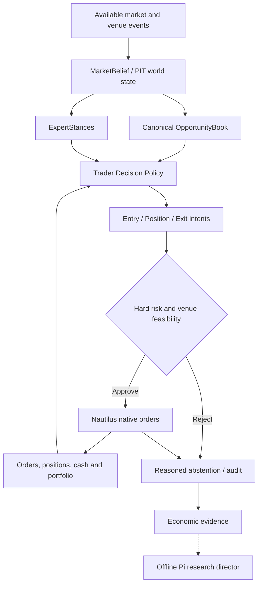
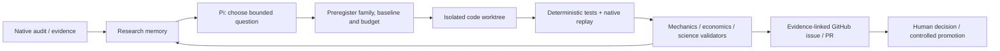

# V9 — Market-Aware Adaptive Trading Intelligence

## Bilimsel mimari monografı, kanıt sentezi ve V8-next evrim sözleşmesi

**Sürüm:** `V9-ARCH-RFC-1.0-DRAFT`  
**Tarih:** 1 Kasım 2026  
**Dil:** Türkçe; kod, araştırma başlıkları ve teknik sözleşmeler İngilizce kimliklerini korur.  
**Uygulama sınırı:** `ddawnlll/v8` → `v8-next/` (Python 3.12, NautilusTrader 2.0.0rc4; bu sürüm depoda pinlenmiştir).  
**Belge türü:** bağımsız araştırma sentezi + sınanabilir hedef mimari; kod veya ekonomik sertifika değildir.  
**Normatif durum:** **ÖNERİ / OWNER APPROVAL PENDING**. V8 Anayasası'nı veya geçmiş immutable kanıtları tek başına değiştirmez.  
**Kısa hüküm:** *V9, V8'in zaten mevcut olan MarketState–Opportunity–Expert–Execution anlayışını sürekli, bağlama duyarlı, açıklanabilir trader kararına dönüştürür; Pi Agent ile denetimli Kaizen, bu canlı karar çekirdeğinin yerine değil, onun dışında eklenir.*

> **Bilimsel dürüstlük bildirimi.** Bu çalışma, kullanıcının ilettiği özgün V8 monografı, iki 2026 Deep Research raporu, araştırma handoff ZIP'i, D4 native raporu ve önceki bağımsız ham audit raporunu, erişilebilen GitHub kodunu ve doğrulanmış birincil akademik kaynakları sentezler. Bu belgede yeni bir backtest, sealed OOS sınaması, bağımsız çalıştırılmış V9 prototipi veya canlı işlem sonucu **üretilmemiştir**. Mevcut deneyler yalnız tanımlı BTCUSDT 1H geliştirme bandı ve test koşullarını temsil eder. Kanıt-iddia kapsamı kaynaklara sıkıca bağlı tutulur.

---

# Özet / Abstract

**Araştırma problemi.** Finansal piyasa koşulları durağan değildir; fırsat gözlemi, işlem seçimi, giriş fiyatı, sermaye işgali, pozisyonun sonraki yönetimi ve emir gerçekleşmesi birbirleriyle etkileşir. Bir sistemin çok sayıda uzman modülü veya ayrıntılı audit üretmesi, gözlemlediği değişikliklere doğru ekonomik tepki verdiğini göstermez. V8-next'in native keşif deneyleri, mevcut konsensüsün seçimde etkisiz kaldığı bir örneği; gecikmeli doğrulamanın ekonomik zararını; dinamik stop yönetiminin belirsiz fakat araştırmaya değer sonuçlarını; gerçek kalıcı fırsat durumunun tek başına ekonomik avantaj sağlamadığını ortaya koymuştur. Temel soru, **V8'in hangi yeteneklerinin daha tutarlı bir karar döngüsüne dönüşmesi gerektiği** ve bunun nasıl yanlışlanacağıdır.

**Yöntem.** Tarihsel mimari belgeleri kodla eşleştirildi; A/B/C/D4 yerel deneylerinin iddia sınırları ayrıştırıldı; piyasa rejimleri, çevrimiçi değişim tespiti, seçici tahmin, maliyetli yürütme, çoklu test ve otonom araştırma literatürü tarandı; tasarım sözleşmeleri, durum makineleri, güvenlik sınırları, test matrisi ve geçiş planı oluşturuldu. Kaynaklar *birincil akademik yayın / repoda gözlenmiş / yerel rapor / tasarım çıkarımı / açık soru* olarak etiketlendi.

**Öneri.** Tek ürün çekirdeği korunur: PIT market observations → world/market belief → canonical opportunities ← expert evidence → trader decision policy → price-aware entry/position/portfolio policies → hard risk guard → native NautilusTrader → audit + economic attribution → yeni gözlemle yeniden değerlendirme. İkinci, **çevrimdışı** katman Pi Agent ile hipotez üretir, mevcut research/evaluation/Oracle altyapısında test eder, GitHub Issue/PR üzerinden onaya sunar. Hiçbir LLM canlı trading risk kapısını atlayamaz.

**Sonuç statüsü.** Bu, *ekonomik edge'in kanıtı* değil, **test edilebilir mimari öneridir**. Kabul, yalnız kontrol edilen davranışların ve ilgili ekonomik sonuçların yeni, geçerli deneylerle doğrulanmasına bağlıdır.

**Anahtar terimler:** market belief, non-stationarity, point-in-time, behavioral experts, opportunity sovereignty, selective decisions, native execution, endogenous occupancy, post-entry management, economic attribution, falsification, autonomous Kaizen, audit lineage.

---

# I. Araştırma soruları, kapsam ve kanıt hiyerarşisi

## 1.1 Birincil araştırma sorusu

> Gözlemleyip anlık emir açan bir sistem, piyasadaki değişimleri izleyen, kendi aktif görüşünü yeniden değerlendiren, fırsat ve pozisyonlarını devam eden bir ekonomik karar problemi olarak ele alan **adaptif trader** sistemine nasıl evrilir; bu gelişmenin gerçek değer kattığı nasıl ölçülür?

Bu sorunun yedi alt parçası vardır: (Q1) piyasayı doğru zaman sınırlarıyla nasıl temsil ederiz; (Q2) davranış temelli expert'ların marjinal değeri nedir; (Q3) fırsatın kimliği ve takibi emirden nasıl ayrılır; (Q4) karar bekleme/giriş/tutma/düzenleme/çıkışı nasıl ele alır; (Q5) portföy işgali karşı-olgusal seçimi nasıl etkiler; (Q6) sonuç nasıl güvenilir ölçülür; (Q7) Pi Agent bu sistemi yetkisiz kontrol etmeden nasıl geliştirir?

## 1.2 Kapsam dışı iddialar

Bu makale V9'un kârlı olduğunu; 28 expert'ın tahmin gücünün kanıtlandığını; rejim sınıflandırmasının getiriyi artırdığını; sürekli LLM kararının yararlı olduğunu; veri rejimlerinin sabit olduğunu; BTC sonuçlarının altcoin perpetual evrenine taşınabildiğini; funding, gerçek L1/L2 fill veya likidasyonların doğrulandığını **iddia etmez**. Ayrıca bir V9 canlı işletim sertifikası veya bağımsız hakemli yayın değildir.

## 1.3 Kanıt etiketleri

| Etiket | İçerik | İzin verilen yorum |
|---|---|---|
| `PRIMARY_LITERATURE` | DOI/arXiv üzerinden doğrulanmış dış çalışma | Yalnız çalışmanın popülasyonu, yöntemi ve varsayımları |
| `REPO_OBSERVED` | GitHub'da okunan gerçek kaynak/konfigürasyon | Kodun mevcut olması; bütün sistemin çalıştığını kanıtlamaz |
| `PROJECT_REPORTED` | Ham artifact, yerel run veya kullanıcı raporu | Raporlanan döneme ve profile özgü sonuç |
| `PROJECT_AUDITED_LIMITED` | Bağımsız ZIP üzerinde yeniden hesaplanan kontrol | Yalnız mevcut artifact ve bağlam kapsamı |
| `DESIGN_INFERENCE` | Bu monograftaki mühendislik önerisi | Ekonomik üstünlük iddiası yok |
| `OPEN / BLOCKED` | Yanıtlanmamış, ölçülemeyen veya geçersiz alan | Uygun koşul olmadan kullanılamaz |

## 1.4 Araştırma kaynakları

Yerel `index(3).html` V8 tarihsel tam monografı; Deep Research I (Kasım 2026, 92 KB metin) ve Deep Research II (Kasım 2026, 69 KB Markdown), `V8_NEXT_V9_RESEARCH_COMPLETE_HANDOFF.zip` (616 üyeli paket, orijinal run ve kanıtlar), `D4_ANSWER_TR.md`, `audit-20261030T223550Z-6ffc87e.zip` ve `v8_next_independent_raw_audit_review.md` bu araştırmanın birincil **proje** kaynaklarıdır. Belgelerdeki sayılar kaynaklarının zaman ve statülerine bağlıdır. GitHub varsayılan dalı, yerel olarak henüz push edilmemiş D4 araştırma modüllerini göstermeyebilir.

---

# II. V8'in özgün düşüncesi ve mimari hastalığı

## 2.1 Özgün tez: Expert bir trader değildir

V8 araştırma monografındaki temel ifade şu anlamı taşır: **MarketState, OpportunityEpisode, ExpertEvidence, ExecutionCampaign ve Order/Fill aynı ekonomik nesne değildir.** Market doğrudan gözlemlenebilir, PIT-zamanlı fırsat olayı yaratır; expert bu olayı gözlemler, destekleyebilir, çürütebilir veya çekimser kalabilir. Fırsatın kimliği expert sayısıyla çoğalmaz. Emre giriş, ayrı risk/utility kararıdır. Orijinal `V8_CONSTITUTION` bu ayrımları, duplicate observer invariance'ı, ilk-sınıf abstention'ı, immutable evidence ve locked OOS kontrolünü açıkça tanımlar [P1].

Bu miras **korunmalıdır**. V9'a taşınmaması gereken şey geçmişteki ağır komite/governance yüzeylerinin tümünü kopyalama zorunluluğudur. Her yeni karar için 5-agent kurul, farklı authority root, ikinci claim registry veya yeni engine yapmak, bu çalışmanın ölçülebilir amacına ters düşer. Eski anayasal hükümler korunup normatif geçiş gereken maddeler ayrıca sahibi tarafından onaylanmalıdır; bu tasarım belgesi geriye dönük yürürlük vermez.

## 2.2 Mimari boşluk: Bilmek → seçmek → yürütmek → yeniden değerlendirmek

V8-next'te `world/`, `experts/`, `opportunities/`, `risk/`, `economics/`, `adapters/`, `audit/`, `evaluation/`, `oracle/` ve `system_proving/` mevcut modüllerdir [R1]. Dolayısıyla piyasa durumu, fırsat, expert ve audit **eksik kavramlar değildir**. Açık boşluk, bu parçaların değişen piyasa koşullarında birbiriyle tutarlı **sürekli karar kontratı** üretip üretmediğidir.

V9'un mimari sıçraması daha çok sınıf, daha çok ajan veya daha çok kural değil: *taze market bilgisi → önceki görüşü güncelle → işlem niyetini seç → risk/kapasite kontrolü → native gerçekleşme → gerekçe geçerliliğini yeniden değerlendir*. Bu süreç pozisyon kapatıldığında değil, pozisyon açıkken de sürer.

## 2.3 Laboratuvardan ürün döngüsüne

V8 ekonomi ve kanıt altyapısı güçlü, fakat bugüne kadar tek bir `volume_confirmed_breakout` araştırma kampanyası gibi dar koşullarda testler öne çıktı. V9, yeni evrenlere / altcoin perps'e geçişi **ayrı veri ve likidite uygunluk aşaması** olarak tanımlar. Araştırma maliyetini azaltmak için önce hızlı sinyal/karar taraması, sonra yalnız final adaylarda native NautilusTrader replay'i kullanır. Hızlandırma hiçbir zaman replay semantiğini, stop sırasını veya maliyet modelini sessizce değiştiremez.

---

# III. Bugüne kadar ne ölçüldü? Empirik dayanak

## 3.1 Baseline: tanımı ve kapsamı

Raporlanan deney evreni: BTCUSDT Binance USDT-M perpetual, 1H, 2.160 bar, 2025-01-01–2025-04-01; tek 90 günlük **development** pencere; 10.000 USDT simülasyon sermayesi; maker 0.0002/taker 0.0005; %2 koruyucu stop/%4 hedef. 123 fırsat kaydedildi, baseline 45 kampanya açtı ve 44'ünü kapattı. Kapalı işlemlerde net −8,67470686 USDT ve ≈−0,02208R/işlem raporlandı; native komisyon toplamı ≈36,766 USDT; funding uygulanmadı. Bu 10.000 USDT gerçek portföy önerisi, 20 USDT'lik canlı hesap fizibilitesi veya sonradan oluşan veri değildir [P2, P3].

### A/B/C/D4 ayrıştırma özeti

| Araştırma sorusu | Gerçek gözlem | Geçerli çıkarım | İzin verilmeyen çıkarım |
|---|---|---|---|
| **A Expert seçiciliği** | Grammar-only A1 baseline defteriyle aynı; 123 fırsatın tamamı consensus desteği alıyor | Mevcut gate bu bandda ek seçim yaratmadı | Uzmanlık genelde faydasız |
| **B Entry** | Native B4 ~20 işlem, −0,14537 net R/işlem; bazı model gecikme kolları negatif | Basit onay/erteleme maliyet yaratabiliyor | Bütün giriş teyitleri kötü |
| **B3 realistic profile** | 11 giriş, G8 reconciliation bozuk, koruma eksiği | **INVALID**; ekonomik tabloya katılmaz | Bu rakamlar gerçek slippage'ı ölçüyor |
| **C4 +1R stop→BE** | 21 native protective-stop update; ~+0,14173 net R/işlem; eşleşmiş +0,1008R, GA [−0,0426,+0,2442] | İşlem yönetimi mekanik olarak değişti; sonuç **INCONCLUSIVE** | Kanıtlanmış breakeven edge |
| **D4 kalıcı retest/reclaim** | 123 watching, 65 armed, 25 girilen kampanya; net −0,04524R (defter), −0,08500R native-bracket; PnL −36,12 USDT | Gerçek kalıcılık var, fakat bu kural V8'i geçmedi | Bütün lifecycle politikaları gereksiz |

D4 ile V8 arasında ortak 12 opportunity için raporlanan D4−V8 farkı −0,91391R, %95 GA [−1,62986,−0,26449]; fakat aynı 123 fırsat üzerinden tüm-birim farkı −0,00130R, %95 GA [−0,17133,+0,16040]. Farklı karşılaştırma birimleri farklı sorular sorar; küçük ortak örnekleme dayanarak genel “zararlı” hükmü verilemez [P4].

## 3.2 D4'ün esas mekanizması: Seçim ile gerçekleşme ayrı

D4, V8'in açtığı 45 kampanyanın yalnız 12'sine girdi, 33'ünü kaçırdı; baseline'ın girmediği 13 fırsata girdi. Rapora göre ortak 12 fırsatta girişler ortalama 3,8 bar gecikti ve giriş fiyatı ortalama 0,68931R kötüleşti. 65 ARMED fırsatın 38'i `POSITION_OCCUPIED`, ikisi kapasite/sıra dolayısıyla iptal edildi [P4]. Bu, “daha iyi fırsat alt kümesi seçmek” ile “daha iyi portföy sonucu üretmek” arasındaki uçurumu somutlaştırır. Ancak D4'ün aynı kapanış MARKET ve bar-only semantiği gerçek piyasaya hazır değildir; funding eksiktir.

## 3.3 Audit doğruluğu: önemli bağımsız itirazlar

2026-10-30 ZIP'i üzerinden yapılan bağımsız inceleme, 89 native fill, 45 entry, 29 stop, 15 target ile ücret toplamlarının genel düzeyde uzlaştığını; ancak bazı audit artifact'lerinde **89/89 cashflow kaydının son kampanyaya etiketlenmesi**, 45 entry event'inde kampanya referanslarının yanlış/eksik olması, lifecycle opportunity/decision join bozukluğu, giriş mumundan sonraya görünmeyen high/low yolunun yanlış kullanılması ve `G7 PASS` ile eksik protection ID join'leri arasında çelişki bildirdi [P5]. Bu inceleme orijinal tape ve runtime olmadan ZIP düzeyinde yapıldığı için sorunların güncel koda hâlâ uygulanıp uygulanmadığı **yeniden doğrulanmalıdır**; otomatik olarak çözülmüş sayılmaz.

Bu düzeyde bir bağ kopukluğu `AUDIT_COMPLETE` etiketiyle örtülemez. V9'un **P0 başlangıç koşulu**, ilgili iddialar için `opportunity → decision → order → fill → campaign → cashflow` lineage bütünlüğünü native event seviyesinde kanıtlamak ve MFE/MAE'nin entry-time sınırlarını düzeltmek veya ölçümü geçici olarak `NOT_IDENTIFIABLE` ilan etmektir.

## 3.4 Mevcut açık ekonomik sınırlamalar

Funding akışı ve mark atfı; aynı-bar intrabar sıra; spread/quote/order-book/queue eksikliği; per-fill identity ve partial fill; native bracket/position ID callback order; altcoin likiditesi, minimum notional ve quantization; tek 90 günlük rejim; sealed OOS kullanımı. Bunlar farklı şiddette engellerdir. Birinin giderilmesi tümünü gidermez. Ayrıca geçmiş V8 next handoff ZIP'i D3'ün B4 replikasyonu olduğunu belirtir; D4 ise **daha sonra yapılmış ayrı çalışma** olup kendi 14/14 raporlanan doğrulamasına rağmen ekonomik üstünlük kanıtlamaz [P3, P4].

---

# IV. Bilimsel temel: piyasayı 'anlamak' ne anlama gelir?

## 4.1 Metafizik değil, güncellenebilir epistemik durum

Bir algoritmanın piyasayı 'anlaması', piyasanın geleceğini bildiği anlamına gelmez. Ölçülebilir tanım: **mevcut bilgiye dayalı sürümlenmiş piyasa görüşü** oluşturmak; bu görüşün geçerlilik alanını, belirsizliğini ve zaman sınırını belirtmek; yeni bilgi geldiğinde önceki kararın hâlâ uygun olup olmadığını sınamak. Bu, gözlemden aksi yöne ısrar etmek yerine `ABSTAIN`, `WAIT`, `REASSESS` gibi eylemleri birinci sınıf yapar. Seçici sınıflandırmanın risk–coverage değiş tokuşu bu tasarımın genel istatistiksel analojisidir; bilgisayarlı görü çalışmalarındaki risk garantileri finansal getiriye doğrudan aktarılamaz [L04, L05].

## 4.2 Zamanın dört ayrı anlamı

Her market/derived event için en az `event_time`, `exchange_publication_time` (varsa), `local_receipt_time`, `decision_time` ayrı tutulmalı. Eski candle'ın `bar_end` zamanı, geçmişte gerçek bilgiye erişildiğini kanıtlamaz. PIT bilgi kümesi

\[
\mathcal F_t = \sigma\{x_i: \operatorname{available\_at}(x_i)\leq t\}
\]

olmak üzere, belirli politika sürümü için `Action_t = π(F_t, Portfolio_t, PolicyVersion)` verisi ile tekrar üretilebilir olmalıdır. Retroaktif `funding`, `OI` veya dış veri eklemek, mevcut hipoteze yeni veri bilgisi kazandırıyorsa yeni dataset/version ve ayrı deney kimliği gerektirir.

## 4.3 MarketBelief: önerilen tip

```text
MarketBeliefV1:
  instrument_id, interval_set, decision_time_ns, input_available_max_ns
  state_id, state_version, data_quality_state
  regime_distribution: {trend, range, transition, shock, unknown}
  structure: {direction, swing_state, breakout_state, support_resistance_ref}
  volatility: {level, percentile, change_state}
  liquidity_context: {proxy_values, availability, missingness}
  time_horizon_alignment: {15m, 1h, 4h, unknown}
  uncertainty: {model_id, definition, calibrated_if_available}
  transition_evidence: {previous_state_id, changed_fields, trigger_event_ids}
  provenance: {source_hash, feature_version, model_version, data_role}
```

Bu bir **target schema**dır; mevcut kodun birebir API'si olduğu iddia edilmez. Özellikle `regime_distribution` değerleri kalibre olasılık diye sunulamaz: bağımsız validation yoksa `scores` veya `UNKNOWN` kullanılır. Likiditeye ilişkin sadece OHLCV proxy varsa L2-based sponsorship veya fill modellemesi yapılmaz. Rejim değişimi ölçümü için bir *aday yöntem* olarak Adams–MacKay çevrimiçi changepoint detection incelenebilir; bu çalışma V9'da edge'i kanıtlamaz [L01].

## 4.4 Multi-horizon ve market state çevrimi

15m fırsat barı, 1h bağlam ve 4h durum gözlemi gibi saat ölçekleri kullanıcı hedefleriyle uyumludur; ilk doğrulama için mevcut 1H BTC enstrümanının dışına geçmek gerekmez. Çoklu ölçeklerde tamamlanmamış üst periyot mumlarını kullanmak `PIT` ihlalidir. `MarketBelief` güncellemesi, **relevant market event** veya karara etki eden risk/pozisyon değişikliği olduğunda; zorunlu her tick'te bütün expert'ları hesaplayarak değil, dependency invalidation ile uygulanmalıdır.

## 4.5 Değişim tespiti ve hata payı

Rejim tahminleri hatalı olabilir. False transition ile yanlış expert yönlendirmeyi önlemek için (i) `UNKNOWN` ve abstention; (ii) transition hysteresis/tutarlılık; (iii) minimum event/time validity; (iv) regime classifier karşılaştırması; (v) sınırlı drift/coverage monitor önerilir. Eşikler önceden sürümlenip test edilir; bu makale rakamsal optimum belirtmez.

## 4.6 Market understanding nasıl yanlışlanır?

Daha zengin MarketBelief, daha iyi PnL iddiasına eşit değildir. Üç ayrı test gerekir: (A) **Causal validity** — karar anında erişilemeyen veri kullanıldı mı? (B) **Representation stability** — aynı rejim tanımı farklı örneklemlerde tutarlı mı? (C) **Incremental decision utility** — basit `MarketState` karşısında aynı opportunity/risk/execution ile portföy düzeyinde net fayda değişiyor mu? C başarısızsa yeni state özellikleri izleme/diagnostic olarak kalabilir ama ekonomik karar etkisi için gerekçe olmaz.

---

# V. Expert intelligence: uzmanların görüşü, hakikatin çoğalması değil

## 5.1 Kimlik ve rol

Expert bir *observer*dır; ekonomik opportunity ID üretmez, sermaye tahsis etmez, emir göndermez. `ExpertStance = {expert_id, version, habitat_id, opportunity_id, support/contradict/abstain, reason_code, observed_features, availability_bounds, lineage}`. Aynı kanıta dayanarak oy veren kopya expert'ların çoğunluk oluşturması bilgi üretmez. Orijinal V8'in clone invariance ve opportunity sovereignty ilkeleri korunur [P1].

## 5.2 Context-aware uzmanlık

Önerilen V9 davranışı: expert önce kendi habitatına uygunluğunu belirtir; uygunluk yoksa `ABSTAIN`. `MarketBelief` expert görüşü için ortak bilgi bağlamıdır, ancak **sabit ve yanlış olabilecek bir regime-router'ın expert'ları zorla susturması** varsayılan değildir. Yeni routing, consensus, confidence calibration veya learned scorer ancak mevcut self-gating baseline'a karşı testten sonra ekonomik karar yoluna alınır.

## 5.3 A deneyinden çıkarılan gerçek ders

Bir consensus gate'in 123 fırsatın 123'ünü geçirmesi, 28 expert'ın bütünüyle gereksiz olduğunu kanıtlamaz; yalnız o gate'in **marginal selection effect = 0** olduğunu gösterir. Bu durumda gereken, yeni 28 expert değil: gerçek `support/contradict/abstain` distribution, hangi fırsatı hangi model eledi, ablation ve dependency-adjusted evidence measurement. Ölçülecek metrikler: altered decision count, alternative coverage, incremental net equity, non-entry opportunity opportunity cost, regime-conditioned error; yalnız win rate veya consensus oranı değil.

## 5.4 Model çeşitleri

Rule-based, istatistiksel ve makine öğrenmeli expert'lar **aynı üretim sözleşmesine** bağlanabilir; buna izin verilmesi bunların tümünün etkin olduğu anlamına gelmez. Her modelin veri lineage, training split, calibration, uncertainty ve artifact hash'i vardır. Model sonuçları anlık gözlemlerle kendiliğinden yeniden eğitilmez; challenger policy olarak ayrı araştırma ve promotion gerektirir.

---

# VI. Opportunity Lifecycle: hafıza, strateji değil

## 6.1 Bir fırsatın yaşamı

`OpportunityEpisode` **fırsatın varlığına dair zamanlı hipotezdir**; tekil trade değildir. Önerilen durumlar mevcut `OpportunityBook` sözleşmesinin izin verdiği kapsamda korunur: `DETECTED/CANDIDATE`, `OBSERVED`, `QUALIFIED`, `WATCHING`, `ARMED` (opsiyonel politika), `INVALIDATED`, `EXPIRED`, `REJECTED`, `ADMITTED`, `EXECUTED`, `CLOSED`. Bu liste tek dev bir enumerasyon olarak uygulanmak zorunda değildir. Epistemik episode status, entry-order state ve position state **ayrı tipler** olmalı; D4'teki retest/reclaim kuralı default-on yapılmamalıdır.

## 6.2 Decision-time re-evaluation

Aynı fırsatın doğuş anındaki kanıtları immutable `BirthSnapshot` olarak kalır. Sonraki market belief ve expert stances, ayrı `EvaluationSnapshot` olarak eklenir. Durum değişimleri tekrar oynatılabilir; cancel/expiry, fill sayılmaz. `OpportunityBook` fırsatın geçmişini tutar; **Entry Policy** o andaki fiyatın ekonomik olarak kabul edilir olup olmadığını hesaplar. Bir firmanın her fırsatı beklemeye alması veya her güncellemede emir açması gerekmez.

## 6.3 D4'e karşı tasarım savunması

D4 state machine gerçek ve baseline'dan farklı davrandı, ama −36,12 USDT'lik raporlanan sonuçla immediate girişe üstün gelmedi. Bu, `OpportunityBook`'un hafıza ve açıklama için değersiz olduğunu göstermez; **belirli retest/reclaim admission kuralının** ekonomik üstünlüğü desteklenmediğini gösterir. V9 fırsatı izlerken `WAIT` ve `EXPIRE` durumu tutabilecek, ancak bekleme zorunluluğu ekonomik politikaya göre, kanıta dayalı olacaktır [P4].

## 6.4 Fırsat ile emir arasındaki tek yönlü güven sınırı

`Opportunity` veya `ExpertStance` doğrudan Nautilus order objesi üretemez. Emir istemi `TraderDecision` → `EntryIntent` → `RiskAdmission` → native adapter yolundan geçer. Her bağlantı `decision_id`, `opportunity_id`, `policy_hash` taşır. Fırsat sayısı, expert sayısı veya izlenen sembol sayısı artırıldığında toplam risk yetkisi otomatik büyümez.

---

# VII. Trader Decision Policy: V9'un davranış merkezidir

## 7.1 Yanlış ikilik: 'sinyal varsa al' / 'sinyal yoksa hiçbir şey yapma'

Profesyonel bir trader, fırsat **henüz ortaya çıkmadan** bağlam oluşturur, fırsatı izler, uygun fiyatı bekler, pozisyon açıkken fikrini günceller ve bazen hiç işlem yapmaz. V9, bu davranışları algoritmik olarak tanımlayacaktır. Bu bir LLM'yi intraday trader koltuğuna oturtmak değildir; ekonomik olarak test edilebilir **decision policy contract** oluşturmaktır.

## 7.2 Karar uzayı

\[
\mathcal A_t = \{\mathrm{ABSTAIN, WATCH, ENTER, HOLD, MODIFY, REDUCE, EXIT, CANCEL, REJECT}\}
\]

`WATCH` ile `ENTER`, `HOLD` ile `EXIT`, `REJECT` ile `EXPIRED` farklıdır. Sistem konumuna göre yasal aksiyon kümesi değişir: pozisyon yokken `HOLD` verilemez, sahip olunmayan emri `CANCEL` edilemez, korumasız pozisyon bilinçli olarak bırakılamaz. Uygulamada sözleşme, büyük bir monolit yerine mevcut `economics/`, `domain/`, `risk/`, `opportunities/`, `adapters/` içindeki sorumlulukların düzenli API'si olabilir.

## 7.3 Observation → Belief → Decision → Intent → Realization



Geri dönen pozisyon değişimi veya yeni data, gelecekteki karar anında döngüyü yeniden çalıştırır. Şema rol ilişkilerini gösterir; `Risk` yalnız bir kez çalışmaz: order submit, order update, pozisyon büyütme, stop değişimi ve account kill-switch noktalarında sert olarak tekrar doğrulanır.

## 7.4 Formal sözleşme

Bir politika `π_v` için sürümlenmiş bilgi durumu `s_t = (B_t, O_t, E_t, P_t, V_t, C_t)` olsun: `B` MarketBelief, `O` OpportunityBook, `E` ExpertEvidence, `P` portfolio/positions, `V` venue constraints, `C` cost model. Amaç en yüksek *gerçekleşmiş hindsight PnL* değil, **karar anında uygulanabilir kısıtlı fayda**dır:

\[
\pi_v(s_t) \in \arg\max_{a\in\mathcal A_{\rm feasible}(s_t)} \left\{\widehat{\mathbb E}_t[\Delta \Pi_{\rm net}(a)]-\lambda_t \widehat{\mathcal R}_t(a)-\widehat{\mathcal C}_{\rm opp,t}(a)\right\}.
\]

Bu, bir **tasarım hedef fonksiyonudur**, bugün bütün terimlerin doğru kalibre edildiği iddiası değildir. Verisi bulunmayan expected net utility `UNKNOWN` olmalı; sistem uydurma edge ile sermaye tahsis etmemeli. `STOP / RISK_LIMIT / NOTIONAL_MIN / MARGIN` gibi hard constraints skalar beklentiyle geçersiz kılınamaz. Fayda, `gross alpha`, `commissions`, `spread`, `slippage`, `funding`, `capacity`, `uncertainty` bileşenleriyle ayrı açıklanır.

## 7.5 Karar kaydı

```json
{
  "decision_id": "decision-...",
  "decision_time_ns": 0,
  "market_belief_id": "belief-...",
  "opportunity_id": "opp-...",
  "active_position_ids": [],
  "policy_id": "v9-decision-v1",
  "action": "WAIT",
  "reason_codes": ["PRICE_UNFAVORABLE"],
  "feasibility": "PASS",
  "economic_estimate_status": "NOT_IDENTIFIABLE",
  "candidate_intent_id": null,
  "data_available_max_ns": 0,
  "policy_hash": "sha256:..."
}
```

Örnek gösterimdir; `0` ve `...` placeholder alanları **gerçek run artifact'ı değildir**. Üretimde id/hash/timestamps, native kaynaklardan gelmeli ve eksikse `BLOCKED` olmalıdır. Karar nedenleri yalnız raporda değil, yürütmenin üretildiği noktada oluşturulmalıdır. Karar verdiği sırada trade yoksa da neden kaydedilir.

## 7.6 Aksiyon önceliği ve conflict policy

Deterministik öncelik: (0) circuit breaker / kill switch; (1) mevcut pozisyonun korunması ve venue safety; (2) gerekli risk azaltma; (3) hazır order cancellation/reconciliation; (4) portfolio capacity kararları; (5) yeni entry intent; (6) research telemetry. Bu **koruyucu sıralama** üretime kabul edilmeden önce native callback order testlerine bağlanmalıdır. Bir expert'ın bullish olması risk stop'unu kaldırmaz. İki fırsat çelişirse aynı ekonomik maruziyet için identifier-based dedup ve risk kısıtları uygulanır.

## 7.7 Açık pozisyon varken karar yeniden değerlendirme

Yeni state'e geçildiğinde yapılacak otomatik aksiyon `always exit` olamaz. Pozisyon gerekçesi, kalan risk, maliyet, beklenen tutma değeri, kill switch ve native koruma durumu birlikte değerlendirilir. Ani market shock, önemli liquidity change veya exposure violation ayrı işlem adaylarıdır. Gereksiz bar-bar stop oynatma churn yaratır; policy rate limit ve idempotence gerektirir.

---

# VIII. Entry & Order Management: selection ile execution arasındaki ekonomik köprü

## 8.1 Ayrım

`Opportunity quality ≠ Entry quality ≠ Fill quality`. Fırsat iyi olabilir, fiyat kötü olabilir; fiyat uygun olabilir, order hiç dolmayabilir; order dolabilir, maliyetli olabilir. D4 tam bu ayrışmayı gözlemiştir. EntryPolicy, sinyali üretmekten çok **giriş yapılabilir ekonomik fiyat ve süre penceresi** oluşturur.

## 8.2 EntryIntent hedef sözleşmesi

`EntryIntent = {decision_id, opportunity_id, side, instrument, valid_after_ns, expires_at_ns, acceptable_price_interval, order_policy, structural_stop_ref, size_policy_id, expected_friction_status, kill_conditions, cancel_reasons, venue_version}`. Native market/limit/post-only gibi davranışlar gerçek exchange metadata ve mevcut emir adapter yeteneğiyle sınırlanır; elde yalnız bar varsa kuyruk pozisyonu veya maker fill için güvenli bir garanti verilemez.

## 8.3 Beş giriş kararı

(1) `MARKET_NOW`: yalnız geçerli piyasa fiyatı ve maliyet bütçesi varsa. (2) `LIMIT_WAIT`: fiyat bandı ve TTL ile; touched-price ≠ filled-price. (3) `SKIP_PRICE`: model görüşü doğru olsa da fiyat kaçtı. (4) `WAIT_BELIEF`: bilgi yetersiz; ancak beklemek sistematik zorunlu değil. (5) `CANCEL_STALE`: entry intent artık güncel piyasa veya risk koşuluyla uyuşmuyor. Bunların hiçbiri ekonomik açıdan otomatik üstün ilan edilmez.

## 8.4 Bar-only replay problemi

NautilusTrader'ın belgelenmiş backtest yürütme sırası, data exchange üzerinde işlendiğinde mevcut order'ların etkilenmesi, ardından strategy callbacks ve aynı timestamp'te yeni komutların settle edilmesi şeklindedir [T1]. Bar-only MARKET emri, geçmiş bar kapanışını gerçekte elde edilebilir bir fiyat gibi kullanıyorsa model hatası oluşabilir. **Entry availability** ve **fill model** ayrıdır. Bu yüzden: aynı-kapanış profile `DIAGNOSTIC_ONLY`, next-observable execution profile ayrı, L1/L2/ticks mevcutsa onların iddiaları ayrı, funding/fees/slippage artan doğrulukta modellenir [T1, T2]. Maliyetli execution profile B3 doğrulanmadığı sürece o kol maliyet iddiası vermez.

## 8.5 Yaşam döngüsü: ideal native olaylar

`INTENT_CREATED → RISK_APPROVED → ORDER_SUBMITTED → ORDER_ACCEPTED → PARTIALLY_FILLED* → FILLED|CANCELED|REJECTED|EXPIRED → POSITION_OPENED/UPDATED/CLOSED`; aynı zaman damgası yeterli join key değildir; native order id/client order id ve event id önceliklidir. Exchange callbacks için causal/invariant testleri gerekir.

## 8.6 Kabul testleri

- Aynı opportunity'den idempotent tekrar sinyal geldiğinde iki order yaratılmaz.
- No-market-data veya stale source anında yeni emir reddedilir.
- Close-time availability + engine processing order ile future lookahead yoktur.
- Stop/target, gerçek position id ve reduce-only semantics ile bağlıdır.
- Partial fill, komisyon ve child-order koruma state'iyle uzlaşır.
- TTL dolduğu ve risk değiştiği an pending order cancel edilir.
- Maker/taker ücretleri, fiyat kayması ve funding ayrı ledger bileşenleridir.
- Order reject, `NO_TRADE` ve `CANCEL` asla başarılı fill sayılmaz.

---

# IX. Position Manager: açık riskin dinamik yönetimi

## 9.1 Kritik fark

Bir pozisyon açıldıktan sonra sistem **bekleyen eski bir entry sinyalinden** ibaret olmamalıdır. `PositionManager` pozisyonun devam eden gerekçesini ve riskini denetler; ancak kural optimizasyonu yaparken gerçek yönetim mekaniklerini değiştirmez. Mevcut native `STOP_MARKET`, `LIMIT`, bracket ve koruyucu stop update'leri korunur.

## 9.2 PositionThesis / PositionState

`PositionThesis = {entry_decision_id, original_opportunity_id, original_market_belief_id, initial_stop_ref, original_risk_usdt, target_plan, invalidation_conditions, policy_version}` immutable başlangıç kaydıdır. Güncel `PositionState = {native_position_id, fills, qty, avg_px, pnl, protective_order_ids, latest_market_belief_id, thesis_validity, allowed_actions, elapsed_bars, funding_exposure}` olur. R ölçümünde **orijinal stop mesafesi** ile sonradan oluşan bracket yüzdesinin paydası ayrı tutulmalı, D4'te görülen `R` payda karışıklığı tekrar etmemelidir.

## 9.3 Dinamik aksiyonlar

`HOLD` (mevcut risk kabul edilebilir), `PROTECT` (stop güncelle), `REDUCE`, `EXIT`, `TIME_STOP`, `CANCEL_TARGET`, `REJECT_AMENDMENT`. Sadece kâr oranına göre değil, market thesis invalidation, liquidity shock, execution viability ve hard-risk limitine göre değerlendirilebilir. Koruyucu stop'u uzaklaştırma, açık riski sessiz artırma ve zararı sonsuz bekleme **yasak politika** olarak korunmalıdır.

## 9.4 C4'ün yorumu

`+1R` sonrası BE stop siyaseti 21 native güncelleme ve olumlu, fakat istatistiksel belirsizlik içeren sonuç üretmiştir. `C4` **aday/experimental flag**, default-off. Güven aralığı ve tek DEV pencere kapanmadan `SUPPORTED_EDGE` kabul edilemez. Ayrıca politika sadece aynı opportunity'nin trade R'sini değil, boşalan sermayenin sonra hangi diğer fırsatları alabildiğini değiştirir; doğru ekonomik test **calendar-aligned portfolio equity** üzerinden yapılmalıdır [P3, P4].

## 9.5 Time & event validity

Stop güncellemesi eski native emrin onaylandığını varsayamaz. `ORDER_UPDATED/REJECTED/CANCELED`, position-closed/reopened ve restart idempotency açık test edilir. Koruma yönetiminin sürekli yürütülmesi, model önerisinin her mumda emir güncellemesi üretmesi anlamına gelmez.

---

# X. Portfolio & Risk: fırsat rekabeti ve sermaye ekonomisi

## 10.1 Tek pozisyon bile portföy problemidir

NETTING/tek pozisyon occupancy altında bile aynı anda potansiyel iki fırsattan birinin reddedilmesi sermaye ve zaman fırsat maliyeti yaratır. D4'te 38 occupied + 2 capacity reject görülmesi, bu sorumluluğun ölçülmesi gerektiğini gösterir. Ancak rejected fırsatları ikinci paralel gerçek portföyde açılmış sayan hindsight rapor, **gerçekleştirilmiş gelir** değildir.

## 10.2 Risk constraints ayrı otoritedir

`equity`, available margin, max per-trade loss, max gross exposure, instrument venue filters, max portfolio heat, loss circuit-breakers ve liquidation distance, herhangi bir expert veya Pi Agent tarafından değiştirilemez hard limitlerdir. Gerçek 20 USDT senaryosunda lot/step/minNotional ve fee floor nedeniyle sık no-trade sonucu çıkabilir; bu, **başarısız sinyal** değil işlem yapılamazlığıdır. Küçük sermaye ve kaldıraç daha yüksek beklenen değer üretmez; tasfiye olasılığını yükseltebilir.

## 10.3 Allocator'ın görevi

İlk aşamada allocator yeni bir machine-learning ranker değil, **admission/occupancy attribution** tablosudur. Başka pozisyon açıkken fırsat gelirse `occupied_by`, `would_have_required_margin`, `risk_conflict`, `candidate_expiry`, `decision_reason` kaydedilir. Yeni opportunity karşı eski position arasında gerçek tercih yapmak için hem mevcut pozisyonu kapatmanın maliyetleri hem yeni girişin maliyetleri ve riskleri ölçülmelidir. Güvenilir estimated utility yoksa mevcut güvenli risk politikasını korur.

## 10.4 Doğru karşılaştırma birimi

İşlem başı ortalama R tek başına yanıltıcıdır: bekleme, farklı işlemler açar ve exposure değiştirir. Ana economic estimand:

\[
\Delta U=U\!\left(E^{\mathrm{V9}}_{t_0:t_1},\mathrm{risk},\mathrm{costs}\right)-U\!\left(E^{\mathrm{V8}}_{t_0:t_1},\mathrm{risk},\mathrm{costs}\right)
\]

burada aynı veri, başlangıç sermayesi, venue kuralları, zaman penceresi ve eylem kısıtları kullanılır; equity **açık pozisyon mark-to-market ve tüm cashflow** içerir. İkincil analiz: matched opportunity delta, entry-price delta, occupancy, missed value, trade count, turnover, exposure. Bu karşılaştırmaların hiçbiri OOS güvenilirliği olmadan gelecekteki avantaj garantisi sunmaz.

---

# XI. Native execution, market-data ve ekonomik gerçekçilik

## 11.1 Mevcut engine korunsun

NautilusTrader v2.0.0rc4 depoda pinlidir; engine, strategy adapter, event callbacks, netting position, order, fill ve hesap muhasebesi için canonical yoldur [R2]. `v8-next` üzerine yeni C++/CUDA matching engine, ikinci kendi backtester'ımız veya LLM order router yazılmayacak. Hızlı araştırma için Polars/NumPy/vektörize ekranlar `DIAGNOSTIC_ONLY`, tam iddia için native finalist testleri kullanılır.

## 11.2 Veri kalitesi hiyerarşisi

**Bar** fiyat aralığı hakkında sınırlı bilgi; **trade ticks** işlem anları; **L1 quote** spread/bid-ask; **L2** fiyat seviyelerinde agregasyon; **L3** order-level kitap görünürlüğü sağlar. Ama tarihsel emir defteri bile adayın piyasaya etkisini ve gerçek queue priority'yi kesin garanti etmez [T2]. Her claim `data_resolution` ve `fill_authority` etiketine bağlanır. Yalnız bar verisiyle maker fill, exchange latency, intra-bar stop timing veya slippage kesinlik iddiası yasaktır.

## 11.3 Funding & perpetual semantics

Perpetual sözleşmelerde funding cashflow'u karar zamanında görünür veri ile, sözleşmenin gerçek settlement sınırı üzerinden uygulanmalıdır; işleme giriş/çıkışten sonra eski funding'i şimdiki pozisyona uygulamak yanlış atıftır. `mark_price`, `funding_rate`, `settlement_time`, `receipt_time` ayrı alanlardır. Funding mekanizmasının perpetual–spot fiyat bağına etkisi literatürde teorik olarak çalışılmıştır; bu V9'un kendi funding implementation doğruluğunu kanıtlamaz [L10].

## 11.4 First-class execution refusals

`MISSING_MARK`, `FUNDING_UNAVAILABLE`, `INSUFFICIENT_BOOK`, `UNSUPPORTED_FILL_MODEL`, `LIQUIDATION_UNKNOWN`, `QUANTITY_ROUNDS_TO_ZERO`, `NATIVE_ORDER_LINK_BROKEN` gibi durumlar ekonomik raporda gizlenmemeli; `BLOCKED` veya `QUALIFIED_DIAGNOSTIC` etiketi üretmelidir. Aynı uyarı, farklı data evreninde başka anlamlara gelebileceğinden policy/venue/version bağlanmalıdır.

## 11.5 Hızlandırma stratejisi

1. Frozen PIT feature caches.
2. Ucuz behavioral screening / no-native candidate rejection.
3. Sınırlı ve kaydedilmiş development mini-window.
4. Sadece finalistlerde native portfolio replay.
5. Gerekçeli adaylar için multi-period walk-forward/robustness.
6. Sealed final OOS yalnız ayrı yetkiyle, ardından prospective shadow.

Bu merdiven, aynı adayın birçok “gizli varyant” şeklinde tekrar tekrar denenmesini mümkün kılmak için değil; maliyeti düşürmek ve **bütün varyantları** trial ledger'a kaydetmek içindir.

---

# XII. Economic evidence, audit ve bilimsel yanlışlama

## 12.1 Tek kaynaklı kayıtlar ve immutable provenance

Önerilen soy ağacı:

```text
market_event_id -> market_belief_id -> opportunity_id
                -> expert_stance_ids -> decision_id
                -> order_intent_id -> native_order_id
                -> native_fill_event_id -> campaign_id
                -> position_id -> cashflow_id -> outcome_id
```

Tüm join'ler her kayıtta birebir olamaz (ör. bir fırsata birden fazla karar, bir emre çoklu partial fills), ama çokluk açıkça tanımlanmalı ve orphan sıfır olmalıdır. Aynı `ts_event` kimlik değildir. Tekir `campaign_id` NETTING position id'si ile eşit kabul edilmez. Mimari bu ilişkileri raporda yeniden tahmin etmek yerine oluşum anında bağlamayı gerektirir.

## 12.2 Audit'in dört ayrı sorusu

**Mechanical correctness:** Emir, stop, fill ve timestamps tutarlı mı? **Economic correctness:** Fees/funding/equity doğru mu? **Scientific validity:** Baseline, veri, multiple-testing, uncertainty doğru mu? **Authority:** Bu sonuç hangi iddiayı desteklemeye yetkili? Tek `PASS` tümünü örtmez. V8 `evaluation/gate_registry.py`, `audit/pipeline.py`, `evaluation/store.py`, `oracle/utility.py`, `evaluation/kaizen_delta.py` gibi parçaları yeniden kullanır [R3].

## 12.3 Ekonomik ölçüm tablosu

| Boyut | Asgari ölçüt | Hata belirtisi |
|---|---|---|
| Entry decision | changed decisions + abstention + reasons | Consensus değişmiyor ama değer atfediliyor |
| Order mechanics | native accepted/filled/canceled/rejected event join | Stop kayboluyor, unmatched fills |
| Trading economics | gross price PnL, commissions, slippage, funding | Karışmış fee/slippage; missing funding |
| Account economics | marked equity, DD, exposure, capital time | Cash balance `equity` diye etiketleniyor |
| Opportunity value | opportunity-level paired outcomes, occupancy | Ex-post opportunity gerçek PnL sayılıyor |
| Scientific | OOS role, family size, effective trials, uncertainty | 25 dependent trade = 25 independent samples |
| Operations | wall-clock, RAM, artifact hash, test receipts | Stale attestations, yanlış test sayısı |

## 12.4 İstatistiksel çıkarım

**Selection bias ve multiplicity:** White'ın Reality Check'i [L06], Hansen'in SPA yaklaşımı [L07], Bailey–López de Prado Deflated Sharpe [L08] ve PBO/CSCV [L09], birçok varyant arasından en iyisini seçmenin yarattığı iyimserliği değerlendirir. Bu yöntemler *mekanik doğruluk garantisi değildir*, küçük ve bağımlı örneklemde otomatik zorunlu olarak hesaplanabilir kabul edilmez. **MinervaScore** araştırmasının kendi unseen real-market testinde anlamlı ileri dönem ilişki bulmadığını bildirmesi, composite skorları kâr olasılığına eşitlememe gerekçesidir [L11].

**Time dependence:** İşlemler örtüşebilir; funding dönemleri, market-regime ve aynı symbol ortak faktör yaratır. Bootstrap unit trade değil bağımlılığı koruyan uygun gün/hafta/regime block veya exposure-aligned time interval olmalıdır. Sadece 12 matched D4 opportunity ile bootstrap p-değeri üretmek diğer rejimlerde kalıcı üstünlük göstermez. Belirsiz ölçüm `INFERENCE_NOT_IDENTIFIED` olarak açık bırakılır.

## 12.5 OOS ve research-debt disiplini

- `DEVELOPMENT`: açık araştırma; tüm varyantlar kaydedilir.
- `ROLLING_VALIDATION`: prosedür dondurulmuş, sonuçlara dönük ayarlama sınırlı ve loglu.
- `SEALED_FINAL_OOS`: ayrı process/permission; agent kendi iş ağacından okuyamaz.
- `PROSPECTIVE_SHADOW`: ileriye dönük paper/shadow; gerçek venue fill iddiası ayrı.
- `LIVE`: ayrı operasyonel sertifika ve insan onayı; bu monografta yetkilendirilmez.

Sealed OOS'un dosyası agent çalışma ortamında bulunmamalıdır; promptta “sakın okuma” demek yetmez. Bir OOS penceresinin sonucunu gördükten sonra aynı policy lineage açısından bağımsızlık tükenir. Yeni varyanta reset hakkı vermek için dosya adı veya hash değiştirmek kabul edilmez.

## 12.6 Kontrollü deney tasarımı: A/B/C/D sonrası

| Deney | İncelenecek tek davranış | Baseline | Gözlem | Hüküm |
|---|---|---|---|---|
| `M1` | MarketBelief'in karar/rejim katkısı | PIT state+raw features | altered action count, economic delta | Kanıt yoksa diagnostic only |
| `E1` | Expert stance gate gerçekten bağlayıcı mı? | grammar only | matched opportunities + portfolio | `NO_EDGE` geçerli |
| `I1` | Price discipline vs same-close | immediate entry | time/calendar equity + fill realism | Maliyet modeli nitelikli olmalı |
| `P1` | Native position policy | static bracket | marked equity, occupancy | C4 candidate, no promotion |
| `A1` | Occupancy allocation | single-active-position policy | exposure/risk-constrained calendar PnL | Reel margin semantics |
| `K1` | Pi araştırma loop faydası | manual bounded research | doğru sonuç / süre / maliyet | Trading edge için doğrudan kanıt değildir |

Her aşamada mekanik değişim önce, ekonomik superiority sonra sınanır. Değişen market modeline aynı anda entry, expert, stop ve sizing değiştirilirse neden-sonuç ayrıştırması kaybolur. Sonraki multi-component policy yalnız ayrı `interaction` deneyidir.

---

# XIII. Autonomous Kaizen: trading core'a EK yetenek

## 13.1 Rol ve bağımsızlık

**Trading core Pi'ye bağlı olmayacak.** Offline/ayrı süreçte çalışan Pi Agent, mevcut `audit/`, `evaluation/`, `oracle/`, `research` ve GitHub issue altyapısına read/write sınırlarıyla bağlıdır. Canlı `on_bar` veya `on_order_filled` callback'i LLM yanıtı beklemez. Pi durursa strategy devam eder, planlanmış risk kuralları bozulmaz.

## 13.2 En küçük inandırıcı araştırma döngüsü



Tek research director varsayılan. `pi-goal-x` hedef/iş bitirme ve bounded workflow, `pi-subagents` gereken bağımsız reviewer için kullanılır; 5-agent sürekli konsey değil. Codemode çok sayıda yerel kayıt/issue taramasına yararlı, ama kısmi yan etkiler için transaction garantisi vermez. Bağımsız reviewer, deterministic validator'ın PASS/FAIL hükmünü değiştirme yetkisi taşımaz [D1, D2, L12, L13].

## 13.3 Issue tipleri

`BUG_VALIDATED`, `RESEARCH_HYPOTHESIS`, `EVIDENCE_GAP`, `ARCHITECTURE_PROPOSAL`, `INVALID_EXPERIMENT`, `REPRODUCTION`, `PROMOTION_REQUEST`. Her issue, `source_commit`, `data_window`, `policy_family`, `previous_trial_ids`, `acceptance_criteria`, `runtime_budget`, `allowed_files`, `evidence_refs` içerir. Yeni issue açılmadan önce semantik benzerlik taraması ve aynı lineage dedup yapılır; *false positive* dedup görüldüğünde iki hipotez kaydı korunabilir.

## 13.4 Risk temelli review

Rutin belge/test değişikliği tek builder + focused tests ile ilerler. Native execution, funding, risk, OOS policy, evaluation thresholds veya ekonomik iddia değiştiriyorsa bağımsız reviewer ve kapsamlı deterministic doğrulama gerekir. Reviewer'ın ayrı model olması tek başına bağımsızlık garantisi değildir; ayrı context, raw receipt ve base/head SHA farkına doğrudan erişim gerekir. Geçmiş pi-goal-x auditor churn'ünde görüldüğü gibi `COMPLETE` rozetine ulaşmak deneyin amacı değildir.

## 13.5 Research memory

`evaluation/store.py` ve mevcut trial ledger önceliklidir. Ek minimum tablo: `hypothesis_family`, `attempt`, `artifact_digest`, `conclusion`, `reopen_condition`, `related_issue`, `cost_wallclock`. Başarısız, deneysel, belirsiz sonuçlar silinmez. VectorDB veya knowledge graph **ölçülmüş arama/duplicate sorunu ortaya çıkmadan** eklenmez.

## 13.6 Yetki matrisi

| Eylem | Pi/Builder | Deterministic runner | İnsan/operatör |
|---|---|---|---|
| Read DEV evidence | İzinli/denetimli | İzinli | İzinli |
| Hipotez/issue/branch/PR | Sınırlandırılmış | Receipt | Onay/sahiplik |
| Research code değişimi | İzole worktree | Denetler | Gerekirse onay |
| Trade risk/validator override | **Yasak** | Hard-reject | Değişim için ayrı süreç |
| Sealed OOS erişimi | **Yasak** | Yetkili ayrı süreç | Explicit grant |
| Production merge/deploy | **Yasak** | Immutable receipt | Explicit approval |
| Live orders | **Yasak** | Trading core dışı | Ayrı üretim yetkisi |

## 13.7 Performans

16 GB Windows workstation ve 8 GB VPS için önerilen başlangıç: tek native process; tek builder; reviewer ardışık; thread/RAM limitleri; full suite yalnız ilgili milestone; 1–2 hipotezlik bounded research cycle; max wall-clock/LLM token/deneme sayısı; OOM/timeout `OPERATIONAL_FAILURE` olarak ayrılır. Gerçek hız artışı ancak aynı kabul ölçütü ve aynı hardware/model bütçesiyle ölçülen `accepted_results per compute-hour` üzerinden iddia edilebilir. Dış raporlardaki cent bazlı fiyatlar kontrata veya yerel ölçüme dönüşmeden maliyet garantisi değildir.

---

# XIV. Gerçek mevcut kodla V9 hedeflerinin eşleştirilmesi

Aşağıdaki tablo, GitHub'da gözlenen dosyalarla ve proje raporlarıyla eşleşen **hedef sorumluluk haritasıdır**. İç API imzaları, runtime test ve yerel push edilmemiş değişiklikler tam incelenmeden somut refactor sınırı kesinleşmez.

| Mevcut yol | V8 rolü | V9 hedefi | Karar | Yeni davranışın kabul ölçütü |
|---|---|---|---|---|
| `world/`, `domain/market.py` | Market, causal representation | MarketBelief/transition/uncertainty | `REFINE` | PIT, state version, known unknown |
| `experts/` | Behavior observer | Habitat-conditional stance, independent contribution | `REFINE` | Non-degenerate ablation, unchanged baseline default |
| `opportunities/book.py`, `models.py` | Canonical OpportunityBook | Immutable birth + multiple evaluation views | `REFINE` | Persistence without forced D4 wait |
| `economics/decisions.py`, `observer_policy.py` | Decision economics | TraderDecision contract/decision explanation | `REFACTOR` | Recorded WAIT/HOLD/EXIT reasons |
| `risk/admission.py`, `sizing.py` | Hard limits | Revalidate every intent/order adjustment | `KEEP+REFINE` | Risk and venue reject fail-closed |
| `economics/allocation.py`, `domain/positioning.py` | Portfolio/exposure | Occupancy-aware policy and attribution | `REFINE` | Opportunity blocked-by-position trace |
| `adapters/` | Nautilus strategy & order | Entry/Position policy adapters | `KEEP+REFINE` | Native callback/fill/stop identity |
| `audit/pipeline.py`, `audit/reconciliation.py` | Forensic audit | Full lineage, MFE time-bound safety | `P0 REPAIR` | Zero unlinked campaign/cashflow claims |
| `evaluation/store.py` | Trials/lineage | Reuse as append-only research memory | `KEEP` | All variants and failed attempts counted |
| `evaluation/gate_registry.py`, `kaizen_delta.py` | Gates and benchmark deltas | Separate correctness and economic promotion | `REFINE` | Reproducible outcome under fixed hashes |
| `oracle/utility.py` | Economic feasibility contract | Retain economic constraints | `KEEP` | No unsupported EV autopromotion |
| `system_proving/` | Receipt/proving tools | Fault-injection and structural qualification | `REFINE` | Invalid joins/gates rejected |
| `app/cli.py` | Unified CLI | Bounded research/adaptation commands | `SMALL EXTENSION` | No second CLI or hidden native path |
| `research_ops/` (**conditional**) | Not yet a canonical package | Pi queue/lease/budget/GitHub reconciliation | `ADD_IF_NEEDED` | A full bounded issue→trial→receipt pilot |

**Uyarı:** Eski `index.html` monografındaki V8 `src/v8/` veya Rust dosyaları aktif uygulama olarak kullanılmaz; depo `AGENTS.md` ve owner boundary `v8-next/` tek aktif kod alanıdır. Belgedeki eski `KaizenController` otorite tanımları V9 çalışma ortamında yeniden yazılmadan önce hangi gerçek modüllerin aktif olduğuyla eşleştirilmeli, birden çok sovereign controller inşa edilmemelidir [R1, R2].

---

# XV. Mimari tercih: minimal / orta / karmaşık

| Alternatif | İçerik | Neden/neden değil |
|---|---|---|
| **A — Minimum extension** | V8-next + yeni decision contract + Pi manuel bounded tasks | İlk dikey dilim için ideal; research scheduling az |
| **B — Bounded persistent Kaizen** | A + mevcut ledger'la çalışan küçük queue/lease/budget/receipts | V9 için önerilen **Kaizen eki**; runner tekrarlarını ve audit churn'ünü azaltabilir |
| **C — Agent swarm + vector memory + adaptive bandits** | Ek agency, bilgi grafikleri, karmaşık scheduler | Bu donanım ve henüz kanıtlanmamış araştırma hacmi için **DEFER** |

**Önemli ayrım:** Buradaki Mimari B seçimi **V9 trading core'un yerine agent control plane koymak değildir**. Ana ürün tasarımı IV–XII bölümlerindeki market-aware trader'dır; araştırma otomasyonu kendi içinde orta düzeyde kalıcılığa sahiptir.

---

# XVI. Aşamalı uygulama programı ve geçiş planı

## Phase 0 — Kaynak sınırını ve evidence truth'ü sabitle (P0)

- `v8-next/` tek active codebase; local branch ve D4 kaynaklarının GitHub ile farkı raporlanır.
- `docs/` kaynakları ve `tools/build_monograph.py` üretim akışı korunur; V8 `site/index.html` tarihsel çıktı olarak kalır.
- P0 native callback, bracketing, cashflow/campaign join, position/equity mark, MFE time bound, funding and same-bar clauses için golden testler planlanır.
- `P0-AUDIT` geçmeden ekonomik iyileştirme iddiaları `BLOCKED/DIAGNOSTIC` kalır.

## Phase 1 — MarketBelief vertical slice

- Mevcut MarketState üzerinden tek enstrüman, tek PIT data path ile `MarketBeliefV1` veya mevcut tipe eşdeğer view çıkar.
- `UNKNOWN`, staleness, transition ve availability tests.
- Eski baseline event/fill/ledger semantiği policy-off modda byte-level veya semantic equivalence ile korunur.
- Model parametrelerini art arda optimize etmeden önce tek örnek input→output→replay testi tamamlanır.

## Phase 2 — TraderDecision & Expert/Opportunity integration

- Mevcut expert stances ve OpportunityBook canonical identities bağlanır.
- `ABSTAIN/WATCH/ENTER/HOLD/ADJUST/EXIT/REJECT` sözlüğü; reason code; state changes.
- Yeni `decision_id` ve policy hash her native entry/order event'ine izlenir.
- İlk sürümde mevcut sabit trade policy referans olarak korunur, bekleme veya yeni ML gate varsayılan olmaz.

## Phase 3 — Entry/Position/Portfolio behaviour

- `EntryIntent` ile emir niyeti ayrı kayıt; fiyat uygunluğu ve TTL.
- `PositionThesis` ve `PositionEvaluation` ile açık pozisyon tekrar değerlendirmesi.
- `PortfolioFeasibility` ve `occupancy` ölçümü; tek-pozisyon baseline değişmez.
- Yeni politika bayrakları default-off, her değişiklikte ayrı native test.

## Phase 4 — Economic ablations and shadow

- Baseline vs M1/E1/I1/P1/A1; her seferinde tek davranış değişir.
- Aynı dönem/exposure/fee/funding/mark settings; işlem bazlı ve portföy bazlı rapor ayrı.
- Rolling validation ve sealed OOS erişim sınırı; random-entry benchmark ve cost sensitivity.
- En az ikinci bağımsız enstrüman/rejim kümesi ve gerçek altcoin venue constraints tanımlanır.
- Henüz desteklenmeyen gerçek-time fill ve microstructure iddiaları yapılmaz.

## Phase 5 — Autonomous Kaizen pilot (paralel, ama P0'dan sonra)

- Pi bounded task → GitHub Issue → preregistration → separate worktree → focused tests → one native finalist → audit → immutable trial → human-reviewed PR.
- Bir örnek `NEGATIVE` ve bir `BLOCKED` outcome üzerinden raporun dürüstlüğü sınanır.
- Başarısız auditor completion loop'u zaman/bütçe nedeniyle sınırsız tekrar edilmez.
- Research pilot code, trading engine market callback'lerini LLM bağımlı yapmaz.

## Phase 6 — Operasyonel kvalifikasyon (başlı başına program)

- Restart/replay/reconnect idempotence; partial fills; native stop protection; mark/funding; exchange failure; rate limits; stale data; shadow parity.
- Paper/shadow ile exchange-specific risk; min notional, lot sizes, tick sizes ve margin modes.
- Production promotion ayrı, insan onaylı belge; `V9 Architecture` RFC'si tek başına gerçek emir yetkisi vermez.

---

# XVII. Kabul kriterleri: fikir değil, sınanabilir davranış

| ID | Sorumluluk | Mekanik gate | Ekonomik gate / statü |
|---|---|---|---|
| `G-MKT-01` | Market belief PIT | Future-data mutation test sonucu değiştirmez; UNKNOWN yasal | Rejim edge'i iddiası için ayrı comparison |
| `G-EXP-01` | Expert contribution | Clone invariance; attribution + ablation | Marjinal net utility; no effect → KEEP/DEFER |
| `G-OPP-01` | Opportunity lifecycle | No episode duplicate; event/time validity | D4 kuralı yalnız candidate |
| `G-DEC-01` | Trader decisions | Her native order intent bir `decision_id` ile bağlı | Decision delta + portfolio accounting |
| `G-ENT-01` | Execution | Same-bar disclosure; partial fill/stop join | Realistic profile invalid → BLOCKED |
| `G-POS-01` | Position | Native stop updates correct and idempotent | C4 OOS olmayan +0.1008R yeterli değil |
| `G-POR-01` | Portfolio | No over-risk; occupancy and blocked candidate lineage | Calendar-aligned costed marked equity |
| `G-AUD-01` | Audit correctness | No orphan/false PASS; MFE native bounds | Audited receipt required for economic claim |
| `G-KAI-01` | Kaizen | Complete issue→trial→receipt; no OOS/merge access | Reduced walltime only if benchmarked |
| `G-OPS-01` | Live readiness | Restart, venue risk, native protection proven | Ayrı production authority; RFC ≠ approval |

## 17.1 Anti-regression invariant'ları

`policy_feature_off` eski V8 baseline davranışını korur; `source/time` monotonic; idempotent same-event replay; STOP-FIRST yalnız uygun bar-only diagnostic bağlamında; STOP native order without position id ≠ verified protection; `cashflow` realized/unrealized ayrımı; sealed data reachable olmayan agent worktree; code/venue/schema hash değişince trial identity farklı; negative trial append-only tutulur. Bu değişmezler birer test fikri değil, uygulanması gereken kabul sözleşmesidir.

## 17.2 Ekonomik hüküm dili

`IMPLEMENTED` mekanik doğru yürütmeyi; `MECHANICALLY_VALIDATED` belirli native senaryodaki doğrulamayı; `ECONOMICALLY_INCONCLUSIVE` belirsiz sonucu; `ECONOMICALLY_SUPPORTED` uygun bağımsız koşulları; `LIVE_AUTHORIZED` ayrı üretim yetkisini ifade eder. `PASS` raporunun kapsamı belirtilmeden başka seviyeye taşınamaz. Arşivlenmiş V8 monografının eski normatif adlandırmalarıyla görece durum geçişleri ayrı ADR olarak çözülür.

---

# XVIII. Risk kaydı ve neden yapmayacağımız şeyler

| Risk | Şiddet | Karşı önlem / bilinmeyen |
|---|---|---|
| Market regime classifier overfit | High | Dondurulmuş PIT features, ablation, rolling validation |
| Many expert consensus illusion | High | Clone/lineage controls, actual selection changes |
| Entry false fill / same-close lookahead | Critical | Native sequencing tests, L1/L2 when claims need it |
| Position stop mismatch | Critical | Native callback and reduce-only / order list tests |
| Funding/cashflow misattribution | High | Settlement event/campaign-level reconciliation |
| Portfolio occupancy hindsight fallacy | High | Same-calendar constrained native replay |
| Sealed OOS contamination by agents | Critical | Physical isolation + explicit operator grant |
| Audit PASS with wrong join | Critical | Fault injection and multi-key native reconciliation |
| Autonomous hyperparameter p-hacking | High | Trial ledger, family size, explicit stop conditions |
| Pi agent runaway auditor loop | Medium/High | Per-run time, token and retry budget; evidence-focused completion |
| 20 USDT quantization / liquidation | High | Venue fee/lot/margin feasibility; fail closed |
| Compute exhaustion / VPS OOM | Medium | Single native process and pinned resource budgets |

**Bilinçli olarak yapılmayacaklar:** yeni repo/engine; live LLM market controller; ikinci `OpportunityBook`, economics ledger, auditor registry veya trader's brain; 28 expert'ı topluca sıfırlamak; kanıtlanmadan compulsory retest; fine-tuning live model in-place; automated agent main merge; daemon agent swarm; knowledge graph/vector DB without measured need; garantili edge ifadesi; 1H OHLCV'den gerçek order-book physics çıkarma.

---

# XIX. Architecture Decision Records (ADR)

### ADR-001 — Kaynak ve repo
**Karar:** `ddawnlll/v8` içinde `v8-next/` tek çalışma kodu; V8 monografı archive/historical. **Alternatif:** yeni V9 repo. **Ret:** migration, duplicate code, baseline loss. **Reversal:** mevcut tasarımın ölçülmüş ve düzeltilemeyen yapısal sınırı.

### ADR-002 — Trader core LLM'siz
**Karar:** market/expert/entry/position/risk kararları sürümlü algoritmik politikalardır; LLM yalnız offline research. **Reversal:** ayrı güvenilir latency/repro/risk testleri ve açık yetki; bu monografta önerilmez.

### ADR-003 — MarketBelief önce ölçüm, sonra alpha
**Karar:** PIT/belief/uncertainty tanımları semantic foundation; production routing ancak economic evidence sonrası. **Reversal:** basit market state baseline'ın yeterli olduğu kanıtlanırsa yeni model kaldırılır.

### ADR-004 — Fırsat ayrı, emir ayrı
**Karar:** opportunity identity korunur, entry intent ayrıştırılır; D4 retest default-on değil. **Reversal:** decision/entry ayrımının kayıt veya sonuç kalite katkısı olmadığı ölçülürse mevcut API içinde birleştirilir.

### ADR-005 — Dinamik pozisyon yönetimi policy seviyesinde
**Karar:** native bracket korunur; C4 default-off, hypothesis. **Reversal:** bounded replay ile mekanik kararsızlık saptanırsa özellik ertelenir.

### ADR-006 — Portfolio ilk başta attribution
**Karar:** yeni ranker/simultaneous position allocation önce değil, occupancy ölçümü önce. **Reversal:** matched multi-opportunity benchmark yeterli örneklem ve artı katkı gösterirse allocator challenger.

### ADR-007 — Audit doğruluğu ekonomik araştırmadan önce
**Karar:** P0 reconciliation, funding ve timing gaps sınıflandırılır; yanlış PASS yok. **Reversal:** kaynağı güncel kodla yeniden doğrulanmış no-finding kayıtlar ilgili problemi kapatır.

### ADR-008 — Kaizen küçük ve ikincil
**Karar:** Pi + mevcut trial/evaluation + GitHub; bütçeli pilot, single-agent default. **Reversal:** yerel accepted-task-per-hour ölçümünde başka yapı anlamlı üstünse.

### ADR-009 — Monograf source-of-truth
**Karar:** V9 için `docs/v9/` altında sürümlü Markdown; `site/v9.html` derlenmiş output, elle düzenlenmez; `site/index.html` V8 historical kalır. **Reversal:** owner aynı site index'ini V9 ana giriş olarak değiştirmeyi açıkça yetkilendirirse; yine Markdown canonical kalır.

---

# XX. Kod/Docs geçişi: bu belge repoda nasıl yaşamalı?

```text
ddawnlll/v8/
  docs/
    v9/
      V9_ARCHITECTURE_MONOGRAPH.md       # BU MAKALE, immutable first draft + revisions
      V8_TO_V9_DELTA.md                  # code-path map + KEEP/REFINE/ADD
      V9_IMPLEMENTATION_PLAN.md          # issues, gates, milestones
      V9_SOURCE_REGISTER.md              # bibliography + evidence provenance
  site/
    index.html                           # historical generated V8 monograph
    v9.html                              # generated V9 reader, not source
  tools/
    build_monograph.py                   # existing V8 compiler preserved
    build_v9_monograph.py                # optional tiny wrapper/new manifest if necessary
  v8-next/
    src/v8_next/...                      # same codebase, evolutionary patches
```

**Dokümantasyon kompozisyonu:** Mevcut `tools/build_monograph.py` V8 bölüm listesini `NAMES` ile sabitliyor ve `tools/heads/head_en.html` temel şablonundan üretim yapıyor [R4]. V9 sürümü ayrı `manifest` veya küçük generic include listesi ile aynı görsel/head alışkanlığını kullanabilir; V8 `NAMES` listesine rastgele ekleme yaparak eski index'i istemeden değiştirmemeli. Önce Markdown source-of-truth eklenir, ardından HTML deterministik üretilir ve generated-file hash/derleme testi PR'da kaydedilir. Bu monograftaki hiçbir öneri repo üzerinde otomatik uygulanmamıştır.

---

# XXI. Çalışma planı: 30 gün, sonuca odaklı

| Dönem | Çıktı | Temel gate |
|---|---|---|
| Gün 1–4 | Local Git tree, code map, audit findings triage, V9 docs | Bütün path ve provenance referansları gerçek |
| Gün 5–9 | Campaign/fill/stop/equity/funding correctness tests | İlişkiler doğru veya açık BLOCKED |
| Gün 10–14 | MarketBelief + Decision contract vertical slice | Baseline off-mode korunmuş; PIT invariants |
| Gün 15–19 | EntryIntent/PositionThesis + occupancy telemetry | Native lifecycle and risk hard gates |
| Gün 20–24 | Stage-by-stage native economic ablation | Maliyetli aligned portfolio, honest uncertainty |
| Gün 25–30 | Pi bounded research loop + GitHub Issue pilot + review | Negative/inconclusive output supported; no live authority |

Bu plan araştırma raporunun varsayılan 30 günlük programıdır, katı takvim/garantili süre değildir. P0 audit kilidi çözülemezse ekonomik Phase 4 ertelenir; Pi self-improvement operational tests paralel yapılabilir ama yanlış ekonomik metriği “öğrenme” kaynağı sayamaz.

---

# XXII. Sınanabilir başarısızlık koşulları / Projeyi nasıl yanlışlarız?

1. `MarketBelief` yanlış data availability üretir veya yeni bilgi olmadan geçmiş kararı değiştirirse mekanik **FAIL**.
2. Expert ablation tekrar baseline ile aynıysa daha karmaşık consensus için ekonomik **NO_EDGE/DEFER**.
3. Fırsat hafızası yalnız bekleme zorunluluğu getirip D4 benzeri gecikme ve PnL zararına sebep olursa policy **REJECT**; kimlik/audit hafızası yine korunabilir.
4. Giriş iyileşmesi native realistic fill modelde yeniden üretilemiyorsa **INVALID/BLOCKED**; ucuz screening sonucu destek sayılmaz.
5. Position Manager stop update'leri idempotent veya reduce-only değilse üretim entegrasyonu **BLOCKED**.
6. Portföy değişimi yalnız trade-level ortalamayı iyileştirip calendar equity'yi iyileştirmiyorsa economic superiority iddiası **REJECT/INCONCLUSIVE**.
7. Audit yanlış campaign-to-fill bağlayıp `PASS` üretiyorsa ilgili kanıt zincirinin bütün verdictleri **BLOCKED**.
8. Pi Agent aynı negatif fikri farklı isimle yüzlerce kez optimize ediyorsa Kaizen pilotu **FAIL**.
9. Agent ayrı sealed OOS veya live order API'sine erişebiliyorsa güvenlik sınırı **FAIL**.
10. V9 mimari katkıları ekstra complexity karşısında basit V8 baseline'a göre ölçülmüş fayda üretmiyorsa yeni modüller **ROLLBACK/DEFER**.

---

# XXIII. Açık sorular, sınırlamalar ve gelecek araştırma

**Açık deneysel sorular:** (i) MarketBelief regime priors gerçekten fayda sağlıyor mu? (ii) 28 expert'ın hangileri bağımsız, işe yarar? (iii) Stop yönetimi değişikliği farklı dönemlerde, altcoin'lerde ve funding dahil koşullarda kârlı mı? (iv) Pozisyon işgali fırsat maliyeti doğru yönlü tahmin edilebilir mi? (v) Entry limit order fill olasılığı daha yüksek çözünürlükte ölçülebilir mi? (vi) 20 USDT altcoin perpetual hesabı gerçek min notional ve fee koşullarında çalışabilir mi? (vii) Pi research loop, aynı bütçeli manuel ve basit workflow'a göre kanıtlı soru yanıtlama hızını artırıyor mu?

**Temel limit:** Kullanıcının projedeki tarihi dokümanlarında güçlü governance iddiaları bulunabilir; bu çalışma onları yeni codebase'in hazır özellikleri saymaz. Bazı yerel değişiklikler varsayılan GitHub dalında bulunmayabilir. Bağımsız ZIP audit'inin sorunları farklı tarihteki run'a ilişkindir; güncel kodda düzeltme olup olmadığı yeniden ölçülmelidir. ArXiv akademik çalışma sonuçları V9'un kendi kârlılık validasyonu değildir.

**Değerlendirme programının başarı tanımı:** İlerleme, eklenen agent/subsystem sayısı veya monograf uzunluğu değil; (a) daha doğru gözlenebilir piyasa/karar state'i; (b) valid native execution; (c) kararlara ekonomik attribution; (d) falsifiable after-cost policy comparisons; (e) kaybolmayan negative evidence; (f) insan kontrollü production riskidir.

---

# XXIV. Kaynakça ve provenance register

*Aşağıdaki URL'ler erişilen birincil kaynaklara veya kullanıcı tarafından gönderilen proje artifact'larına işaret eder. Literatür sonuçlarının V9'a taşınması bu makalenin `DESIGN_INFERENCE` yorumudur; doğrudan deneysel kanıt değildir.*

## A. Hakemli araştırma ve doğrulanmış preprint'ler

- **[L01]** Adams, R. P. & MacKay, D. J. C. (2007), *Bayesian Online Changepoint Detection*, arXiv:0710.3742. https://arxiv.org/abs/0710.3742 — rejim/değişim tespiti için aday yöntem.
- **[L02]** Moskowitz, T. J., Ooi, Y. H., Pedersen, L. H. (2012), *Time Series Momentum*, Journal of Financial Economics 104(2), 228–250. https://doi.org/10.1016/j.jfineco.2011.11.003 — diğer futures evrenlerindeki bulgu, altcoin'e direkt edge garantisi değil.
- **[L03]** Almgren, R. & Chriss, N. (2001), *Optimal Execution of Portfolio Transactions*, Journal of Risk. https://doi.org/10.21314/JOR.2001.041 — risk/impact/maliyet değiş tokuşu.
- **[L04]** El-Yaniv, R. & Wiener, Y. (2010), *On the Foundations of Noise-free Selective Classification*, JMLR 11. https://jmlr.org/papers/v11/el-yaniv10a.html — reject option ve coverage.
- **[L05]** Geifman, Y. & El-Yaniv, R. (2017), *Selective Classification for Deep Neural Networks*, arXiv:1705.08500. https://arxiv.org/abs/1705.08500 — seçici sınıflandırma, finansal ekonomik garanti değildir.
- **[L06]** White, H. (2000), *A Reality Check for Data Snooping*, Econometrica 68(5). https://doi.org/10.1111/1468-0262.00152 — multiple testing / benchmark search.
- **[L07]** Hansen, P. R. (2005), *A Test for Superior Predictive Ability*, Journal of Business & Economic Statistics 23(4). https://doi.org/10.1198/073500105000000063 — SPA karşılaştırması; yöntem uygunluğu önkoşulu.
- **[L08]** Bailey, D. & López de Prado, M. (2014), *The Deflated Sharpe Ratio: Correcting for Selection Bias, Backtest Overfitting, and Non-Normality*, Journal of Portfolio Management 40(5). https://doi.org/10.3905/jpm.2014.40.5.094 — seçilmiş Sharpe inflation.
- **[L09]** Bailey, D., Borwein, J., López de Prado, M. & Zhu, Q. (2017), *The Probability of Backtest Overfitting*, Journal of Computational Finance. https://doi.org/10.21314/JCF.2016.322 — PBO/CSCV; veri bağımlılığı ve örneklem büyüklüğüyle sınırlı.
- **[L10]** Kim, J. & Park, H. (2025), *Designing Funding Rates for Perpetual Futures in Cryptocurrency Markets*, arXiv:2506.08573. https://arxiv.org/abs/2506.08573 — teorik funding tasarımı; exchange simulator'a doğrudan doğrulama değil.
- **[L11]** Santoni, M. L., Jouanne, V. & Scullin, M. L. (2026), *Equity Strategy Backtesting: Luck or Edge? The MinervaScore as a Statistical Robustness Grade*, arXiv:2608.23808v2. https://arxiv.org/abs/2608.23808 — gerçek ileri dönem veride skorla performans ilişkisinin anlamlı bulunmadığı raporlanır.
- **[L12]** Li, Y. vd. (2025), *R&D-Agent-Quant: A Multi-Agent Framework for Data-Centric Factors and Model Joint Optimization*, arXiv:2505.15155v2, NeurIPS 2025. https://arxiv.org/abs/2505.15155 — research/development/feedback mimari örneği.
- **[L13]** Mao, J. vd. (2026), *Reliable Before Profitable: QuantHarness for Governing Financial Strategy Development with LLM Agents*, arXiv:2610.26101. https://arxiv.org/abs/2610.26101 — trajectory evidence ve agent governance; trading edge değil.
- **[L14]** Lu, C. vd. (2024), *The AI Scientist: Towards Fully Automated Open-Ended Scientific Discovery*, arXiv:2408.06292. https://arxiv.org/abs/2408.06292 — LLM ile araştırma otomasyonu; V9 review authority için yeterli değil.
- **[L15]** Du, W. & Chung, S. (2026), *Can AI Agents Make Open-Ended Scientific Discovery? Evidence from Station*, arXiv:2610.08927. https://arxiv.org/abs/2610.08927 — araştırma sürekliliği, farklı görev popülasyonu.
- **[L16]** Sabashvili, A. (2026), *Conformal Prediction Algorithms for Time Series Forecasting: Methods and Benchmark*, arXiv:2601.18509. https://arxiv.org/abs/2601.18509 — zaman serisinde exchangeability sınırlaması.

## B. Mevcut yazılımın birincil dokümantasyonu

- **[T1]** NautilusTrader, *Backtest Execution Flow*. https://nautilustrader.io/docs/latest/concepts/backtesting/execution-flow/ — callback/same timestamp semantiği, v2.0.0rc4 ile sürüm eşleşmesi ayrıca nitelendirilmeli.
- **[T2]** NautilusTrader, *Backtest Data and Venues*. https://nautilustrader.io/docs/latest/concepts/backtesting/data-and-venues/ — bar/tick/L1/L2/L3 model yetenekleri.
- **[R1]** `ddawnlll/v8` source tree (`v8-next/src/v8_next/`). https://github.com/ddawnlll/v8/tree/main/v8-next/src/v8_next — kod envanteri; güncel yerel branch ile parity doğrulanmalı.
- **[R2]** `v8-next/pyproject.toml`, `README.md`, `AGENTS.md`; root `AGENTS.md`. https://github.com/ddawnlll/v8/tree/main/v8-next — aktif Python/Nautilus kod sınırı ve test koşulları.
- **[R3]** `v8-next/src/v8_next/audit/pipeline.py`, `evaluation/store.py`, `gate_registry.py`, `kaizen_delta.py`, `oracle/utility.py`, `opportunities/book.py`, `app/cli.py`. https://github.com/ddawnlll/v8/tree/main/v8-next/src/v8_next — mevcut core research/audit modülleri.
- **[R4]** `tools/build_monograph.py` ve root `README.md`. https://github.com/ddawnlll/v8/blob/main/tools/build_monograph.py — docs Markdown → generated monograph HTML; V8 `NAMES` sabit.

## C. Proje kanıtları (kullanıcı tarafından sağlanan, internet yayını değildir)

- **[P1]** `index(3).html`, *V8 Final Research Monograph* — eski V8 constitution, docs/ contracts, kaizen vision, historical architecture. Kullanıcı dosyası.
- **[P2]** `audit-20261030T223550Z-6ffc87e.zip` — native audit artifact set; exact run fingerprint archive manifestinde.
- **[P3]** `V8_NEXT_V9_RESEARCH_COMPLETE_HANDOFF.zip` — A/B/C/D3, 616 arşiv üyesi, Türkçe `V9_RESEARCH_HANDOFF_TR.md`, `OUTSTANDING_ISSUES_TR.md`, original JSONL, SHA-256 doğrulama manifestleri.
- **[P4]** `D4_ANSWER_TR.md`, `D4_lifecycle_opportunity_states.jsonl`, `D4_lifecycle_screening.json` — ayrı D4 retest/reclaim DEV native raporu. Kaynak yerel run yeniden yürütülmedi.
- **[P5]** `v8_next_independent_raw_audit_review.md` — 2026-10-30 audit ZIP'ine dair bağımsız artifact-based inceleme; güncel kod düzeltmelerini yeniden test etmez.
- **[D1]** Deep Research I, `Pasted text(9).txt`, Kasım 2026 — literatür ve otonom araştırma üzerine kullanıcı dokümanı; bazı performans/maliyet iddiaları bağımsız tekrar ölçülmedi.
- **[D2]** Deep Research II, `Pasted text (2)(1).txt`, Kasım 2026 — repo-odaklı güven sınırları ve düşük karmaşıklık araştırması; kaynak/claim sınırlamalarını açıkça beyan eder.

---

# XXV. Nihai sentez

**V8'in değerli çekirdeği korunur:** point-in-time market state, expert-observer, canonical OpportunityBook, risk/utility separation, NautilusTrader native execution, evidence lineage ve bilimsel yanlışlama. **V9'un yeniliği**, bu parçaların birbirinden kopuk açıklamalar olarak kalmayıp tek bir **sürekli trader karar çevrimi** üretmesidir: piyasa görüşünün güncellenmesi, fırsatın yeniden değerlendirilmesi, fiyat farkındalığı olan giriş, pozisyon tezi ve koruma yönetimi, sermaye/occupancy bilinci, ekonomik sonucunun native audit ile ölçümü. Bu davranışların doğruluğu önce; kârlılığı sonra test edilecektir.

**Otonom Kaizen ek yetenektir.** Pi Agent yeni hipotezleri seçer, sınanabilir araştırma planları üretir, izole kod yazar, mevcut audit/experiment store'u çağırır, GitHub Issues/PR üzerinden insanın incelemesini sağlar. Pi ne bir intrabar strateji callback'idir ne ikinci ekonomist ne de trading risk otoritesi. Pi kapalıyken V9 trading çekirdeği kendi bütünlüğüyle çalışır.

Bu monografın kabul edilmesi tek başına **profitable bot** veya production authorization değildir; ama V8'den V9'a geçişi soyut “daha akıllı trader” söyleminden çıkarıp kod eşleme, falsifiable interface, native mekanik test ve ekonomik benchmark setine dönüştürür. V9'un asıl ölçütü daha fazla kod değil, **kararların nedenlerini, alternatiflerini ve sonuçlarını daha doğru ölçüp güvenilir biçimde geliştirebilen bir trader sistemi** olmaktır.


---

# EK A — Safety & Evidence Contracts (bağlayıcı uygulama eki · 4 Kasım 2026)

**Kapsam ve yorum.** Bu ek, orijinal RFC 1.0'ın *ne inşa edileceğini* belirleyen IV–XII. bölümlerini **değiştirmez**: MarketBelief, mevcut 28 expert'ın bağlama duyarlı görüşleri, tek OpportunityBook, sürekli Trader Decision Policy, açık pozisyonun aktif değerlendirilmesi ve portföy seçimi V9'un hedef ürünüdür. Ek yalnız *nasıl güvenli uygulanacağına* ve *hangi iddianın kanıtlanmış sayılacağına* sınır koyar. Başka bir normatif mimari, ikinci trader beyni veya V9'u V8 paritesi/tek giriş vetosuna indirgeyen ürün tanımı oluşturmaz. **Tasarım → shadow çalışma → native mekanik doğrulama → ekonomik değerlendirme → insan onaylı aktivasyon → ayrı canlı yetki** birbirinden farklıdır.

## A.1 Emir ve risk otoritesi

- **Tek native writer:** Emir gönderme, iptal, stop/target değişikliği, risk kabulü, pozisyon/koruma uzlaştırması ve hesap limitleri mevcut NautilusTrader + doğrulanmış V8-next adapter/risk yoluna bağlı kalır. Expert, OpportunityBook, MarketBelief, LLM veya ayrı bir SafetyController doğrudan exchange emri üretemez. Gerçek kaynak fonksiyonları işe başlanırken pinli commit + Nautilus sürümü + `module:line:symbol` ile eşlenir; bu belge bulunmayan API'yi var saymaz.
- **Durable intent/idempotency:** Bir ekonomik niyet için account/venue-scope kalıcı logical key, tek doğan `client_order_id` ve intent/outbox kaydı **atomik** olacak biçimde uygulanır veya mevcut store'un eşdeğer atomikliği testle kanıtlanır. Bellek içi `seen_ids`, read-then-submit veya yalnız event timestamp'i exactly-once garantisi değildir. Restart, eşzamanlı callback ve aynı olayın tekrarı **ikinci emir yaratmamalıdır**. Yan etki içeren mevcut V8 decision callback'i bir shadow/parity wrapper için ikinci kez çağrılamaz.
- **Gerçek exposure ve protective orders:** `OPEN` ile `ENTRY_PENDING`/partial fill eşzamanlı olabilir. Stop/target ve azaltma emri **gerçekleşmiş ve uzlaştırılmış native position ID, filled quantity, exchange/NETTING semantiği ve reduce-only koruması** ile ilişkilendirilmelidir; planlanan başlangıç miktarı gerçek filled quantity değildir. Stop reject/cancel/reconnect durumunda koruma varmış gibi `PASS` verilmez. Stop genişletme veya bilinmeyen exposure üzerinde kör market flatten yasaktır.
- **UNKNOWN_AT_VENUE ve BLOCKED:** Submit timeout, `NOT_FOUND` veya boş active-order cevabı emrin hiç yaratılmadığını kanıtlamaz; native order **ve terminal fill geçmişi** sorgulanmadan aynı client/order niyetiyle kör submit yapılmaz. `BLOCKED` yeni risk ve kör recovery'yi durdurur; **mevcut native stop/fill/exit/cancel olay işleme, koruyucu emirler, cashflow uzlaştırması ve sınırlı salt-okunur venue sorguları devam eder**. Doğrulanmış exposure için önceden yetkilendirilmiş risk azaltma ayrıca mümkündür; tahmini miktar kullanılmaz.

## A.2 Veri, ekonomi ve araştırma yetkisi

- **PIT/no-lookahead:** Her market/expert/belief/decision girdisi gerçek `available_at <= decision_cut` koşulunu sağlamalıdır. Tamamlanmamış üst-zaman dilimi barı, daha sonra yayımlanan funding/mark veya gelecekteki OHLC hareketi geriye dönük karar girdisi olamaz. Aynı input+policy hash aynı karar ve reason kayıtlarını üretir; belirsiz veri `UNKNOWN/ABSTAIN` ile görünürdür.
- **Bağımsız ekonomik mutabakat:** `opportunity → decision → intent → native order → fill → campaign/position → fee/funding/mark → cashflow/equity` zinciri native kimliklerle uzlaştırılır. Realized/unrealized, cash balance/marked equity ve funding settlement ayrı tutulur. Güncel kodda kanıtlanmamış tarihsel audit bulguları otomatik açık/kapalı kabul edilmez. **#491 veya yanlış mark/equity producer**, yalnız kullandığı ekonomik claim'i `BLOCKED` yapar; bağımsız shadow/mekanik çalışma devam edebilir.
- **Ekonomik producer tutarlılığı:** Aynı estimand için canonical producer, transitive fee/funding/mark bağımlılıkları, dataset, execution profile, başlangıç equity ve tolerans **sonuç görülmeden** sabitlenir. Bağımsız oracle ile açıklanamayan uyuşmazlıkta daha iyi sonuç veren producer'a geçmek yasaktır: **etkilenen ekonomik iddia `CROSS_PRODUCER_CONFLICT/BLOCKED`**. İki farklı estimand zorla eşitlenmez; fark belgelenir.
- **Gerçekçi native test ve küçük sermaye:** Bar-only `STOP-FIRST` temkinli bir diagnostic kuraldır, gerçek intrabar sıralama kanıtı değildir; limit touch ≠ fill. Maker/taker fee, slippage, spread, funding, mark ve fill authority açıklanır. 20 USDT altcoin perps için her sembolün PIT minNotional/minQty/stepSize/tickSize, margin/isolated mode ve liquidation mesafesi doğrulanır; uygun değilse **no-trade**, riski artırmak için yuvarlama veya leverage zorlama yok.
- **Bilimsel sınır:** Hipotez/policy versiyonu, risk bütçesi, deney ailesi ve karşılaştırıcılar ön-kayıtlıdır; aynı sermaye/takvimle costed native replay, random-entry veya random-veto gibi uygun kontroller, walk-forward ve erişimi ayrılmış sealed OOS kullanılır. Negatif denemeler silinmez; `NO_EDGE`, `INCONCLUSIVE` ve `BLOCKED` geçerli sonuçlardır. Bağımsız bileşen faydası **birleşik adaptif policy** faydasının kanıtı değildir: birleşik model ayrıca interaction/equity testinden geçer. Offline Pi agent sealed OOS veya live order yetkisine sahip değildir.

## A.3 Asgari test kapısı (uygulamadan önce kabul edilmeyen iddialar)

| Fixture | Beklenen davranış |
|---|---|
| `SAFE-01` duplicate/restart/submit timeout | Aynı niyet ikinci order yaratmaz; `UNKNOWN_AT_VENUE` sorgu ve fail-closed üretir |
| `SAFE-02` partial fill + cancel/replace + stop reject | Reconciled filled qty kadar koruma; orphan stop veya yanlış `reduce-only` PASS sayılmaz |
| `SAFE-03` blocked-with-open-exposure | Yeni risk kapalı; mevcut koruma ve fill/exit olay işleme devam |
| `SAFE-04` future-data/funding mutant | PIT ihlali ve yanlış campaign/mark/equity atfı tespit edilir |
| `SAFE-05` independent two-campaign oracle + producer conflict | Yanlış ama dolu native join / tutarsız net equity claim `BLOCKED` |
| `SAFE-06` venue minima + liquidation unknown | Uygun olmayan 20 USDT emri reddedilir, otomatik risk büyütülmez |
| `SAFE-07` integrated trader shadow loop | MarketBelief → 28 expert stance/abstain → opportunity re-evaluation → `WAIT/ENTER/HOLD/REDUCE/EXIT` → position/portfolio geri beslemesi; **yeni native emir sıfır** |

**Çıkış kuralı:** Bunlar bugün geçmiş testler değil, **uygulanacak acceptance fixture sözleşmeleridir**. Shadow ürün döngüsünün çalışması ekonomik edge veya live yetki değildir. Emri etkileyecek her yeni V9 politikası, kullanılan native safety kapılarını ve ilgili bağımsız ekonomik kanıtı geçmeden açılmaz.

*Belge sonu · V9-ARCH-RFC-1.0-DRAFT · 2026-11-01*
