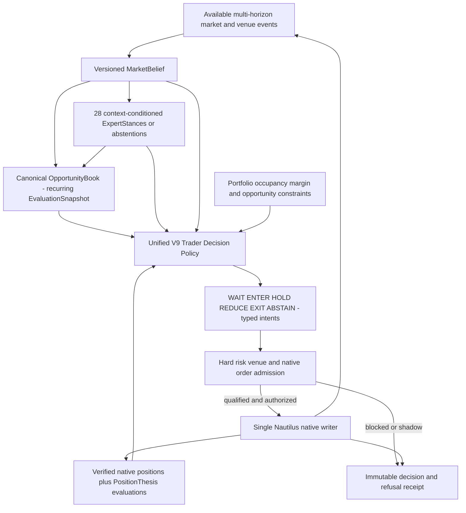
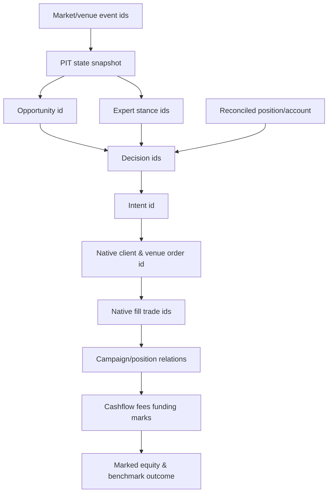
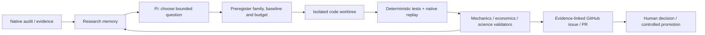

# V9 — Market-Aware Adaptive Trading Intelligence

## Tek kanonik hedef mimari · sürekli bağlama duyarlı trader · V8-next evrim sözleşmesi

**Sürüm:** `V9-ARCH-RFC-1.4` — RFC 1.0 ürün vizyonu + RFC 1.3.2 güvenlik/kanıt sözleşmelerinin **tek normatif kaynakta birleştirilmesi**.  
**Revizyon tarihi:** 4 Kasım 2026.  
**Kanonik kaynak:** `docs/v9/V9_ARCHITECTURE_MONOGRAPH.md`. Eski sürümler Git geçmişinde tarihidir; paralel bağlayıcı bir RFC yoktur.  
**Uygulama sınırı:** `ddawnlll/v8` / `v8-next/`; gerçek commit, Python ve Nautilus sürümleri işe başlanırken pinlenir.  
**Normatif durum:** **OWNER-DIRECTED UNIFIED TARGET DESIGN / IMPLEMENTATION UNVERIFIED / NO ECONOMIC CLAIM / NO LIVE AUTHORITY**. Bu belge çalışır bot, council oybirliği, ekonomi veya canlı güvenlik sertifikası değildir.

**Ürün tanımı (bağlayıcı):** V9, yeni piyasa ve venue bilgileriyle `MarketBelief`'ini güncelleyen, **28 mevcut expert'ı bağlama göre aday kanıt üreticisi** olarak değerlendiren, tek `OpportunityBook`'taki fırsatları sürekli yeniden yorumlayan, açık pozisyon tezini ve sermaye kısıtlarını da hesaba katarak **WAIT / ENTER / HOLD / REDUCE / EXIT / ABSTAIN** kararı üreten **sürekli çalışan adaptif trader'dır**. Her ekonomik karar tek Nautilus native risk ve execution otoritesinden geçer.

**İlk dilim ≠ ürün:** `DecisionPolicyV0` yalnız V8'le mekanik parite ve güvenli geçiş kontrolüdür; **V9 tamamlanma ölçütü değildir**. `M1` tek entry veto deneyidir; **V9 adaptasyon yeteneğinin tanımı veya üst sınırı değildir**. Market intelligence, expert intelligence, fırsatın yeniden değerlendirilmesi, active position ve portfolio policy **opsiyonel gelecek fikirler değil hedef ürünün zorunlu tasarım yetenekleridir**. Bunlar erken aşamada shadow olarak inşa edilir; ekonomik kanıt olmadan gerçek risk yetkisi kazanmazlar.

> **Kanıt ve güvenlik ayrımı:** Tasarımın mevcut olması, modülün shadow ortamda çalışması, native mekanik doğruluğu, maliyetler sonrası ekonomik üstünlük ve live authorization ayrı hükümlerdir. Eski V8 geliştirme bandı veya model görüşleri V9 edge kanıtı değildir. Emri ve stop'u yalnız doğrulanmış native adapter yürütür. Offline Pi/Kaizen bir trading karar beyni değildir.

---

# Özet / Abstract

**Problemin özü.** V8'in MarketState, 28 expert, OpportunityBook, pozisyon, risk, execution ve audit parçaları vardır; ancak bunların yeni koşullarla **tekrar tekrar karar alan bütünleşik bir trader'a** dönüştüğü henüz kanıtlanmış değildir. V9'un ürün hedefi raporlama veya daha az giriş yapan bir V8 değil; fırsatı doğmadan önce bağlam hazırlayan, doğduğunda değerlendiren, açık pozisyonu izlemeyi sürdüren ve risk/sermaye koşullarında kararını güncelleyen trader'dır.

**Kanonik hedef döngü:** PIT market + verified venue observations → multi-horizon MarketBelief → canonical OpportunityBook + context-conditioned 28 ExpertStances → birleşik Trader Decision Policy ← open position thesis + portfolio state → typed entry/position/exit intent → hard risk + single native Nautilus writer → fill/position/equity evidence → bir sonraki olayda yeniden değerlendirme.

**Metot:** Hedef davranış **ürün sözleşmesidir**; ilk güvenli uygulama ise V8 parity/safety düzeltmeleri ve baştan sona çalışan **shadow integrated trader vertical slice** ile başlar. Bağımsız market, expert, entry, position ve portfolio deneyleri ekonomik iddiaları ayrıştırır; birleşik sistem ayrıca interaction-aware native replay ve prospective shadow ile sınanır.

**Sonuç statüsü:** Bu belgeyi kabul etmek kârlılığı, doğru maker fill'i, funding doğruluğunu veya canlı deploy'u doğrulamaz. `NO_EDGE`, `INCONCLUSIVE` ve `BLOCKED` sonuçları geçerlidir. Bununla birlikte bu sonuçlar **ürünün hedef yeteneklerinin tasarımdan silinmesi** anlamına gelmez.

---

# Tek normatif mimari — ürün hedefi ve aktivasyon sınırları

## A. Bağlayıcı ürün tamamlanma sözleşmesi (RFC 1.0'ın özü)

1. **Market intelligence:** PIT çoklu zaman ufukları, state/structure/volatility/uncertainty/değişim geçmişi; yeni olayda bağımlı görüşlerin güncellenmesi.
2. **28 expert intelligence:** Mevcut 28 expert envanterde korunur ve uygun veri/bağlamı olanlar `support / contradict / abstain` üretir; aynı kanıtın kopyaları çoğunluk yaratmaz. Hiçbir expert'ın para kazandırdığı varsayılmaz.
3. **Canonical OpportunityBook:** Bir fırsatın tek kimliği ve immutable doğumu vardır; sonraki market/expert değerlendirmeleri tekrar kaydedilir; D4'ün bekleme kuralı zorunlu değildir.
4. **Unified Trader Decision:** Tek sürümlü politika hem flat hem open context'te **WAIT, ENTER, HOLD, REDUCE, EXIT, ABSTAIN** gibi yasal kararlar üretir; cancel/protect gibi eylemler typed intent'tir. Sırf V8 entry veto V9 değildir.
5. **Active position thesis:** Fills/position/protection native gerçekliğine bağlı olarak giriş tezinin hâlâ geçerli olup olmadığı **her ilgili yeni olayda yeniden değerlendirilebilir**. Risk artıran amend veya exit ekonomik olarak varsayılan açılmaz.
6. **Portfolio choice:** Aynı anda izlenen fırsatlar ile fiilî exposure, margin, sermaye işgali ve kısıtlar birleşik karara girer; ex-post hayali kâr gerçekleşmiş fırsat maliyeti sayılmaz.
7. **One native authority:** Risk/venue veto mutlak; tek writer, idempotent intent, konum/stop doğrulama ve fail-closed durumlar bu hedefi değiştirmez.
8. **Evidence and integration:** Tekil bileşen ablation'ları + **birleşik politika etkileşim testi** + tam takvim/maliyetli portföy replay'i ve uygun OOS; sonuç olumsuzsa yeni politika üretime alınmaz.

**V9 ürün olarak tamamlanma:** `V9_INTEGRATED_SHADOW_VERIFIED`, altı trading sorumluluğunun gerçek kanıt zinciriyle birlikte çalıştığını ispatlar; `V9_INTEGRATED_ECONOMICALLY_EVALUATED` ise ayrı ekonomik sonuçtur. **V0_PARITY_VERIFIED, V9_COMPLETE anlamına gelmez.** Bir politikaya canlı yetki ancak ayrı production gate ile verilir.

## B. Tek otorite ve yorum sırası

**Bu dosya tek normatif RFC'dir.** Bölüm IV–XII'deki **birleşik hedef mimari ve bu bölümdeki ürün sözleşmesi** ürün kapsamını belirler; `7`/`8`/`11`/`12`'deki safety/evidence kuralları **emir, test claim'i ve promotion yetkisini** sınırlar. `V0`/`M1`/`P0` ifadeleri birer **aşama**dır, nihai ürün tanımı değildir. Tarihsel council/revizyon notları veya önceki sürümden kalan örnekler bu hedefi daraltamaz. Belirsizlikte hem ürün yeteneğini hem risk izolasyonunu koruyan çözüm uygulanır; güvenlik override edilemez, tasarım yeteneği silinmez.

**Sorumluluk ile otorite farklıdır:** MarketBelief/Expert/Opportunity/TraderPolicy/Position/Portfolio bileşenleri shadow ortamda geliştirilebilir; tek başlarına order oluşturamaz. Yalnız kanıtlı, sınırlandırılmış, sahibi tarafından açılmış policy versiyonu native execution’a öneri sunar. Aynı policy bileşenini tasarlamak ile o bileşene sermaye yetkisi vermek iki ayrı olaydır.

## C. Tarihsel revizyonların doğru okunması (normatif olmayan kayıt)

- **1.0:** Sürekli market→expert→opportunity→decision→position/portfolio→native execution döngüsünü ürün vizyonu yaptı.
- **1.1:** Kanonik karar sözlüğü, ortogonal native state, unknown/partial fill ve araştırma/kanıt semantiğini netleştirdi.
- **1.2–1.3:** V8 parity ile adaptif politika yetkisini ayırdı; evidence gate ve actual source mapping zorunluluğunu ekledi.
- **1.3.1–1.3.2:** Legacy expert gate paritesi, tek kalıcı order doğumu, `BLOCKED` koruma sürekliliği, yan etkili baseline'ın ikinci defa çağrılmaması ve ekonomik producer conflict kurallarını koydu.
- **1.4:** Bu güvenlik kazanımlarını koruyup, V0/veto merkezli **ürün kapsamı daralmasını geri aldı**. Önceki sürümler ayrıca yorum otoritesi değildir.

Bağımsız council review metinleri uygulama testleri sayılmaz. RFC 1.3.1 için üç *tamamlanmış ve bağımsız* kaynak-temelli onay elde edilmiş değildir. Bu revizyon çalıştırılmış V9 testi, replay veya ekonomik kanıt üretmez.

## Belge onayının beş ayrı düzeyi

| Düzey | Ne gerektirir? | Ne **sağlamaz**? |
|---|---|---|
| `ARCHITECTURE_ACCEPTED` | Owner tarafından karara bağlanmış hedef sorumluluklar | Çalışan kod |
| `MECHANICS_VERIFIED` | Pinned commit, deterministik fixture, native olay sınırı | Market edge |
| `EVIDENCE_QUALIFIED` | Geçerli veri, execution ve muhasebe kapsamı | OOS üstünlüğü |
| `ECONOMICALLY_SUPPORTED` | Tanımlı aile/ölçütle yeterli bağımsız karşılaştırma | Üretim yetkisi |
| `PRODUCTION_AUTHORIZED` | Ayrı güvenlik, operatör ve venue kabulü | Gelecek kâr garantisi |

Bu beş boyut tek `PASS` veya sayısal score içine sıkıştırılamaz. V9.1, **ilk iki düzey için henüz uygulanmamış kabul taslaklarını** sunar; hiçbir mekanik doğrulama düzeyine ulaşıldığını **iddia etmez**. Repo temizliği, 1.043 hızlı testin geçmesi veya sıfır açık GitHub issue, V9 runtime paritesi ya da ekonomik onay değildir.

---

# I. Araştırma soruları, kapsam ve kanıt hiyerarşisi

## 1.1 Birincil araştırma sorusu

> Gözlemleyip anlık emir açan bir sistem, piyasadaki değişimleri izleyen, kendi aktif görüşünü yeniden değerlendiren, fırsat ve pozisyonlarını devam eden bir ekonomik karar problemi olarak ele alan **adaptif trader** sistemine nasıl evrilir; bu gelişmenin gerçek değer kattığı nasıl ölçülür?

Bu sorunun yedi alt parçası vardır: (Q1) piyasayı doğru zaman sınırlarıyla nasıl temsil ederiz; (Q2) davranış temelli expert'ların marjinal değeri nedir; (Q3) fırsatın kimliği ve takibi emirden nasıl ayrılır; (Q4) karar bekleme/giriş/tutma/düzenleme/çıkışı nasıl ele alır; (Q5) portföy işgali karşı-olgusal seçimi nasıl etkiler; (Q6) sonuç nasıl güvenilir ölçülür; (Q7) Pi Agent bu sistemi yetkisiz kontrol etmeden nasıl geliştirir?

## 1.2 Kapsam dışı iddialar

Bu makale V9'un kârlı olduğunu; 28 expert'ın tahmin gücünün kanıtlandığını; rejim sınıflandırmasının getiriyi artırdığını; sürekli LLM kararının yararlı olduğunu; veri rejimlerinin sabit olduğunu; BTC sonuçlarının altcoin perpetual evrenine taşınabildiğini; funding, gerçek L1/L2 fill veya likidasyonların doğrulandığını **iddia etmez**. Ayrıca bir V9 canlı işletim sertifikası veya bağımsız hakemli yayın değildir.

## 1.3 Kanıt etiketleri

| Etiket | İçerik | İzin verilen yorum |
|---|---|---|
| `PRIMARY_LITERATURE` | DOI/arXiv üzerinden doğrulanmış dış çalışma | Yalnız çalışmanın popülasyonu, yöntemi ve varsayımları |
| `REPO_OBSERVED` | GitHub'da okunan gerçek kaynak/konfigürasyon | Kodun mevcut olması; bütün sistemin çalıştığını kanıtlamaz |
| `PROJECT_REPORTED` | Ham artifact, yerel run veya kullanıcı raporu | Raporlanan döneme ve profile özgü sonuç |
| `PROJECT_AUDITED_LIMITED` | Bağımsız ZIP üzerinde yeniden hesaplanan kontrol | Yalnız mevcut artifact ve bağlam kapsamı |
| `DESIGN_INFERENCE` | Bu monograftaki mühendislik önerisi | Ekonomik üstünlük iddiası yok |
| `OPEN / BLOCKED` | Yanıtlanmamış, ölçülemeyen veya geçersiz alan | Uygun koşul olmadan kullanılamaz |

## 1.4 Araştırma kaynakları

Yerel `index(3).html` V8 tarihsel tam monografı; Deep Research I (Kasım 2026, 92 KB metin) ve Deep Research II (Kasım 2026, 69 KB Markdown), `V8_NEXT_V9_RESEARCH_COMPLETE_HANDOFF.zip` (616 üyeli paket, orijinal run ve kanıtlar), `D4_ANSWER_TR.md`, `audit-20261030T223550Z-6ffc87e.zip` ve `v8_next_independent_raw_audit_review.md` bu araştırmanın birincil **proje** kaynaklarıdır. Belgelerdeki sayılar kaynaklarının zaman ve statülerine bağlıdır. GitHub varsayılan dalı, yerel olarak henüz push edilmemiş D4 araştırma modüllerini göstermeyebilir.

---

# II. V8'in özgün düşüncesi ve mimari hastalığı

## 2.1 Özgün tez: Expert bir trader değildir

V8 araştırma monografındaki temel ifade şu anlamı taşır: **MarketState, OpportunityEpisode, ExpertEvidence, ExecutionCampaign ve Order/Fill aynı ekonomik nesne değildir.** Market doğrudan gözlemlenebilir, PIT-zamanlı fırsat olayı yaratır; expert bu olayı gözlemler, destekleyebilir, çürütebilir veya çekimser kalabilir. Fırsatın kimliği expert sayısıyla çoğalmaz. Emre giriş, ayrı risk/utility kararıdır. Orijinal `V8_CONSTITUTION` bu ayrımları, duplicate observer invariance'ı, ilk-sınıf abstention'ı, immutable evidence ve locked OOS kontrolünü açıkça tanımlar [P1].

Bu miras **korunmalıdır**. V9'a taşınmaması gereken şey geçmişteki ağır komite/governance yüzeylerinin tümünü kopyalama zorunluluğudur. Her yeni karar için 5-agent kurul, farklı authority root, ikinci claim registry veya yeni engine yapmak, bu çalışmanın ölçülebilir amacına ters düşer. Eski anayasal hükümler korunup normatif geçiş gereken maddeler ayrıca sahibi tarafından onaylanmalıdır; bu tasarım belgesi geriye dönük yürürlük vermez.

## 2.2 Mimari boşluk: Bilmek → seçmek → yürütmek → yeniden değerlendirmek

V8-next'te `world/`, `experts/`, `opportunities/`, `risk/`, `economics/`, `adapters/`, `audit/`, `evaluation/`, `oracle/` ve `system_proving/` mevcut modüllerdir [R1]. Dolayısıyla piyasa durumu, fırsat, expert ve audit **eksik kavramlar değildir**. Açık boşluk, bu parçaların değişen piyasa koşullarında birbiriyle tutarlı **sürekli karar kontratı** üretip üretmediğidir.

V9’un **hedeflenen**, V0’da henüz gerçekleştirilmeyen mimari sıçraması daha çok sınıf, daha çok ajan veya daha çok kural değil: *taze market bilgisi → önceki görüşü güncelle → işlem niyetini seç → risk/kapasite kontrolü → native gerçekleşme → gerekçe geçerliliğini yeniden değerlendir*. Pozisyon açıkken yeniden değerlendirme bu sürümün **araştırma hedefidir**; V0 için yalnız mevcut native stop/target ve gözlem yetkilidir. Gelecekteki bir policy bu davranışı ayrı deney ve native güvenlik gate olmadan değiştiremez.

## 2.3 Laboratuvardan ürün döngüsüne

V8 ekonomi ve kanıt altyapısı güçlü, fakat bugüne kadar tek bir `volume_confirmed_breakout` araştırma kampanyası gibi dar koşullarda testler öne çıktı. V9, yeni evrenlere / altcoin perps'e geçişi **ayrı veri ve likidite uygunluk aşaması** olarak tanımlar. Araştırma maliyetini azaltmak için önce hızlı sinyal/karar taraması, sonra yalnız final adaylarda native NautilusTrader replay'i kullanır. Hızlandırma hiçbir zaman replay semantiğini, stop sırasını veya maliyet modelini sessizce değiştiremez.

---

# III. Bugüne kadar ne ölçüldü? Empirik dayanak

## 3.1 Baseline: tanımı ve kapsamı

Raporlanan deney evreni: BTCUSDT Binance USDT-M perpetual, 1H, 2.160 bar, 2025-01-01–2025-04-01; tek 90 günlük **development** pencere; 10.000 USDT simülasyon sermayesi; maker 0.0002/taker 0.0005; %2 koruyucu stop/%4 hedef. 123 fırsat kaydedildi, baseline 45 kampanya açtı ve 44'ünü kapattı. Kapalı işlemlerde net −8,67470686 USDT ve ≈−0,02208R/işlem raporlandı; native komisyon toplamı ≈36,766 USDT; funding uygulanmadı. Bu 10.000 USDT gerçek portföy önerisi, 20 USDT'lik canlı hesap fizibilitesi veya sonradan oluşan veri değildir [P2, P3].

### A/B/C/D4 ayrıştırma özeti

| Araştırma sorusu | Gerçek gözlem | Geçerli çıkarım | İzin verilmeyen çıkarım |
|---|---|---|---|
| **A Expert seçiciliği** | Grammar-only A1 baseline defteriyle aynı; 123 fırsatın tamamı consensus desteği alıyor | Mevcut gate bu bandda ek seçim yaratmadı | Uzmanlık genelde faydasız |
| **B Entry** | Native B4 ~20 işlem, −0,14537 net R/işlem; bazı model gecikme kolları negatif | Basit onay/erteleme maliyet yaratabiliyor | Bütün giriş teyitleri kötü |
| **B3 realistic profile** | 11 giriş, G8 reconciliation bozuk, koruma eksiği | **INVALID**; ekonomik tabloya katılmaz | Bu rakamlar gerçek slippage'ı ölçüyor |
| **C4 +1R stop→BE** | 21 native protective-stop update; ~+0,14173 net R/işlem; eşleşmiş +0,1008R, GA [−0,0426,+0,2442] | İşlem yönetimi mekanik olarak değişti; sonuç **INCONCLUSIVE** | Kanıtlanmış breakeven edge |
| **D4 kalıcı retest/reclaim** | 123 watching, 65 armed, 25 girilen kampanya; net −0,04524R (defter), −0,08500R native-bracket; PnL −36,12 USDT | Gerçek kalıcılık var, fakat bu kural V8'i geçmedi | Bütün lifecycle politikaları gereksiz |

D4 ile V8 arasında ortak 12 opportunity için raporlanan D4−V8 farkı −0,91391R, %95 GA [−1,62986,−0,26449]; fakat aynı 123 fırsat üzerinden tüm-birim farkı −0,00130R, %95 GA [−0,17133,+0,16040]. Farklı karşılaştırma birimleri farklı sorular sorar; küçük ortak örnekleme dayanarak genel “zararlı” hükmü verilemez [P4].

## 3.2 D4'ün esas mekanizması: Seçim ile gerçekleşme ayrı

D4, V8'in açtığı 45 kampanyanın yalnız 12'sine girdi, 33'ünü kaçırdı; baseline'ın girmediği 13 fırsata girdi. Rapora göre ortak 12 fırsatta girişler ortalama 3,8 bar gecikti ve giriş fiyatı ortalama 0,68931R kötüleşti. 65 ARMED fırsatın 38'i `POSITION_OCCUPIED`, ikisi kapasite/sıra dolayısıyla iptal edildi [P4]. Bu, “daha iyi fırsat alt kümesi seçmek” ile “daha iyi portföy sonucu üretmek” arasındaki uçurumu somutlaştırır. Ancak D4'ün aynı kapanış MARKET ve bar-only semantiği gerçek piyasaya hazır değildir; funding eksiktir.

## 3.3 Audit doğruluğu: önemli bağımsız itirazlar

2026-10-30 ZIP'i üzerinden yapılan bağımsız inceleme, 89 native fill, 45 entry, 29 stop, 15 target ile ücret toplamlarının genel düzeyde uzlaştığını; ancak bazı audit artifact'lerinde **89/89 cashflow kaydının son kampanyaya etiketlenmesi**, 45 entry event'inde kampanya referanslarının yanlış/eksik olması, lifecycle opportunity/decision join bozukluğu, giriş mumundan sonraya görünmeyen high/low yolunun yanlış kullanılması ve `G7 PASS` ile eksik protection ID join'leri arasında çelişki bildirdi [P5]. Bu inceleme orijinal tape ve runtime olmadan ZIP düzeyinde yapıldığı için sorunların güncel koda hâlâ uygulanıp uygulanmadığı **yeniden doğrulanmalıdır**; otomatik olarak çözülmüş sayılmaz.

Bu düzeyde bir bağ kopukluğu `AUDIT_COMPLETE` etiketiyle örtülemez. V9'un **P0 başlangıç koşulu**, ilgili iddialar için `opportunity → decision → order → fill → campaign → cashflow` lineage bütünlüğünü native event seviyesinde kanıtlamak ve MFE/MAE'nin entry-time sınırlarını düzeltmek veya ölçümü geçici olarak `NOT_IDENTIFIABLE` ilan etmektir.

### 3.3.1 V8 kapanışı sonrası kanıt statüsü (3 Kasım 2026)

Kullanıcının V8 cleanup raporuna göre 6 PR birleştirilip GitHub `main=f07d9e21d48dc61a6eb79e0dde98b61b02058eef` noktasına gelmiş; 7 yerel evidence/accounting düzeltmesi taşınmış; 29 issue kapatılıp 22 çözülmemiş yükümlülük `docs/V9_BACKLOG.md` içine kaydedilmiş ve hızlı test koşusu `1043 passed / 41 skipped / 506 deselected` olarak raporlanmıştır. Bu **raporlanmış depo bakım sonucu**, V9 çalışma kanıtı değildir. 3 tarihsel slow-test hatasının sürdüğü de bildirilmektedir.

Özellikle `#491` kısmen düzelmiştir: entry→exit işaretleme yoluna müdahale edilmesine rağmen, dört bacaklı gerçek veri raporunda `portfolio_P ≈ 5,8050 USDT` ve `portfolio_PE ≈ 22,5040 USDT` açıklanamayan residual kalmaktadır (`V9_BACKLOG` B19). `#476` producer→consumer wiring R1 de tamamlanmamıştır (B18). Geri kalan P0 dış kanıtlar `EXT-VENUE/FUNDING/TAPE/PARITY` vb. bağımlılıklara bağlıdır. Bu rapor hiçbirini **fix edilmiş** saymaz; `CURRENT_HEAD_RECHECK_REQUIRED` kayıtla uygulama P0 kapısına taşır.

**Güncel lineage protokolü:** test edilen SHA, engine pin, tape hash, fixture ve event sequence kimlikleri kaydedilmeden “orphan 0” iddiası kurulmaz. Orphan=0 bulunması da yanlış ama dolu join’i elemez. Native bağımsız oracle hem orphan/duplicate sayısını hem **doğru campaign/decision/order/fill→cashflow eşleşmesini** ve tamlık/payda kapsamını ölçmelidir.

### 3.3.2 Kritik ekonomik residual — kaynaklara ayrılmış ayrı gate

V8 kapanışının raporladığı `portfolio_P = 5,8050 USDT`, `portfolio_PE = 22,5040 USDT` değerleri açıklanmamış **residual** büyüklükleridir; yeni sürümde yeniden hesaplanmış sayılar değildir. #491'in exit-leg muhasebe düzeltmesi bu iki farkı açıklamamıştır. `equity_mtm` terminali ile `balance_total` arasındaki tutarsızlığın bir kısmını tüm barlara eşit dağıtan *graft*, doğru zamanlı PnL ölçümü sayılmaz. Çıkış fiyatı, nakit bakiye, realised PnL, unrealised PnL, fees, settled funding ve mark zamanları **ayrı** defter satırlarına ayrılıp bağımsız oracle ile doğrulanmalıdır. Eksik funding veya mark `0` olarak impute edilemez.

**Ayrı statüler:** `LINEAGE_VERDICT` join doğruluğu; `EQUITY_VERDICT` gerçek mark ve aritmetik eşitlik; `FUNDING_VERDICT` settlement coverage ve işaret; `NATIVE_PROTECTION_VERDICT` emir/pozisyon kimliği. Birinin yeşil olması diğerini kurtarmaz. `EQUITY_VERDICT != PASS` iken Sharpe, drawdown, tail mean ve takvim hizalı net equity gibi metrikler **otorite/verdict üretemez**; yanlış veri üzerinde hesaplanmış tanı amaçlı değer açık etiketle saklanabilir. Canonical 12-ay tape eksikse gerçek çalışma üzerindeki ilgili iddia `EXT-TAPE/BLOCKED` kalır; küçük sentetik oracle mekanik yanlışın yakalanmasını sağlar ama ekonomik tamlık kanıtlamaz.

### 3.3.3 RFC-1.3.1 code-surface defect register — safety/audit repair

Üçüncü council modeli `c84fecbff3981ad2e6d4da3e0f974c81e2d80b61` kaynaklarında mekanik fixture/probe bildirmiştir. Aşağıdaki **kod mekanizmaları** kaynakta da incelenmiştir; **fixture sonuçları bu editoryal revizyonda yeniden koşulmamıştır**. Etki alanı ilgili adapter/strategy/config ile sınırlıdır. Onarımlar `SAFETY_REPAIR` / `AUDIT_REPAIR` olarak baseline'dan ayrı etiketlenir; V9 alpha değildir.

| Pinli kod adresi | Saptanan mekanizma | Ayrı kabul kanıtı |
|---|---|---|
| `adapters/swing_engine.py` (cancel paths) | `cancel_order(order)` kullanılıyor, pinli NautilusTrader rc4 binding'i `ClientOrderId` bekliyor | Sibling cancellation, timeout, reject ve late-fill native trace; diğer stratejilere otomatik genellenmez |
| `adapters/swing_engine.py` (`_submit_bracket`) | İlk partial fill sonrasında planın *tam* miktarı ile protective legs kuruluyor; sonradan artan filled qty reconcile edilmemiş | Per-fill open qty, reduce-only, sibling cancellation, NETTING position identity fixtures |
| `audit/pipeline.py` (`assign_campaign_ids`) | `POSITION_OPENED` sıra sınırı ve client-ID suffix'i üzerinden campaign bağlama | İki kampanya native order→fill→cashflow hand oracle; yanlış-ama-dolu mutantı |
| `audit/native_telemetry.py` (`reconcile_fills`) | `set` farkı multiplicity kaybeder; `last_trade_id` öncelik sırasında yok | İki yönlü multiset + exact fill identity + qty/fee conservation |
| `adapters/expert_strategy.py` (risk sizing / min-notional) | Risk-normalized qty venue minimumuna **yukarı** zorlanabiliyor; gerçekleşen stop-risk tekrar doğrulanmıyor | Risk-mode reject, quantization sonrası stop-risk/margin/liquidation ve 20 USDT fixture |

Bu kod gözlemleri **canlı ters pozisyon oluştuğu**, eski 89/89 popülasyonun güncel SHA'da yeniden ölçüldüğü veya bütün V8 implementasyonunun aynı hataya sahip olduğu iddiası değildir. Önce P0-A'da hangi baseline yolunun kullanılacağı seçilir.

## 3.4 Mevcut açık ekonomik sınırlamalar

Funding akışı ve mark atfı; aynı-bar intrabar sıra; spread/quote/order-book/queue eksikliği; per-fill identity ve partial fill; native bracket/position ID callback order; altcoin likiditesi, minimum notional ve quantization; tek 90 günlük rejim; sealed OOS kullanımı. Bunlar farklı şiddette engellerdir. Birinin giderilmesi tümünü gidermez. Ayrıca geçmiş V8 next handoff ZIP'i D3'ün B4 replikasyonu olduğunu belirtir; D4 ise **daha sonra yapılmış ayrı çalışma** olup kendi 14/14 raporlanan doğrulamasına rağmen ekonomik üstünlük kanıtlamaz [P3, P4].

---

# IV. Bilimsel temel: piyasayı 'anlamak' ne anlama gelir?

## 4.1 Metafizik değil, güncellenebilir epistemik durum

Bir algoritmanın piyasayı 'anlaması', piyasanın geleceğini bildiği anlamına gelmez. Ölçülebilir tanım: **mevcut bilgiye dayalı sürümlenmiş piyasa görüşü** oluşturmak; bu görüşün geçerlilik alanını, belirsizliğini ve zaman sınırını belirtmek; yeni bilgi geldiğinde önceki kararın hâlâ uygun olup olmadığını sınamak. Bu, gözlemden aksi yöne ısrar etmek yerine `ABSTAIN`, `WAIT`, `REASSESS` gibi eylemleri birinci sınıf yapar. Seçici sınıflandırmanın risk–coverage değiş tokuşu bu tasarımın genel istatistiksel analojisidir; bilgisayarlı görü çalışmalarındaki risk garantileri finansal getiriye doğrudan aktarılamaz [L04, L05].

## 4.2 Zamanın dört ayrı anlamı

Her market/derived event için en az `event_time`, `exchange_publication_time` (varsa), `local_receipt_time`, `decision_time` ayrı tutulmalı. Eski candle'ın `bar_end` zamanı, geçmişte gerçek bilgiye erişildiğini kanıtlamaz. PIT bilgi kümesi

\[
\mathcal F_t = \sigma\{x_i: \operatorname{available\_at}(x_i)\leq t\}
\]

olmak üzere, belirli politika sürümü için `Action_t = π(F_t, Portfolio_t, PolicyVersion)` verisi ile tekrar üretilebilir olmalıdır. Retroaktif `funding`, `OI` veya dış veri eklemek, mevcut hipoteze yeni veri bilgisi kazandırıyorsa yeni dataset/version ve ayrı deney kimliği gerektirir.

## 4.3 MarketBelief — birinci sınıf hedef runtime sorumluluğu

`MarketBelief` **V9 hedef ürününde zorunludur**; yalnız “belki V2+ araştırması” değildir. İlk inşa aşamasında mevcut `MarketState`/`world` yollarından PIT-safe, read-only, **shadow** bir projection/adaptor olarak üretilebilir; yeni büyük ML servisi şart değildir. MarketBelief, yalnız expert'a etiket dağıtan rejim sınıflandırıcısı değil; **piyasa koşulları, veri kalitesi, belirsizlik ve tez değişiminin sürümlü durumu**dur.

```text
MarketBeliefV1  # REQUIRED TARGET CONTRACT; may be SHADOW / no order authority
  instrument_id, interval_set, decision_cut_ns, input_available_max_ns
  market_state_ref, state_id, state_version, source_event_ids
  data_quality: VALID | STALE | INCOMPLETE | UNKNOWN
  structure: {direction, swing_state, breakout_state, support_resistance_ref}
  volatility: {level, percentile, change_state}
  context_scores: {trend, range, shock, transition, unknown}
  liquidity_context: {proxies, availability, missingness}
  horizon_alignment: {15m, 1h, 4h, unknown}
  evidence_changes: {previous_state_id, changed_fields, trigger_event_ids}
  uncertainty: {measure_id, definition, calibrated_if_available}
  provenance: {source_hash, feature_version, model_version, data_role}
```

**Sözleşme:** Gözlemler yalnız `available_at <= decision_cut` ise kullanılabilir; incomplete higher-TF bars ve backfilled funding decision input'u olamaz. Context skorları keyfi şekilde toplamı 1 olan “kalibre rejim olasılığı” diye sunulamaz; doğrulanmış ve birbirini dışlayan olay/probability modeli yoksa `scores` ve `UNKNOWN` kullanılır. L1/L2 olmayan likidite proxy'si book fill doğruluğu iddiası değildir.

**Event-driven update:** PIT market/venue event, önemli risk/pozisyon değişimi veya geçerlilik süresi dolması ilgili bağımlılıkları invalidate eder; her tick'te bütün 28 expert'ı çalıştırmak zorunlu değildir. Aynı kaynak/version/event kesiti deterministik MarketBelief üretmeli; farklı görüş, yeni sürüm ve neden kaydı ister.

**Yetki:** MarketBelief'in **shadow ve integrated policy input** olması ürün hedefidir. Canlı girişi, stop'u veya çıkışı değiştirmesi ayrı policy activation/ablation/native safety kapısı gerektirir. BOCPD/HMM/learned router zorunlu başlangıç algoritması değildir; ham özellik/threshold karşılaştırması korunur.

## 4.4 Multi-horizon ve market state çevrimi

15m fırsat barı, 1h bağlam ve 4h durum gözlemi gibi saat ölçekleri kullanıcı hedefleriyle uyumludur; ilk doğrulama için mevcut 1H BTC enstrümanının dışına geçmek gerekmez. Çoklu ölçeklerde tamamlanmamış üst periyot mumlarını kullanmak `PIT` ihlalidir. `MarketBelief` güncellemesi, **relevant market event** veya karara etki eden risk/pozisyon değişikliği olduğunda; zorunlu her tick'te bütün expert'ları hesaplayarak değil, dependency invalidation ile uygulanmalıdır.

## 4.5 Değişim tespiti ve hata payı

Rejim tahminleri hatalı olabilir. False transition ile yanlış expert yönlendirmeyi önlemek için (i) `UNKNOWN` ve abstention; (ii) transition hysteresis/tutarlılık; (iii) minimum event/time validity; (iv) regime classifier karşılaştırması; (v) sınırlı drift/coverage monitor önerilir. Eşikler önceden sürümlenip test edilir; bu makale rakamsal optimum belirtmez.

## 4.6 Market understanding nasıl yanlışlanır?

Üç iddia testte ayrılmalıdır: `PIT_VALIDITY` (bilgi gerçekten karar anında var mı?), `REPRESENTATION_UTILITY` (etiket, aynı bilgiyle kurulan basit durumdan farklı test edilebilir koşullu davranış tanımlıyor mu?) ve `DECISION_UTILITY` (bu fark risk/pozisyon/execution sabitken ekonomik sonucu değiştiriyor mu?). Bir market belief'ın daha çok alanı olması hiçbiri için kanıt değildir.

Ön kayıtlı ilk koşullu hedef örneği: `future 1H absolute return > a × trailing ATR` gibi **gözlemlenecek olayın**, veri ufkunun ve eşiklerinin en baştan dondurulması; belirsizlik tahmini kalibre edilemiyorsa olasılık iddiası yok. Bilginin *eyleme etkisi* ayrıca `changed_action_count`, `avoidance_cost`, `calendar_aligned_net_equity_delta` ile ölçülür. Sadece tahmin skorundaki fark, trading aktivasyon izni vermez.

`M1` karşılaştırması dört karar verebilir: (i) hiçbir karar değişmez → temsil ekonomik karar girdisi olamaz; (ii) karar değişir ama ledger yetersiz → `INCONCLUSIVE`; (iii) ekonomi kötüleşir → `NO_EDGE` veya `REJECTED` (önkayıt kriterine göre); (iv) bağımsız geçerli sınama yeterli fayda verir → sınırlı politika promotion incelemesi. Farklı dönemlerde gözlenen farklı sonuçlar gizlenmez.

---

### 4.7 Market intelligence ürün yolu ve ekonomik aktivasyon

MarketBelief + `PITFeatureView`, **V9 integrated shadow trader'a ilk dikey dilimden itibaren girdi** olarak bağlanır; V0 legacy native route ile karıştırılmaz. Yeniden değerlendirme yalnız yeni entry veto için değil, **bekleyen fırsatın geçerliliği, expert stance değişimi, açık pozisyon tezi ve portföy risk/kapasitesi** için de tasarlanır.

Ekonomik karar otoritesine geçişte her kullanım ailesi kendi `claim × producer × dataset × execution_profile` kapsamıyla test edilir. İlk ucuz deney `M1_ENTRY_VETO` olabilir ancak **zorunlu tek V9 market intelligence ürünü veya tavanı değildir**. Market context→position/entry/portfolio davranışları da tasarımda yer alır; ayrı denemeler ve birleşik replay'e kadar shadow/default-off kalır.

PIT validity, raw-feature threshold karşılaştırması, drift, calibration (olasılık iddiası varsa), changed decision count, calendar-aligned net equity ve bağımsız holdout ekonomi hükmünün gereğidir. Tutarsız sonuç `NO_EDGE`/`INCONCLUSIVE` doğurabilir; MarketBelief'in gözlem ve deterministik ürün API'sini ortadan kaldırmaz.

# V. Expert intelligence: uzmanların görüşü, hakikatin çoğalması değil

## 5.1 Kimlik, 28 expert kapsamı ve görevleri

28 mevcut expert **V9'un hedef expert intelligence evrenidir**. Her biri `expert_id`, `version`, davranış/kanıt ailesi, `habitat`, erişilebilir PIT feature ve `support/contradict/abstain` nedeni ile envanterlenir. `ExpertStance = {expert_id, version, habitat_id, opportunity_id, support/contradict/abstain, reason_code, observed_features, availability_bounds, lineage}`.

Expert emir veya yeni opportunity kimliği yaratmaz; yalnız **bağlama bağlı, zamana duyarlı ekonomik karar kanıtı** sağlar. Aynı feature'dan üretilmiş korelasyonlu oylar bağımsız gözlem sayılamaz. V8'in legacy gate'i V0 karşılaştırmasında saklanır; yeni V9 expert intelligence hedefinden çıkarılmaz.

**Asgari teslim:** Bütün mevcut 28 expert için `INVENTORIED / EXECUTABLE / INCOMPATIBLE_WITH_REASON` statüsü, immutable stance veya tipli abstention, her relevant market change için dependency-aware re-evaluation, clone invariance ve altered-decision attribution. Eksik expert gizlice silinmez ya da “28/28 faydalı” denmez. Başarısız bir expert'in üretim ağırlığı sıfır olabilir; tarihsel kanıt ve hedef interface kaybolmaz.

## 5.2 Context-aware expert intelligence (V9 target)

`MarketBelief` bağlamı ve `OpportunityBook`'un son evaluation snapshot'ı her uygun expert'a sunulur. Expert kendi habitatında destek/çelişki/çekimserlik bildirir; hatalı bir sabit regime classifier'ın bütün expert'ları susturması varsayılan politika değildir. Çakışan kanıtlar **kaynak bağımlılıklarıyla** temsil edilir; çoğunluk oyu tek başına fiyat tahmini veya sermaye emri değildir.

V9 Trader Policy, **kanıt gruplarını, karşıt expert görüşlerini ve abstention'ı** uygun risk/kapasite altında kullanabilecek şekilde tasarlanır. İlk shadow testinde context değişince stance'lerin ve decision reason'ın değişmesi izlenebilir olmalıdır. Economic promotion için legacy self-gating, basit raw-feature ve dependency-adjusted ablation karşılaştırmaları gerekir. Learned weights/consensus/routing yalnız doğrulanmış sürümlü policy olarak canlıya açılır; hedef interface'in inşası bu kanıtı beklemek zorunda değildir.

## 5.3 A deneyinden çıkarılan gerçek ders

Bir consensus gate'in 123 fırsatın 123'ünü geçirmesi, 28 expert'ın bütünüyle gereksiz olduğunu kanıtlamaz; yalnız o gate'in **marginal selection effect = 0** olduğunu gösterir. Bu durumda gereken, yeni 28 expert değil: gerçek `support/contradict/abstain` distribution, hangi fırsatı hangi model eledi, ablation ve dependency-adjusted evidence measurement. Ölçülecek metrikler: altered decision count, alternative coverage, incremental net equity, non-entry opportunity opportunity cost, regime-conditioned error; yalnız win rate veya consensus oranı değil.

## 5.4 Model çeşitleri

Rule-based, istatistiksel ve makine öğrenmeli expert'lar **aynı üretim sözleşmesine** bağlanabilir; buna izin verilmesi bunların tümünün etkin olduğu anlamına gelmez. Her modelin veri lineage, training split, calibration, uncertainty ve artifact hash'i vardır. Model sonuçları anlık gözlemlerle kendiliğinden yeniden eğitilmez; challenger policy olarak ayrı araştırma ve promotion gerektirir.

---

# VI. Opportunity Lifecycle: hafıza, strateji değil

## 6.1 Fırsat, karar, emir ve pozisyon ayrıdır

V8'in **opportunity sovereignty** ilkesini koruyan tek kanonik fırsat kaydı bulunur. Fırsatın epistemik durumu, emir ve pozisyonun gerçekleşmiş durumuyla **birleştirilmez**. İlk sürümün asgari fırsat durumları `DETECTED`, `ACTIVE`, `INVALIDATED`, `EXPIRED`; `WATCHING` ayrı bir gözlem etiketi olabilir, karar aksiyonu değildir. `ARMED/RETEST_SEEN` D4'e özgü araştırma policy state'leridir, default-on V9 yaşam döngüsü değildir. `ADMITTED/EXECUTED/CLOSED` opportunity enum'ları değil, ayrı decision/order/position ilişkilerinden türetilen görünüm olabilir.

Her fırsat `BirthSnapshot` immutable, sonraki `EvaluationSnapshot` append-only olur. `Expiry` fırsatın varlık hipotezinin sona ermesidir, emir iptali veya pozisyon kapanışı değildir. Canlı pozisyon, fırsat expired olsa bile kendi ayrı risk/protection güvenlik sözleşmesine tabidir. D4'ün kötüleşen fiyat ve occupancy sonuçları zorunlu gecikme eklenmemesi için pozitif gerekçedir [P4].

## 6.2 Decision-time re-evaluation

Aynı fırsatın doğuş anındaki kanıtları immutable `BirthSnapshot` olarak kalır. Sonraki market belief ve expert stances, ayrı `EvaluationSnapshot` olarak eklenir. Durum değişimleri tekrar oynatılabilir; cancel/expiry, fill sayılmaz. `OpportunityBook` fırsatın geçmişini tutar; **Entry Policy** o andaki fiyatın ekonomik olarak kabul edilir olup olmadığını hesaplar. Bir firmanın her fırsatı beklemeye alması veya her güncellemede emir açması gerekmez.

## 6.3 D4'e karşı tasarım savunması

D4 state machine gerçek ve baseline'dan farklı davrandı, ama −36,12 USDT'lik raporlanan sonuçla immediate girişe üstün gelmedi. Bu, `OpportunityBook`'un hafıza ve açıklama için değersiz olduğunu göstermez; **belirli retest/reclaim admission kuralının** ekonomik üstünlüğü desteklenmediğini gösterir. V9 fırsatı izlerken `WAIT` kararını ve `EXPIRED` fırsat durumunu ayrı kaydedecek; bekleme zorunluluğu ancak ayrı ekonomik politika ve kanıtla etkinleştirilecektir [P4].

## 6.4 Fırsat ile emir arasındaki tek yönlü güven sınırı

`Opportunity` veya `ExpertStance` doğrudan Nautilus order objesi üretemez. Emir istemi `TraderDecision` → `EntryIntent` → `RiskAdmission` → native adapter yolundan geçer. Her bağlantı `decision_id`, `opportunity_id`, `policy_hash` taşır. Fırsat sayısı, expert sayısı veya izlenen sembol sayısı artırıldığında toplam risk yetkisi otomatik büyümez.

---

## 6.5 Sürekli opportunity evaluation — V9 ürün sözleşmesi

§OpportunityBook§ yalnız hafıza değildir: yeni MarketBelief/ExpertStance, fill/cancel, risk/kapasite veya validity timer olayı §EvaluationSnapshot(opportunity_id, source_cut, belief_ref, stance_refs, price_feasibility, validity, decision_effect, reason)§ üretir. Birth snapshot değişmez. Bir fırsat zaman içinde §WATCH→ENTER§, §ENTER→WAIT§ veya §ACTIVE→INVALIDATED/EXPIRED§ karar girdisi olabilir; **durum değişimi otomatik yeni order değildir**. Aynı event replay'i duplicate opportunity/intent doğurmaz. En az iki bağımsız ve çakışan opportunity, mevcut açık position ve changed-market olayıyla shadow E2E fixture zorunludur.

---

# VII. Trader Decision Policy: çalıştırılabilir v0, araştırma hedefi vN

## 7.0 Ürün policy'si ve göç aşamalarının doğru ayrımı

- **`V9TraderPolicy` — tek hedef karar otoritesi:** Sürüm, market belief, 28 expert'tan uygun stance'ler, tek OpportunityBook, açık PositionThesis, pending emirler, venue durumu, portföy ve gerçek risk/maliyet kısıtlarını **birleşik değerlendirme** içinde kullanır. Flat durumda `WAIT/ENTER/ABSTAIN`, açık pozisyonda `HOLD/REDUCE/EXIT/ABSTAIN` kararı verebilir; farklı intent türleri tek native writer'a gider.
- **`V0 / DecisionPolicyV0` — parity adapter:** Pinli `strategy_class + config_hash + code_sha + execution_profile` ile **mevcut V8 stratejisini koruma / ölçme** aşaması. Legacy expert gate varsa korunur; yeni adaptive karar yetkisi yoktur; **V9 ürününün tamamlanma kriteri değildir**.
- **`V9_INTEGRATED_SHADOW` — hedef ürünün ilk gerçek demosu:** MarketBelief + 28-expert inventory + OpportunityBook + TraderPolicy + Position/Portfolio değerlendirmesi **sentetik veya kwalifiye PIT event stream üzerinde tek döngüde** çalışır. Risk/venue gerçekliği modellenir fakat tüm adaptive action'lar `DIAGNOSTIC_ONLY`, native risk emri yoktur.
- **`V9_ACTIVATED_POLICY` — kanıtlı sürüm:** Ayrı ayrı test edilmiş policy aileleri ve birleşik etkileşim etkisi, execution/accounting gates ve açık owner onayıyla **yalnız onaylanan kapsamda** canlı native yoluna öneri iletebilir. Başarısız `M1`, expert/position/portfolio hedef API'sini silmez.

**Yetki tek yönlüdür:** Gelecek hakkında ekonomik görüş yalnız politika önerisidir; hard risk ve native venue authority üstün kalır. Shadow kararlar mevcut V8 order callback'lerini yönlendiremez. Aynı expert/market görünümleri deterministik olmalı, live feature promotion ayrı signed/configured policy versiyonuyla yapılmalıdır.

## 7.1 Dört farklı sözcük alanı: karar ≠ niyet ≠ olay ≠ gerekçe

Council'ın saptadığı `WAIT/WATCH`, `ADJUST/MODIFY` tutarsızlığı **bu revizyonda giderildi**. Aşağıdaki adlar V9 tasarımının önerilen **kanonik sözlüğüdür**, kodda şimdiden bulunduğu iddia edilmez. Eski adlar migration adapter'da dönüştürülebilir; ekonomi sözleşmesinde iki eşanlamlı eylem bulunamaz.

| Tür | Kanonik değerler | Sahip ve anlamı |
|---|---|---|
| `DecisionAction` | `WAIT`, `ENTER`, `HOLD`, `REDUCE`, `EXIT`, `ABSTAIN` | Versioned policy bir *karar* üretir; `ABSTAIN` gerekli girdiler/yetki bilinmediğinde öneri yoktur |
| `IntentKind` | `SUBMIT_ENTRY`, `CANCEL_ENTRY`, `AMEND_PROTECTION`, `SUBMIT_REDUCE`, `SUBMIT_EXIT`, `SAFETY_RECONCILE` | Bir kararın uygulanabilir alt isteği; emir değildir |
| `OpportunityStatus` | `DETECTED`, `ACTIVE`, `INVALIDATED`, `EXPIRED` | Fırsat gözlemi; eylem değil |
| `VenueOrderStatus` | `NOT_SUBMITTED`, `SUBMITTING`, `ACCEPTED`, `PARTIALLY_FILLED`, `FILLED`, `CANCEL_PENDING`, `CANCELED`, `REJECTED`, `EXPIRED`, `UNKNOWN_AT_VENUE` | Native order/event gerçekliği; yerel policy değil |
| `PositionStatus` | `FLAT`, `OPEN`, `REDUCING`, `CLOSING`, `UNKNOWN_AT_VENUE` | Venue ile uzlaştırılmış pozisyon durumu |
| `ReasonCode` | `NO_OPPORTUNITY`, `PRICE_UNFAVORABLE`, `STALE_DATA`, `RISK_LIMIT`, `POSITION_OCCUPIED`, `ENTRY_PENDING`, `VENUE_UNCERTAIN`, `PROTECTION_GAP`, `THESIS_INVALID`, `TIME_STOP`, `NOTIONAL_TOO_SMALL`, `ESTIMATE_UNKNOWN` | Denetim için açıklama, tek başına trade emri değil |

`WATCH` insan için fırsat izleme anlatımıdır; V9 karar aksiyonu değildir. `MODIFY`, `ADJUST`, `PROTECT` ve `TIME_STOP` yüksek seviyeli `DecisionAction` değildir: `AMEND_PROTECTION` bir niyet, `TIME_STOP` bir neden, `CANCEL_TARGET` bir alt intent olabilir. `REJECT` ise hangi katmanda reddedildiğine göre `RiskDecision.REJECTED` veya `VenueOrderStatus.REJECTED` olur. Bu terminoloji farklı nesnelerin durumunu tek enum'da şişirmeyi önler.

## 7.2 Kanonik hedef trader döngüsü ve ayrı V0 parite yolu

`V9` **sürekli ve olay güdümlü** karar verebilir: tamamlanmış/erişilebilir market barı, venue order/fill/position değişimi, koruma/risk uyarısı, opportunity invalidation veya ön-kayıtlı timer yeniden değerlendirmeyi tetikler. Bütün input'ların `available_at_ns <= decision_cut_ns` olmalı; eşzamanlı callback sırası keyfi varsayılamaz.



**Yukarıdaki grafik `V9 TARGET / SHADOW` grafiğidir, çalışan live sistem iddiası değildir.** V0 baseline parity aynı grafiğin “yeni MarketBelief/stance/active policy” decision edge'leri olmadan, pinli **mevcut V8 strategy→risk→native** akışını korur. Yeni graph V0 baseline'a paralel ikinci emir yolu olarak kurulamaz. Gerçek politika ve native fonksiyon adresleri `7.3.2`'nin P0-A source manifestinde kanıtlanır.

**State feedback:** Yeni fill/position, açık PositionEvaluation ve PortfolioView'u yeniler; bu, bir sonraki decision cut'ına girer. `TraderDecision` order accepted veya stop covered demek değildir; native callback/venue inquiry gerçeği ayrı otoritedir.

## 7.3 Yasal eylem matrisi — V9 target ve V0 parity ayrımı

| Reconciled state | V9 target policy (shadow until authorized) | V0 parity / hard-safety behavior | Mutlak invariant |
|---|---|---|---|
| `FLAT` + PIT fresh + qualified opportunity | `ENTER / WAIT / ABSTAIN` | Pinli baseline `ENTER / WAIT` | Yeni emir yalnız risk, venue ve kalıcı ID kontrolüyle |
| `FLAT` + no qualified opportunity | `WAIT` veya gerekçeli `ABSTAIN` | `WAIT` | Hayalî expected edge üretme |
| `ENTRY_PENDING / CANCEL_PENDING` | Yeni giriş için `WAIT`, gerektiğinde `CANCEL_ENTRY` intent | Venue reconcile | Pending fill yok sayılmaz |
| `OPEN` + verified protection | `HOLD / REDUCE / EXIT`; reason + PositionEvaluation | Mevcut native stop/target, V0 `HOLD` | Shadow policy native bracket'i iptal edemez |
| `OPEN` + partial fill + pending entry | `HOLD / REDUCE / EXIT` yalnız doğrulanmış native qty, ayrı intent/protection | `PARTIAL_FILL_ENTRY_PENDING` | Exposure + pending aynı anda geçerli |
| `OPEN` + protection unknown/gap | `ABSTAIN` yeni risk; native recovery ayrı | Verified venue state query | Bilinmeyen miktarda kör flatten yok |
| `UNKNOWN_AT_VENUE`, restart | `ABSTAIN`, reconcile | No-new-risk + operator notification | New order yok; stop/fill callback döngüsü açık |
| Kill switch / hard exposure limit | Ekonomik policy geri çekilir | Mevcut native risk playbook | Policy risk limitini override edemez |

**Çekirdek ayrım:** `HOLD/REDUCE/EXIT` **V9 ürününün hedef kararlarıdır**; `DecisionPolicyV0`'ın bunları üretmemesi yalnız parity aşamasının sınırıdır, hedef mimaride yasak değildir. Safety correction native adapter yetkisidir, ikinci safety brain veya ekonomik karar motoru değildir.

### 7.3.1 Safety Binding Contract — ikinci politika yok

`ABSTAIN` yalnız **ekonomik policy’nin öneri yetkisini geri çekmesidir**, venue/emergency eylemlerinin yeni bir “SafetyController” tarafından seçilmesi değildir. Asgari **operasyon → mevcut kaynak işlev** eşlemesi uygulama P0-A’da, `pinned_git_sha + nautilus_version + symbol + test_id` olarak doldurulmalıdır; bu monograf var olmayan Native API isimleri icat etmez:

| Venue/risk durumu | Zorunlu mevcut yürütme davranışı | Kanıt kapısı |
|---|---|---|
| `FLAT + fresh + risk-valid` | Mevcut V8 admission ve native submit; başka karar yolu açılmaz | Baseline equal order intent |
| `ENTRY/CANCEL_PENDING` | Native status/fill inquiry; yeni entry bloke | Out-of-order fill + cancel race |
| `OPEN + COVERED` | Mevcut native stop/target ilişkisi aynen kalır | Position/stop ID, qty, reduce-only coverage |
| `OPEN + GAP` | Önce verified venue state, varsa mevcut native protective placement; gerekiyorsa mevcut risk-reduction playbook | Reject/restart/gap fixture; fail-closed |
| `UNKNOWN_AT_VENUE` | Venue order/position/fill query, operator notice; yeni submit bloke | Timeout + crash/restart fixture |
| `KILL_SWITCH` | Mevcut hard risk limitinin, **doğrulanmış exposure** için önceden yetkilendirilmiş native reduce/flatten çağrısı | Risk-state → native event golden |

**Ayrım:** yeni ekonomik eylem seçimi (policy) ile var olan risk-limit sözleşmesinin zorunlu icrası (operation) aynı kod kavramı değildir. `unknown exposure` hâlinde bilinmeyen qty ile kör market flatten güvenli değildir. `protection` ölçümü, farklı native stop/target emirlerinin miktarını iki kez sayamaz. Bu tablonun gerçek API karşılığı bulunamazsa **`SAFETY_BINDING_BLOCKED`**, rastgele ikinci controller eklenmez.

### 7.3.2 Native binding manifest — uydurulmuş API yerine kod adresi

P0-A tamamlanmadan `baseline_decide()`, `existing_risk.*`, `native_reconcile()` gibi sözde kod isimlerinden **çalışan implementasyon türetilmez**. Aşağıdaki satırlar P0-A sırasında sürüm kontrollü, gerçek `module:line:symbol` ve bir minimal test ID ile doldurulmalıdır:

| Sorumluluk | Başlangıçta incelenecek kaynak yüzeyi | Zorunlu çıktı | Tasarım anındaki durum |
|---|---|---|---|
| Opportunity/candidate üretimi | `opportunities/book.py`, `economics/observer_policy.py` | Exact entry point, input/output types | `UNMAPPED` |
| Baseline entry/exit kararı | `economics/decisions.py`, native strategy classes | Exact symbol, branch condition, native side-effect sites | `UNMAPPED` |
| Risk admission ve sizing | `risk/admission.py`, `risk/sizing.py` | Exact rejection code, quantity/limits | `UNMAPPED` |
| Order submission, protection, flatten | `adapters/` ve pinli Nautilus strategy | Exact submit/cancel/reduce API, position/order IDs | `UNMAPPED` |
| Order/fill/status/position venue inquiry | Native adapter + venue API boundary | Exactly what is queryable, when, and failure behavior | `UNMAPPED` |
| Atomic intent + outbox | `evaluation/store.py` ve mevcut transaction boundary | One-write uniqueness, rollback, crash/recovery behavior | `UNMAPPED` |

**Sembol haritası görünür şekilde boş tutulmuştur:** dosya/klasör adları referans arama yüzeyidir, çalıştığı iddia edilen fonksiyonlar değildir. Verilen SHA, `nautilus_version`, test fixture, input tape hash ve source code linki olmadan bir tablo hücresi `BOUND` olmaz. Birim testte sahte `flatten()` yazılması native güvenlik binding'i sayılmaz.

## 7.4 Unified V9 Trader Decision Policy — hedef sözleşme

`V9TraderPolicy` ilk olarak **pure, deterministic, side-effect-free, fully integrated SHADOW** evaluator olarak inşa edilir. Girdi `DecisionFrame = {cut, MarketBelief, OpportunityEvaluations, ExpertStances, NativePositionSnapshot, PositionEvaluations, PortfolioConstraints, CostAssumptions, PolicyVersion}`. Çıktı `TraderDecision = {action, typed_intents, causal_reasons, source_refs, policy_hash, confidence_status, execution_authority}`. `WAIT/HOLD/ABSTAIN` da immutable kayıt üretir.

**Temel karar sırası:** (1) veri/venue gerçekliği ve stop koruması; (2) mevcut exposure ve açık tez; (3) pending emirlerin idempotent reconciliation'ı; (4) opportunity/experts/market bağlamının güncel değerlendirmesi; (5) feasible portfolio alternatifi; (6) izinli karar/intent. Risk limitine aykırı proposed action **ABSTAIN veya native hard-risk refusal** olur. Ekonomik utility hesaplanamıyorsa uydurma `argmax` yok; önceden tanımlı no-new-risk fallback ve `ESTIMATE_UNKNOWN` kaydı bulunur.

**Aktif pozisyon:** PositionThesis invalidation, native protected qty, remaining risk ve alternatif fırsat **ayrı kanıtlardır**. Policy `HOLD/REDUCE/EXIT` önerisi yapabilir, fakat yalnız doğrulanmış risk/venue quantity ile onaylı policy versiyonu native intent yaratabilir. Aynı anda birkaç recommendation varsa hard-safety önceliği ve hesap-scope tek writer tekrar kontrol eder.

**Shadow acceptance (asgari `V9-INT-001..006`):** (001) 15m/1h/4h completed event değişir, MarketBelief güncellenir; (002) 28 expert manifesti ve en az iki çelişkili stance izlenir; (003) aynı opportunity born/evaluated/invalidated/reevaluated olur; (004) açık pozisyonun eski tezi yeni kanıtla yeniden değerlendirilir ve `HOLD/REDUCE/EXIT` reason setleri ayrılır; (005) ikinci fırsat ve kıt margin kararı değiştirir; (006) aynı olay replay'i bitwise/semantic equivalent receipt üretir, **sıfır yeni native order**. Sentetik fixture **ekonomik edge kanıtı değildir**.

**Deney yolu:** Önce bileşenlerin nedensel ve karar değiştiren katkısı ölçülür; sonra **birleşik trader policy** için interacting changes, aynı takvim ve sermayeyle full native replay yapılır. Tek başına başarılı M1/E1/P1 testleri birleştirilmiş policy'ye yetki vermez.

### 7.4.1 DecisionPolicyV0 — sadece V8 parity/bridge, ürünün kendisi değil


**Ekonomik otorite pinli V8 baseline'ıdır.** Aşağıdaki `baseline_decide`, `existing_risk` vb. adlar çalışan API değil, role pseudocode'dur. Legacy expert quorum baseline içinde kalabilir. **Mevcut native order/position/exit/stop/target/cancel callback'leri, V0 entry-only receipt'inden bağımsız olarak çalışır**. V0 native pozisyon yönetimini `HOLD` ile veto edemez.

**Tek çağrı/tek yan etki invariantı:** Pinli legacy V8 `baseline_decide` gerçekte order submit, cache mutation, journal write veya risk rezervasyonu yapıyorsa onu **ikinci kez** çalıştıran saf wrapper kurmak yasaktır. P0-A mevcut kararın native submission öncesindeki gerçekten saf seam'ini kanıtlar; varsa V0 orada tek kez karar üretir. Böyle bir seam yoksa V0 ilk dilimde yalnız **mevcut tek karar akışının yanında salt-okunur receipt/instrumentation** olur veya saf candidate extraction ayrı `SAFETY_REPAIR/REFACTOR` + parity fixture'ıyla doğrulanır. İkinci entry/order/risk mutator yaratılmaz, callback sırası sessizce değişmez; saf arayüz yoksa `PURE_BASELINE_BINDING_BLOCKED` ve no-new-risk. Bu kural role pseudocode'u var olmayan API kabul etmeyi önler.

```python
# PURE, ENTRY-ONLY ROLE PSEUDOCODE; NOT AN IMPLEMENTED API.
def decision_policy_v0(pit_cut, verified_venue_snapshot, baseline_decide, existing_risk):
    v = verified_venue_snapshot
    # Existing native callbacks/reconciliation/position exits run separately.
    if v.unreconciled or v.unknown_at_venue:
        return receipt("ABSTAIN", "VENUE_UNCERTAIN", no_new_risk=True)
    if existing_risk.kill_switch_or_limit(v):
        return receipt("ABSTAIN", "RISK_LIMIT", no_new_risk=True)
    if v.exposed_qty > 0 and not v.verified_protection_for_exposure:
        return receipt("ABSTAIN", "PROTECTION_GAP", no_new_risk=True)
    if v.exposed_qty > 0 and v.has_entry_or_cancel_pending:
        return receipt("HOLD", "PARTIAL_FILL_ENTRY_PENDING", no_new_risk=True)
    if v.has_entry_or_cancel_pending:
        return receipt("WAIT", "ORDER_PENDING", no_new_risk=True)
    if v.exposed_qty > 0:
        return receipt("HOLD", "BASELINE_NATIVE_MANAGEMENT_UNCHANGED")
    if not pit_cut.valid or not pit_cut.market_fresh:
        return receipt("ABSTAIN", "DATA_UNAVAILABLE", no_new_risk=True)
    candidate = baseline_decide(pit_cut.baseline_inputs)  # ONLY a proven pure seam; never a second live strategy invocation
    if candidate is None:
        return receipt("WAIT", "NO_BASELINE_ENTRY")
    admission = existing_risk.admit_baseline_candidate(candidate, v)
    if not admission.allowed:
        return receipt("WAIT", admission.reason)
    # Pure proposal, no reserve/store or order side effect here.
    return receipt("ENTER", "BASELINE_ADMITTED", proposed_intent=candidate)
```

**Side-effect sınırı:** Risk tekrar doğrulaması, unique logical-key rezervasyonu, immutable `client_order_id` ve outbox yazımı **tek account-scoped native adapter execution boundary** içinde atomik yapılır (§8.7). `ENTER` receipt'i sipariş gönderildi demek değildir; duplicate logical intent ikinci emir yaratamaz. Bu transaction henüz uygulanmış ve test edilmiş sayılmaz.

**Mekanik kabul:** aynı event/tape/config/rc4 ve risk bütçesinde V0’ın baseline ile aynı kabul/red, instrument, side, qty, order/bracket, native position/fill ve strategy net sonucu vermesi; yalnız ek decision/intent receipt farkına izin vardır. Doğru safety düzeltmesi farklılık yaratırsa `SAFETY_REPAIR` ayrı test, izin ve kanıt etiketi alır; **V9 economic alpha** sayılmaz. Baseline parity hem policy **kapalıyken** hem V0 **açıkken** tekrarlanır. V0 parity fail iken V1 açılmaz.

**V0 dışı ve explicit OFF:** MarketBelief-driven veto, expert routing, dynamic stop, regime exit, allocator/rotation, Q-optimizer, online LLM. `WATCHING` OpportunityBook durumudur; `WAIT` policy eylemidir; `AMEND_PROTECTION` native operasyonel alt niyettir, yeni `DecisionAction` değildir.

## 7.5 Karar kaydının değişmez alanları

```json
{
  "schema_version": "v9.decision.v0",
  "decision_id": "content-addressed-or-durable-id",
  "decision_cut_ns": "int64 from actual run",
  "source_event_ids": ["native-or-catalog-id"],
  "data_available_max_ns": "int64 from actual observation",
  "policy_hash": "sha256 of source and config contract",
  "market_state_ref": "immutable market-state pointer",
  "opportunity_id": null,
  "reconciled_venue_snapshot_id": "native snapshot reference",
  "action": "WAIT",
  "intent_ids": [],
  "reason_codes": ["NO_OPPORTUNITY"],
  "execution_authority": "DIAGNOSTIC_ONLY",
  "economic_estimate_status": "NOT_ESTIMATED",
  "safety_status": "VERIFIED_OR_NOT_APPLICABLE"
}
```

JSON içindeki metinler **şema örneğidir**, gözlenmiş run değildir. Üretim alanı zaman, hash, native order/client ID ile gerçek veri üzerinden doldurulmalı; `UNKNOWN` gizlenmemelidir. Bir `decision_id`, farklı hesap/venue snapshot altında rastgele tekrar kullanılamaz. **Kalıcı idempotency otoritesi** §8.7’deki atomik intent/outbox işlemidir; `stable_idempotency_key.is_unused` veya bellekte set()/check-then-submit yaklaşımı yasaktır. Önerilen logical key `(venue, account, strategy, opportunity, intent_revision, policy_hash)` ancak gerçek NETTING/campaign ve OCO davranışıyla sınanır. Exchange’in kabul ettiği gerçek `client_order_id` **ilk intent doğum transaction’ında yalnız bir kez** saklanır.

## 7.6 Öncelik, UNKNOWN ve çakışma çözümü

**Ekonomik öneri önceliği:** P0 verified venue/fill snapshot → P1 kill-switch ve koruma bütünlüğü → P2 pending order/cancel reconcile → P3 açık pozisyonun PositionEvaluation'ı ve hard exposure → P4 MarketBelief/Expert/Opportunity context → P5 portfolio feasibility ve uygun yeni entry. Bu sıra `HOLD`'u otomatik sabit bracket'e zorlamaz: V9 policy'si gerekçeli `REDUCE/EXIT` önerebilir; yalnız native safety/activation koşulları sağlanırsa icraya girer. V0 aşamasında mevcut native bracket korunur.

**UNKNOWN ekonomik tahmin:** `expected_net_value=UNKNOWN` yeni risk veya capital rotation yetkisi vermez. Shadow değerlendirme gerçekçi olmayan EV uydurmaz; karar için açık `ABSTAIN/WAIT` ve eksik veri nedenleri vardır. Aynı anda iki opportunity varsa deterministic identity dedup yapılır fakat ID sırası ekonomik üstünlük gibi sunulmaz.

## 7.7 Optimizasyon ve allocator — hedef var, doğrulanmamış canlı yetki yok

RFC 1.0'ın feasible-action utility görüşü V9'un **araştırılabilir karar hedefidir**, çalışan `argmax` fonksiyonu sayılmaz. `Q(s,a)`/learned ranker veya ex-ante allocation estimator istatistiksel/economical validation olmadan native karar veremez; buna karşılık **shadow interface, alternatifleri kaydeden occupancy-aware policy ve kontrollü simulator** V9 hedefinin parçası olarak inşa edilebilir. Başka bir motor, zorunlu optimizer veya live reinforcement agent eklenmez.

`POSITION_OCCUPIED` factual kayıt, karşıolgusal alternatif `SIMULATED_COUNTERFACTUAL`dır; gelmemiş fiyat yolu üzerinden geçmişte en iyi rotation seçilemez. Ex-ante utility tanımlı değilse risk artıran `ROTATE` action'ı yerine `ABSTAIN / existing baseline` uygulanır.

## 7.8 Karar sözleşmesi fixture seti

| Fixture | Başlangıç | Olay | Beklenen V0 karar / niyet | Kritik iddia |
|---|---|---|---|---|
| `DEC-001` | Flat, PIT valid, baseline opportunity true | Yeni completed bar | `ENTER` + baseline intent | Native parity; yeni EV yok |
| `DEC-002` | Flat, market stale | Yeni bar | `ABSTAIN`, no intent | Stale risk yok |
| `DEC-003` | Flat, no opportunity | Taze bar | `WAIT` | İzleme ≠ zorunlu entry |
| `DEC-004` | Entry submitted | Aynı bar duplicate signal | `WAIT/ENTRY_PENDING` | Bir order daha yok |
| `DEC-005` | Partial fill + open qty + kalan entry pending | Order + position update | `HOLD/PARTIAL_FILL_ENTRY_PENDING` yalnız verified protection varsa; native exit/cancel callback sürer | Exposure ve pending birlikte izlenir |
| `DEC-006` | Venue timeout, order unknown | Retry | `ABSTAIN/RECONCILE` | Kör tekrar submit yok |
| `DEC-007` | Open protected position | Regime label flips | `HOLD` | v0 pozisyonu belief ile kapatmaz |
| `DEC-008` | Risk limit triggered | Entry opportunity | `ABSTAIN/RISK_LIMIT` | Expert risk override yok |
| `DEC-009` | Same bar replay duplicated | Same event ID | No second side-effect | Idempotency |
| `DEC-010` | Closed native stop, opportunity active | Fill callback | Reconcile, next valid cut | Fırsat ve pozisyon farklı durum |

Bunlar gerçek koda karşı tests/specification hâline gelecek **expected cases**dir, şu anda başarılı test raporu değildir.

---

## 7.9 Ürün yetenekleri ve güvenli aktivasyon matrisi

| Yetenek | V9 target / integrated shadow | V0 parity | Ekonomik/live activation |
|---|---|---|---|
| MarketBelief / multi-horizon updates | **REQUIRED**, immutable PIT state | Read-only, eski V8'e karışmaz | Her karar etkisi için ayrı evidence |
| 28 expert candidate stances / habitat | **REQUIRED**, eligibility + abstain + clone/lineage | Legacy gate değişmez | E1 ve interaction evidence |
| Opportunity re-evaluation | **REQUIRED**, immutable snapshots | Existing identity preserved | Bekleme/admission değişirse ayrı trial |
| Unified Trader Decision | **REQUIRED**, `WAIT ENTER HOLD REDUCE EXIT ABSTAIN` | `DecisionPolicyV0` yalnız entry parity | Risk- and claim-scoped enabled policy |
| Entry intents / price discipline | **REQUIRED**, shadow | Existing native submission | Qualifying native realistic-fill data |
| Active PositionThesis | **REQUIRED**, snapshot → updated evaluation | Static existing native bracket | Safe stop/exit/reduce tests + policy evidence |
| Portfolio opportunity constraints | **REQUIRED**, competing candidates and occupancy | Existing budget and capacity | Ex-ante capital allocation comparison |
| Native risk, execution, ledger | **REQUIRED**, one writer/inquiry | Used-path repairs and parity | Mechanics, oracle, operator qualification |
| Offline Pi/Kaizen | Optional second workflow | Not in native callbacks | No live order authority |

**Yaşam döngüsü:** `TARGET_DESIGNED → SHADOW_IMPLEMENTED → MECHANICALLY_VERIFIED → ECONOMICALLY_EVALUATED (or NO_EDGE/INCONCLUSIVE/BLOCKED) → OWNER_PROMOTED_IN_SCOPED_POLICY → separately LIVE_AUTHORIZED`. Bir aşamada çalışmaması, **hedef şemayı silmek** değildir; bir sonraki aşamaya native yetki aktarılmaz.

**V9 ürün testinin minimumu:** `V9-INT-001..006` deterministik E2E shadow döngüsü (yeni bilgi ile mevcut market belief, opportunity, expert stance, position thesis ve portfolio karar değişimi). **Sadece `V0_PARITY_VERIFIED` veya tek `V9-M1_ENTRY_VETO` başarıyla biten proje `PRODUCT_SCOPE_REGRESSION` sayılır.** Birleşik policy ekonomik kabulü ayrıca tam costed, same-capital, interaction-aware native replay gerektirir.

# VIII. Entry & Order Management: gerçek durumun eşzamanlı nesneleri

## 8.1 Ayrım: fırsat kalitesi ≠ giriş kalitesi ≠ fill kalitesi

D4'te gözlenen 3,8 bar bekleme, daha kötü giriş fiyatı ve occupied fırsatlar; seçici görünen bir politikanın ekonomik açıdan iyi olduğu anlamına gelmediğini gösterir [P4]. Bu nedenle `EntryIntent`, **fırsatın kimliği** veya `OpportunityBook`un state'i değil, bir karar sonucu oluşturulmuş, süresi ve fiyat şartları olan typed istektir.

```text
EntryIntentV1 (PROPOSED):
  decision_id, opportunity_id, instrument_id, account_id
  policy_hash, exchange_metadata_hash
  side, requested_qty, allowable_price_bound, trigger_availability_ns
  expires_at_ns, order_kind, stop_basis_ref
  estimated_cost_status, submission_idempotency_key
```

`MARKET_NOW`, `LIMIT_WITH_TTL`, `SKIP_PRICE`, `SKIP_STALE` gibi seçenekler ayrı *entry-policy outcome/reason* olarak temsil edilir; `WAIT_BELIEF` kanonik `DecisionAction` değildir. `LIMIT_WITH_TTL` için price-touch tek başına fill ispatı değildir; maker queue, latency ve spread iddiaları veri/sim destek düzeyini aşamaz.

## 8.2 Üç ortogonal state machine

Üst düzey anlatı `INTENT→ORDER→POSITION` kolaylığı için çizilebilir ama **doğrusal yürütme** iddiası yanlıştır. Partial fill sırasında emir hâlâ kısmen açıktır; pozisyon ve koruma aynı anda vardır. Aşağıdaki makine ilişkileri eşzamanlıdır.

```text
INTENT:  PROPOSED -> RISK_REJECTED | APPROVED -> SUBMIT_PENDING
         -> NATIVE_ACK | UNKNOWN_SUBMISSION | SUPERSEDED
ORDER:   NOT_SUBMITTED -> SUBMITTING -> ACCEPTED -> PARTIALLY_FILLED
                  -> FILLED | CANCEL_PENDING -> CANCELED | REJECTED
         any uncertain state -> UNKNOWN_AT_VENUE -> RECONCILED
POSITION: FLAT -> OPEN(partial or full) -> REDUCING -> FLAT
               any uncertain state -> UNKNOWN_AT_VENUE -> RECONCILED
PROTECTION: UNNEEDED(flat) | REQUIRED(qty>0) | COVERED | GAP | REPLACING
```

`protection` ayrı bir doğrulanmış ilişki/görünüm olabilir; yeni bir network service olması gerekmez. `PositionStatus.OPEN` yalnız `ORDER.FILLED` sonrasında başlamaz; **ilk nonzero fill'den itibaren** açık miktar ve risk vardır. Koruma kapsamı `verified_reduce_only_qty >= exposed_qty` gibi kaba bir kuraldan daha zordur; aynı pozisyon için ters yönde stop/target çifte sayılması, margin/NETTING dönüşleri ve native order list semantics dikkate alınmalıdır. Gerçek değer, exchange native ID ve open qty ile hesaplanır.

### 8.2.1 Event sequencing, legal transitions ve bounded recovery

Niyet/Order/Position/Protection birbirinin yerine geçebilen dört “karar beyni” değil; **native olaylardan türetilen, farklı kimlikli doğrulanmış görünümler**dir. V0 yeni merkezi state machine yaratmaz. Owner sırasıyla durable intent store (intent), Nautilus/venue (order ve position), doğrulanmış native position/order ilişkisinden türetilen adapter view (protection) olur. Çelişkili snapshot → `UNKNOWN_AT_VENUE`, asla otomatik `FLAT` değil.

**Sıralama sözleşmesi:** Native venue sequence/transaction ID varsa onu kullan; ayrı kaynaklar arasında yalnız timestamp'e bakarak toplam sıra icat etme. Aynı `ts_event` ve farklı `trade_id` ayrı fill'dir; aynı venue trade ID ikinci kez gelirse dedup. Event listesi deterministic canonical replay için `(source, native_sequence_or_event_id, local_receipt_index)` kimliğiyle kaydedilir; **bu tuple venue'de olmayan bir garanti yaratmaz**. Total order'ın bilinmediği callback'lerde adapter state `RECONCILIATION_BLOCKED` ve risk-increase disabled kalır. Pinli rc4 fixture, kısmi fill/cancel/stop/target aynı timestamp olaylarını doğrulamadan izin verilmez.

| Önce | Native olay / koşul | Kanıtlı sonra | Yasak geçiş veya eylem |
|---|---|---|---|
| `INTENT_RESERVED` | Persisted payload + client ID commit | `SUBMIT_PENDING` | Kayıt öncesi submit |
| `SUBMIT_PENDING` | ACK yok / timeout | `UNKNOWN_AT_VENUE` | Yeni client ID ile kör retry |
| `ACCEPTED` | Unique partial fill | `PARTIAL_FILL + OPEN_EXPOSURE` | Order tamamlanmadı diye `FLAT` |
| `CANCEL_PENDING` | Late unique fill | `OPEN_EXPOSURE` güncellenir | Cancel'i fill yok sanmak |
| `OPEN_EXPOSURE` | Verified active stop relation | `COVERED` | Stop+target qty iki kez saymak |
| `OPEN_EXPOSURE` | Rejected/missing stop | `PROTECTION_GAP` | `HOLD` ile sessizce devam, yeni entry |
| `UNKNOWN_AT_VENUE` | Venue position+orders+fills reconciled | `RECONCILED` | Yerel cache ile uydurma `FLAT` |
| `PROTECTION_GAP` | Existing native recovery accepted, qty verified | `COVERED` veya verified `FLAT` | Kabul edilmemiş korumayı saymak |

**Bounded recovery / `BLOCKED` ayrımı:** Mevcut native işlemler yalnız doğrulanmış exposure üzerinde, önceden belirlenmiş en çok `N` **otomatik corrective inquiry/retry** ve backoff ile uygulanabilir; `N`, timeout ve eylem türü konfigürasyonu gerçek API testi öncesinde dondurulur. Sınır dolunca `BLOCKED + operator escalation + no-new-risk`: **yeni entry/scale-in, otomatik kör re-submit ve limitsiz corrective retry yasaktır**. Ancak halihazırda venue'de çalışan native protective stop/target, native event/fill/cancel işleme ve idempotent cashflow reconciliation **kapanmaz**; mevcut exposure/protection için düşük frekanslı, rate-bounded salt-okunur inquiry ve operator notice sürer. Yalnız venue snapshot'ı, yönü, miktarı, reduce-only yetkisi ve ayrı recovery playbook'u kanıtlanmış **operator-authorized veya önceden açıkça izinli native risk azaltımına** kontrollü yeniden giriş yapılabilir; bu `N` sayacını sessizce sıfırlamaz, yeni controller yaratmaz. Venue ulaşılamazsa güvenli flatten'ın sonlu sürede garanti edileceği iddia edilmez; bilinmeyen qty ile kör market flatten yasaktır. Bu ayrımı doğrulayan `BLOCKED-with-open-exposure`, late-fill ve stop-reject fixture'ları P0-SAFETY için zorunludur.

## 8.3 Olay kimlikleri ve otorite

`decision_id`, `intent_id`, `client_order_id`, `venue_order_id`, `trade_id/last_trade_id`, `native_position_id`, `campaign_id` ve `cashflow_id` farklı kimliklerdir; aynı `ts_event` bağlayıcı anahtar değildir. `client_order_id → intent_id` doğum anında; `venue_order_id → client_order_id` native ack alındığında; `last_trade_id → order_id → campaign_id` her fill olayında kayıt edilir. NETTING position ID ile campaign ID ayrı kalır. Çoğulluk: 1 intent → ≥0 orders (retries/replacements), 1 order → ≥0 fill events, 1 position → birçok campaign event olabilir. Bu kardinaliteler denetlenebilir kayıt olmalıdır.

**Mülkiyet:** Policy yalnız niyet önerir; **mevcut V8 risk/admission yolu** onaylar veya reddeder; **mevcut native Nautilus adapter** order mutasyonu yapar; ACK/FILL/CANCEL/REJECT olayları gerçek exposure'u değiştirir. Koruma açığı ve kill-switch yönetimi **bu mevcut risk + native adapter operasyonları** tarafından yürütülür; `SafetyReconciler` adlı yeni bir çalışan nesne veya ikinci policy **tanımlanmaz**. P0-A gerçek kod sembollerini bulamazsa otomatik recovery yapılamaz ve `SAFETY_BINDING_BLOCKED` kalır. Hiçbir `OrderSubmitted` kaydı `OrderAccepted` yerine geçmez.

**Kalıcı anahtar ilkesi:** `client_order_id` sipariş gönderilmeden önce tek seferlik durable intent kaydıyla üretilir. Intent doğumuna ait immutable order payload hash’i ve merchant/venue constraints aynı kayda alınır. Sonradan öğrenilen `venue_order_id` veya `native_position_id` farklı kimliktir. Aynı native `ts_event` **join key değildir**; her fill `trade_id/event_id` ile atomik dedup gerektirir.

## 8.4 Yarış durumları ve sınır koşulları

| Yarış / hata | Yasak kestirme | Asgari güvenli tepki |
|---|---|---|
| Entry submit timeout | "Emir gitmedi" varsayıp aynı order'ı yeniden yolla | Idempotent client ID ile venue sorgusu, belirsizlikte yeni risk blok |
| Cancel pending iken partial fill | Cancel success sanmak | Native fill'i işleyip exposure/protection güncelle, order status'u ayrı izle |
| Stop amend reject | Eski stop iptal edildi sanmak | Eski korumayı doğrula; gap oluştuysa safety workflow |
| Stop cancel/replace ile position closes | Yeni stop koymaya devam et | Confirmed qty/position identity ile stale amend iptal |
| Duplicate/reordered callbacks | Fill'i iki kere muhasebeleştir | Monotonic order version + dedup trade ID |
| Restart after disconnect | Local JSONL'i venue hakikati saymak | Account/venue positions + pending orders + cash yeniden oku, reconcile |
| Unknown protection status | Sadece `HOLD` ve sessizlik | Koruma/risk acil prosedürü, yeni risk yasağı, operatör uyarısı |
| TTL expiration | Cancel gönderince fill olmaz kabulü | ACK gelene kadar `CANCEL_PENDING`, geç fill'ler hesaplanır |

**Koruma invariantı:** Bilinen ve onaylanmış açık risk için, eski stop'un iptali ve yeni stop'un exchange tarafından kabulü arasındaki potansiyel boşluk tahminle kapatılamaz. Venue native atomic modify/replace destekliyorsa sürüme özel test edilecek; desteklemiyorsa yeni proteksiyon planı gerçekte oluşturulmadan eski korumadan vazgeçilmez *veya* mevcut hard-risk/native playbook’un açıkça belgelenmiş risk azaltma prosedürü uygulanır. Bu, her venue ve OMS için farklı davranabileceğinden "atomik" olduğu varsayılmaz.

## 8.5 Restart / reconciliation protokolü

1. Strategy **yeni risk açmayı durdurur** ve current reconciliation epoch kaydeder.
2. Venue/account açık pozisyon, bekleyen emir, executed fills ve cash durumunu native API ile okur; zamanlar/source IDs saklanır.
3. Local intent/order/position history ile çift yönlü farkı çıkarır; orphan/misattribution belirler.
4. Açık pozisyonun qty/stop/target kapsamını doğrular. Belirsiz risk, `RECONCILIATION_BLOCKED`; yetkili risk azaltımı gerekiyorsa önceden tanımlı operasyonel playbook işler.
5. Tekrarlanmış event'lerin etkisizliği doğrulanır, yalnız uzlaşmış state sonrası yeni giriş tekrar açılır.
6. Persisted receipt'ler yeniden başlatmaya dayanır; sistem `UNKNOWN_AT_VENUE`yü sahte `FLAT`a dönüştürmez.

Bu algoritma **önerilen kabul sözleşmesidir**. Canlı ortamda güvenilir olduğu iddia edilmez; native NETTING/isolated margin + exchange incident testleri gerekir.

## 8.6 Execution fixture'ları

`ORD-001` one order N partial fills → qty sum ve per-fill fee doğruluğu; `ORD-002` cancel/fill cross → final qty doğru; `ORD-003` submit timeout → duplicate zero; `ORD-004` stop amendment REJECTED → protection false-PASS yok; `ORD-005` native STOP/target child relation → gerçek order IDs; `ORD-006` restart after accepted-but-unseen order → new risk blocked; `ORD-007` simultaneous stop/target with bar OHLC → STOP-FIRST yalnız sim policy, tarihsel gerçek değil; `ORD-008` native order sequence tied to exact NautilusTrader 2.0.0rc4; `ORD-009` mark/funding timestamp separation. Golden inputs ve beklenen etki, implementasyonda kendi üretici kodundan bağımsız hesaplanır.

**Düzgün API için ölçüt:** Bir piyasa olayını veya callback'i iki kez oynatmak para, emir ve risk yan etkisini çoğaltmamalıdır. Aynı timestamp ama farklı native trade ID'ler ise gerçekten farklı fill'ler olarak korunmalıdır.

---

## 8.7 Durable Intent + Outbox — crash-safe tek doğum işlemi

Bu, **önerilen implementasyon sözleşmesidir**; güncel repo store’unun transaction/uniqueness kapasitesi P0-A’da ölçülmeden uygulanmış sayılmaz. İkinci database kurma varsayılanı yoktur; mevcut store uygunsa onu kullan.

```text
DurableIntent (persistent, unique logical_key):
  strategy_id, account_id, venue_id, instrument_id
  opportunity_id, decision_id, intent_revision, policy_hash
  client_order_id, immutable_payload_hash, exchange_filter_hash
  reservation_epoch, state=RESERVED|SUBMITTING|ACKED|UNKNOWN|TERMINAL
  venue_order_id?, native_position_id?, created_cut_ns

DurableOutbox (same atomic transaction):
  intent_id, operation=SUBMIT|CANCEL|AMEND, payload_hash
  operation_revision, delivery_state, retry_count, last_ack_id?

NativeEvent (dedup by venue+account+order+trade/event identity):
  event_id, trade_id?, venue_order_id?, native_position_id?
  event_time_ns, receipt_time_ns, payload_hash
```

1. **Pure policy / tek native execution writer:** Policy DB yazmadan immutable proposal/receipt üretir. Adapter'ın account-scoped risk/admission'ı tekrar doğrulamasından sonra `decision receipt + immutable intent + unique logical key + client_order_id + outbox` tek atomik transaction'da kaydedilir. `read unused → send → store` anti-pattern'dir. Native submit commit'ten sonra olur; proposal sipariş değildir.
2. **Submit:** exchange işlemi DB transaction’ının dışındadır; TCP timeout veya crash durumunda `UNKNOWN` olabilir. Tekil client ID korunur; yeni ID ile ikinci risk gönderilmez. Venue inquiry olmadan “not submitted” varsayımı kurulmaz. **`NOT_FOUND` veya boş açık-emir listesi tek başına “hiç gönderilmedi” kanıtı değildir:** terminal emir/fill geçmişi, venue sorgu penceresi ve snapshot completeness değerlendirilir; kesinlik yoksa `UNKNOWN_AT_VENUE + no-new-risk + operator escalation`. Yeni client ID'yle kör retry yapılmaz.
3. **Recovery:** restart `UNKNOWN/ACKED` emirleri, açık position ve active native protection’ı gerçek venue kaynaklarından uzlaştırır; local-only `FLAT` çıkarmaz. Reconcile epoch account+venue kapsamındadır.
4. **Dedup:** aynı trade/event identity aynı nakit ve qty sonucunu iki kere yazamaz. Aynı timestamp’te farklı trade ID’ler meşru farklı fill’lerdir.
5. **NETTING/OCO:** client ID sınır/uzunluk/tekillik ve position-ID yaşam döngüsü pinned venue/adaptor fixtures’ıyla doğrulanır. Kısmi fill ilk sıfır olmayan qty’de açık risk doğurur.
6. **Outbox liveness:** kalıcı reserve başarılı fakat exchange submit hiç gerçekleşmemişse pending intent sonsuza kadar fark edilmeden açılamaz; bounded inquiry/dead-letter/operator warning vardır. Bu, liveness ile safety’yi ayrı tutar.

**Kabul:** Crash before/after reserve, submit-before-ack, ACK-after-restart, duplicate callback, cancel/fill race, partial fill plus stop, two accounts same opportunity, same-time different fill ve NETTING position reuse fixture’ları; sonuç at-most-one **unintended** risk side-effect. “Exactly once external execution” vaat edilmez, recoverable at-most-once intent + idempotent effect hedeflenir.

**P0 transaction kanıtının zorunlu probu:** mevcut repository/store API'si tek transaction içinde `(account, strategy, opportunity, revision)` unique reservation, immutable payload hash ve `client_order_id` yazabiliyor mu? Aynı anahtarla iki eşzamanlı writer'dan **tam bir** kazanan ve aynı native ID'yi okuyan loser olmalı. Power-loss probu `commit → native submit` arası kesilip restartta aynı kayıtla venue inquiry yapmalı. Kabul ancak transaction isolation, unique constraint, replay ve persisted result fixture'ları ile verilir. Bu probe geçmezse yeni ikinci ledger/veritabanı kendiliğinden eklenmez; `DURABLE_INTENT_BLOCKED` ve `no-new-risk`. Bu sistem **exactly-once venue side effect** iddia etmez.

## 8.8 Pinned Nautilus 2.0.0rc4 callback contract

Çalışan sürüm ve adapter SHA, kullanılan feed types ve venue emulation pinlenir. Giriş / ACK / partial fill / cancel / reject / stop or target / funding-settlement / restart olayları için `ts_event`, `ts_init`, local receive, native ID ve **gerçek callback delivery order** golden trace olarak saklanır. **Aynı timestamp, aynı callback sırası demek değildir**; tie davranışı event queue ve engine sürümüne duyarlı ölçülür. Hem gerçek rc4 callback davranışı hem kontrollü reorder mutantları çalıştırılır; yöntem “en yeni Nautilus dokümantasyonu böyledir” çıkarımına dayanmaz. 

Fixture grupları: `ORD-001..009` + `NET-001..004` (partial fill coverage, unknown stop owner, reduce-only/open qty, concurrent cancel+fill) + `IDEMP-001..008`. Sonuç `NATIVE_CALLBACK_VERIFIED` ancak gözlenen order/ID ve beklenen yan etkiler bire bir eşleşiyorsa geçerlidir. Veri yoksa `BLOCKED`, `STOP_FIRST_DIAGNOSTIC` native callback gerçeği diye sunulmaz.

# IX. Dynamic Position Management: sürekli değerlendirme, sınırlı eylem

## 9.1 Sürekli position thesis değerlendirmesi — V9 ürün gereği

Bir V9 trader pozisyon açıldıktan sonra sadece native stop ve hedefi bekleyemez. **MarketBelief, expert dissent, opportunity validity, açık risk, gerçekleşen fill ve sermaye alternatifleri değiştikçe pozisyonun tezi yeniden değerlendirilir**. Bu, her değerlendirmede market emri gönderilmesi ya da stop oynatılması demek değildir.

`PositionEvaluationSnapshot = {position_ref, native_qty_and_protection, original_thesis_ref, latest_belief_ref, relevant_stance_refs, validity: VALID|WEAKENED|INVALID|UNKNOWN, candidate_action: HOLD|REDUCE|EXIT|ABSTAIN, evidence, decision_cut, policy_version}`; ilk shadow dikey dilim için zorunlu sözleşmedir. Girişin tarihsel `PositionThesis` kaydı immutable kalır, yeni değerlendirme onun üzerine yazılmaz.

**Ayrı yetkiler:** V0 parity mevcut statik bracket'i aynen korur. Integrated shadow, yeni rejim/kanıtla `HOLD/REDUCE/EXIT` önerilerini **sıfır native emirle** gösterebilir. Bu önerilerin canlı native reduce/exit/stop amend yaratması ancak doğrulanmış qty/identity, pinned callback/protection fixtures, ön-kayıtlı maliyetli policy comparison ve owner activation ile olur. Bir `regime flip` otomatik çıkış emri değildir.

C4'ün 21 reported amend'i ve +0.1008R eşleşmiş fakat güven aralığı sıfırı kapsayan sonucu pozitif edge kanıtı değildir. `PositionPolicy`'yi tasarımdan çıkarmak için de kanıt değildir. Risk artıran stop widen, kontrolsüz churn ve native protection boşluğu yasaktır.

## 9.2 Immutable PositionThesis ve reconciliation

`PositionThesis = {entry_decision_id, opportunity_id, entry_cut, entry_evidence_ids, policy_version, initial_risk_per_unit, initial_protective_stop, invalidation_rule_version}` başlangıç gerekçesinin **tarihsel kanıtıdır**. Sonraki görüş, immutable thesis'ı değiştirmez; `PositionEvaluationSnapshot` olarak eklenir. `position_qty`, native `avg_entry_px`, open reduction orders, confirmed stop, realized fill events ve funding liability **native gerçeklik**tir. İzleme anında gereken veri kesiti PIT'dir. Orijinal R paydası sonradan yeniden ölçeklenmez.

## 9.3 Dinamik aksiyonların tek anlamı

`HOLD`: mevcut korumanın ve native target/stop yolunun korunması; trade açma veya stop iptal anlamına gelmez. `REDUCE` ve `EXIT`: quantity-bounded intent ve hard risk admission gerektirir. `AMEND_PROTECTION`: yeni bir karar eylemi değil, önceden yetkilendirilmiş pozisyon policy'sinin alt intent'idir. `TIME_STOP` yalnız çıkış gerekçesidir. Orijinal stop'u uzaklaştırmak, hedef dışında risk büyütmek ve default-on sürekli amend yasaktır.

## 9.4 İlk test edilebilir dinamik challenger (P1)

Tek politika seçimi ön-kayıt gerektirir. Örnek aday: `BE_AFTER_FAVORABLE_EXCURSION_V1` (C4 ile ilişkili ama ondan otomatik türetilmiş geçerli edge değildir). Gerekli koşullar:

- Olay tetikleyicisi yalnız *tamamlanmış ve erişilebilir* fiyat veya verified native market event; intrabar MFE, ticari order fill'iyle aynı şey değildir.
- `original_R > 0`; referans ve stop yüzdesi değişmez. Eğer R tanımsızsa amend yok.
- `new_stop` current valid stop'a göre **risk artırmaz**, venue tick/step'e yuvarlandıktan sonra da değişiklik anlamlıdır.
- `cooldown_bars`, `minimum_stop_delta_ticks`, `max_amends_per_position`, `reentry_cooldown` sayıları development verisinden sonuç görülerek ayarlanamaz; **konfigürasyon sürümü ve preregistered planı** zorunludur. Bu makale optimum sayı icat etmez.
- `AMEND_PROTECTION` ile stopun exchange tarafından kabulü ayrı olaydır; reject, timeout ve partial fill yaratılan boşluğu otomatik `PASS`e çeviremez.
- Protection reconciliation korunmazsa durum `BLOCKED`; önceden tanımlı safety action uygulanır ve kayıt edilir.

Kıyas: aynı takvim, başlangıç sermayesi, giriş, ücret, funding, maliyet/fill ve risk koşullarıyla `static_bracket` karşısında *tek* challenger. `amends/trade`, `turnover`, trade count, marked equity, loss tail, protection-gap duration, occupancy, missed opportunities raporlanır. Yalnız matched winner R başarı ölçütü değildir.

## 9.5 Değişimin anlamlılığını ayıran iki sayaç

(1) `decision_reassessments`: her yeni etkin inputta açıklanabilir görüş güncellemesi. (2) `venue_mutations`: gerçek submit/cancel/amend/fill işlemleri. Çok sayıda değerlendirme, çok sayıda emir üretmek zorunda değildir. Churn ve histerezis eşikleriyle karar, niyet ve gerçekleşme ayrı ölçülür. MarketBelief titreşimi `range → transition → range` üretirse v0 `HOLD` değişmez; ilerideki position policy yalnız ayrı testle eylem üretebilir.

## 9.6 Position safety fixture'ları

`POS-001`: partial filled qty için confirmed stop coverage; `POS-002`: reject old-stop remains/cannot claim coverage; `POS-003`: stop amend + native fill race; `POS-004`: two consecutive identical belief events → no duplicate amendment; `POS-005`: adverse mark staleness → no risk-increasing amendment; `POS-006`: restart open position and missing protection → emergency reconcile; `POS-007`: original R denominator invariant; `POS-008`: dynamic off → native baseline semantic parity; `POS-009`: max amendments exceeded → `HOLD` with reason; `POS-010`: end-of-window open position marked equity. Bunların hepsi uygulanabilir golden fixtures, bugün geçmiş sayılan test değildir.

---

# X. Portfolio / Risk: kıt sermaye ve ex-ante alternatifler

## 10.1 İşgal olgusu, fırsat maliyeti tahmini değildir

D4'te `POSITION_OCCUPIED=38` ve iki kapasite reddi oluştu [P4]. Bu **hangi fırsatların reddedildiğini** kanıtlar; kabul edilselerdi net kazanç yazacağını kanıtlamaz. V9 v0, `blocked_by_position`, açık risk, candidate expiry, risk-conflict ve applicable quantity/venue constraints kayıtlarını tutar. Mümkün kılınmamış ikinci bir portföyün sonradan fiyat yolu üzerinden kazanılmış sayılması **gerçekleşmiş PnL değildir**.

## 10.2 Native gerçek exposure ve ex-ante portfolio alternatifleri

| Ölçü | Kaynak | V9 target policy kullanımı |
|---|---|---|
| Factual occupied time and positions | Native order/fill/position events | Başlangıç durumunun uzlaştırılması, nedenli capital constraints |
| Actual free margin / pending exposure | Verified venue/account snapshot | Hard risk gating; uydurma available equity yok |
| Competing OpportunityBook proposals | Same PIT cut, validated snapshots | Shadow candidate feasibility and deterministic bounded choice |
| Simulated alternative policy | Frozen same-capital full replay | `SIMULATED_COUNTERFACTUAL`, realised PnL değildir |
| Estimated opportunity cost | Ex-ante available model with uncertainty | UNKNOWN ise live rotation yok; model kanıt ister |

**V9'un tamamlanma hedefi**, aynı anda en az iki fırsat ve bir açık pozisyon varken hangi ekonomik seçeneklerin **feasible/blocked/unknown** olduğunu ve hangi gerekçenin kararı değiştirdiğini açıklayan bir `PortfolioEvaluation` sağlamaktır. Sadece `POSITION_OCCUPIED` saymak yeterli değildir. Bu hedef için zorunlu learned Q/ranker şart değildir: kısıtlı deterministic allocation baseline ve abstention mümkündür.

Hindsight `best replacement`, gerçekleşmiş kaçırılan kâr gibi gösterilemez. Aynı sermaye/margin, fee/funding, execution profile, zaman ufku, qty quantization ve NETTING/venue kısıtları korunur. Shadow/diagnostic alternatif inşa edilebilir; ekonomik veya native rotation yetkisi önceden nitelendirilmiş policy olmadıkça yoktur.

## 10.3 Risk üstünlüğü ve 20 USDT fizibilitesi

Risk guard; equity/margin, max loss, kill-switch, liquidation distance, mark quality, venue minQty/minNotional, tickSize/stepSize, fee/funding buffer ve isolated mode varsayımlarını, politika ne önerirse önersin tekrar doğrular. `qty` step'e yuvarlanınca sıfır olursa `NOTIONAL_TOO_SMALL/QUANTITY_ROUNDS_TO_ZERO` bir **geçerli no-trade**dir. Küçük bakiye/kaldıraç daha yüksek EV üretmez. `liquidation_distance` eldeki bar verisiyle ve venue-specific account model olmadan kesin hesaplanamıyorsa `UNKNOWN`; canlı risk yetkisi doğmaz.

## 10.4 Trader ile birleşik portfolio policy

`PortfolioEvaluation` ve `TraderDecision` **aynı decision cut'ındaki** fırsat/pozisyon/risk nedenlerini paylaşır; ikinci bir sovereign allocation/trader brain kurulmaz. İlk ürün dikey diliminde aynı anda gelen fırsatların kaynak kıtlığı nedeniyle ayrışması, bütçe tutulumu, uygun olmayan symbol ve `ABSTAIN` sonucu deterministik shadow fixture ile gösterilir.

Öğrenilmiş ranker, position rotation veya net fayda `argmax` modeli **zorunlu değildir**. Ancak V9'un ileride sermaye tahsis edebilmesi hedef mimari sorumluluğudur; “yalnız telemetry” ile V9 ürün tamamlandı denemez. Aktif allocator/rotation için ex-ante alternatif, same-capital event-driven replay, fee/funding/mark, margin/liq, valid native fill ve birleşik policy interaction testi şarttır.

## 10.5 Birincil ekonomik karşılaştırma

Tanımlı geçerli takvim zamanlarında, açık pozisyonların doğru mark ile değerlendiği **net marked equity** birincil estimand'dır:

\[
\Delta_{\mathrm{portfolio}}
=\frac{E^{\mathrm{challenger}}_{t_1}-E^{\mathrm{challenger}}_{t_0}}{E_0}
-\frac{E^{\mathrm{baseline}}_{t_1}-E^{\mathrm{baseline}}_{t_0}}{E_0}.
\]

İki politika aynı `E_0`, `t0/t1`, contract universe, fee/funding, mark method, execution profile ve risk budget kullanır. Bağımlılığı koruyan `daily/weekly aligned equity increments` ikincil test örneklemi oluşturabilir; kesim sonu fark tek başına inference vermez. `Net return` ile business OPEX (varsa) ayrı raporlanır; business net trading net yerine geçmez. `avg net R per trade`, `per opportunity R`, `drawdown`, `occupancy`, `turnover`, `rejected notional` açıklayıcı ikinci çıktılardır.

---

# XI. Native execution ve claim-uyumlu veri / fill otoritesi

## 11.1 NautilusTrader mevcut canonical engine olarak kalır

`v8-next/` Python/NautilusTrader uygulama sınırıdır. Ek C++ matching engine, ikinci live OMS veya bütün trading kararlarını LLM'ye devreden agent framework'ü kurulmaz. Depodaki NautilusTrader sürüm pin'i 2.0.0rc4 olarak gözlenmişti [R2], fakat **local HEAD ve güncel pin** ikinci repo-grounded review sırasında tekrar kaydedilmelidir. Güncel `latest` dokümanındaki callback davranışı otomatik 2.0.0rc4 garantisi değildir. Historical exchange bar replay ile gerçek venue latency/queue aynı iddia türü değildir.

### 11.1.1 Native risk-operasyon eşlemesi (P0-A sahibi tarafından doldurulur)

`existing_admission_symbol`, `submit_symbol`, `cancel_symbol`, `protective_submit_symbol`, `reduce_or_flatten_symbol`, `venue_inquiry_symbol` ve callback girişlerinin **gerçek dosya/sınıf/metot** adresleri tek bir sabit SHA tablosunda belirtilmelidir. Yeni `SafetyController`, ikinci matching engine veya bağımsız order-mutator kütüphanesi açılmaz. Native API’nin belirli sürümde bulunmadığı anlaşılırsa `API_BINDING_BLOCKED` gerekir; benzer isimli başka API icat edilmez. Bağlantının tek account-scoped writer ile çalıştığı ve riskin hiçbir transit durumda korunmasız kalmadığı test edilmelidir.

## 11.2 Execution profile authority matrix

| Profile (versioned) | Girdi / semantik | Neyi ölçebilir? | İddia yasağı |
|---|---|---|---|
| `BAR_SAME_CLOSE_DIAGNOSTIC` | OHLCV, aynı-kapanış MARKET varsayımı; kaynağa özel | Karar farklılığı, baseline parity, kaba benchmark | Elde edilebilir canlı fill, maker priority, stable net edge |
| `NEXT_OBSERVABLE_CONSERVATIVE` | Bar close sonrası gözlenebilir fiyat; explicit adverse slippage ve STOP-FIRST tie varsayımı | Varsayıma bağlı costed sensitivity; tam eşit native comparison | Gerçek intrabar sıra, kesin realized spread, actual venue queue |
| `TRADE_TICK_REPLAY` | PIT tick/trade stream + native fill version | Daha ayrıntılı trigger/order timing | Unseen queue priority / impact |
| `L1_BBO` | PIT bid/ask + trades/fill model | Quote-based spread bounds; selected market orders | Limit queue fill certainty |
| `L2_BOOK` | Timestamped depth/trades + explicit fill assumptions | Depth-based execution scenarios | L3 order-level exact priority, self-impact without evidence |
| `PROSPECTIVE_SHADOW` | Gerçek zamanlı observation + dry-run | Veri sürekliliği, karar/niyet davranışı | Gerçek private venue execution, portfolio realizations |
| `LIVE_VERIFIED` | Ayrı onaylı private account and reconciliation | Gerçek fill ve hesap sonuçları (izinli kapsam) | Gelecek kâr garantisi |

Profile bir kalite merdivenidir ama her profil otomatik üstün değildir; veri PIT kalitesi, instruments, mark/funding ve yerel engine state doğruluğu ayrı kontrol edilir. `BAR_SAME_CLOSE_DIAGNOSTIC` ile raporlanan ekonomi yalnız varsayımsal, **otoritesi sınırlı** sayılır; next-observable profile gerçek fill kanıtı da değildir. `B3` realistic profile reconciliations `INVALID` ise başarılı bir maliyet modeli gibi sunulamaz. STOP-FIRST ancak OHLC belirsizliğini modelleyen konservatif simülasyon politikasıdır, gerçek piyasa patikası değildir [T1,T2,P3].

## 11.3 Funding / mark / settlement olay modeli

`funding_rate_publication` (bilginin erişildiği an) ile `funding_settlement` (cashflow doğduğu an) farklı olaylardır. Her settlement kendi `rate_id`, `timestamp`, `mark/reference price`, `account position exposure just before settlement`, `cashflow_ref`, `native trade/position lineage` taşımalıdır. Gelen rate'in gelecekteki kapanıştan elde edilmiş fiyatla hesaplanması **PIT ihlali** olabilir; gerçek settlement atfı pozisyon o anda mevcut değilse geçmişe taşınamaz. Native funding simülasyonu var diye bizim kullanıcının replay'inde uygulanmış sayılmaz.

Eşitlik kontrolü (uygun instrument işaretiyle):

\[
\mathrm{Cash}_{t_1}=\mathrm{Cash}_{t_0}+\sum_{i\in\text{fills}}\mathrm{RealizedPricePnL}_i -\sum_i \mathrm{Fees}_i +\sum_{k\in\text{settlements}}\mathrm{FundingCashflow}_k +\mathrm{OtherDocumentedCashflows}.
\]

\[
\mathrm{MarkedEquity}_t = \mathrm{Cash}_t + \mathrm{UnrealizedPnL}_t
\quad (\text{in the account's explicitly declared accounting convention}).
\]

İşlem kayıtlarının mark/equity hesabı cross/isolated, collateral, settlement currency ve instrument multiplier'a duyarlıdır; bu yalın eşitlik bir **bağımsız test şeması**dır, bütün venue'ların birebir matematiği olduğu iddiası değildir. Realized/unrealized ve funding aynı maliyeti iki kere sayamaz. `MISSING_MARK` varsa uygun equity estimand `BLOCKED`, uydurulmuş mark ile kâr iddiası yok.

**V9.1 funding zamanı:** `publication_time` decision PIT evrenine girme yetkisini, `settlement_time` gerçek nakit etkisinin anını, `receipt_time` yerel erişimi belirtir; hepsini tek OHLC bar timestamp’iyle eşleştirmek yasaktır. Geç settlement, open/close sınırındaki pozisyonun tarihsel event-time exposure’una bağlanır. Gerçek venue statement yoksa `FUNDING_FINALITY_UNVERIFIED`; bunu `0 funding` olarak raporlamak yasaktır.

## 11.4 Realistic fill / fees qualification

`order_type`, `time_in_force`, `post_only`, `reduce_only`, `trigger_price_source`, `native version`, `latency_assumption`, `limit_touch_fill_rule`, `fee_schedule_version`, `slippage_rule` profile içinde hash ile dondurulur. `touched_price == filled_order` varsayımı maker için kabul edilmez. Kısmi fill farklı fiyat ve komisyonla ayrı kayıt; stop veya cancellation ACK belirsizliği hataya dönüşebilir. Asgari test, aynı fill tape üzerinde farklı emission order/pairing mutantlarının yanlış PASS üretmediğini göstermelidir.

## 11.5 Veri sınırı ve altcoin genellemesi

Basit 1H BTC development verisi, altcoin perpetual evrenindeki delisting, temporary suspension, tick/step updates, spread widening, mark anomalies, liquidation, funding frequency ve fill impact için veri değildir. Altcoin araştırması PIT universe membership, listing age, quote volume as-of, contract specs as-of, min notional, availability, data gaps ve survivorship farklarını kaydetmelidir. Başlangıçtaki 20 USDT senaryosu `FEASIBILITY_NOT_ESTABLISHED` olarak işaretlenir; bakiyenin tamamını risk etme veya yüksek kaldıraç, iyi karar kalitesiyle eşanlamlı değildir.

### 11.5.1 20 USDT altcoin perpetual — fail-closed emir fizibilitesi

Bu **ayrı mekanik test** canlıya izin değildir. PIT venue `minNotional`, lot/step, tick-size, mark/trigger metadata, maintenance margin, leverage cap ve account balance ile planlanan quantity ölçülür. `qty_raw = allowed_risk / abs(entry-stop)` yalnız ilk adaydır: `qty_quantized`, `notional`, fees, initial margin, margin buffer, liquidation-vs-stop (hesaplanabiliyorsa) tekrar doğrulanır. Quantize edilmiş qty minimumu tutturmuyorsa qty/leverage’ı gizlice büyütme; `REJECT:VENUE_MINIMUM`. Margin veya liquidation bilgisi eksikse `REJECT:UNKNOWN_MARGIN/LIQUIDATION`, uygun değilse `REJECT:INSUFFICIENT_MARGIN`. 20 USDT fikstürü ve her seçilen altcoin sembolünün PIT exchange filters’ı ayrı ele alınır; BTC/10.000 USDT fixture yerine geçmez.

### 11.5.2 Küçük sermaye için native miktar kabulü (20 USDT)

Her sembol ve karar anında PIT exchange metadata alınır: `step_size`, `min_qty`, `min_notional` (varsa uygulanma koşulları), `tick_size`, margin/leverage/bracket limitleri, estimated fee+slippage, stop ve liquidation hesabının gerek duyduğu mark/funding kaynakları. Karar `stop_distance = abs(entry_px - stop_px) > 0` önkoşuluyla `qty_raw = risk_budget_USDT / stop_distance` ile başlar; ardından **Decimal** ile venue kurallarına uygun **aşağı yuvarlama** (`qty`) uygulanır. `qty * allowable_entry_px` uygun minimum notional'ı karşılamıyorsa, margin+fees+bakiye ve *stop-loss before liquidation* koşulu doğrulanmıyorsa ya da gerekli metadata yoksa `REJECT/FEASIBILITY_NOT_ESTABLISHED`; miktarı minimuma **yukarı zorlayıp riski aşmak yasaktır**.

TP1/TP2 ve partial exit ayrıca `reduce_only`, minimum quantity, remaining position/dust, fees ve exact NETTING semantics ile sınanır. **20 USDT için kategorik TP1/TP2 yasağı yoktur:** symbol-specific native koşullar sağlanmıyorsa bu intent `REJECT/NO_TRADE` olur; tek parça çıkışa geçiş ancak ayrı önceden tanımlanmış baseline policy varsa meşrudur. Risk bütçesini büyüten yukarı yuvarlama asla yapılmaz. Tam kapanışa izin veren borsa istisnaları, sabit min-notional kurallarına varsayımsal istisna gibi eklenmez; sadece native kanıt varsa kullanılır. 20 USDT başarısı 10.000 USDT BTC testinden çıkarılamaz; **bu rakam bir venue fizibilitesi test girdisidir, sermaye tavsiyesi veya işlem yetkisi değil**. Başarısız fixture'lar gerçek `NO_TRADE` sonucudur, min notional'ı atlama gerekçesi değildir.

## 11.6 Aşamalı araştırma ekonomisi

PIT-cache → ucuz, **diagnostic-only** tarama → sınırlı DEV native sanity → tam native finalist → rolling validation → ayrı yetkili sealed final OOS → prospective shadow. Hızlı tarama, native fill varsayımlarını geçerliymiş gibi bildirmez. Tarama sırasında bakılan bütün varyantlar trial family içinde görünür; başarısız screening görünmez test sayılmaz.

---

# XII. Economic evidence, bağımsız audit ve bilimsel doğrulama protokolü

## 12.1 Tarihsel audit riski: mevcut kod için değil, artefakt için kesin konuş

30 Ekim 2026 tarihli ZIP üzerinde yapılan bağımsız artifact incelemesi, **o run'ın** `cashflows.jsonl` kaydındaki 89/89 campaign join'inin yanlış `C0045` ilişkisi taşıdığını; native entry callback'lerindeki 45 kaydın hiçbirinin doğru campaign'e bağlanmadığını; 45 lifecycle `decision_id` alanının null olduğunu; 0/45 fırsat eşleşmesi ve bazı tarihsel path-MFE/MAE çelişkileri bulunduğunu raporladı [P5]. Manifest hash'lerinin doğru oluşu **raporun semantik doğruluğu** değildir. Bu bulguların bugünkü local HEAD'te devam edip etmediği **bilinmiyor**; v1.1 bunları güncel bug kesinliği diye sunmaz.

**P0-AUDIT çalışma sırası:**

1. `repo_commit`, Nautilus sürümü, dataset hash, config/policy hash ve historical audit ZIP'i pinle; yerel HEAD ve D4 unpushed farklarını ayrı kaydet.
2. Historical ZIP için immutable defect matrix (F01–F08), raw offending IDs ve önceki gate statuslarını koru; artifact geçmişini düzeltip üzerine yazma.
3. Güncel native replay'de aynı ID ilişkilerini *yeniden ölç*: cashflow→fill→order→campaign; entry decision/opportunity join; protection child IDs; realized/unrealized cash accounting.
4. **Independent golden-oracle**: elle hesaplanmış iki campaign, aynı timestamp'te farklı client order ID, bir order ile iki partial fill, funding open vs closed exposure, stop/target ve kesim sonu açık pozisyon. Validator'ı üreten kodla aynı join helper'ından beklenen sonuç türetme.
5. **Fault injection**: yanlış fakat *tam dolu* campaign join, duplicated fill, missing funding event, stale mark, wrong child order ID, wrong time cut, missing protective order, synthetic target winner MFE=0. Her mutantın doğru sebeple reddedildiği kaydedilmeli.
6. Güncel kod başarısızsa kaynak/konfigürasyon ve testleri minimum scope ile düzelt; yeni run'ın gate statuslarını üret; daha önceki `PASS` iddialarını otomatik üst sürüme taşımadan superseding report yaz.

`orphan_count=0` gerekli olabilir, fakat **yeterli değildir**: bütün kayıtların yanlış `campaign_id`ye bağlanması sıfır orphan üretebilir. Native event'lerin kendi tekil kimliklerine ve bağımsız accounting oracle'a göre doğru mapping kanıtı gereklidir.

### 12.1.1 P0 Native Lineage Oracle — CURRENT HEAD zorunluluğu

**8 maddelik hakem RFC kapısının en yüksek öncelikli eylemi:** (1) HEAD ve engine pinini sabitle, (2) gerçek native audit run’ının fırsat, karar, order, fill, campaign, position ve cashflow ID popülasyonlarını al, (3) `orphan`, `duplicate`, `wrong-but-populated-join`, `unmatched-native-fill`, `incorrect-cashflow-campaign`, `entry-time-MFE-future-high/low` sayılarını **payda ile** raporla, (4) iki çakışan campaign ve aynı timestamp/farklı trade ID içeren **bağımsız elle hesaplanan oracle** üret, (5) join anahtarını değiştirerek yanlış ama dolu etiketleme mutantı en az bir kez FAIL üretmeli, (6) art arda tekrar ve restartta cashflow double-counting olmamalı.

**Kapanış mantığı:** `HEAD_LINEAGE_VERIFIED` için yalnız orphan=0 yeterli değildir. Yanlış join sayısı ve nakit/position conservation bağımsız oracle’da sıfır olmalı; gerçek tape bunlara yeterli değilse ölçülmeyen kısımlar `NOT_IDENTIFIABLE/BLOCKED` kalır. Tarihsel ZIP kusuru ile güncel defect birbirine eşitlenmez; her düzeltme SHA+test+artifact kanıtı ister.

**#491 ayrık bir gate:** missing exit-leg düzeltmesi ile 5,8050 / 22,5040 USDT unexplained residual kapatılmış değildir. Endpoint equity / realized / unrealized / funding / fees ve fiyat markları ayrı kaynaklarla reconciled olmadan `EQUITY_RECONCILIATION_BLOCKED`. Hatalı eşitliği cost “drift/graft” içine yaymak, dağılım-temelli metrikleri doğrulamaz.

### 12.1.2 Minimum iki kampanyalı bağımsız oracle ve residual ayrıştırma

P0-B önce *kendi audit join helper'ını yeniden kullanmadan* iki kampanya, farklı native order/trade ID'leri, aynı timestamp'li en az iki ayrı fill, bir partial fill, ayrı stop ve target child order, bir cancel/fill yarışı ve bir seçilmiş funding olayı için **elle hesaplanan** beklenen tabloyu üretir. Golden içerik `(event_id, client_order_id, venue_order_id, trade_id, campaign_id, position_id, signed_qty, signed_cash, fees, funding_time, available_at, mark)` alanlarını taşır. Testin kendisi aynı yanlış join fonksiyonunu çağırarak expected hesaplayamaz.

Kasıtlı yanlış ama *dolu* campaign-id mutantı cashflow count'unu ve toplam PnL'yi değiştirmeden doğru `WRONG_CAMPAIGN_JOIN` verdict'ini tetiklemelidir. İkinci mutant yeni trade ID eklediğinde duplicate detection false-positive olmamalı, aynı trade ID yine geldiğinde double-counting olmamalıdır. `#491` için hem `(equity_eod - capital)` hem de `realized + unrealized − commission ± settled_funding` **imzalı, zaman-sıralı** independent reconciler ile hesaplanır; residual `5,8050 / 22,5040` farkını sayıların kendisini silerek değil, kaynak olaylarına ayırarak kapatmak gerekir. Canonical tape yokken test geçse de `REAL_WINDOW_ACCOUNTING_BLOCKED` kalır.

**Üç tarihsel slow-test failure:** 1.043 hızlı PASS raporu onları otomatik düzeltmez. P0-B raporu her üçünün test ID'sini, baseline üzerinde tekrarını, finansal etkisini (`AFFECTS_P0 | UNRELATED | UNKNOWN`) ve tekil yeniden üretim komutunu sunar. İsimleri/ayrıntıları bu kaynaklarda mevcut değilse `IDENTITY_NOT_REPORTED` denir; varsayım yapılmaz.

## 12.2 Audit'in dört bağımsız hükümleri

| Hüküm | Hangi soruyu cevaplar? | Standart başarısızlık |
|---|---|---|
| `MECHANICAL_VERDICT` | State, order/fill/stop/transition doğru mu? | `FAIL/UNKNOWN` |
| `ACCOUNTING_VERDICT` | Cashflow, funding, fee, mark, equity doğru mu? | `FAIL/BLOCKED` |
| `SCIENTIFIC_VERDICT` | PIT, baseline, family, sample ve OOS bağımsızlığı geçerli mi? | `INVALID/INCONCLUSIVE` |
| `PROMOTION_AUTHORITY` | Bu delil hangi ortamda hangi davranışı etkinleştirmeye yetkili? | `NOT_AUTHORIZED` |

Bu dört sonuç, mevcut gate isimleri (`G0–G9` gibi) ile adlarını zorla yeniden yazmak için değil **semantik sınır** için tanımlanır. Var olan `audit/pipeline.py`, `evaluation/gate_registry.py`, `evaluation/store.py`, `system_proving/` ve `oracle/utility.py` ile eşleme yapılır [R3]. Sürüm ve gate semantiği değişimi geçmiş receiptleri geriye dönük güncellemez.

## 12.3 Provenance bir DAG, tek bir lineer zincir değil



Her karar birden fazla expert stance, bir order birçok partial fills, bir position birden fazla campaign event taşıyabilir. Beklenen cardinality ve unique key açıkça belirtilir. `campaign_id`, `native_position_id`, `symbol`, `opportunity_id` interchangeable değildir. `last_trade_id` tekrar ediyorsa cashflow double-count engellenir. Report producer ve verifier, aynı türdeki yanlış reference mapping'i paylaşarak sahte PASS üretememelidir.

## 12.4 Sonuç otoritesi: belge değil veri birinci sınıf

Her rapor şunları bağlar: input dataset hashes, PIT availability policy, source and config hashes, exchange metadata version, native engine and fill model version, starting equity, mark/funding coverage, branch/head sha, baseline comparison, family_id, all attempted variants, terminal no-trade outcomes, recognized missingness. Eksik alan `UNKNOWN/BLOCKED` taşır; sahte sıfır, sentetik p-value veya gerçek işlemmiş gibi counterfactual yazılmaz.

**MFE/MAE:** karar barının yüksek/düşük fiyatı girişten sonra yaşanmış sayılmaz; native fill zamanından önceki fiyatlar pozisyon patikasına eklenmez. Kapalı kazanan pozisyon için gözlenen exit price ile aritmetik olarak çelişen `MFE_R=0`, geçerli rapor olamaz. Yalnız completed bars ile intrabar ekstrem sırası kesin bilinmiyorsa `PATH_PARTIALLY_IDENTIFIED` ve konservatif *bound* raporlanabilir; kesin sıralama uydurulamaz.

## 12.5 Ekonomik testte birincil estimand ve belirsizlik

Birincil karşılaştırma **aynı takvimde, aynı başlangıç bakiyesi ve risk/venue kısıtlarıyla, açık exposure'ı da içeren net marked equity değişimi**dir (§10.5). İşlem sayısı veya winrate birincil kriter değildir; farklı policy'ler farklı trade listelerine yol açar. D4'ün 12 ortak fırsatı üzerinde hesaplanan farkı, 123 fırsatlı portföyün veya bağımsız gelecek dönemlerin farkı gibi yorumlama yanlıştır. Tek 90 günlük BTC 1H DEV penceresi, birleştirilmiş politika için confirmatory kanıt değildir.

İkinci raporlar: gross/net cash, fee, funding, slippage, protected exposure, time-in-position, aborted orders, queued/cancelled intents, `blocked_by_position`, reason-code distributions, R denominator, entry delay, latency sensitivity, liquidation feasibility. Cost estimate eksikse net profitability iddiası `BLOCKED` olur. Revenue/trading return ve business OPEX attribution ayrı tutulur.

## 12.6 Bileşen hipotezleri ve birleşik V9 değerlendirmesi

**Bir değişiklik ilkesi ilk *nedensel* deneyler için korunur; bütünleşik V9 ürününü tek vetoya indirgemez.**

| Family | İlk falsifiable müdahale | Comparator / ekonomik sınır |
|---|---|---|
| `V9-M1` | Market context'in tek karar etkisi (ilk ucuz aday veto olabilir) | V8, raw feature threshold, same-capital/full replay |
| `V9-E1` | Context-conditional expert group, abstention/clone contribution | Legacy self-gating/grammar-only ve altered decisions |
| `V9-O1` | Opportunity recurrent evaluation/expiry/admission | Immediate baseline ve D4 waits'in maliyeti |
| `V9-I1` | Price bound / TTL entry discipline | Native fill realism, no touch=fill |
| `V9-P1` | Thesis-driven HOLD/REDUCE/EXIT ya da tek stop amendment | Static bracket, native stop coverage ve churn |
| `V9-A1` | Constraints + opportunity allocation | Single-position, ex-ante alternatives, same capital |
| `V9-INT` | **Integrated market/expert/opportunity/position/portfolio policy** | Bileşenleri kapalı/yalın baseline ve joint interactive full replay |
| `V9-K1` | Optional offline agent productivity/quality | Manual script baseline; trading alpha değil |

**M1 veto kontrolü:** Kaybeden baseline trade'lerini defterden silmek counterfactual değildir. Same-calendar, same-initial-capital **tam native replay** ile occupancy ve sonraki fırsatlar yeniden hesaplanır; `cash/no-trade`, coverage-matched `random-veto` ve raw ATR threshold karşılaştırılır. Negatif baseline'a göre az kaybetmek pozitif net expectancy kanıtı değildir.

**Integrated interaction gate:** Bileşenlerin ayrı testlerde başarılı olması birleşimde ücretsizdir anlamına gelmez. `V9-INT` için dondurulmuş combined policy/version, dependency graph, conflict precedence, risk budget, opportunity coverage, position thesis action, margin/occupancy, same-calendar net marked equity, fees/slippage/funding, trade turnover, stop coverage ve altcoin feasibility birlikte ölçülür. Preregistered plain V8 and staged simpler-policy baseline ile karşılaştırılır. Birlikte NO_EDGE sonucu, mekanik shadow ürününü silmez fakat ekonomik activation'ı kapalı tutar.

**Ön kayıt:** Her family ve integrated policy için `data_role`, PIT eligible universe, baseline/challenger hash, exact changed behavior, parameter candidates, family/multiple-testing registry, estimand, justified smallest meaningful effect, risk budget, blocks/cluster units, stopping rule, sealed OOS authority, negative-null kaydedilir. Veri/örneklem yetersizliği `INCONCLUSIVE`; yanlış join `INVALID/BLOCKED`; model görüş birliği empirical replication sayılmaz. WRC/SPA/DSR/PBO örneklem varsayımları uygun değilse sahte p-değeri yok.

## 12.7 OOS izolasyonu ve selection-debt

`DEVELOPMENT` geniş ama kayıtlı araştırma alanıdır; rolling validation prosedürü frozen olduğunda değerlendirme alanıdır; `SEALED_FINAL_OOS` ayrı izinli runner'da ve Pi filesystem'inden uzakta tutulur. Sonucu görülen pencerede yeniden model ayarlamak bağımsız doğrulamayı tüketir. OOS bir kez görüldükten sonra dosya adına/branch'e yeni isim verip "taze" sayılmaz. Prospective shadow gerçek emir fill'inin vekili değildir. Altcoin listing/delisting evren filtreleri as-of kodlanır.

## 12.8 Yerleşik ekonomik ve güvenlik testleri

Aşağıdaki testler için **hiç sonuç uydurulmaz**; her biri repo implementasyonunda doğrulanmalıdır: `AUD-001` 2 campaigns incorrect but complete join -> FAIL; `AUD-002` wrong `last_trade_id` -> FAIL; `AUD-003` exit winner with impossible MFE -> FAIL; `AUD-004` missing mark with open position -> ACCOUNTING BLOCKED; `AUD-005` funding event after position close attributed to earlier open -> FAIL; `AUD-006` partial fill aggregate duplicate -> FAIL; `AUD-007` protection ref missing despite child order -> contradictory PASS disallowed; `AUD-008` economic claim on same-close bar -> AUTHORITY DENIED; `AUD-009` sealed OOS accessible from agent worktree -> SECURITY FAIL; `AUD-010` negative dev trial omitted from family -> SCIENTIFIC INVALID.

---

## 12.9 RFC kapısı ve belgelendirilmiş bilinmezler

**P0 evidence-gate'leri** yalnız ilgili `claim × producer × dataset × execution_profile` kapsamında zorunlu ve izlenebilirdir. `P0-A` tekil baseline belirler. Kullanılmayan future consumer veya bozuk equity producer bağımsız sentetik mekanik fixture yazımını otomatik yasaklamaz. Ekonomik promotion ise ilgili end-to-end bağımsız lineage/equity/funding nitelendirmesi olmadan yasaktır.

**Çapraz-producer ekonomik tutarlılık ve seçim yasağı (RFC 1.3.2):** Sonuçlara bakmadan önce, her ekonomik claim için **birincil canonical producer**, bütün *transitive* cashflow/mark/funding/fee kaynak bağımlılıkları, `dataset_hash`, execution profile, başlangıç equity, zaman penceresi, metric/estimand tanımı, aynı sermaye, fiyat/mark yöntemi ve bağımsız oracle seçilip immutable trial/claim kaydında sabitlenir. Residual toleransı `epsilon`, para/precision/fee semantiğinden **ex ante** gerekçelendirilir; sonradan sonuç lehine büyütülemez. Claim'e giden tüm producer DAG'ı o claim için nitelendirilir; eksik settlement veya mark sıfır varsayılamaz. Aynı estimand, aynı veri, aynı execution ve aynı accounting basis üzerinde iki bağımsız producer açıklanamayan biçimde `epsilon`'dan fazla ayrışırsa **etkilenen bütün ekonomik claim'ler `CROSS_PRODUCER_CONFLICT/BLOCKED` kalır**; farkın nedenini ve hangisinin yetkili olduğunu bağımsız event oracle'ı çözmeden, daha iyi sonuç veren producer'a geçilmez, aynı hatalı upstream bağımlılık yeni adla aklanamaz. Üretici farklı bir estimand ölçüyorsa eşitlik zorlanmaz; farklı tanım ve farkın köprüsü belgelenir. Bağımsız mekanik fixture'lar bu nedenle topluca bloke olmaz. Bu kural `AUD-011` wrong-producer-substitution ve `AUD-012` equal-population-divergent-producers mutantıyla test edilir.

Aşağıdaki tablo her satırın kapsadığı hüküm için kullanılır:

| ID | Soru | Gerekli fiziksel kanıt | Başarısızlıkta sonuç |
|---|---|---|---|
| `P0-HEAD` | Hangi kod? | Verified branch/SHA, Nautilus pin, dirty state | `BLOCKED` |
| `P0-LINEAGE` | Doğru native join? | Wrong-but-populated mutation, independent two-campaign oracle, native ID census | `BLOCKED` |
| `P0-EQUITY` | #491 kapandı mı? | Real-window exit/fees/funding/mark reconciliation, independently derived residual identity | `BLOCKED` |
| `P0-CROSSPRODUCER` | Economic producer alternatifleri çelişiyor mu? | Preregistered primary producer + transitive DAG + independent oracle + `AUD-011/012` | `CROSS_PRODUCER_CONFLICT/BLOCKED` for affected claims |
| `P0-WIRING` | #476 gerçek consumer edge var mı? | Producer→benchmark→receipt→HTML/readiness E2E, `audit_wiring` ve non-orphan semantics | `BLOCKED` |
| `P0-SAFETY` | Risk azaltımının native çağrısı nedir? | Risk/adapter symbol map + stop/reduce golden | `BLOCKED` |
| `P0-IDEMP` | Client ID tek sefer kalıcı mı? | Existing-store one-transaction uniqueness, concurrent writers, crash/retry/native inquiry | `BLOCKED` |
| `P0-NATIVE` | rc4 callback gerçeği nedir? | Exact pinned event trace/reordered mutations | `BLOCKED` |
| `P0-V0` | V8 paritesi var mı? | Actual bound V8 symbols; matched decisions, native orders, qty, bracket, fills; equity only if P0-EQUITY passes | `BLOCKED` |
| `P0-CAPITAL` | 20 USDT venue filtresine uygun mu? | Symbol-specific PIT filter/margin/liq reject tests | `FEASIBILITY_NOT_ESTABLISHED` |
| `P0-EXPLICIT-OFF` | Yeni politika kapalı mı? | Belief/expert/position/allocator + Pi no-side-effect tests | `BLOCKED` |

**Faz ayrımı:** Mekanik testler `V0_MECHANICS_ONLY` statüsünde yazılabilir; native/safety/idempotency fixture'ları geçmeden runnable yetki yoktur. #491/#476 yalnız etkiledikleri `producer × claim` için `BLOCKED` yaratır; kullanılmayan gelecekteki consumer wiring'i başka fixture'ı durdurmaz. İlgili ekonomik yol bağımsız nitelendirilmeden `ADAPTIVE_TRADER_READY`, ekonomik challenger promotion veya production authority iddia edilmez. P0 fixture kurulumunun mümkün olmadığı alan açık BLOCKED kalır; model tarafından uydurulmuş native olay yaratılmaz.

# XIII. Autonomous Kaizen: trading core'a EK yetenek

## 13.1 Rol ve bağımsızlık

**Trading core Pi'ye bağlı olmayacak.** Offline/ayrı süreçte çalışan Pi Agent, mevcut `audit/`, `evaluation/`, `oracle/`, `research` ve GitHub issue altyapısına read/write sınırlarıyla bağlıdır. Canlı `on_bar` veya `on_order_filled` callback'i LLM yanıtı beklemez. Pi durursa strategy devam eder, planlanmış risk kuralları bozulmaz.

## 13.2 En küçük inandırıcı araştırma döngüsü



Tek research director varsayılan. `pi-goal-x` hedef/iş bitirme ve bounded workflow, `pi-subagents` gereken bağımsız reviewer için kullanılır; 5-agent sürekli konsey değil. Codemode çok sayıda yerel kayıt/issue taramasına yararlı, ama kısmi yan etkiler için transaction garantisi vermez. Bağımsız reviewer, deterministic validator'ın PASS/FAIL hükmünü değiştirme yetkisi taşımaz [D1, D2, L12, L13].

## 13.3 Issue tipleri

`BUG_VALIDATED`, `RESEARCH_HYPOTHESIS`, `EVIDENCE_GAP`, `ARCHITECTURE_PROPOSAL`, `INVALID_EXPERIMENT`, `REPRODUCTION`, `PROMOTION_REQUEST`. Her issue, `source_commit`, `data_window`, `policy_family`, `previous_trial_ids`, `acceptance_criteria`, `runtime_budget`, `allowed_files`, `evidence_refs` içerir. Yeni issue açılmadan önce semantik benzerlik taraması ve aynı lineage dedup yapılır; *false positive* dedup görüldüğünde iki hipotez kaydı korunabilir.

## 13.4 Risk temelli review

Rutin belge/test değişikliği tek builder + focused tests ile ilerler. Native execution, funding, risk, OOS policy, evaluation thresholds veya ekonomik iddia değiştiriyorsa bağımsız reviewer ve kapsamlı deterministic doğrulama gerekir. Reviewer'ın ayrı model olması tek başına bağımsızlık garantisi değildir; ayrı context, raw receipt ve base/head SHA farkına doğrudan erişim gerekir. Geçmiş pi-goal-x auditor churn'ünde görüldüğü gibi `COMPLETE` rozetine ulaşmak deneyin amacı değildir.

## 13.5 Research memory

`evaluation/store.py` ve mevcut trial ledger önceliklidir. Ek minimum tablo: `hypothesis_family`, `attempt`, `artifact_digest`, `conclusion`, `reopen_condition`, `related_issue`, `cost_wallclock`. Başarısız, deneysel, belirsiz sonuçlar silinmez. VectorDB veya knowledge graph **ölçülmüş arama/duplicate sorunu ortaya çıkmadan** eklenmez.

## 13.6 Yetki matrisi

| Eylem | Pi/Builder | Deterministic runner | İnsan/operatör |
|---|---|---|---|
| Read DEV evidence | İzinli/denetimli | İzinli | İzinli |
| Hipotez/issue/branch/PR | Sınırlandırılmış | Receipt | Onay/sahiplik |
| Research code değişimi | İzole worktree | Denetler | Gerekirse onay |
| Trade risk/validator override | **Yasak** | Hard-reject | Değişim için ayrı süreç |
| Sealed OOS erişimi | **Yasak** | Yetkili ayrı süreç | Explicit grant |
| Production merge/deploy | **Yasak** | Immutable receipt | Explicit approval |
| Live orders | **Yasak** | Trading core dışı | Ayrı üretim yetkisi |

## 13.7 İlk pilotun ölçülebilir başarısı ve ikinci ürün yasağı

**Kaizen'in mevcut hedef mimariye dahil edilmesi**, ek bir agent framework'ünün bugün geliştirilmesini şart koşmaz. Pilot **tek** bounded Issue/hipotez üzerinde başlar: Pi `DEV` kanıtlarını okur, geçmiş family kayıtlarını kontrol eder, bir preregistration önerir, izinli worktree'ye yalnız ilgili test/kod yazar, mevcut CLI/native runner'ı çağırır, kabul/ret/INCONCLUSIVE sonucunu silmeden kaydeder ve gerekçeli PR veya kapanış notu hazırlar. Aynı görev, aynı budget, aynı acceptance ve aynı hardware'da manuel/scripted baseline ile karşılaştırılır.

Pilot başarı metrikleri: tekrarlanabilir kanıt doğruluğu, verifier-detected defects, negatif/INCONCLUSIVE sonucun dürüst korunması, unauthorized access count; wall-clock ve token/tool cost yalnız **operasyonel bütçe** ölçütüdür, araştırma doğruluğunun yerine geçmez. **Pozitif Sharpe bulması başarı ölçütü değildir.** İlk pilot, negatif veya `BLOCKED` bir sonucu doğru kaydedebildiği için başarılı olabilir. Tek task pilotu gerçek hız kazancı ispatlamaz; daha geniş throughput çalışması ayrıca yapılmalıdır.

`research_ops/` kalıcı queue, lease, semantic vector memory ve multi-agent swarm ihtiyaç kanıtlanmadan açılmaz. Agent audit/evaluation eşiklerini, sealed OOS'u, live order API'sini veya merge yetkisini alamaz. Pi'den bağımsız çekirdek için test: Pi process tamamen kapalıyken aynı prerecorded event tape, aynı deterministic decisions ve safety davranışı üretir.

## 13.8 Performans

16 GB Windows workstation ve 8 GB VPS için önerilen başlangıç: tek native process; tek builder; reviewer ardışık; thread/RAM limitleri; full suite yalnız ilgili milestone; 1–2 hipotezlik bounded research cycle; max wall-clock/LLM token/deneme sayısı; OOM/timeout `OPERATIONAL_FAILURE` olarak ayrılır. Gerçek hız artışı ancak aynı kabul ölçütü ve aynı hardware/model bütçesiyle ölçülen `accepted_results per compute-hour` üzerinden iddia edilebilir. Dış raporlardaki cent bazlı fiyatlar kontrata veya yerel ölçüme dönüşmeden maliyet garantisi değildir.

---

# XIV. Gerçek mevcut kodla V9 hedeflerinin eşleştirilmesi

Aşağıdaki tablo, GitHub'da önceki incelemelerde gözlenen dosyalarla ve proje raporlarıyla eşleşen **hedef sorumluluk haritasıdır**; 2 Kasım 2026 local çalışma ağacının tekrar okunduğunu iddia etmez. İç API imzaları, runtime test ve yerel push edilmemiş değişiklikler tam incelenmeden somut refactor sınırı kesinleşmez.

| Mevcut yol | V8 rolü | V9 hedefi | Karar | Yeni davranışın kabul ölçütü |
|---|---|---|---|---|
| `world/`, `domain/market.py` | Market, causal representation | MarketBelief/transition/uncertainty | `REFINE` | PIT, state version, known unknown |
| `experts/` | Behavior observer | Habitat-conditional stance, independent contribution | `REFINE` | Non-degenerate ablation, unchanged baseline default |
| `opportunities/book.py`, `models.py` | Canonical OpportunityBook | Immutable birth + multiple evaluation views | `REFINE` | Persistence without forced D4 wait |
| `economics/decisions.py`, `observer_policy.py` | Decision economics | DecisionPolicyV0 canonical action/intent/event vocabulary; reasoned parity | `REFACTOR` | DEC-001..010 fixtures, unknown/priority/idempotency, baseline parity |
| `risk/admission.py`, `sizing.py` | Hard limits | Revalidate every intent/order adjustment | `KEEP+REFINE` | Risk and venue reject fail-closed |
| `economics/allocation.py`, `domain/positioning.py` | Portfolio/exposure | Occupancy-aware policy and attribution | `REFINE` | Opportunity blocked-by-position trace |
| `adapters/` | Nautilus strategy & order | Entry/Position policy adapters | `KEEP+REFINE` | Native callback/fill/stop identity |
| `audit/pipeline.py`, `audit/reconciliation.py` | Forensic audit | Independent oracle, false-full-join mutants, protected equity and MFE time-bound safety | `P0 REPAIR` | Native joins correct independently, not merely zero orphan |
| `evaluation/store.py` | Trials/lineage | Reuse as append-only research memory | `KEEP` | All variants and failed attempts counted |
| `evaluation/gate_registry.py`, `kaizen_delta.py` | Gates and benchmark deltas | Separate correctness and economic promotion | `REFINE` | Reproducible outcome under fixed hashes |
| `oracle/utility.py` | Economic feasibility contract | Retain economic constraints | `KEEP` | No unsupported EV autopromotion |
| `system_proving/` | Receipt/proving tools | Fault-injection and structural qualification | `REFINE` | Invalid joins/gates rejected |
| `app/cli.py` | Unified CLI | Bounded research/adaptation commands | `SMALL EXTENSION` | No second CLI or hidden native path |
| `research_ops/` (**conditional**) | Not yet a canonical package | Only if pilot proves need: Pi queue/lease/budget/GitHub reconciliation | `ADD_IF_NEEDED` | A full bounded issue→trial→receipt pilot |

**Uyarı:** Eski `index.html` monografındaki V8 `src/v8/` veya Rust dosyaları aktif uygulama olarak kullanılmaz; depo `AGENTS.md` ve owner boundary `v8-next/` tek aktif kod alanıdır. Belgedeki eski `KaizenController` otorite tanımları V9 çalışma ortamında yeniden yazılmadan önce hangi gerçek modüllerin aktif olduğuyla eşleştirilmeli, birden çok sovereign controller inşa edilmemelidir [R1, R2].

---

# XV. Mimari tercih: minimal / orta / karmaşık

| Alternatif | İçerik | Neden/neden değil |
|---|---|---|
| **A — Minimum extension** | V8-next + yeni decision contract + Pi manuel bounded tasks | İlk dikey dilim için ideal; research scheduling az |
| **B — Bounded persistent Kaizen** | A + mevcut ledger'la çalışan küçük queue/lease/budget/receipts | V9 için önerilen **Kaizen eki**; runner tekrarlarını ve audit churn'ünü azaltabilir |
| **C — Agent swarm + vector memory + adaptive bandits** | Ek agency, bilgi grafikleri, karmaşık scheduler | Bu donanım ve henüz kanıtlanmamış araştırma hacmi için **DEFER** |

**Önemli ayrım:** Buradaki Mimari B seçimi **V9 trading core'un yerine agent control plane koymak değildir**. Ana ürün tasarımı IV–XII bölümlerindeki market-aware trader'dır; araştırma otomasyonu kendi içinde orta düzeyde kalıcılığa sahiptir.

---

# XVI. Aşamalı uygulama — ürün merkezli, kanıta bağlı

**Plan kuralı:** İlk V0 parity işleri ile integrated V9 shadow mimarisini ayrı ayrı görünür kıl. Güvenlik engeli native yeni riski durdurur, **read-only/synthetic adaptif tasarım inşasını engellemez**. Issue ve milestone planları yalnız `docs/v9/V9_ARCHITECTURE_MONOGRAPH.md` içindeki bu ürün tanımından türetilir; tarihsel v1.0 ayrı ikinci spesifikasyon yapılmaz.

## M0 — V8 source mapping + native safety/accounting foundation

- Pinli source SHA, gerçek class/function/native callback ve owner haritası; legacy V8 baseline config/strategy/execution profile.
- Cancel API, partial-fill coverage, idempotent durable client ID, unknown-at-venue, `BLOCKED` koruma sürekliliği ve qty rounding riskini kullanılan kod yollarında doğrula/onar.
- Fill/campaign/cashflow, mark/funding ve `#491` için bağımsız oracle + mutant; ekonomik claim producer DAG'ını ex-ante sabitle.
- **M0 gate:** native used-path safety ve `V0_PARITY` mekanikleri kanıtlanır; henüz edge yok. `#491` yalnız bağlı ekonomik claim'i bloke eder, shadow V9'i değil.

## M1 — Market + 28 Expert Intelligence (shadow)

- Tek PIT-safe, sürümlü multi-horizon `MarketBelief`; transition/UNKNOWN/stale ve replay tests.
- Mevcut **28 expert** manifesti ve adapter/stance/abstain, dependency grouping, habitat conditional logic, context event ile re-evaluation.
- **M1 gate:** Yeni completed market observation en az iki farklı context/stance sonucu doğurur; belirsizlik/yinelenen evidence yanlış bağlanmaz; **native side effect = 0**.

## M2 — Continuous Trader Brain (shadow, V9'un zorunlu dikey dilimi)

- Canonical OpportunityBook'un birth + recurrent `EvaluationSnapshot` state'i.
- Tek unified `V9TraderPolicy`, open `PositionThesis` ve native state, portfolio candidates ile **WAIT ENTER HOLD REDUCE EXIT ABSTAIN** hedef davranışı.
- `V9-INT-001..006` synthetic E2E: belief update → expert stance change → opportunity re-evaluation → open position thesis revision → capital-constrained decision; event replay deterministic; **0 live orders**.
- **M2 gate:** `V9_INTEGRATED_SHADOW_VERIFIED`. **Yalnız V0 parity veya tek entry-veto bu milestone'u kapatamaz.**

## M3 — Adaptive Trade Management / Economic Challengers

- Entry bound/TTL; active position policy HOLD/REDUCE/EXIT/AMEND; optional context-aware expert policy; competing opportunity allocation.
- Her değişiklik default-off, ayrı family prereg, native safe order lifecycle ve owner activation gates. No learned utility magic, no uncontrolled stop widen.
- Feasible 20 USDT per-symbol venue minima, isolated margin, quantized qty and funding/cost filters.
- **M3 gate:** ayrı mekanik fixture ve ekonomik claim scope; başarısız family `NO_EDGE` olarak kalır, tüm V9 ürün tasarımı silinmez.

## M4 — Integrated Trader Interaction + Qualified Evaluation

- `V9-INT` birleştirilmiş policy için same-capital/calendar costed native replay; baseline, simpler-policy, component ablation ve interaction testleri.
- Sealed OOS ayrı izinle, negative trials immutable; prospective shadow ve tek açık risk otoritesi.
- **M4 gate:** Integrated mechanical+scientific verdict **ayrı**; kârlılık yoksa `NO_EDGE`, uygulama tamamlandı diye gerçek emir yetkisi verilmez.

## Ayrı yetkiler — Offline Kaizen ve Production

- İsteğe bağlı Kaizen tek bounded offline pilotla başlayabilir; 7/24 agent/LLM market callbacks ve sealed OOS erişimi yoktur.
- Production qualification: reconnect, venue API failure, cancel/ACK race, native protection, operational kill switch, on-call, actual symbol/account authorization. Bu RFC hiçbir live izin vermez.

**Milestone bağımlılığı:** M0 native repairs ekonomik deneyden önce; M1/M2'nin **shadow** inşası M0 ekonomik equity çözümlerini beklemeyebilir. M3 ve M4 native ekonomik claim'leri ancak ilgili safety + accounting + data gates ile ilerler. Tek target vardır, tek V9 ürün tanımı vardır.

# XVII. Kabul kriterleri — V9 ürünü ve ayrı runtime yetkileri

| ID | Asgari ürün davranışı | Sınanabilir mekanik kabul | Ekonomik/live kabul |
|---|---|---|---|
| `G-MKT-01` | Multi-horizon MarketBelief ve sürümlü transition | PIT, stale/UNKNOWN, changed event, deterministic replay | Ekonomik etkisi separate |
| `G-EXP-01` | Mevcut 28 expert manifesti, habitat-aware stance ve abstention | All inventoried, clone-invariant, conflicting evidence visible | Marginal after-cost impact |
| `G-OPP-01` | Canonical OpportunityBook recurring evaluation | Birth immutable, evaluation changes, no duplicated episode | No mandatory D4 wait |
| `G-DEC-01` | Unified Trader Policy for flat/open with `WAIT ENTER HOLD REDUCE EXIT ABSTAIN` | `V9-INT-001..006` full integrated shadow + reasons | Costed joined-policy replay |
| `G-POS-01` | Active immutable PositionThesis + current snapshot | Thesis invalidation reacts to market event, confirmed native protection | Safe exit/reduce/amend policy qualification |
| `G-POR-01` | Competing opportunities and portfolio capacity | Two candidates + open position produce reasoned feasible/blocked choices | Same-capital allocation comparison |
| `G-ENT-01` | Native single-writer typed intent boundary | Exact order/fill/position IDs, restart/idempotency | Qualified fill profile |
| `G-AUD-01` | Independent audit, fee/funding/equity oracle | Wrong-but-populated join & producer conflict mutants FAIL | Economically eligible receipt |
| `G-KAI-01` | Offline research optional | Cannot mutate live policy or access OOS | No alpha claim |
| `G-OPS-01` | Production safety separate | Risk/stop/reconnect/operator coverage | Explicit live authorization |

### 17.0 Ayrı ürün ve yetki statüleri

| Statü | Başarı için gereken | Bu statünün sağlamadığı |
|---|---|---|
| `V0_PARITY_VERIFIED` | Pinli V8 baseline ve native safety/parity fixtures | **V9'un ürün olarak tamamlanması** |
| `V9_INTEGRATED_SHADOW_VERIFIED` | MarketBelief + 28 expert manifest + opportunity + open position + capital decision + full events, 0 native orders | Ekonomik edge veya live |
| `V9_INTEGRATED_ECONOMICALLY_EVALUATED` | Full native same-capital/costs, interactions, valid data, baselines, OOS protocol | Pozitif sonuç garantisi |
| `NO_EDGE / INCONCLUSIVE / BLOCKED` | Geçerli olumsuz/eksik kanıt | İlgili policy için promotion |
| `OWNER_PROMOTED_IN_SCOPED_POLICY` | Her canlı davranışın önce safety, evidence, owner ve venue sınırı | Sınırsız risk / production yetkisi |
| `LIVE_AUTHORIZED` | Bağımsız P3 venue/operations/account onayı | Gelecek kâr garantisi |

**Hüküm:** Tamamlanmış V0 migration veya yalnız `V9-M1_ENTRY_VETO` sunan proje `PRODUCT_SCOPE_REGRESSION` kabul edilir. 28 expert'ın tamamını kârlı göstermek gerekmez; ancak hedef observer/intelligence altyapısı olmadan `V9_INTEGRATED_SHADOW_VERIFIED` denemez. Integrated failure sonucu dürüstçe `NO_EDGE` olabilir.

## 17.1 Anti-regression invariant'ları

`policy_feature_off` eski V8 baseline davranışını korur; `source/time` monotonic; idempotent same-event replay; STOP-FIRST yalnız uygun bar-only diagnostic bağlamında; STOP native order without position id ≠ verified protection; `cashflow` realized/unrealized ayrımı; sealed data reachable olmayan agent worktree; code/venue/schema hash değişince trial identity farklı; negative trial append-only tutulur. Bu değişmezler birer test fikri değil, uygulanması gereken kabul sözleşmesidir.

## 17.2 Ekonomik hüküm dili

`IMPLEMENTED` mekanik doğru yürütmeyi; `MECHANICALLY_VALIDATED` belirli native senaryodaki doğrulamayı; `ECONOMICALLY_INCONCLUSIVE` belirsiz sonucu; `ECONOMICALLY_SUPPORTED` uygun bağımsız koşulları; `LIVE_AUTHORIZED` ayrı üretim yetkisini ifade eder. `PASS` raporunun kapsamı belirtilmeden başka seviyeye taşınamaz. Arşivlenmiş V8 monografının eski normatif adlandırmalarıyla görece durum geçişleri ayrı ADR olarak çözülür.

---

# XVIII. Risk kaydı ve neden yapmayacağımız şeyler

| Risk | Şiddet | Karşı önlem / bilinmeyen |
|---|---|---|
| Market regime classifier overfit | High | Dondurulmuş PIT features, ablation, rolling validation |
| Many expert consensus illusion | High | Clone/lineage controls, actual selection changes |
| Entry false fill / same-close lookahead | Critical | Native sequencing tests, L1/L2 when claims need it |
| Position stop mismatch | Critical | Native callback and reduce-only / order list tests |
| Funding/cashflow misattribution | High | Settlement event/campaign-level reconciliation |
| Portfolio occupancy hindsight fallacy | High | Same-calendar constrained native replay |
| Sealed OOS contamination by agents | Critical | Physical isolation + explicit operator grant |
| Audit PASS with wrong join | Critical | Fault injection and multi-key native reconciliation |
| Autonomous hyperparameter p-hacking | High | Trial ledger, family size, explicit stop conditions |
| Pi agent runaway auditor loop | Medium/High | Per-run time, token and retry budget; evidence-focused completion |
| 20 USDT quantization / liquidation | High | Venue fee/lot/margin feasibility; fail closed |
| Compute exhaustion / VPS OOM | Medium | Single native process and pinned resource budgets |

**Bilinçli olarak yapılmayacaklar:** yeni repo/engine; live LLM market controller; ikinci `OpportunityBook`, economics ledger, auditor registry veya trader's brain; 28 expert'ı topluca sıfırlamak; kanıtlanmadan compulsory retest; fine-tuning live model in-place; automated agent main merge; daemon agent swarm; knowledge graph/vector DB without measured need; garantili edge ifadesi; 1H OHLCV'den gerçek order-book physics çıkarma.

---

# XIX. Architecture Decision Records (ADR)

### ADR-001 — Kaynak ve repo
**Karar:** `ddawnlll/v8` içinde `v8-next/` tek çalışma kodu; V8 monografı archive/historical. **Alternatif:** yeni V9 repo. **Ret:** migration, duplicate code, baseline loss. **Reversal:** mevcut tasarımın ölçülmüş ve düzeltilemeyen yapısal sınırı.

### ADR-002 — Trader core LLM'siz
**Karar:** market/expert/entry/position/risk kararları sürümlü algoritmik politikalardır; LLM yalnız offline research. **Reversal:** ayrı güvenilir latency/repro/risk testleri ve açık yetki; bu monografta önerilmez.

### ADR-003 — MarketBelief önce ölçüm, sonra alpha
**Karar:** PIT/belief/uncertainty tanımları semantic foundation; production routing ancak economic evidence sonrası. **Reversal:** basit market state baseline'ın yeterli olduğu kanıtlanırsa yeni model kaldırılır.

### ADR-004 — Fırsat ayrı, emir ayrı
**Karar:** opportunity identity korunur, entry intent ayrıştırılır; D4 retest default-on değil. **Reversal:** decision/entry ayrımının kayıt veya sonuç kalite katkısı olmadığı ölçülürse mevcut API içinde birleştirilir.

### ADR-005 — Dinamik pozisyon yönetimi policy seviyesinde
**Karar:** native bracket korunur; C4 default-off, hypothesis. **Reversal:** bounded replay ile mekanik kararsızlık saptanırsa özellik ertelenir.

### ADR-006 — Portfolio ilk başta attribution
**Karar:** yeni ranker/simultaneous position allocation önce değil, occupancy ölçümü önce. **Reversal:** matched multi-opportunity benchmark yeterli örneklem ve artı katkı gösterirse allocator challenger.

### ADR-007 — Audit doğruluğu ekonomik araştırmadan önce
**Karar:** P0 reconciliation, funding ve timing gaps sınıflandırılır; yanlış PASS yok. **Reversal:** kaynağı güncel kodla yeniden doğrulanmış no-finding kayıtlar ilgili problemi kapatır.

### ADR-008 — Kaizen küçük ve ikincil
**Karar:** Pi + mevcut trial/evaluation + GitHub; bütçeli pilot, single-agent default. **Pilot durdurma koşulu:** ölçülmüş güvenilirlik, audit doğruluğu, başarısız/negatif sonucu dürüst tutma veya yetki sınırı bozulursa pilot durdurulur; throughput bilimsel hakikat ya da policy yetkisi değildir.

### ADR-009 — Monograf source-of-truth
**Karar:** V9 için `docs/v9/` altında sürümlü Markdown; `site/v9.html` derlenmiş output, elle düzenlenmez; `site/index.html` V8 historical kalır. **Reversal:** owner aynı site index'ini V9 ana giriş olarak değiştirmeyi açıkça yetkilendirirse; yine Markdown canonical kalır.

---

### ADR-010 — V0 parity is not the V9 product
**Karar:** V0 yalnız V8 ekonomik politikasının izlenebilir yürütme paritesidir; asıl V9 ürünü MarketBelief, 28 expert, canonical opportunity, active position ve portfolio ile bütünleşik karar çevrimidir. İlk native müdahale tek-family olabilir, fakat ürünün sınırını veto çizmez.

### ADR-011 — Safety is an operational binding, not a policy brain
**Karar:** mevcut risk/native adapter çağrılarına SHA+symbol+fixture map; ikinci safety controller veya alternatif OMS yok. Açık exposure bilinmiyorsa kör reduce/flatten yok.

### ADR-012 — Durable single-birth intent and fail-closed native identity
**Karar:** Atomik kalıcı intent+client order ID+outbox; NETTING/OCO ve pinned rc4 callback testleri. Memory set ve `is_unused` güvenlik otoritesi sayılmaz.

### ADR-013 — Integrated design is mandatory; native promotion is gated
**Karar:** MarketBelief, 28 expert stances, recurring opportunity, PositionThesis ve portfolio evaluations V9 integrated SHADOW runtime'ında **tasarlanır ve doğrulanır**; V0 legacy native behavior unchanged kalır. Belief-driven exit, expert routing, Q/rotation yalnız ayrı önkayıtlı native policy promotion ile risk yetkisi alabilir. Kaizen live callback her durumda yasaktır.

### ADR-014 — Council is critical commentary, not replication
**Karar:** üç korelasyonlu model görüşü düzeltme önerisidir, bağımsız test/araştırma kanıtı değildir. Hükümleri mutasyon testi, native olay ve costed evaluation olmadan gerçeklik statüsü kazanmaz.

---

# XX. Kod/Docs geçişi: bu belge repoda nasıl yaşamalı?

```text
ddawnlll/v8/
  docs/
    v9/
      V9_ARCHITECTURE_MONOGRAPH.md       # BU MAKALE, immutable first draft + revisions
      V8_TO_V9_DELTA.md                  # code-path map + KEEP/REFINE/ADD
      V9_IMPLEMENTATION_PLAN.md          # issues, gates, milestones
      V9_SOURCE_REGISTER.md              # bibliography + evidence provenance
  site/
    index.html                           # historical generated V8 monograph
    v9.html                              # generated V9 reader, not source
  tools/
    build_monograph.py                   # existing V8 compiler preserved
    build_v9_monograph.py                # optional tiny wrapper/new manifest if necessary
  v8-next/
    src/v8_next/...                      # same codebase, evolutionary patches
```

**Dokümantasyon kompozisyonu:** Mevcut `tools/build_monograph.py` V8 bölüm listesini `NAMES` ile sabitliyor ve `tools/heads/head_en.html` temel şablonundan üretim yapıyor [R4]. V9 sürümü ayrı `manifest` veya küçük generic include listesi ile aynı görsel/head alışkanlığını kullanabilir; V8 `NAMES` listesine rastgele ekleme yaparak eski index'i istemeden değiştirmemeli. Önce Markdown source-of-truth eklenir, ardından HTML deterministik üretilir ve generated-file hash/derleme testi PR'da kaydedilir. Bu monograftaki hiçbir öneri repo üzerinde otomatik uygulanmamıştır.

---

# XXI. Milestone/issue teslim dizisi — tek V9 tasarımından türet

**Gün 1–30 takvimi bir gate değildir.** İlk planlama agent'ı önce pinned source manifest + V9 hedef kabiliyetlerine bire bir traceability çıkarır, 5 milestone ve dependency ilişkili küçük issue önerir. **Yalnız audit/V0 issue'ları çıkarıp V9'u tamamlandı ilan etmesi `PRODUCT_SCOPE_REGRESSION`dür.**

| Milestone | Gerekli somut çıktılar | Bağımlılık | Kapatma kanıtı |
|---|---|---|---|
| M0 Foundation | Actual source bindings, native safety/lineage, `#491` kapsamı, V0 parity | Repo SHA | Native fixtures + immutable receipts |
| M1 Market/Expert | MarketBelief PIT multi-horizon + **28 expert** adapter/stance inventory | V8 world/experts | Shadow event-driven tests |
| M2 Continuous Trader | Opportunity lifecycle + unified TraderDecision + PositionThesis + portfolio feasibility | M1 + canonical IDs; M0 native reality is read-only | **`V9-INT-001..006`**, 0 new native orders |
| M3 Trade Management | Entry + position + allocation challengers, native safe scoped policy implementations | M0 safety, M2 integrated contracts | Individual prereg + native mechanic tests |
| M4 Integrated Validation | Joint/interaction native replay, sealed OOS policy, independent accounting, shadow | M3 selected families + claim-specific P0 gates | Qualified economic verdict; live separate |

**No fake completion:** An issue can close when its code/fixture and scope match; every milestone has product-visible behavior. `BLOCKED` native claim doesn't prevent harmless M1/M2 shadow work, but does stop unsafe deployment and economic promotion.

**Stop condition:** Wrong native join mutant is undetected, stop ownership cannot be shown, rc4 callback unresolved, conflicting economic producers or missing mark/funding -> affected execution/economic claim `BLOCKED`. No data substitution, no bypass from model confidence; no second OMS/brain.

# XXII. Sınanabilir başarısızlık koşulları / Projeyi nasıl yanlışlarız?

1. `MarketBelief` yanlış data availability üretir veya yeni bilgi olmadan geçmiş kararı değiştirirse mekanik **FAIL**.
2. Expert ablation tekrar baseline ile aynıysa daha karmaşık consensus için ekonomik **NO_EDGE/DEFER**.
3. Fırsat hafızası yalnız bekleme zorunluluğu getirip D4 benzeri gecikme ve PnL zararına sebep olursa policy **REJECT**; kimlik/audit hafızası yine korunabilir.
4. Giriş iyileşmesi native realistic fill modelde yeniden üretilemiyorsa **INVALID/BLOCKED**; ucuz screening sonucu destek sayılmaz.
5. Position Manager stop update'leri idempotent veya reduce-only değilse üretim entegrasyonu **BLOCKED**.
6. Portföy değişimi yalnız trade-level ortalamayı iyileştirip calendar equity'yi iyileştirmiyorsa economic superiority iddiası **REJECT/INCONCLUSIVE**.
7. Audit yanlış campaign-to-fill bağlayıp `PASS` üretiyorsa ilgili kanıt zincirinin bütün verdictleri **BLOCKED**.
8. Pi Agent aynı negatif fikri farklı isimle yüzlerce kez optimize ediyorsa Kaizen pilotu **FAIL**.
9. Agent ayrı sealed OOS veya live order API'sine erişebiliyorsa güvenlik sınırı **FAIL**.
10. V9 mimari katkıları ekstra complexity karşısında basit V8 baseline'a göre ölçülmüş fayda üretmiyorsa yeni modüller **ROLLBACK/DEFER**.

---

# XXIII. Açık sorular, sınırlamalar ve gelecek araştırma

**Açık deneysel sorular:** (i) MarketBelief regime priors gerçekten fayda sağlıyor mu? (ii) 28 expert'ın hangileri bağımsız, işe yarar? (iii) Stop yönetimi değişikliği farklı dönemlerde, altcoin'lerde ve funding dahil koşullarda kârlı mı? (iv) Pozisyon işgali fırsat maliyeti doğru yönlü tahmin edilebilir mi? (v) Entry limit order fill olasılığı daha yüksek çözünürlükte ölçülebilir mi? (vi) 20 USDT altcoin perpetual hesabı gerçek min notional ve fee koşullarında çalışabilir mi? (vii) Pi research loop, aynı bütçeli manuel ve basit workflow'a göre kanıtlı soru yanıtlama hızını artırıyor mu?

**Temel limit:** Kullanıcının projedeki tarihi dokümanlarında güçlü governance iddiaları bulunabilir; bu çalışma onları yeni codebase'in hazır özellikleri saymaz. Bazı yerel değişiklikler varsayılan GitHub dalında bulunmayabilir. Bağımsız ZIP audit'inin sorunları farklı tarihteki run'a ilişkindir; güncel kodda düzeltme olup olmadığı yeniden ölçülmelidir. ArXiv akademik çalışma sonuçları V9'un kendi kârlılık validasyonu değildir.

**Değerlendirme programının başarı tanımı:** İlerleme, eklenen agent/subsystem sayısı veya monograf uzunluğu değil; (a) daha doğru gözlenebilir piyasa/karar state'i; (b) valid native execution; (c) kararlara ekonomik attribution; (d) falsifiable after-cost policy comparisons; (e) kaybolmayan negative evidence; (f) insan kontrollü production riskidir.

---

# XXIV. Kaynakça ve provenance register

*Aşağıdaki URL'ler erişilen birincil kaynaklara veya kullanıcı tarafından gönderilen proje artifact'larına işaret eder. Literatür sonuçlarının V9'a taşınması bu makalenin `DESIGN_INFERENCE` yorumudur; doğrudan deneysel kanıt değildir.*

## A. Hakemli araştırma ve doğrulanmış preprint'ler

- **[L01]** Adams, R. P. & MacKay, D. J. C. (2007), *Bayesian Online Changepoint Detection*, arXiv:0710.3742. https://arxiv.org/abs/0710.3742 — rejim/değişim tespiti için aday yöntem.
- **[L02]** Moskowitz, T. J., Ooi, Y. H., Pedersen, L. H. (2012), *Time Series Momentum*, Journal of Financial Economics 104(2), 228–250. https://doi.org/10.1016/j.jfineco.2011.11.003 — diğer futures evrenlerindeki bulgu, altcoin'e direkt edge garantisi değil.
- **[L03]** Almgren, R. & Chriss, N. (2001), *Optimal Execution of Portfolio Transactions*, Journal of Risk. https://doi.org/10.21314/JOR.2001.041 — risk/impact/maliyet değiş tokuşu.
- **[L04]** El-Yaniv, R. & Wiener, Y. (2010), *On the Foundations of Noise-free Selective Classification*, JMLR 11. https://jmlr.org/papers/v11/el-yaniv10a.html — reject option ve coverage.
- **[L05]** Geifman, Y. & El-Yaniv, R. (2017), *Selective Classification for Deep Neural Networks*, arXiv:1705.08500. https://arxiv.org/abs/1705.08500 — seçici sınıflandırma, finansal ekonomik garanti değildir.
- **[L06]** White, H. (2000), *A Reality Check for Data Snooping*, Econometrica 68(5). https://doi.org/10.1111/1468-0262.00152 — multiple testing / benchmark search.
- **[L07]** Hansen, P. R. (2005), *A Test for Superior Predictive Ability*, Journal of Business & Economic Statistics 23(4). https://doi.org/10.1198/073500105000000063 — SPA karşılaştırması; yöntem uygunluğu önkoşulu.
- **[L08]** Bailey, D. & López de Prado, M. (2014), *The Deflated Sharpe Ratio: Correcting for Selection Bias, Backtest Overfitting, and Non-Normality*, Journal of Portfolio Management 40(5). https://doi.org/10.3905/jpm.2014.40.5.094 — seçilmiş Sharpe inflation.
- **[L09]** Bailey, D., Borwein, J., López de Prado, M. & Zhu, Q. (2017), *The Probability of Backtest Overfitting*, Journal of Computational Finance. https://doi.org/10.21314/JCF.2016.322 — PBO/CSCV; veri bağımlılığı ve örneklem büyüklüğüyle sınırlı.
- **[L10]** Kim, J. & Park, H. (2025), *Designing Funding Rates for Perpetual Futures in Cryptocurrency Markets*, arXiv:2506.08573. https://arxiv.org/abs/2506.08573 — teorik funding tasarımı; exchange simulator'a doğrudan doğrulama değil.
- **[L11]** Santoni, M. L., Jouanne, V. & Scullin, M. L. (2026), *Equity Strategy Backtesting: Luck or Edge? The MinervaScore as a Statistical Robustness Grade*, arXiv:2608.23808v2. https://arxiv.org/abs/2608.23808 — gerçek ileri dönem veride skorla performans ilişkisinin anlamlı bulunmadığı raporlanır.
- **[L12]** Li, Y. vd. (2025), *R&D-Agent-Quant: A Multi-Agent Framework for Data-Centric Factors and Model Joint Optimization*, arXiv:2505.15155v2, NeurIPS 2025. https://arxiv.org/abs/2505.15155 — research/development/feedback mimari örneği.
- **[L13]** Mao, J. vd. (2026), *Reliable Before Profitable: QuantHarness for Governing Financial Strategy Development with LLM Agents*, arXiv:2610.26101. https://arxiv.org/abs/2610.26101 — trajectory evidence ve agent governance; trading edge değil.
- **[L14]** Lu, C. vd. (2024), *The AI Scientist: Towards Fully Automated Open-Ended Scientific Discovery*, arXiv:2408.06292. https://arxiv.org/abs/2408.06292 — LLM ile araştırma otomasyonu; V9 review authority için yeterli değil.
- **[L15]** Du, W. & Chung, S. (2026), *Can AI Agents Make Open-Ended Scientific Discovery? Evidence from Station*, arXiv:2610.08927. https://arxiv.org/abs/2610.08927 — araştırma sürekliliği, farklı görev popülasyonu.
- **[L16]** Sabashvili, A. (2026), *Conformal Prediction Algorithms for Time Series Forecasting: Methods and Benchmark*, arXiv:2601.18509. https://arxiv.org/abs/2601.18509 — zaman serisinde exchangeability sınırlaması.

## B. Mevcut yazılımın birincil dokümantasyonu

- **[T1]** NautilusTrader, *Backtest Execution Flow*. https://nautilustrader.io/docs/latest/concepts/backtesting/execution-flow/ — callback/same timestamp semantiği, v2.0.0rc4 ile sürüm eşleşmesi ayrıca nitelendirilmeli.
- **[T2]** NautilusTrader, *Backtest Data and Venues*. https://nautilustrader.io/docs/latest/concepts/backtesting/data-and-venues/ — bar/tick/L1/L2/L3 model yetenekleri.
- **[R1]** `ddawnlll/v8` source tree (`v8-next/src/v8_next/`). https://github.com/ddawnlll/v8/tree/main/v8-next/src/v8_next — kod envanteri; güncel yerel branch ile parity doğrulanmalı.
- **[R2]** `v8-next/pyproject.toml`, `README.md`, `AGENTS.md`; root `AGENTS.md`. https://github.com/ddawnlll/v8/tree/main/v8-next — aktif Python/Nautilus kod sınırı ve test koşulları.
- **[R3]** `v8-next/src/v8_next/audit/pipeline.py`, `evaluation/store.py`, `gate_registry.py`, `kaizen_delta.py`, `oracle/utility.py`, `opportunities/book.py`, `app/cli.py`. https://github.com/ddawnlll/v8/tree/main/v8-next/src/v8_next — mevcut core research/audit modülleri.
- **[R4]** `tools/build_monograph.py` ve root `README.md`. https://github.com/ddawnlll/v8/blob/main/tools/build_monograph.py — docs Markdown → generated monograph HTML; V8 `NAMES` sabit.

## Council bilimsel hakemlik kaynakları

- **[C1]** `Pasted text(10).txt` — Blind Model Council review 1 (592 satır); kapsamı yalnız monograf; code audit değildir.
- **[C2]** `Pasted text (2)(2).txt` — Blind Model Council review 2 (104 satır); tek belge üzerinden akademik ve mimari eleştiri.
- **[C3]** `Pasted text (3).txt` — Blind Model Council review 3 (664 satır); trading karar semantiği, partial fills, accounting ve test stratejileri.
- **[C4]** `V9_MODEL_COUNCIL_SYNTHESIS_v1.md` — yorum/karar tablosu; üç raporun bilimsel bağımsızlığını veya repo kodunun doğruluğunu kanıtlamaz.

## C. Proje kanıtları (kullanıcı tarafından sağlanan, internet yayını değildir)

- **[P1]** `index(3).html`, *V8 Final Research Monograph* — eski V8 constitution, docs/ contracts, kaizen vision, historical architecture. Kullanıcı dosyası.
- **[P2]** `audit-20261030T223550Z-6ffc87e.zip` — native audit artifact set; exact run fingerprint archive manifestinde.
- **[P3]** `V8_NEXT_V9_RESEARCH_COMPLETE_HANDOFF.zip` — A/B/C/D3, 616 arşiv üyesi, Türkçe `V9_RESEARCH_HANDOFF_TR.md`, `OUTSTANDING_ISSUES_TR.md`, original JSONL, SHA-256 doğrulama manifestleri.
- **[P4]** `D4_ANSWER_TR.md`, `D4_lifecycle_opportunity_states.jsonl`, `D4_lifecycle_screening.json` — ayrı D4 retest/reclaim DEV native raporu. Kaynak yerel run yeniden yürütülmedi.
- **[P5]** `v8_next_independent_raw_audit_review.md` — 2026-10-30 audit ZIP'ine dair bağımsız artifact-based inceleme; güncel kod düzeltmelerini yeniden test etmez.
- **[D1]** Deep Research I, `Pasted text(9).txt`, Kasım 2026 — literatür ve otonom araştırma üzerine kullanıcı dokümanı; bazı performans/maliyet iddiaları bağımsız tekrar ölçülmedi.
- **[D2]** Deep Research II, `Pasted text (2)(1).txt`, Kasım 2026 — repo-odaklı güven sınırları ve düşük karmaşıklık araştırması; kaynak/claim sınırlamalarını açıkça beyan eder.

---

# XXV. Model Council hakem cevapları ve değişiklik izi (HISTORICAL / NON-NORMATIVE)

Üç blind review belgenin **aynı sürümünü** okudu; onların fikir birliği dış kodu doğrulamak için bağımsız emprik kanıt sayılamaz. Birinci hakem `Pasted text(10).txt` [C1], ikinci hakem `Pasted text (2)(2).txt` [C2], üçüncü hakem `Pasted text (3).txt` [C3]. Editorial synthesis [C4] yeni mimari hedefin korunması ama broad implementation izninin verilmemesi yönündedir.

| Council kusuru | Önceki v1.0 | v1.1 düzeltmesi | Kalan doğrulama |
|---|---|---|---|
| Central policy `argmax` uygulanamıyor | §7.4 soyut hedef | §7.4 explicit DecisionPolicyV0; §7.7 optimizer future-only | Local function API + native parity |
| WAIT/WATCH, MODIFY/ADJUST | Çoklu isim | §7.1 dört/altı typed alan, state enum ve reasons | Enum/contracts source compatibility |
| 89/89 cashflow ve historical audit | “P0 repair” genel | §12.1 hand-computed oracle + false-full-join mutants | Local HEAD status unknown |
| Fill & funding authority | Genel OHLC uyarısı | §11.2 profile matrix + §11.3 settlement model | Actual engine callback/tape qualification |
| MarketBelief etiket torbası | Regime distribution | §4.3 validated-score vs probabilities; §4.6 prereg falsifiable use | M1 data and result |
| Correlated expert evidence | Clone invariance tekil | §5 + E1 group ablation | Dependency graph measured |
| Position churn/unprotected exposure | Qualitative safeguards | §8.4 races, §9.4 bounded amendment, §9.6 fixtures | Venue semantics, tests |
| Linear order lifecycle | `INTENT→ORDER→POSITION` | §8.2 orthogonal intent/order/position/protection state | Native event sequence tests |
| Opportunity cost hindsight | Factual vs simulated yalnız anlatım | §10.2 dual metrics + no rotation UNKNOWN | Same-capital paired portfolio trials |
| OOS family design | Genel araştırma kuralları | §12.6 one-change/family/protocol | Precise thresholds prereg before running |
| Agentic second product | Conditional research_ops | §13.7 one-task pilot, Pi absent parity | Measured overhead and isolation |

**Kısmen reddedilen hakem önerisi:** Market Intelligence, Position Management veya Portfolio sorumluluğunu *hedef mimariden* çıkarma önerisi. Bunların kârlı olduğu iddia edilmemektedir; yeni araştırma hedefi olarak kalmaları, kontrolsüz üretim aktivasyonundan farklıdır. V9'un trading zekâsına ait bilimsel sorular korunurken, uygulama P0 dar karar ve veri doğruluğundan başlar.

## XXV-A. Normatif terimler ve adlandırma kilidi

Bu belge içinde `DecisionAction.WAIT` ≠ `OpportunityStatus.WATCHING`; `IntentKind.AMEND_PROTECTION` ≠ `DecisionAction.EXIT`; `VenueOrderStatus.REJECTED` ≠ `RiskDecision.REJECTED`. İdeal implementasyonda aynı semantik kavram için ikinci synonym enum bulunmaz. `UNKNOWN` ekonomik tahmin ve venue state'de farklı **typed** nedenlerle kullanılır.

## XXV-B. Mimari tasarımı yanlışlayabilecek deneyler

V9'un piyasa zekâsı iddiası yanlışlanabilir: `M1` feature/belief karar kalitesini değiştirmiyor ya da basic threshold'dan kötü; `E1` expert contribution yok; `I1` entry delay returns negative; `P1` amend churn net PnL'yi kötüleştiriyor; allocator fırsat maliyeti ex-ante tanımlanmıyor; `K1` agentic pilot bounded manual task'tan yavaş/yanlış. Bu bulgular ilgili *policy'yi* reddetmeye veya diagnostic'e indirmeye yeterli olabilir; **korunan mevcut V8 runtime'ın tüm varlığını** reddetmez.

## XXV-C. V9.1 ikinci hakem turuna yanıt / revision trace

| Hakem bulgusu | Monografın düzeltilen yeri | Gözlenmeyen kanıt ve kapı |
|---|---|---|
| `V0` adaptif trader değil | Özet, §7.0, §7.4, §17.0 | V0 native parity ayrı ekonomik challenger |
| Safety ikinci beyin | §7.3.1, §11.1.1, ADR-011 | Güncel native çağrı haritası + protection fixture |
| Historical ZIP audit ≠ current HEAD | §3.3.1, §12.1.1, §12.9 | HEAD orphan/wrong join oracle, residual accounting |
| Council bağımsız bilimsel kanıt değil | Editoryal karar, ADR-014 | Her somut iddia ayrı test |
| Belief/position geçişi operasyonel değil | §4.7, §7.9, §9.1, P1 | Single-intervention default-off, prereg + promoter |
| Expert stance V0'dan ayrılmalı | §5.1, §7.0 | E1 separate ablation, clone graph |
| Client ID read-then-write yarış açık | §7.5, §8.7, ADR-012 | Atomic intent/outbox, crash NETTING tests |
| Q/rotator yetkisiz optimizasyon | §7.7, §10.2, ADR-013 | Yeni ayrı RFC olmadan yok |
| Nautilus rc4 callback varsayım | §8.8, §11.1 | Exact pinned callback trace fixture |
| Kaizen hız ölçütü bilimsel otorite değil | §13.7, ADR-008 | Negatif sonuç doğruluğu / güvenlik |

**Kalan kabul statüsü:** `PROMISING BUT REQUIRES REVISION`, yani normatif tasarım kapıları tanımlandı; mevcut HEAD’de testler **bu monografın hazırlanması sırasında çalıştırılmadı**. `V9.1` fiilî uyarlamalı trader olarak nitelendirilmez.

---

## XXV-D. RFC-1.3 tarihsel hakem turu — test edilmemiş ilk dilim (NON-NORMATIVE)

Bu sürüm iki yeni kullanıcı iletili adversarial hakem raporunu **eleştiri kaydı** olarak kullanır; bunlar yeni piyasa veri kümesi, backtest veya bağımsız runtime doğrulaması değildir.

| Çapraz eleştiri | RFC-1.3 değişikliği | Hâlâ eksik fiziki kanıt |
|---|---|---|
| `V0` gerçek kod API değil, özet boşluğu | §7.3.2 `module:line:symbol` manifest; §7.2 V0-only yürütme grafiği | Pinned HEAD mapping ve parity fixtures |
| 89/89 historical misjoin ve 491 residual | §3.3.2 + §12.1.2 bağımsız iki-kampanya oracle, yanlış-dolu mutation, ayrı equity gate | Current HEAD native tape, canonical 12-ay tape |
| V0 flow'unda belief/expert yanlış okları | §7.2 grafiği tamamen ayrıldı, §4.7 ve §7.9 kısıtı korundu | M1 prereg/decision delta yok |
| Safety Reconciler yeni aktör gibi | §8.3 tek mevcut risk/native sahipliği; §8.2.1 bounded recovery | Exact protective/reduce/flatten symbol ve rc4 callback trace |
| Outbox transaction varsayım | §8.7 existing store concurrency/crash test; ikinci DB zorunluluğu yok | Unique atomic reservation/restart proof |
| MarketBelief kalibre olmayan etiket torbası | V0 runtime class yok; V1'e `PITFeatureView`/basit-threshold karşılaştırması | Gerçek incremental information/utility |
| 20 USDT altcoin order impossible olabilir | §11.5.2 reject-first quantization/TP1/dust/liq contract | Point-in-time per-symbol venue metadata |
| Kaizen timing/scoring karışıyor | §17 G-KAI hız tamamen çıkarıldı, §XXI takvim kaldırıldı | Ayrı pilot ve ledger integrity |

**Kısmen reddedilen önerilerin gerekçesi:** Tüm historical expert/OpportunityBook/Kaizen kodunu fiziksel olarak silmek, negatif ya da inconclusive deneyleri saklama yükümlülüğünü ve gelecekteki falsification olanağını zayıflatabilir. Bu, onların V0'da aktif olması gerektiği anlamına **gelmez**: hiçbirinin native decision side effect yolu yoktur. Expert stance 123/123 karşılaştırmasından geniş popülasyon bağımsızlığı çıkarılamaz. OpportunityBook kimliği ile zorunlu D4 bekleme kuralı eşit değildir. Otonom araştırma trading core ve sealed OOS'tan ayrık kalmalıdır. Yetersiz kanıtla yeni 4-part service yaratılmadığı gibi mevcut repository'nin her modülü de “edge üretmedi” diye otomatik silinmez.

**Hüküm:** `PROMISING BUT REQUIRES REVISION`. Monografın bu sürümü daha güçlü **P0 uygulama sınırı** tanımlar; **hiçbir fixture çalıştırılmış kabul edilmez** ve `P0-A/B/C` bitmeden çalışan V9 trader hükmü yoktur.

# XXVI. Nihai sentez — RFC 1.4 unified V9 adaptive trader

**V9'un ana ürünü:** RFC 1.0'ın bilimsel/ürün vizyonundaki **sürekli piyasa + 28 expert + opportunity + unified trader + açık pozisyon + portföy** karar döngüsüdür. `DecisionPolicyV0` geçiş kontrolüdür; `M1_ENTRY_VETO` ancak ilk deney ailesidir. Ne biri ne diğeri V9'un tanımı veya teslimatının sonu değildir.

**V9'un güvenliği:** RFC 1.3.2'den gelen tek native authority, PIT availability, durable ID/outbox, callback idempotence, partial-fill protection, fail-closed/no blind retry, cross-producer oracle, anti-leakage/OOS ve ekonomik authority sınırları **tamamen geçerlidir**. Açık implementation kusurları (cancel, bracket qty, campaign/fill joins, `#491`, venue minimumları) test edilmeden çözülmüş sayılmaz.

**Tasarım ile canlı yetki farklıdır:** İlk integrated V9 shadow path en az altı zorunlu kabiliyeti birlikte çalıştırır, ama 0 native side effect üretir. Sonraki deneyler net ekonomik değer üretemiyorsa `NO_EDGE` dürüst kabul edilir ve kâr iddiası yapılmaz; hedef ürün sözleşmesi kaybolmaz.

**Tek kanonik belge:** Tarihsel v1.0–1.3.2 sürümleri Git geçmişi / review kayıtlarıdır, ayrı bağlayıcı mimari otorite yoktur. Issue ve milestone planı bu **tek** RFC 1.4 belgesinden türetilir. Yeni agent işinin ilk adımı implementasyon değil, frozen pinned code üstünde product→source→issue traceability'dir.

**Durum:** Bu PR yalnız tasarım dokümanıdır; native test, V9 runtime, OOS kanıtı, council tam onayı ve canlı permission bu revizyonda üretilmedi. PR merge edilene kadar draft/review statüsü korunur.

*Belge sonu · V9-ARCH-RFC-1.4 / SINGLE CANONICAL ADAPTIVE TRADER ARCHITECTURE · 2026-11-04*
