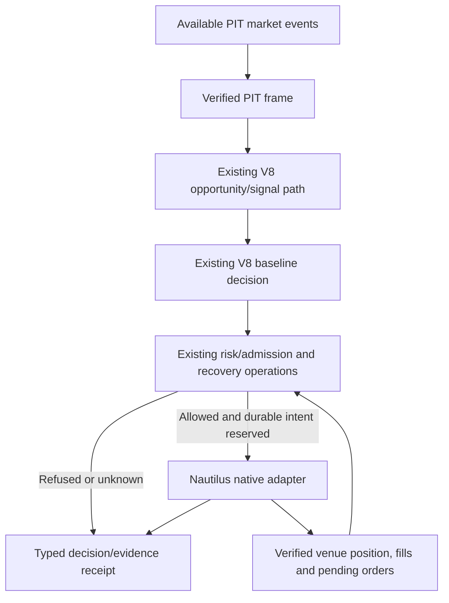
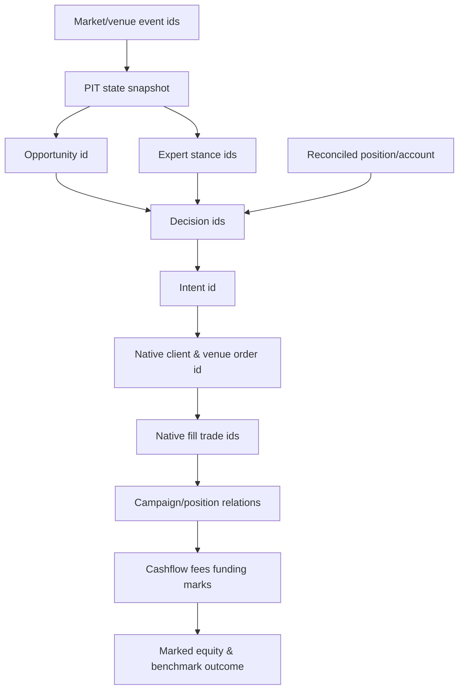
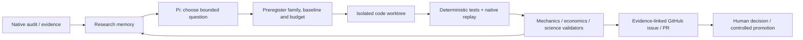

# V9 — Market-Aware Adaptive Trading Intelligence

## Bilimsel mimari monografı · V9.1 tasarım revizyonu · V8-next evrim sözleşmesi

**Sürüm:** `V9-ARCH-RFC-1.3` · **Tasarım dalı:** `V9.1` (monografın devam eden revizyonu, yeni ürün sürümü veya çalışan bot değil)  
**Revizyon tarihi:** 3 Kasım 2026  
**Dil:** Türkçe; kod, araştırma başlıkları ve teknik sözleşmeler İngilizce kimliklerini korur.  
**Uygulama sınırı:** `ddawnlll/v8` → `v8-next/` (Python 3.12, NautilusTrader 2.0.0rc4; bu sürüm depoda pinlenmiştir).  
**Belge türü:** bilimsel mimari monografı + hakem revizyonu + normatif aday sözleşmeler; kod, ekonomik sertifika veya otomatik uygulama izni değildir.  
**Normatif durum:** **DESIGN REVISION / OWNER APPROVAL PENDING / P0 SYMBOL-BINDING UNVERIFIED / NO ECONOMIC CLAIM**. V8 Anayasası'nı veya geçmiş immutable kanıtları tek başına değiştirmez.  
**Kısa hüküm:** *V9.1'in ilk **önerilen** uygulanabilir dilimi, gerçek V8 fonksiyonlarıyla henüz bağlanmamış bir `DecisionPolicyV0` **parite sözleşmesidir**. Ne çalışan yeni trader ne de doğrulanmış mekanik kabul söz konusudur. Bağlama duyarlı trader, gerekli P0 kanıtları tamamlanırsa tek müdahaleli challengerlarda sınanacak **uzun vadeli araştırma hedefidir**. Bu taslak hiçbir uyarlamalı emir veya canlı yetki tanımaz.*

> **Bilimsel dürüstlük bildirimi.** Bu çalışma, aynı belgeyi okuyan üç ilişkili Model Council görüşü ve revizyon sentezi ile kullanıcının ilettiği özgün V8 monografı, iki 2026 Deep Research raporu, araştırma handoff ZIP'i, D4 native raporu ve önceki bağımsız ham audit raporunu, erişilebilen GitHub kodunu ve doğrulanmış birincil akademik kaynakları sentezler. Bu belgede yeni bir backtest, sealed OOS sınaması, bağımsız çalıştırılmış V9 prototipi veya canlı işlem sonucu **üretilmemiştir**. Mevcut deneyler yalnız tanımlı BTCUSDT 1H geliştirme bandı ve test koşullarını temsil eder. Kanıt-iddia kapsamı kaynaklara sıkıca bağlı tutulur.

---

# Özet / Abstract

**Araştırma problemi.** Finansal piyasa koşulları durağan değildir; fırsat gözlemi, işlem seçimi, giriş fiyatı, sermaye işgali, pozisyonun sonraki yönetimi ve emir gerçekleşmesi birbirleriyle etkileşir. Bir sistemin çok sayıda uzman modülü veya ayrıntılı audit üretmesi, gözlemlediği değişikliklere doğru ekonomik tepki verdiğini göstermez. V8-next'in native keşif deneyleri, mevcut konsensüsün seçimde etkisiz kaldığı bir örneği; gecikmeli doğrulamanın ekonomik zararını; dinamik stop yönetiminin belirsiz fakat araştırmaya değer sonuçlarını; gerçek kalıcı fırsat durumunun tek başına ekonomik avantaj sağlamadığını ortaya koymuştur. Temel soru, **V8'in hangi yeteneklerinin daha tutarlı bir karar döngüsüne dönüşmesi gerektiği** ve bunun nasıl yanlışlanacağıdır.

**Yöntem.** Tarihsel mimari belgeleri kodla eşleştirildi; A/B/C/D4 yerel deneylerinin iddia sınırları ayrıştırıldı; piyasa rejimleri, çevrimiçi değişim tespiti, seçici tahmin, maliyetli yürütme, çoklu test ve otonom araştırma literatürü tarandı; tasarım sözleşmeleri, durum makineleri, güvenlik sınırları, test matrisi ve geçiş planı oluşturuldu. Kaynaklar *birincil akademik yayın / repoda gözlenmiş / yerel rapor / tasarım çıkarımı / açık soru* olarak etiketlendi.

**Öneri.** Tek ürün çekirdeği korunur; **önerilen, henüz fixture ile kanıtlanmamış V0 yolu**: PIT market observations → canonical opportunities / mevcut V8 karar algoritması → mevcut risk kabulü → native NautilusTrader → olay/karar receipt’i ve bağımsız doğruluk denetimi. **Hedef V1/V2 yolu**: ölçülmüş MarketBelief → tek sınırlı challenger → doğrulanmış native risk ve yürütme. Expert routing, dinamik position ve portfolio rotation ilk dilimde emir üretemez. **Otonom Kaizen** bu uygulama diliminin dışındadır; ileride ayrı bir araştırma operasyonu olarak ele alınabilir. Hiçbir LLM canlı trading risk kapısını atlayamaz.

**Sonuç statüsü.** Bu, *ekonomik edge'in kanıtı* değil, **test edilebilir hedef mimari ve daraltılmış uygulanabilir davranış sözleşmesidir**. Kabul, yalnız kontrol edilen davranışların ve ilgili ekonomik sonuçların yeni, geçerli deneylerle doğrulanmasına bağlıdır.

**Anahtar terimler:** PIT feature view, market-belief research hypothesis, non-stationarity, point-in-time, behavioral experts, opportunity sovereignty, selective decisions, native execution, endogenous occupancy, post-entry management, economic attribution, falsification, autonomous Kaizen, audit lineage.

---

# Hakem sonrası editoryal karar ve revizyon kapsamı

Üç modelin **aynı monografı** okuyarak yaptığı, ortak öncülleri nedeniyle korelasyonlu sayılabilecek incelemeler aynı üst hükmü verdi: `PROMISING BUT REQUIRES REVISION` [C1–C3]. Bu raporlar **tasarım eleştirisi kayıtlarıdır**; kod doğrulaması, istatistiksel tekrar veya bağımsız bilimsel kanıt değildir. Bulgular içinde belgenin kendi üzerinde gösterilebilen kusurlar ile bugünkü `v8-next/` kodunda gerçekten sürüp sürmediği bilinmeyen tarihsel audit sorunları ayrılmıştır. Kararların ayrıntılı izi [C4] sentezinde korunur.

**v1.1 revizyon tarihçesinde kabul edilen on temel düzeltme (v1.2 öncesi):** (1) sembolik ekonomik `argmax` üretim algoritması olmaktan çıkarıldı; (2) tek kanonik karar/niyet/venue olayı/neden sözlüğü ve izin matrisi tanımlandı; (3) baseline-equivalent `DecisionPolicyV0` algoritması yazıldı; (4) opportunity, intent, order ve position durumları ortogonal ayrıldı; (5) partial fill, cancel/replace, unknown venue ve restart için güvenlik kuralları kondu; (6) `MarketBelief` ölçülebilir, test edilmemiş bir view olarak sınırlandı; (7) yalnızca tarihsel artefakta ilişkin audit kusurları canlı implementasyon kusuru gibi gösterilmedi; (8) funding, fill ve mark otoritesi matrisi eklendi; (9) ilk deneyde aynı takvim equity, deneme ailesi ve karar değiştiren tek müdahale şart koşuldu; (10) Pi Kaizen çekirdeğin yanında, yetkisiz bir eklenti olarak korundu.

**Hakemlerden kısmen ayrıldığımız nokta:** İlk implementasyonda çalıştırılmayacak diye `Market Intelligence`, `Dynamic Position` ve `Portfolio` sorumluluklarını V9'un nihai vizyonundan çıkarmıyoruz. `TARGET_DESIGNED`, `INSTRUMENTED`, `MECHANICALLY_VALIDATED`, `ECONOMICALLY_EVALUATED`, `PROMOTABLE` durumlarını birbirine karıştırmadan ilerliyoruz. Başarısız deney mimari hipotezi reddedebilir; bir sınıfın varlığı ekonomik faydayı kanıtlamaz.

## V9.1 (RFC-1.2) revizyon notu — aynı monograf, yeni sözleşme katmanı

Bu sürüm v1.1’in I–XXVI bölümlerini, A/B/C/D4 deney özetlerini, tarihsel denetim şüphelerini, bilimsel literatürünü ve kaynakçayı **koruyarak** ilgili normatif paragrafları revize eder. Ayrı bir küçük RFC, yeni motor veya V8 geçmişinin yeniden yazımı değildir. Yerel `V9_1_ARCHITECTURE_DESIGN_RFC.md` tasarım notları bu monografın ilgili bölümlerine **soğurulmuştur**; paralel bir normatif kaynak doğurulmaz.

**Hakem düzeltme kayıtları:** (R1) V0 paritesi ve V1/V2 adaptif yetki ayrıldı; (R2) ikinci safety politikası yasaklandı; (R3) güncel HEAD native lineage testine zorunlu kapı kondu; (R4) council kanıt sayılmıyor; (R5) belief/position/allocator aktivasyonu açılıp kapanan açık feature gate’e bağlandı; (R6) expert V0 karar girdisinden çıkarıldı; (R7) client order ID’nin tek kalıcı doğum işlemi normatif kılındı; (R8) optimizasyon modeli ve ex-post regret karar yetkisinden çıkarıldı; (R9) pinned Nautilus rc4 callback/NETTING fixture zorunlu; (R10) Kaizen accepted-task/hour terfi veya reversal ölçütünden çıkarıldı.

**Çelişki çözüm kuralı:** Bu sürümde aşama izin tablosu (`§7.9`), **Safety Binding Contract** (`§7.3`), **durable order outbox** (`§8.7`) ve **P0 kanıt kilidi** (`§12.9`) önceki hedef mimari tasvirlerinin üstündedir. Bir diyagramda ilerideki modül gösterilmesi, V0 emir yetkisi vermez.

**Versiyon semantiği:** `V9.1` tasarım iterasyonunun adı; `RFC-1.2` belgenin revizyonudur. Birbirlerinin yerine kullanılamaz. GitHub `main` ve yerel entegrasyonun 3 Kasım 2026 kullanıcı operasyon raporu `f07d9e21…` temelini bildirir; **bu monograf çalıştırılabilir test veya doğrulanmış güncel native olay çıktısı üretmez**. Gerçek envanter uygulama başlamadan SHA ile yeniden sabitlenmelidir.

## V9.1 monograf revizyonu — RFC-1.3 ve hakem cevapları

İki ek adversarial değerlendirmenin ortak sonucu `PROMISING BUT REQUIRES REVISION`dır. **Bu görüşler çalıştırılmış test değildir.** Değerlendirmeler üç uyuşmazlığı belirginleştirir: (i) henüz gerçek fonksiyonlara bağlanmamış V0 parite fikrini çalışan sistem sanmak, (ii) eski ZIP audit riskini veya #491 residual'ını GitHub issue kapanışı ile çözülmüş saymak, (iii) piyasa zekâsı hedefini fiilî karar yolu gibi çizmek. Bu sürüm yeni özellik eklemek yerine ilk uygulama diliminin fiziksel sınırını daraltır.

**Bağlayıcı revizyonlar:** V0 akışında belief/expert/router okları yok (§7.2); yeni Safety Reconciler aktörü yok (§8.3); Kaizen hız eşikleri kabul ölçütü değil (§17); gün bazlı takvim tamamen kaldırıldı (§XXI); gerçek sembol/API adresi ve durum sahipliği P0-A çıktısı (§7.3.2, §8.2.1, §12.9); mark ve equity residual ayrık fiziki gate (§3.3.1, §12.1.2); outbox ayrı bir DB zorunluluğu değil, mevcut transaction'ın kanıtlanması (§8.7); M1'de önce `PITFeatureView` / basit eşik kıyası (§4.3, §4.7); 20 USDT feasibility yalnız native filtre ve risk testleriyle (§11.5.1).

**Hakemlerin önerilerinden ayrıldığımız noktalar:** 123/123 consensus sonucu, *o development penceresinde seçim katkısının sıfır olduğunu* kanıtlar; tüm expert kodunun değersizliğini ve silinmesi gerektiğini kanıtlamaz. D4 gecikmesinin olumsuzluğu OpportunityBook kimliğiyle zorunlu bekleme politikasını özdeşleştirmez. Pi'nin araştırma projesi olarak mevcut olması canlı trading yetkisi gerektirmez. Dolayısıyla bu modüller **V0 uygulamasında yok veya unreachable** olur; tarihsel kanıt ve deney araçları silinmez. Yeni bir modülü meşrulaştırmak için yalnız daha hoş adlandırma değil, davranışsal bilgi katkısı gerekir.

**Bu monografın bu turda ürettiği kanıt:** Kaynak metinleri ve kullanıcı tarafından iletilmiş raporlar üzerindeki editoryal analiz; **yeni native run, benchmark, HEAD doğrulaması veya store transaction testi yoktur**. Bu tür kanıtları gerektiren kabul hücreleri `UNVERIFIED / BLOCKED` olarak kalır.

## Belge onayının beş ayrı düzeyi

| Düzey | Ne gerektirir? | Ne **sağlamaz**? |
|---|---|---|
| `ARCHITECTURE_ACCEPTED` | Owner tarafından karara bağlanmış hedef sorumluluklar | Çalışan kod |
| `MECHANICS_VERIFIED` | Pinned commit, deterministik fixture, native olay sınırı | Market edge |
| `EVIDENCE_QUALIFIED` | Geçerli veri, execution ve muhasebe kapsamı | OOS üstünlüğü |
| `ECONOMICALLY_SUPPORTED` | Tanımlı aile/ölçütle yeterli bağımsız karşılaştırma | Üretim yetkisi |
| `PRODUCTION_AUTHORIZED` | Ayrı güvenlik, operatör ve venue kabulü | Gelecek kâr garantisi |

Bu beş boyut tek `PASS` veya sayısal score içine sıkıştırılamaz. V9.1, **ilk iki düzey için henüz uygulanmamış kabul taslaklarını** sunar; hiçbir mekanik doğrulama düzeyine ulaşıldığını **iddia etmez**. Repo temizliği, 1.043 hızlı testin geçmesi veya sıfır açık GitHub issue, V9 runtime paritesi ya da ekonomik onay değildir.

---

# I. Araştırma soruları, kapsam ve kanıt hiyerarşisi

## 1.1 Birincil araştırma sorusu

> Gözlemleyip anlık emir açan bir sistem, piyasadaki değişimleri izleyen, kendi aktif görüşünü yeniden değerlendiren, fırsat ve pozisyonlarını devam eden bir ekonomik karar problemi olarak ele alan **adaptif trader** sistemine nasıl evrilir; bu gelişmenin gerçek değer kattığı nasıl ölçülür?

Bu sorunun yedi alt parçası vardır: (Q1) piyasayı doğru zaman sınırlarıyla nasıl temsil ederiz; (Q2) davranış temelli expert'ların marjinal değeri nedir; (Q3) fırsatın kimliği ve takibi emirden nasıl ayrılır; (Q4) karar bekleme/giriş/tutma/düzenleme/çıkışı nasıl ele alır; (Q5) portföy işgali karşı-olgusal seçimi nasıl etkiler; (Q6) sonuç nasıl güvenilir ölçülür; (Q7) Pi Agent bu sistemi yetkisiz kontrol etmeden nasıl geliştirir?

## 1.2 Kapsam dışı iddialar

Bu makale V9'un kârlı olduğunu; 28 expert'ın tahmin gücünün kanıtlandığını; rejim sınıflandırmasının getiriyi artırdığını; sürekli LLM kararının yararlı olduğunu; veri rejimlerinin sabit olduğunu; BTC sonuçlarının altcoin perpetual evrenine taşınabildiğini; funding, gerçek L1/L2 fill veya likidasyonların doğrulandığını **iddia etmez**. Ayrıca bir V9 canlı işletim sertifikası veya bağımsız hakemli yayın değildir.

## 1.3 Kanıt etiketleri

| Etiket | İçerik | İzin verilen yorum |
|---|---|---|
| `PRIMARY_LITERATURE` | DOI/arXiv üzerinden doğrulanmış dış çalışma | Yalnız çalışmanın popülasyonu, yöntemi ve varsayımları |
| `REPO_OBSERVED` | GitHub'da okunan gerçek kaynak/konfigürasyon | Kodun mevcut olması; bütün sistemin çalıştığını kanıtlamaz |
| `PROJECT_REPORTED` | Ham artifact, yerel run veya kullanıcı raporu | Raporlanan döneme ve profile özgü sonuç |
| `PROJECT_AUDITED_LIMITED` | Bağımsız ZIP üzerinde yeniden hesaplanan kontrol | Yalnız mevcut artifact ve bağlam kapsamı |
| `DESIGN_INFERENCE` | Bu monograftaki mühendislik önerisi | Ekonomik üstünlük iddiası yok |
| `OPEN / BLOCKED` | Yanıtlanmamış, ölçülemeyen veya geçersiz alan | Uygun koşul olmadan kullanılamaz |

## 1.4 Araştırma kaynakları

Yerel `index(3).html` V8 tarihsel tam monografı; Deep Research I (Kasım 2026, 92 KB metin) ve Deep Research II (Kasım 2026, 69 KB Markdown), `V8_NEXT_V9_RESEARCH_COMPLETE_HANDOFF.zip` (616 üyeli paket, orijinal run ve kanıtlar), `D4_ANSWER_TR.md`, `audit-20261030T223550Z-6ffc87e.zip` ve `v8_next_independent_raw_audit_review.md` bu araştırmanın birincil **proje** kaynaklarıdır. Belgelerdeki sayılar kaynaklarının zaman ve statülerine bağlıdır. GitHub varsayılan dalı, yerel olarak henüz push edilmemiş D4 araştırma modüllerini göstermeyebilir.

---

# II. V8'in özgün düşüncesi ve mimari hastalığı

## 2.1 Özgün tez: Expert bir trader değildir

V8 araştırma monografındaki temel ifade şu anlamı taşır: **MarketState, OpportunityEpisode, ExpertEvidence, ExecutionCampaign ve Order/Fill aynı ekonomik nesne değildir.** Market doğrudan gözlemlenebilir, PIT-zamanlı fırsat olayı yaratır; expert bu olayı gözlemler, destekleyebilir, çürütebilir veya çekimser kalabilir. Fırsatın kimliği expert sayısıyla çoğalmaz. Emre giriş, ayrı risk/utility kararıdır. Orijinal `V8_CONSTITUTION` bu ayrımları, duplicate observer invariance'ı, ilk-sınıf abstention'ı, immutable evidence ve locked OOS kontrolünü açıkça tanımlar [P1].

Bu miras **korunmalıdır**. V9'a taşınmaması gereken şey geçmişteki ağır komite/governance yüzeylerinin tümünü kopyalama zorunluluğudur. Her yeni karar için 5-agent kurul, farklı authority root, ikinci claim registry veya yeni engine yapmak, bu çalışmanın ölçülebilir amacına ters düşer. Eski anayasal hükümler korunup normatif geçiş gereken maddeler ayrıca sahibi tarafından onaylanmalıdır; bu tasarım belgesi geriye dönük yürürlük vermez.

## 2.2 Mimari boşluk: Bilmek → seçmek → yürütmek → yeniden değerlendirmek

V8-next'te `world/`, `experts/`, `opportunities/`, `risk/`, `economics/`, `adapters/`, `audit/`, `evaluation/`, `oracle/` ve `system_proving/` mevcut modüllerdir [R1]. Dolayısıyla piyasa durumu, fırsat, expert ve audit **eksik kavramlar değildir**. Açık boşluk, bu parçaların değişen piyasa koşullarında birbiriyle tutarlı **sürekli karar kontratı** üretip üretmediğidir.

V9’un **hedeflenen**, V0’da henüz gerçekleştirilmeyen mimari sıçraması daha çok sınıf, daha çok ajan veya daha çok kural değil: *taze market bilgisi → önceki görüşü güncelle → işlem niyetini seç → risk/kapasite kontrolü → native gerçekleşme → gerekçe geçerliliğini yeniden değerlendir*. Pozisyon açıkken yeniden değerlendirme bu sürümün **araştırma hedefidir**; V0 için yalnız mevcut native stop/target ve gözlem yetkilidir. Gelecekteki bir policy bu davranışı ayrı deney ve native güvenlik gate olmadan değiştiremez.

## 2.3 Laboratuvardan ürün döngüsüne

V8 ekonomi ve kanıt altyapısı güçlü, fakat bugüne kadar tek bir `volume_confirmed_breakout` araştırma kampanyası gibi dar koşullarda testler öne çıktı. V9, yeni evrenlere / altcoin perps'e geçişi **ayrı veri ve likidite uygunluk aşaması** olarak tanımlar. Araştırma maliyetini azaltmak için önce hızlı sinyal/karar taraması, sonra yalnız final adaylarda native NautilusTrader replay'i kullanır. Hızlandırma hiçbir zaman replay semantiğini, stop sırasını veya maliyet modelini sessizce değiştiremez.

---

# III. Bugüne kadar ne ölçüldü? Empirik dayanak

## 3.1 Baseline: tanımı ve kapsamı

Raporlanan deney evreni: BTCUSDT Binance USDT-M perpetual, 1H, 2.160 bar, 2025-01-01–2025-04-01; tek 90 günlük **development** pencere; 10.000 USDT simülasyon sermayesi; maker 0.0002/taker 0.0005; %2 koruyucu stop/%4 hedef. 123 fırsat kaydedildi, baseline 45 kampanya açtı ve 44'ünü kapattı. Kapalı işlemlerde net −8,67470686 USDT ve ≈−0,02208R/işlem raporlandı; native komisyon toplamı ≈36,766 USDT; funding uygulanmadı. Bu 10.000 USDT gerçek portföy önerisi, 20 USDT'lik canlı hesap fizibilitesi veya sonradan oluşan veri değildir [P2, P3].

### A/B/C/D4 ayrıştırma özeti

| Araştırma sorusu | Gerçek gözlem | Geçerli çıkarım | İzin verilmeyen çıkarım |
|---|---|---|---|
| **A Expert seçiciliği** | Grammar-only A1 baseline defteriyle aynı; 123 fırsatın tamamı consensus desteği alıyor | Mevcut gate bu bandda ek seçim yaratmadı | Uzmanlık genelde faydasız |
| **B Entry** | Native B4 ~20 işlem, −0,14537 net R/işlem; bazı model gecikme kolları negatif | Basit onay/erteleme maliyet yaratabiliyor | Bütün giriş teyitleri kötü |
| **B3 realistic profile** | 11 giriş, G8 reconciliation bozuk, koruma eksiği | **INVALID**; ekonomik tabloya katılmaz | Bu rakamlar gerçek slippage'ı ölçüyor |
| **C4 +1R stop→BE** | 21 native protective-stop update; ~+0,14173 net R/işlem; eşleşmiş +0,1008R, GA [−0,0426,+0,2442] | İşlem yönetimi mekanik olarak değişti; sonuç **INCONCLUSIVE** | Kanıtlanmış breakeven edge |
| **D4 kalıcı retest/reclaim** | 123 watching, 65 armed, 25 girilen kampanya; net −0,04524R (defter), −0,08500R native-bracket; PnL −36,12 USDT | Gerçek kalıcılık var, fakat bu kural V8'i geçmedi | Bütün lifecycle politikaları gereksiz |

D4 ile V8 arasında ortak 12 opportunity için raporlanan D4−V8 farkı −0,91391R, %95 GA [−1,62986,−0,26449]; fakat aynı 123 fırsat üzerinden tüm-birim farkı −0,00130R, %95 GA [−0,17133,+0,16040]. Farklı karşılaştırma birimleri farklı sorular sorar; küçük ortak örnekleme dayanarak genel “zararlı” hükmü verilemez [P4].

## 3.2 D4'ün esas mekanizması: Seçim ile gerçekleşme ayrı

D4, V8'in açtığı 45 kampanyanın yalnız 12'sine girdi, 33'ünü kaçırdı; baseline'ın girmediği 13 fırsata girdi. Rapora göre ortak 12 fırsatta girişler ortalama 3,8 bar gecikti ve giriş fiyatı ortalama 0,68931R kötüleşti. 65 ARMED fırsatın 38'i `POSITION_OCCUPIED`, ikisi kapasite/sıra dolayısıyla iptal edildi [P4]. Bu, “daha iyi fırsat alt kümesi seçmek” ile “daha iyi portföy sonucu üretmek” arasındaki uçurumu somutlaştırır. Ancak D4'ün aynı kapanış MARKET ve bar-only semantiği gerçek piyasaya hazır değildir; funding eksiktir.

## 3.3 Audit doğruluğu: önemli bağımsız itirazlar

2026-10-30 ZIP'i üzerinden yapılan bağımsız inceleme, 89 native fill, 45 entry, 29 stop, 15 target ile ücret toplamlarının genel düzeyde uzlaştığını; ancak bazı audit artifact'lerinde **89/89 cashflow kaydının son kampanyaya etiketlenmesi**, 45 entry event'inde kampanya referanslarının yanlış/eksik olması, lifecycle opportunity/decision join bozukluğu, giriş mumundan sonraya görünmeyen high/low yolunun yanlış kullanılması ve `G7 PASS` ile eksik protection ID join'leri arasında çelişki bildirdi [P5]. Bu inceleme orijinal tape ve runtime olmadan ZIP düzeyinde yapıldığı için sorunların güncel koda hâlâ uygulanıp uygulanmadığı **yeniden doğrulanmalıdır**; otomatik olarak çözülmüş sayılmaz.

Bu düzeyde bir bağ kopukluğu `AUDIT_COMPLETE` etiketiyle örtülemez. V9'un **P0 başlangıç koşulu**, ilgili iddialar için `opportunity → decision → order → fill → campaign → cashflow` lineage bütünlüğünü native event seviyesinde kanıtlamak ve MFE/MAE'nin entry-time sınırlarını düzeltmek veya ölçümü geçici olarak `NOT_IDENTIFIABLE` ilan etmektir.

### 3.3.1 V8 kapanışı sonrası kanıt statüsü (3 Kasım 2026)

Kullanıcının V8 cleanup raporuna göre 6 PR birleştirilip GitHub `main=f07d9e21d48dc61a6eb79e0dde98b61b02058eef` noktasına gelmiş; 7 yerel evidence/accounting düzeltmesi taşınmış; 29 issue kapatılıp 22 çözülmemiş yükümlülük `docs/V9_BACKLOG.md` içine kaydedilmiş ve hızlı test koşusu `1043 passed / 41 skipped / 506 deselected` olarak raporlanmıştır. Bu **raporlanmış depo bakım sonucu**, V9 çalışma kanıtı değildir. 3 tarihsel slow-test hatasının sürdüğü de bildirilmektedir.

Özellikle `#491` kısmen düzelmiştir: entry→exit işaretleme yoluna müdahale edilmesine rağmen, dört bacaklı gerçek veri raporunda `portfolio_P ≈ 5,8050 USDT` ve `portfolio_PE ≈ 22,5040 USDT` açıklanamayan residual kalmaktadır (`V9_BACKLOG` B19). `#476` producer→consumer wiring R1 de tamamlanmamıştır (B18). Geri kalan P0 dış kanıtlar `EXT-VENUE/FUNDING/TAPE/PARITY` vb. bağımlılıklara bağlıdır. Bu rapor hiçbirini **fix edilmiş** saymaz; `CURRENT_HEAD_RECHECK_REQUIRED` kayıtla uygulama P0 kapısına taşır.

**Güncel lineage protokolü:** test edilen SHA, engine pin, tape hash, fixture ve event sequence kimlikleri kaydedilmeden “orphan 0” iddiası kurulmaz. Orphan=0 bulunması da yanlış ama dolu join’i elemez. Native bağımsız oracle hem orphan/duplicate sayısını hem **doğru campaign/decision/order/fill→cashflow eşleşmesini** ve tamlık/payda kapsamını ölçmelidir.

### 3.3.2 Kritik ekonomik residual — kaynaklara ayrılmış ayrı gate

V8 kapanışının raporladığı `portfolio_P = 5,8050 USDT`, `portfolio_PE = 22,5040 USDT` değerleri açıklanmamış **residual** büyüklükleridir; yeni sürümde yeniden hesaplanmış sayılar değildir. #491'in exit-leg muhasebe düzeltmesi bu iki farkı açıklamamıştır. `equity_mtm` terminali ile `balance_total` arasındaki tutarsızlığın bir kısmını tüm barlara eşit dağıtan *graft*, doğru zamanlı PnL ölçümü sayılmaz. Çıkış fiyatı, nakit bakiye, realised PnL, unrealised PnL, fees, settled funding ve mark zamanları **ayrı** defter satırlarına ayrılıp bağımsız oracle ile doğrulanmalıdır. Eksik funding veya mark `0` olarak impute edilemez.

**Ayrı statüler:** `LINEAGE_VERDICT` join doğruluğu; `EQUITY_VERDICT` gerçek mark ve aritmetik eşitlik; `FUNDING_VERDICT` settlement coverage ve işaret; `NATIVE_PROTECTION_VERDICT` emir/pozisyon kimliği. Birinin yeşil olması diğerini kurtarmaz. `EQUITY_VERDICT != PASS` iken Sharpe, drawdown, tail mean ve takvim hizalı net equity gibi metrikler **otorite/verdict üretemez**; yanlış veri üzerinde hesaplanmış tanı amaçlı değer açık etiketle saklanabilir. Canonical 12-ay tape eksikse gerçek çalışma üzerindeki ilgili iddia `EXT-TAPE/BLOCKED` kalır; küçük sentetik oracle mekanik yanlışın yakalanmasını sağlar ama ekonomik tamlık kanıtlamaz.

## 3.4 Mevcut açık ekonomik sınırlamalar

Funding akışı ve mark atfı; aynı-bar intrabar sıra; spread/quote/order-book/queue eksikliği; per-fill identity ve partial fill; native bracket/position ID callback order; altcoin likiditesi, minimum notional ve quantization; tek 90 günlük rejim; sealed OOS kullanımı. Bunlar farklı şiddette engellerdir. Birinin giderilmesi tümünü gidermez. Ayrıca geçmiş V8 next handoff ZIP'i D3'ün B4 replikasyonu olduğunu belirtir; D4 ise **daha sonra yapılmış ayrı çalışma** olup kendi 14/14 raporlanan doğrulamasına rağmen ekonomik üstünlük kanıtlamaz [P3, P4].

---

# IV. Bilimsel temel: piyasayı 'anlamak' ne anlama gelir?

## 4.1 Metafizik değil, güncellenebilir epistemik durum

Bir algoritmanın piyasayı 'anlaması', piyasanın geleceğini bildiği anlamına gelmez. Ölçülebilir tanım: **mevcut bilgiye dayalı sürümlenmiş piyasa görüşü** oluşturmak; bu görüşün geçerlilik alanını, belirsizliğini ve zaman sınırını belirtmek; yeni bilgi geldiğinde önceki kararın hâlâ uygun olup olmadığını sınamak. Bu, gözlemden aksi yöne ısrar etmek yerine `ABSTAIN`, `WAIT`, `REASSESS` gibi eylemleri birinci sınıf yapar. Seçici sınıflandırmanın risk–coverage değiş tokuşu bu tasarımın genel istatistiksel analojisidir; bilgisayarlı görü çalışmalarındaki risk garantileri finansal getiriye doğrudan aktarılamaz [L04, L05].

## 4.2 Zamanın dört ayrı anlamı

Her market/derived event için en az `event_time`, `exchange_publication_time` (varsa), `local_receipt_time`, `decision_time` ayrı tutulmalı. Eski candle'ın `bar_end` zamanı, geçmişte gerçek bilgiye erişildiğini kanıtlamaz. PIT bilgi kümesi

\[
\mathcal F_t = \sigma\{x_i: \operatorname{available\_at}(x_i)\leq t\}
\]

olmak üzere, belirli politika sürümü için `Action_t = π(F_t, Portfolio_t, PolicyVersion)` verisi ile tekrar üretilebilir olmalıdır. Retroaktif `funding`, `OI` veya dış veri eklemek, mevcut hipoteze yeni veri bilgisi kazandırıyorsa yeni dataset/version ve ayrı deney kimliği gerektirir.

## 4.3 MarketBelief: sınırlı ve yanlışlanabilir temsil

**İlk implementasyon varsayımı:** `MarketBeliefV0` yeni bir ontoloji, kalibre edilmemiş rejim olasılık motoru veya bağımsız karar otoritesi değildir; mevcut PIT `MarketState` üzerinden üretilen sürümlü bir **immutable view**dır. Hiçbir yeni belief değişkeni, varsayılan V8 giriş/çıkış davranışını kendiliğinden değiştiremez. Representation, prediction ve decision-utility ayrı araştırma hedefleridir.

```text
MarketBeliefV0  # PROPOSED; no implication of existing class
  instrument_id: String
  decision_cut_ns: Int
  source_event_ids: List[EventId]
  input_available_max_ns: Int
  market_state_ref: StateRef
  data_quality: VALID | STALE | INCOMPLETE | UNKNOWN
  volatility_context: Optional[VersionedObservation]
  structure_context: Optional[VersionedObservation]
  regime_labels: List[VersionedScore]  # NOT calibrated probabilities
  invalidation_events: List[EventId]
  measurement_version: ContentHash
  confidence_semantics: NONE | VALIDATED_MEASURE_ID
```

`trend`, `range`, `shock`, `transition` birbirini dışlamak zorunda olmayan **özelliklerdir**. Basitçe birim-toplamlı dağılım adı vermek matematiksel hata olur: kalibre edilmiş ve açıkça birbirini dışlayan olaylar olmadan `regime_distribution` alanı **yoktur**. Şok sırasında trend de olabilir. `confidence=0.91` gibi çıplak sayı yasaktır; confidence ancak neye ilişkin olduğu, referans olayı, penceresi ve validasyon verisiyle yorumlanır. Mevcut bar OHLCV'den çıkarılmış likidite proxy'si L1/L2 emir defteri olarak adlandırılamaz.

**Birincil kullanım iki farklı yetki ailesidir:** `DATA_QUALITY_REFUSAL` bayat/eksik PIT veri nedeniyle **mevcut risk güvenliği** kapsamındaki ret; ekonomik adaptasyon başarısı **değildir**. `V9-M1_ENTRY_VETO` ise ön-kayıtlı, varsayılan kapalı **tek** volatilite/rejim koşulu altında *baseline’ın açacağı yeni girişi* veto eden ve yeni giriş üretemeyen challenger’dır. `HOLD/EXIT`, stop veya sermaye miktarı M1 ile değişmez. Aynı deneyde `baseline V8` / `raw-feature threshold` / `belief-view condition` karşılaştırılır. Yeni temsil her iki basit karşılaştırıcıyı geçemiyorsa **diagnostic-only** kalır.

**İkinci aşama:** İşe yarayan tek değişken kanıtlanırsa zaman içi stabilite, değişim algılama, multi-horizon etkileşim, kalibrasyon ve conditional outcome distribution ayrı family olarak araştırılır. Adams–MacKay [L01] yalnız aday change-point yöntemi; yararlı trading kararı kanıtı değildir.

**Adlandırma ve kanıt eşiği (RFC-1.3):** V0 için `MarketBelief` diye ayrı bir çalışma zamanı sınıfı **yazılmaz**. Mevcut `MarketState` üzerinde PIT doğruluğu kanıtlanmış özellikleri isimlendirmek gerekiyorsa araştırma/diagnostic yüzeyi `PITFeatureView` olarak tanımlanır. `trend/range/shock/transition` etiketleri kalibre edilmiş posterior değildir. Gizli durum modeli/`MarketBelief` adı ancak model varsayımları, kalibrasyon, drift, basit threshold karşılaştırması ve karar değiştirme değeri ayrı deneyle gösterildikten sonra kazanılır. BOCPD/HMM birincil seçenek değil, ayrı ve yanlışlanabilir model ailesidir; salt yöntem literatüründen edge çıkmaz.

## 4.4 Multi-horizon ve market state çevrimi

15m fırsat barı, 1h bağlam ve 4h durum gözlemi gibi saat ölçekleri kullanıcı hedefleriyle uyumludur; ilk doğrulama için mevcut 1H BTC enstrümanının dışına geçmek gerekmez. Çoklu ölçeklerde tamamlanmamış üst periyot mumlarını kullanmak `PIT` ihlalidir. `MarketBelief` güncellemesi, **relevant market event** veya karara etki eden risk/pozisyon değişikliği olduğunda; zorunlu her tick'te bütün expert'ları hesaplayarak değil, dependency invalidation ile uygulanmalıdır.

## 4.5 Değişim tespiti ve hata payı

Rejim tahminleri hatalı olabilir. False transition ile yanlış expert yönlendirmeyi önlemek için (i) `UNKNOWN` ve abstention; (ii) transition hysteresis/tutarlılık; (iii) minimum event/time validity; (iv) regime classifier karşılaştırması; (v) sınırlı drift/coverage monitor önerilir. Eşikler önceden sürümlenip test edilir; bu makale rakamsal optimum belirtmez.

## 4.6 Market understanding nasıl yanlışlanır?

Üç iddia testte ayrılmalıdır: `PIT_VALIDITY` (bilgi gerçekten karar anında var mı?), `REPRESENTATION_UTILITY` (etiket, aynı bilgiyle kurulan basit durumdan farklı test edilebilir koşullu davranış tanımlıyor mu?) ve `DECISION_UTILITY` (bu fark risk/pozisyon/execution sabitken ekonomik sonucu değiştiriyor mu?). Bir market belief'ın daha çok alanı olması hiçbiri için kanıt değildir.

Ön kayıtlı ilk koşullu hedef örneği: `future 1H absolute return > a × trailing ATR` gibi **gözlemlenecek olayın**, veri ufkunun ve eşiklerinin en baştan dondurulması; belirsizlik tahmini kalibre edilemiyorsa olasılık iddiası yok. Bilginin *eyleme etkisi* ayrıca `changed_action_count`, `avoidance_cost`, `calendar_aligned_net_equity_delta` ile ölçülür. Sadece tahmin skorundaki fark, trading aktivasyon izni vermez.

`M1` karşılaştırması dört karar verebilir: (i) hiçbir karar değişmez → temsil ekonomik karar girdisi olamaz; (ii) karar değişir ama ledger yetersiz → `INCONCLUSIVE`; (iii) ekonomi kötüleşir → `NO_EDGE` veya `REJECTED` (önkayıt kriterine göre); (iv) bağımsız geçerli sınama yeterli fayda verir → sınırlı politika promotion incelemesi. Farklı dönemlerde gözlenen farklı sonuçlar gizlenmez.

---

### 4.7 V0 → V1 davranış geçidi

`MarketBeliefV0` veya `PITFeatureView` V0 karar yoluna **argüman olarak bile geçirilemez**. Salt immutable diagnostic/view ve shadow karar kaydı üretir. V1 economic-entry veto aktifleştirme sırayla `P0-B AUDIT_VERIFIED`, `P0-C V0_PARITY_VERIFIED`, `PINNED_NATIVE_CALLBACK_VERIFIED`, `M1_SINGLE_FAMILY_PREREGISTERED`, `FEATURE_FLAG_DEFAULT_OFF`, `EVIDENCE_QUALIFIED` ve ayrı `OWNER_PROMOTION_APPROVAL` gerektirir. `DATA_QUALITY_REFUSAL` bu karşılaştırmanın içine ekonomik getiriyi iyileştiren feature diye karıştırılmaz. Açık pozisyonda regime flip, V0/V1 için yalnız kayıt/diagnostic olup native stop/target yolunu değiştirmez.

**M1 bilimsel ayırma kapısı:** Ekonomik veto denenmeden önce `PITFeatureView`un gerçek bir ölçüm ekleyip eklemediği, aynı PIT kesitlerinde ham volatilite/ATR özelliği ve ön-kayıtlı tek basit eşik karşısında sınanır. Ayrışma yoksa yeni belief modeli veya sınıfı yazılmaz; mevcut özellik üzerinde `M1_ENTRY_VETO` ablation araştırılabilir ama buna “piyasa anlayışı” denmez. Veto için örnek biçim `eligible_entry_t = baseline_enter_t AND NOT(quality_valid_t AND x_t >= theta)` yalnız **test hipotezi**dir: `x`, `theta`, ön bilgi süresi, time-cut, maliyet ve durdurma kuralı **sonuçları görmeden** dondurulmalıdır. Bayat/eksik veri retleri ayrı safety population'dır; ekonomik başarıya yazılamaz.

# V. Expert intelligence: uzmanların görüşü, hakikatin çoğalması değil

## 5.1 Kimlik ve rol

Expert bir *observer*dır; ekonomik opportunity ID üretmez, sermaye tahsis etmez, emir göndermez. `ExpertStance = {expert_id, version, habitat_id, opportunity_id, support/contradict/abstain, reason_code, observed_features, availability_bounds, lineage}`. Aynı kanıta dayanarak oy veren kopya expert'ların çoğunluk oluşturması bilgi üretmez. Orijinal V8'in clone invariance ve opportunity sovereignty ilkeleri korunur [P1].

**V0 uygulama kilidi:** `ExpertStance`, clone-graph, consensus ve habitat-route çıktıları receipt/araştırma içinde bulunabilir; **`DecisionPolicyV0` entry, sizing, reduction, exit kararlarına girdi olamazlar**. İlk expert katkısı `E1` adında bağımsız ablation ailesiyle, duplicate-observer ve gerçek altered-decision kontrolüyle açılır. Bu bölümü anlatan 28-stance şeması çalışır yetenek sayılmaz.

## 5.2 Context-aware uzmanlık

Önerilen V9 davranışı: expert önce kendi habitatına uygunluğunu belirtir; uygunluk yoksa `ABSTAIN`. `MarketBelief` expert görüşü için ortak bilgi bağlamıdır, ancak **sabit ve yanlış olabilecek bir regime-router'ın expert'ları zorla susturması** varsayılan değildir. Yeni routing, consensus, confidence calibration veya learned scorer ancak mevcut self-gating baseline'a karşı testten sonra ekonomik karar yoluna alınır.

## 5.3 A deneyinden çıkarılan gerçek ders

Bir consensus gate'in 123 fırsatın 123'ünü geçirmesi, 28 expert'ın bütünüyle gereksiz olduğunu kanıtlamaz; yalnız o gate'in **marginal selection effect = 0** olduğunu gösterir. Bu durumda gereken, yeni 28 expert değil: gerçek `support/contradict/abstain` distribution, hangi fırsatı hangi model eledi, ablation ve dependency-adjusted evidence measurement. Ölçülecek metrikler: altered decision count, alternative coverage, incremental net equity, non-entry opportunity opportunity cost, regime-conditioned error; yalnız win rate veya consensus oranı değil.

## 5.4 Model çeşitleri

Rule-based, istatistiksel ve makine öğrenmeli expert'lar **aynı üretim sözleşmesine** bağlanabilir; buna izin verilmesi bunların tümünün etkin olduğu anlamına gelmez. Her modelin veri lineage, training split, calibration, uncertainty ve artifact hash'i vardır. Model sonuçları anlık gözlemlerle kendiliğinden yeniden eğitilmez; challenger policy olarak ayrı araştırma ve promotion gerektirir.

---

# VI. Opportunity Lifecycle: hafıza, strateji değil

## 6.1 Fırsat, karar, emir ve pozisyon ayrıdır

V8'in **opportunity sovereignty** ilkesini koruyan tek kanonik fırsat kaydı bulunur. Fırsatın epistemik durumu, emir ve pozisyonun gerçekleşmiş durumuyla **birleştirilmez**. İlk sürümün asgari fırsat durumları `DETECTED`, `ACTIVE`, `INVALIDATED`, `EXPIRED`; `WATCHING` ayrı bir gözlem etiketi olabilir, karar aksiyonu değildir. `ARMED/RETEST_SEEN` D4'e özgü araştırma policy state'leridir, default-on V9 yaşam döngüsü değildir. `ADMITTED/EXECUTED/CLOSED` opportunity enum'ları değil, ayrı decision/order/position ilişkilerinden türetilen görünüm olabilir.

Her fırsat `BirthSnapshot` immutable, sonraki `EvaluationSnapshot` append-only olur. `Expiry` fırsatın varlık hipotezinin sona ermesidir, emir iptali veya pozisyon kapanışı değildir. Canlı pozisyon, fırsat expired olsa bile kendi ayrı risk/protection güvenlik sözleşmesine tabidir. D4'ün kötüleşen fiyat ve occupancy sonuçları zorunlu gecikme eklenmemesi için pozitif gerekçedir [P4].

## 6.2 Decision-time re-evaluation

Aynı fırsatın doğuş anındaki kanıtları immutable `BirthSnapshot` olarak kalır. Sonraki market belief ve expert stances, ayrı `EvaluationSnapshot` olarak eklenir. Durum değişimleri tekrar oynatılabilir; cancel/expiry, fill sayılmaz. `OpportunityBook` fırsatın geçmişini tutar; **Entry Policy** o andaki fiyatın ekonomik olarak kabul edilir olup olmadığını hesaplar. Bir firmanın her fırsatı beklemeye alması veya her güncellemede emir açması gerekmez.

## 6.3 D4'e karşı tasarım savunması

D4 state machine gerçek ve baseline'dan farklı davrandı, ama −36,12 USDT'lik raporlanan sonuçla immediate girişe üstün gelmedi. Bu, `OpportunityBook`'un hafıza ve açıklama için değersiz olduğunu göstermez; **belirli retest/reclaim admission kuralının** ekonomik üstünlüğü desteklenmediğini gösterir. V9 fırsatı izlerken `WAIT` kararını ve `EXPIRED` fırsat durumunu ayrı kaydedecek; bekleme zorunluluğu ancak ayrı ekonomik politika ve kanıtla etkinleştirilecektir [P4].

## 6.4 Fırsat ile emir arasındaki tek yönlü güven sınırı

`Opportunity` veya `ExpertStance` doğrudan Nautilus order objesi üretemez. Emir istemi `TraderDecision` → `EntryIntent` → `RiskAdmission` → native adapter yolundan geçer. Her bağlantı `decision_id`, `opportunity_id`, `policy_hash` taşır. Fırsat sayısı, expert sayısı veya izlenen sembol sayısı artırıldığında toplam risk yetkisi otomatik büyümez.

---

# VII. Trader Decision Policy: çalıştırılabilir v0, araştırma hedefi vN

## 7.0 Sürüm ayrımı ve karar yetkisi

- `DecisionPolicyV0`: **V8’in ekonomik politika çıktısını değiştirmez**; yeni kalıcı karar/niyet kimlikleri ve doğrulanabilir risk/venue sınırı ekler. Sonuç `V0_PARITY`, **`ADAPTIVE_TRADER` değil**.
- `DecisionPolicyV1`: yalnız `V9-M1_ENTRY_VETO` tek family ve explicit `feature_flag=OFF` varsayılanı; yalnız düz/flat hâlde **baseline girişini reddedebilir**, yeni ekonomik fırsat oluşturamaz.
- `PositionPolicyV2`: ayrı ön-kayıtlı deney ve farklı bayrak. V1’in başarısı otomatik gerekmemekle birlikte aynı P0 audit + native safety şartlarını gerektirir. `HOLD` dışında reducer/exit yetkisi ancak ayrı doğrulama ve onayla.

**Yetki tek yönlüdür:** gözlem ⇒ karar ancak izinli policy, risk ⇒ native side effect yalnız native adapter üzerinden. Hiçbir diagnostic-view, expert veya offline Pi tek başına emir veya stop mutasyonu tetiklemez.

## 7.1 Dört farklı sözcük alanı: karar ≠ niyet ≠ olay ≠ gerekçe

Council'ın saptadığı `WAIT/WATCH`, `ADJUST/MODIFY` tutarsızlığı **bu revizyonda giderildi**. Aşağıdaki adlar V9 tasarımının önerilen **kanonik sözlüğüdür**, kodda şimdiden bulunduğu iddia edilmez. Eski adlar migration adapter'da dönüştürülebilir; ekonomi sözleşmesinde iki eşanlamlı eylem bulunamaz.

| Tür | Kanonik değerler | Sahip ve anlamı |
|---|---|---|
| `DecisionAction` | `WAIT`, `ENTER`, `HOLD`, `REDUCE`, `EXIT`, `ABSTAIN` | Versioned policy bir *karar* üretir; `ABSTAIN` gerekli girdiler/yetki bilinmediğinde öneri yoktur |
| `IntentKind` | `SUBMIT_ENTRY`, `CANCEL_ENTRY`, `AMEND_PROTECTION`, `SUBMIT_REDUCE`, `SUBMIT_EXIT`, `SAFETY_RECONCILE` | Bir kararın uygulanabilir alt isteği; emir değildir |
| `OpportunityStatus` | `DETECTED`, `ACTIVE`, `INVALIDATED`, `EXPIRED` | Fırsat gözlemi; eylem değil |
| `VenueOrderStatus` | `NOT_SUBMITTED`, `SUBMITTING`, `ACCEPTED`, `PARTIALLY_FILLED`, `FILLED`, `CANCEL_PENDING`, `CANCELED`, `REJECTED`, `EXPIRED`, `UNKNOWN_AT_VENUE` | Native order/event gerçekliği; yerel policy değil |
| `PositionStatus` | `FLAT`, `OPEN`, `REDUCING`, `CLOSING`, `UNKNOWN_AT_VENUE` | Venue ile uzlaştırılmış pozisyon durumu |
| `ReasonCode` | `NO_OPPORTUNITY`, `PRICE_UNFAVORABLE`, `STALE_DATA`, `RISK_LIMIT`, `POSITION_OCCUPIED`, `ENTRY_PENDING`, `VENUE_UNCERTAIN`, `PROTECTION_GAP`, `THESIS_INVALID`, `TIME_STOP`, `NOTIONAL_TOO_SMALL`, `ESTIMATE_UNKNOWN` | Denetim için açıklama, tek başına trade emri değil |

`WATCH` insan için fırsat izleme anlatımıdır; V9 karar aksiyonu değildir. `MODIFY`, `ADJUST`, `PROTECT` ve `TIME_STOP` yüksek seviyeli `DecisionAction` değildir: `AMEND_PROTECTION` bir niyet, `TIME_STOP` bir neden, `CANCEL_TARGET` bir alt intent olabilir. `REJECT` ise hangi katmanda reddedildiğine göre `RiskDecision.REJECTED` veya `VenueOrderStatus.REJECTED` olur. Bu terminoloji farklı nesnelerin durumunu tek enum'da şişirmeyi önler.

## 7.2 Otorite ve karar anı — V0'ın tek geçerli kod yolu

Bir karar tetikleyicisi `completed_bar_available`, risk/event update, order event, position event veya açıkça tanımlı timer olabilir. **Decision cut** tekdüze (`decision_cut_ns`) ve veri erişilebilirliğiyle bağlıdır: her input için `available_at_ns <= decision_cut_ns`. Native `ts_event`, snapshot'ın erişildiği an yerine geçmez.

**V0 normatif yürütme çizimi (henüz implementasyon kanıtı değil):**



`PITFeatureView`, `MarketBelief`, expert stance routing, dynamic position manager, allocator ve Pi, **bu yürütme grafiğinin node'ları veya V0 girdileri değildir**. Daha sonraki V1/M1 challenger için ayrı preregistered shadow grafiği vardır ve `feature_flag=OFF` iken adapter'a ulaşamaz. Bu grafik mevcut V8 fonksiyonlarına eşlenmiş gerçek API adreslerinin yerine geçmez (§12.9).

`TraderDecision` hiçbir zaman native `Order`un gerçekleştiğini ilan edemez. Emir, pozisyon ve korumanın gerçek durumu Native adapter/venue reconciliation tarafından belirlenir. Hard risk, karar politikasından bağımsızdır. Aynı timestamp'li iki olay için veri kaynaklı `event_id`, tüketim sırası ve callback semantiği yoksa karar sırası biliniyor varsayılmaz.

## 7.3 Yasal eylem matrisi

| Reconciled state | Yasal politika kararı | İzin verilmeyenler | Güvenli sonuç |
|---|---|---|---|
| `FLAT`, no pending order, PIT valid, baseline opportunity qualified | `ENTER` / `WAIT` | `HOLD`, `REDUCE`, `EXIT` | Baseline niyeti ancak hard risk onayından geçer |
| `FLAT`, no qualified opportunity | `WAIT` | `ENTER` | No order; reason logged |
| `FLAT`, input stale / source unavailable | `ABSTAIN` | Yeni risk | No new entry; stale reason |
| `ENTRY_PENDING` veya `CANCEL_PENDING` | `WAIT` | İkinci entry, fill varsayımı | Venue reconcile; cancel sonucu henüz kesin değil |
| `OPEN`, verified protection | `HOLD` veya yetkili `REDUCE/EXIT` | Koruma kaybı; ikinci entry by default | Mevcut bracket korunur |
| `OPEN`, unverified / uncovered protection | `ABSTAIN` *policy plane* | Yeni risk, tahmini amends | **Mevcut risk/adapter operasyonel playbook**: venue sorgu, mevcut native protection bağlama veya önceden yetkili reduce/flatten; yeni karar beyni yok |
| `UNKNOWN_AT_VENUE` / restart | `ABSTAIN` | New entry, local-state assumption | Risk-blok + venue inquiry + operator notice |
| Kill switch / hard loss limit | `ABSTAIN` policy | Yeni risk artırımı | Mevcut hard-risk uygulamasının native reduce/flatten prosedürü; bilinmeyen miktarda otomatik flatten yok |

`WAIT` düz piyasa koşullarında aktif, meşru *no trade* kararıdır; `ABSTAIN`, hesap/venue/kanıt otoritesi yetersizliğinde ekonomik politika yargısının geri çekilmesidir. İkisi de istek atılmadı diye aynı nedenle raporlanmamalı.

### 7.3.1 Safety Binding Contract — ikinci politika yok

`ABSTAIN` yalnız **ekonomik policy’nin öneri yetkisini geri çekmesidir**, venue/emergency eylemlerinin yeni bir “SafetyController” tarafından seçilmesi değildir. Asgari **operasyon → mevcut kaynak işlev** eşlemesi uygulama P0-A’da, `pinned_git_sha + nautilus_version + symbol + test_id` olarak doldurulmalıdır; bu monograf var olmayan Native API isimleri icat etmez:

| Venue/risk durumu | Zorunlu mevcut yürütme davranışı | Kanıt kapısı |
|---|---|---|
| `FLAT + fresh + risk-valid` | Mevcut V8 admission ve native submit; başka karar yolu açılmaz | Baseline equal order intent |
| `ENTRY/CANCEL_PENDING` | Native status/fill inquiry; yeni entry bloke | Out-of-order fill + cancel race |
| `OPEN + COVERED` | Mevcut native stop/target ilişkisi aynen kalır | Position/stop ID, qty, reduce-only coverage |
| `OPEN + GAP` | Önce verified venue state, varsa mevcut native protective placement; gerekiyorsa mevcut risk-reduction playbook | Reject/restart/gap fixture; fail-closed |
| `UNKNOWN_AT_VENUE` | Venue order/position/fill query, operator notice; yeni submit bloke | Timeout + crash/restart fixture |
| `KILL_SWITCH` | Mevcut hard risk limitinin, **doğrulanmış exposure** için önceden yetkilendirilmiş native reduce/flatten çağrısı | Risk-state → native event golden |

**Ayrım:** yeni ekonomik eylem seçimi (policy) ile var olan risk-limit sözleşmesinin zorunlu icrası (operation) aynı kod kavramı değildir. `unknown exposure` hâlinde bilinmeyen qty ile kör market flatten güvenli değildir. `protection` ölçümü, farklı native stop/target emirlerinin miktarını iki kez sayamaz. Bu tablonun gerçek API karşılığı bulunamazsa **`SAFETY_BINDING_BLOCKED`**, rastgele ikinci controller eklenmez.

### 7.3.2 Native binding manifest — uydurulmuş API yerine kod adresi

P0-A tamamlanmadan `baseline_decide()`, `existing_risk.*`, `native_reconcile()` gibi sözde kod isimlerinden **çalışan implementasyon türetilmez**. Aşağıdaki satırlar P0-A sırasında sürüm kontrollü, gerçek `module:line:symbol` ve bir minimal test ID ile doldurulmalıdır:

| Sorumluluk | Başlangıçta incelenecek kaynak yüzeyi | Zorunlu çıktı | Tasarım anındaki durum |
|---|---|---|---|
| Opportunity/candidate üretimi | `opportunities/book.py`, `economics/observer_policy.py` | Exact entry point, input/output types | `UNMAPPED` |
| Baseline entry/exit kararı | `economics/decisions.py`, native strategy classes | Exact symbol, branch condition, native side-effect sites | `UNMAPPED` |
| Risk admission ve sizing | `risk/admission.py`, `risk/sizing.py` | Exact rejection code, quantity/limits | `UNMAPPED` |
| Order submission, protection, flatten | `adapters/` ve pinli Nautilus strategy | Exact submit/cancel/reduce API, position/order IDs | `UNMAPPED` |
| Order/fill/status/position venue inquiry | Native adapter + venue API boundary | Exactly what is queryable, when, and failure behavior | `UNMAPPED` |
| Atomic intent + outbox | `evaluation/store.py` ve mevcut transaction boundary | One-write uniqueness, rollback, crash/recovery behavior | `UNMAPPED` |

**Sembol haritası görünür şekilde boş tutulmuştur:** dosya/klasör adları referans arama yüzeyidir, çalıştığı iddia edilen fonksiyonlar değildir. Verilen SHA, `nautilus_version`, test fixture, input tape hash ve source code linki olmadan bir tablo hücresi `BOUND` olmaz. Birim testte sahte `flatten()` yazılması native güvenlik binding'i sayılmaz.

## 7.4 V9 DecisionPolicyV0 — V8 parite yürütücüsü, adaptif trader değil

**Tek ekonomist V8 baseline’ıdır.** Bu prosedürde `baseline_decide`, `native_reconcile` ve `existing_risk_*` isimleri **soyut rol**dür; mevcut Python API’si oldukları iddia edilmez. P0-A gerçek sembol ve çağrı yerini göstermeden uygulama kabul edilmez. Aktif pozisyonda statik bracket/stop kapanışı native olay ile çalışır; `HOLD` bunu veto edemez. Partial fill pozisyon doğurur; pending order nedeniyle korumasız riski görmezden gelmek yasaktır.

```python
# NORMATIVE ROLE PSEUDOCODE; NOT AN IMPLEMENTATION OR API CLAIM.
def decision_policy_v0(pit_cut, verified_venue_snapshot, baseline_decide,
                       existing_risk, durable_intent_store):
    v = verified_venue_snapshot
    # Always check exposed quantity and protection even when an order is pending.
    if v.unreconciled or v.unknown_at_venue:
        return receipt("ABSTAIN", "VENUE_UNCERTAIN", no_new_risk=True)
    if existing_risk.kill_switch_or_limit(v):
        # Existing risk/native playbook acts independently of economic policy.
        return receipt("ABSTAIN", "RISK_LIMIT", no_new_risk=True)
    if v.exposed_qty > 0 and not v.verified_protection_for_exposure:
        return receipt("ABSTAIN", "PROTECTION_GAP", no_new_risk=True)
    if v.exposed_qty > 0:
        return receipt("HOLD", "BASELINE_NATIVE_BRACKET_PRESERVED")
    if v.has_entry_or_cancel_pending:
        return receipt("WAIT", "ORDER_PENDING")
    if not pit_cut.valid or not pit_cut.market_fresh:
        return receipt("ABSTAIN", "DATA_UNAVAILABLE", no_new_risk=True)
    candidate = baseline_decide(pit_cut.baseline_inputs)  # no belief/expert/rotator
    if candidate is None:
        return receipt("WAIT", "NO_BASELINE_ENTRY")
    admission = existing_risk.admit_baseline_candidate(candidate, v)
    if not admission.allowed:
        return receipt("WAIT", admission.reason)
    # Atomic reservation happens inside the persistent store, never read-then-write.
    reserved = durable_intent_store.reserve_once(candidate, pit_cut, v)
    if reserved.existing:
        return receipt("WAIT", "INTENT_ALREADY_RESERVED", intent_id=reserved.intent_id)
    return receipt("ENTER", "BASELINE_ADMITTED", intent_id=reserved.intent_id)
```

**Mekanik kabul:** aynı event/tape/config/rc4 ve risk bütçesinde V0’ın baseline ile aynı kabul/red, instrument, side, qty, order/bracket, native position/fill ve strategy net sonucu vermesi; yalnız ek decision/intent receipt farkına izin vardır. Doğru safety düzeltmesi farklılık yaratırsa `SAFETY_REPAIR` ayrı test, izin ve kanıt etiketi alır; **V9 economic alpha** sayılmaz. Baseline parity hem policy **kapalıyken** hem V0 **açıkken** tekrarlanır. V0 parity fail iken V1 açılmaz.

**V0 dışı ve explicit OFF:** MarketBelief-driven veto, expert routing, dynamic stop, regime exit, allocator/rotation, Q-optimizer, online LLM. `WATCHING` OpportunityBook durumudur; `WAIT` policy eylemidir; `AMEND_PROTECTION` native operasyonel alt niyettir, yeni `DecisionAction` değildir.

## 7.5 Karar kaydının değişmez alanları

```json
{
  "schema_version": "v9.decision.v0",
  "decision_id": "content-addressed-or-durable-id",
  "decision_cut_ns": "int64 from actual run",
  "source_event_ids": ["native-or-catalog-id"],
  "data_available_max_ns": "int64 from actual observation",
  "policy_hash": "sha256 of source and config contract",
  "market_state_ref": "immutable market-state pointer",
  "opportunity_id": null,
  "reconciled_venue_snapshot_id": "native snapshot reference",
  "action": "WAIT",
  "intent_ids": [],
  "reason_codes": ["NO_OPPORTUNITY"],
  "execution_authority": "DIAGNOSTIC_ONLY",
  "economic_estimate_status": "NOT_ESTIMATED",
  "safety_status": "VERIFIED_OR_NOT_APPLICABLE"
}
```

JSON içindeki metinler **şema örneğidir**, gözlenmiş run değildir. Üretim alanı zaman, hash, native order/client ID ile gerçek veri üzerinden doldurulmalı; `UNKNOWN` gizlenmemelidir. Bir `decision_id`, farklı hesap/venue snapshot altında rastgele tekrar kullanılamaz. **Kalıcı idempotency otoritesi** §8.7’deki atomik intent/outbox işlemidir; `stable_idempotency_key.is_unused` veya bellekte set()/check-then-submit yaklaşımı yasaktır. Önerilen logical key `(venue, account, strategy, opportunity, intent_revision, policy_hash)` ancak gerçek NETTING/campaign ve OCO davranışıyla sınanır. Exchange’in kabul ettiği gerçek `client_order_id` **ilk intent doğum transaction’ında yalnız bir kez** saklanır.

## 7.6 Öncelik, unknown ve eşitlik çözümü

Öncelik sırası: **(P0) exchange/venue gerçekliğini uzlaştır → (P1) kill-switch ve açık koruma bütünlüğü → (P2) açık fill/cancel/replace hareketini bitir → (P3) açık pozisyonu mevcut doğrulanmış statik kurallarla yönet → (P4) flat koşulda mevcut V8 baseline kararını değerlendir → (P5) new challenger kararını *yalnız deney bayrağı altında* sun.** Aynı anda tetiklenen olaylarda, at-most-once intent side-effect ve account-specific serial mutation garantisi verilir; pending venue order için yeni bağımsız intent açılmaz.

**Bilinmeyen ekonomik beklenti:** `expected_net_value=UNKNOWN` ise *yeni V9 utility-optimal allocation* açılamaz. Mevcut baseline'ın önceden onaylı mekanik koşullarını diagnostic veya yetkili mevcut deployment kontratı kapsamında taklit etmek `unknown EV = zero` varsayımı anlamına gelmez. Bilinmeyen liquidation distance ile canlı yeni risk açılmaz; diagnostic simülasyon ayrı etiketlenir. İki benzer ekonomik fırsatta edge-estimate yoksa **keyfi ID sırasıyla daha yüksek sermaye seçilmez**, mevcut baseline/occupancy politikası korunur.

## 7.7 Optimizasyon hipotezinin normatif sınırı: Q ve rotator **yok**

V9’un uzun vadeli ekonomik karar araştırması yalnız hedef olarak kalır. `Q_h(s,a)` gibi karşı-olgusal beklenen getiri sembolleri **V0/V1/V2 runtime API’sinde, konfigürasyonda, karar skorunda ve allocator’da bulunamaz**. Bu belge bir Q tahmin prosedürü, continuation policy veya kalibrasyon eğitimi sunmaz. Yeni bir optimizer ancak **ayrı RFC**, aynı sermaye ve takvim altında ex-ante uygulanabilir alternatifler, maliyet/funding/riski kapsayan bağımsız doğruluk ve owner yetkisiyle gündeme gelebilir.

`POSITION_OCCUPIED` kayıtları gerçek kısıtı sayar; gerçekleşmemiş alternatif PnL “kaçırılan kazanç” diye yazılmaz. Q hesaplaması/alternatif tanımı yoksa `OPPORTUNITY_COST_NOT_IDENTIFIABLE`; **rotation yetkisi yoktur**. Belirsizlik eksi veya sıfır utility değerine zorlanmaz.

## 7.8 Karar sözleşmesi fixture seti

| Fixture | Başlangıç | Olay | Beklenen V0 karar / niyet | Kritik iddia |
|---|---|---|---|---|
| `DEC-001` | Flat, PIT valid, baseline opportunity true | Yeni completed bar | `ENTER` + baseline intent | Native parity; yeni EV yok |
| `DEC-002` | Flat, market stale | Yeni bar | `ABSTAIN`, no intent | Stale risk yok |
| `DEC-003` | Flat, no opportunity | Taze bar | `WAIT` | İzleme ≠ zorunlu entry |
| `DEC-004` | Entry submitted | Aynı bar duplicate signal | `WAIT/ENTRY_PENDING` | Bir order daha yok |
| `DEC-005` | Partial fill + open qty | Position update | `HOLD` ancak verified protection varsa | Kısmi exposure korunur |
| `DEC-006` | Venue timeout, order unknown | Retry | `ABSTAIN/RECONCILE` | Kör tekrar submit yok |
| `DEC-007` | Open protected position | Regime label flips | `HOLD` | v0 pozisyonu belief ile kapatmaz |
| `DEC-008` | Risk limit triggered | Entry opportunity | `ABSTAIN/RISK_LIMIT` | Expert risk override yok |
| `DEC-009` | Same bar replay duplicated | Same event ID | No second side-effect | Idempotency |
| `DEC-010` | Closed native stop, opportunity active | Fill callback | Reconcile, next valid cut | Fırsat ve pozisyon farklı durum |

Bunlar gerçek koda karşı tests/specification hâline gelecek **expected cases**dir, şu anda başarılı test raporu değildir.

---

## 7.9 Feature activation — bağlayıcı V0/V1/V2 kapısı

| Yetki / çıktı | V0 (ilk önerilen runnable; henüz uygulanmadı) | V1 (ilk market challenger, disabled) | V2 (ayrı position challenger, disabled) |
|---|---|---|---|
| V8 baseline entry | Aynı | Aynı, tek koşul veto edebilir | V1’den bağımsız karşılaştırmada aynı |
| MarketBelief / expert view | Diagnostic log | Sadece bir onaylanmış M1 koşulu | Position’ı değiştirmez, yeni izin gerek |
| V8 native bracket / hard risk | Tek yürütme otoritesi | Tek yürütme otoritesi | Native amendment safety doğrulanmalı |
| Entry quantity / stop / target | Baseline parity | Değişmez | Sadece ayrı testte stop amend önerilebilir |
| Position HOLD/REDUCE/EXIT | Static native bracket; yeni adaptive yok | Static native bracket; yeni adaptive yok | Her mutation ayrı izin/deney ve fail-closed |
| Expert routing, learned scores, allocator/rotation | OFF | OFF | OFF |
| Q-optimizer / agentic live decision | YASAK | YASAK | YASAK |
| Ekonomik iddia | YOK | Yalnız nitelikli costed challenger kanıtıyla | Yalnız ayrı nitelikli costed challenger kanıtıyla |

**Zorunlu sıra:** `PINNED_HEAD_INVENTORY` → `CURRENT_HEAD_LINEAGE_VERIFIED` (ve ilgili equity/mark/funding estimand’ı dürüstçe sınıflanmış) → `NATIVE_CALLBACK_AND_SAFETY_VERIFIED` → `DURABLE_IDEMPOTENCY_VERIFIED` → `V0_NATIVE_PARITY_VERIFIED` → tek deney ailesi ve preregistration → `SHADOW` → `ECONOMICALLY_EVALUATED` → ayrı `OWNER_PROMOTION`. Herhangi biri eksikse yeni davranış **default-off**. P0-B kod tamiri ve V0 fixture geliştirme paralel yapılabilir, ancak ekonomik challenger sonuçlarına yetki verilemez. `MECHANICS_VERIFIED` ekonomik üstünlük değildir.

# VIII. Entry & Order Management: gerçek durumun eşzamanlı nesneleri

## 8.1 Ayrım: fırsat kalitesi ≠ giriş kalitesi ≠ fill kalitesi

D4'te gözlenen 3,8 bar bekleme, daha kötü giriş fiyatı ve occupied fırsatlar; seçici görünen bir politikanın ekonomik açıdan iyi olduğu anlamına gelmediğini gösterir [P4]. Bu nedenle `EntryIntent`, **fırsatın kimliği** veya `OpportunityBook`un state'i değil, bir karar sonucu oluşturulmuş, süresi ve fiyat şartları olan typed istektir.

```text
EntryIntentV1 (PROPOSED):
  decision_id, opportunity_id, instrument_id, account_id
  policy_hash, exchange_metadata_hash
  side, requested_qty, allowable_price_bound, trigger_availability_ns
  expires_at_ns, order_kind, stop_basis_ref
  estimated_cost_status, submission_idempotency_key
```

`MARKET_NOW`, `LIMIT_WITH_TTL`, `SKIP_PRICE`, `SKIP_STALE` gibi seçenekler ayrı *entry-policy outcome/reason* olarak temsil edilir; `WAIT_BELIEF` kanonik `DecisionAction` değildir. `LIMIT_WITH_TTL` için price-touch tek başına fill ispatı değildir; maker queue, latency ve spread iddiaları veri/sim destek düzeyini aşamaz.

## 8.2 Üç ortogonal state machine

Üst düzey anlatı `INTENT→ORDER→POSITION` kolaylığı için çizilebilir ama **doğrusal yürütme** iddiası yanlıştır. Partial fill sırasında emir hâlâ kısmen açıktır; pozisyon ve koruma aynı anda vardır. Aşağıdaki makine ilişkileri eşzamanlıdır.

```text
INTENT:  PROPOSED -> RISK_REJECTED | APPROVED -> SUBMIT_PENDING
         -> NATIVE_ACK | UNKNOWN_SUBMISSION | SUPERSEDED
ORDER:   NOT_SUBMITTED -> SUBMITTING -> ACCEPTED -> PARTIALLY_FILLED
                  -> FILLED | CANCEL_PENDING -> CANCELED | REJECTED
         any uncertain state -> UNKNOWN_AT_VENUE -> RECONCILED
POSITION: FLAT -> OPEN(partial or full) -> REDUCING -> FLAT
               any uncertain state -> UNKNOWN_AT_VENUE -> RECONCILED
PROTECTION: UNNEEDED(flat) | REQUIRED(qty>0) | COVERED | GAP | REPLACING
```

`protection` ayrı bir doğrulanmış ilişki/görünüm olabilir; yeni bir network service olması gerekmez. `PositionStatus.OPEN` yalnız `ORDER.FILLED` sonrasında başlamaz; **ilk nonzero fill'den itibaren** açık miktar ve risk vardır. Koruma kapsamı `verified_reduce_only_qty >= exposed_qty` gibi kaba bir kuraldan daha zordur; aynı pozisyon için ters yönde stop/target çifte sayılması, margin/NETTING dönüşleri ve native order list semantics dikkate alınmalıdır. Gerçek değer, exchange native ID ve open qty ile hesaplanır.

### 8.2.1 Event sequencing, legal transitions ve bounded recovery

Niyet/Order/Position/Protection birbirinin yerine geçebilen dört “karar beyni” değil; **native olaylardan türetilen, farklı kimlikli doğrulanmış görünümler**dir. V0 yeni merkezi state machine yaratmaz. Owner sırasıyla durable intent store (intent), Nautilus/venue (order ve position), doğrulanmış native position/order ilişkisinden türetilen adapter view (protection) olur. Çelişkili snapshot → `UNKNOWN_AT_VENUE`, asla otomatik `FLAT` değil.

**Sıralama sözleşmesi:** Native venue sequence/transaction ID varsa onu kullan; ayrı kaynaklar arasında yalnız timestamp'e bakarak toplam sıra icat etme. Aynı `ts_event` ve farklı `trade_id` ayrı fill'dir; aynı venue trade ID ikinci kez gelirse dedup. Event listesi deterministic canonical replay için `(source, native_sequence_or_event_id, local_receipt_index)` kimliğiyle kaydedilir; **bu tuple venue'de olmayan bir garanti yaratmaz**. Total order'ın bilinmediği callback'lerde adapter state `RECONCILIATION_BLOCKED` ve risk-increase disabled kalır. Pinli rc4 fixture, kısmi fill/cancel/stop/target aynı timestamp olaylarını doğrulamadan izin verilmez.

| Önce | Native olay / koşul | Kanıtlı sonra | Yasak geçiş veya eylem |
|---|---|---|---|
| `INTENT_RESERVED` | Persisted payload + client ID commit | `SUBMIT_PENDING` | Kayıt öncesi submit |
| `SUBMIT_PENDING` | ACK yok / timeout | `UNKNOWN_AT_VENUE` | Yeni client ID ile kör retry |
| `ACCEPTED` | Unique partial fill | `PARTIAL_FILL + OPEN_EXPOSURE` | Order tamamlanmadı diye `FLAT` |
| `CANCEL_PENDING` | Late unique fill | `OPEN_EXPOSURE` güncellenir | Cancel'i fill yok sanmak |
| `OPEN_EXPOSURE` | Verified active stop relation | `COVERED` | Stop+target qty iki kez saymak |
| `OPEN_EXPOSURE` | Rejected/missing stop | `PROTECTION_GAP` | `HOLD` ile sessizce devam, yeni entry |
| `UNKNOWN_AT_VENUE` | Venue position+orders+fills reconciled | `RECONCILED` | Yerel cache ile uydurma `FLAT` |
| `PROTECTION_GAP` | Existing native recovery accepted, qty verified | `COVERED` veya verified `FLAT` | Kabul edilmemiş korumayı saymak |

**Bounded recovery:** Mevcut native işlemler yalnız doğrulanmış exposure üzerinde, önceden belirlenmiş en çok `N` sorgu/deneme ve backoff ile uygulanabilir; `N`, timeout ve eylem türü konfigürasyonu gerçek API testi öncesinde dondurulur. Süre biterse `BLOCKED + operator escalation + no-new-risk` kalır. Venue ulaşılamazsa güvenli flatten işleminin sonlu sürede *garanti* olacağı iddia edilmez. Otomatik reduce/flatten yalnız native miktar, yön, reduce-only ve yetki doğrulanmışsa denenebilir; aksi hâlde kör emir yasak. Böylece ABSTAIN sonsuz sessiz döngü değil, görülebilir bir bloke durumudur.

## 8.3 Olay kimlikleri ve otorite

`decision_id`, `intent_id`, `client_order_id`, `venue_order_id`, `trade_id/last_trade_id`, `native_position_id`, `campaign_id` ve `cashflow_id` farklı kimliklerdir; aynı `ts_event` bağlayıcı anahtar değildir. `client_order_id → intent_id` doğum anında; `venue_order_id → client_order_id` native ack alındığında; `last_trade_id → order_id → campaign_id` her fill olayında kayıt edilir. NETTING position ID ile campaign ID ayrı kalır. Çoğulluk: 1 intent → ≥0 orders (retries/replacements), 1 order → ≥0 fill events, 1 position → birçok campaign event olabilir. Bu kardinaliteler denetlenebilir kayıt olmalıdır.

**Mülkiyet:** Policy yalnız niyet önerir; **mevcut V8 risk/admission yolu** onaylar veya reddeder; **mevcut native Nautilus adapter** order mutasyonu yapar; ACK/FILL/CANCEL/REJECT olayları gerçek exposure'u değiştirir. Koruma açığı ve kill-switch yönetimi **bu mevcut risk + native adapter operasyonları** tarafından yürütülür; `SafetyReconciler` adlı yeni bir çalışan nesne veya ikinci policy **tanımlanmaz**. P0-A gerçek kod sembollerini bulamazsa otomatik recovery yapılamaz ve `SAFETY_BINDING_BLOCKED` kalır. Hiçbir `OrderSubmitted` kaydı `OrderAccepted` yerine geçmez.

**Kalıcı anahtar ilkesi:** `client_order_id` sipariş gönderilmeden önce tek seferlik durable intent kaydıyla üretilir. Intent doğumuna ait immutable order payload hash’i ve merchant/venue constraints aynı kayda alınır. Sonradan öğrenilen `venue_order_id` veya `native_position_id` farklı kimliktir. Aynı native `ts_event` **join key değildir**; her fill `trade_id/event_id` ile atomik dedup gerektirir.

## 8.4 Yarış durumları ve sınır koşulları

| Yarış / hata | Yasak kestirme | Asgari güvenli tepki |
|---|---|---|
| Entry submit timeout | "Emir gitmedi" varsayıp aynı order'ı yeniden yolla | Idempotent client ID ile venue sorgusu, belirsizlikte yeni risk blok |
| Cancel pending iken partial fill | Cancel success sanmak | Native fill'i işleyip exposure/protection güncelle, order status'u ayrı izle |
| Stop amend reject | Eski stop iptal edildi sanmak | Eski korumayı doğrula; gap oluştuysa safety workflow |
| Stop cancel/replace ile position closes | Yeni stop koymaya devam et | Confirmed qty/position identity ile stale amend iptal |
| Duplicate/reordered callbacks | Fill'i iki kere muhasebeleştir | Monotonic order version + dedup trade ID |
| Restart after disconnect | Local JSONL'i venue hakikati saymak | Account/venue positions + pending orders + cash yeniden oku, reconcile |
| Unknown protection status | Sadece `HOLD` ve sessizlik | Koruma/risk acil prosedürü, yeni risk yasağı, operatör uyarısı |
| TTL expiration | Cancel gönderince fill olmaz kabulü | ACK gelene kadar `CANCEL_PENDING`, geç fill'ler hesaplanır |

**Koruma invariantı:** Bilinen ve onaylanmış açık risk için, eski stop'un iptali ve yeni stop'un exchange tarafından kabulü arasındaki potansiyel boşluk tahminle kapatılamaz. Venue native atomic modify/replace destekliyorsa sürüme özel test edilecek; desteklemiyorsa yeni proteksiyon planı gerçekte oluşturulmadan eski korumadan vazgeçilmez *veya* mevcut hard-risk/native playbook’un açıkça belgelenmiş risk azaltma prosedürü uygulanır. Bu, her venue ve OMS için farklı davranabileceğinden "atomik" olduğu varsayılmaz.

## 8.5 Restart / reconciliation protokolü

1. Strategy **yeni risk açmayı durdurur** ve current reconciliation epoch kaydeder.
2. Venue/account açık pozisyon, bekleyen emir, executed fills ve cash durumunu native API ile okur; zamanlar/source IDs saklanır.
3. Local intent/order/position history ile çift yönlü farkı çıkarır; orphan/misattribution belirler.
4. Açık pozisyonun qty/stop/target kapsamını doğrular. Belirsiz risk, `RECONCILIATION_BLOCKED`; yetkili risk azaltımı gerekiyorsa önceden tanımlı operasyonel playbook işler.
5. Tekrarlanmış event'lerin etkisizliği doğrulanır, yalnız uzlaşmış state sonrası yeni giriş tekrar açılır.
6. Persisted receipt'ler yeniden başlatmaya dayanır; sistem `UNKNOWN_AT_VENUE`yü sahte `FLAT`a dönüştürmez.

Bu algoritma **önerilen kabul sözleşmesidir**. Canlı ortamda güvenilir olduğu iddia edilmez; native NETTING/isolated margin + exchange incident testleri gerekir.

## 8.6 Execution fixture'ları

`ORD-001` one order N partial fills → qty sum ve per-fill fee doğruluğu; `ORD-002` cancel/fill cross → final qty doğru; `ORD-003` submit timeout → duplicate zero; `ORD-004` stop amendment REJECTED → protection false-PASS yok; `ORD-005` native STOP/target child relation → gerçek order IDs; `ORD-006` restart after accepted-but-unseen order → new risk blocked; `ORD-007` simultaneous stop/target with bar OHLC → STOP-FIRST yalnız sim policy, tarihsel gerçek değil; `ORD-008` native order sequence tied to exact NautilusTrader 2.0.0rc4; `ORD-009` mark/funding timestamp separation. Golden inputs ve beklenen etki, implementasyonda kendi üretici kodundan bağımsız hesaplanır.

**Düzgün API için ölçüt:** Bir piyasa olayını veya callback'i iki kez oynatmak para, emir ve risk yan etkisini çoğaltmamalıdır. Aynı timestamp ama farklı native trade ID'ler ise gerçekten farklı fill'ler olarak korunmalıdır.

---

## 8.7 Durable Intent + Outbox — crash-safe tek doğum işlemi

Bu, **önerilen implementasyon sözleşmesidir**; güncel repo store’unun transaction/uniqueness kapasitesi P0-A’da ölçülmeden uygulanmış sayılmaz. İkinci database kurma varsayılanı yoktur; mevcut store uygunsa onu kullan.

```text
DurableIntent (persistent, unique logical_key):
  strategy_id, account_id, venue_id, instrument_id
  opportunity_id, decision_id, intent_revision, policy_hash
  client_order_id, immutable_payload_hash, exchange_filter_hash
  reservation_epoch, state=RESERVED|SUBMITTING|ACKED|UNKNOWN|TERMINAL
  venue_order_id?, native_position_id?, created_cut_ns

DurableOutbox (same atomic transaction):
  intent_id, operation=SUBMIT|CANCEL|AMEND, payload_hash
  operation_revision, delivery_state, retry_count, last_ack_id?

NativeEvent (dedup by venue+account+order+trade/event identity):
  event_id, trade_id?, venue_order_id?, native_position_id?
  event_time_ns, receipt_time_ns, payload_hash
```

1. **Aynı transaction:** `decision receipt + immutable intent + unique logical key + client_order_id + outbox` atomik ve dayanıklı kaydedilir. `read unused → send → store` anti-pattern'dir.
2. **Submit:** exchange işlemi DB transaction’ının dışındadır; TCP timeout veya crash durumunda `UNKNOWN` olabilir. Tekil client ID korunur; yeni ID ile ikinci risk gönderilmez. Venue inquiry olmadan “not submitted” varsayımı kurulmaz.
3. **Recovery:** restart `UNKNOWN/ACKED` emirleri, açık position ve active native protection’ı gerçek venue kaynaklarından uzlaştırır; local-only `FLAT` çıkarmaz. Reconcile epoch account+venue kapsamındadır.
4. **Dedup:** aynı trade/event identity aynı nakit ve qty sonucunu iki kere yazamaz. Aynı timestamp’te farklı trade ID’ler meşru farklı fill’lerdir.
5. **NETTING/OCO:** client ID sınır/uzunluk/tekillik ve position-ID yaşam döngüsü pinned venue/adaptor fixtures’ıyla doğrulanır. Kısmi fill ilk sıfır olmayan qty’de açık risk doğurur.
6. **Outbox liveness:** kalıcı reserve başarılı fakat exchange submit hiç gerçekleşmemişse pending intent sonsuza kadar fark edilmeden açılamaz; bounded inquiry/dead-letter/operator warning vardır. Bu, liveness ile safety’yi ayrı tutar.

**Kabul:** Crash before/after reserve, submit-before-ack, ACK-after-restart, duplicate callback, cancel/fill race, partial fill plus stop, two accounts same opportunity, same-time different fill ve NETTING position reuse fixture’ları; sonuç at-most-one **unintended** risk side-effect. “Exactly once external execution” vaat edilmez, recoverable at-most-once intent + idempotent effect hedeflenir.

**P0 transaction kanıtının zorunlu probu:** mevcut repository/store API'si tek transaction içinde `(account, strategy, opportunity, revision)` unique reservation, immutable payload hash ve `client_order_id` yazabiliyor mu? Aynı anahtarla iki eşzamanlı writer'dan **tam bir** kazanan ve aynı native ID'yi okuyan loser olmalı. Power-loss probu `commit → native submit` arası kesilip restartta aynı kayıtla venue inquiry yapmalı. Kabul ancak transaction isolation, unique constraint, replay ve persisted result fixture'ları ile verilir. Bu probe geçmezse yeni ikinci ledger/veritabanı kendiliğinden eklenmez; `DURABLE_INTENT_BLOCKED` ve `no-new-risk`. Bu sistem **exactly-once venue side effect** iddia etmez.

## 8.8 Pinned Nautilus 2.0.0rc4 callback contract

Çalışan sürüm ve adapter SHA, kullanılan feed types ve venue emulation pinlenir. Giriş / ACK / partial fill / cancel / reject / stop or target / funding-settlement / restart olayları için `ts_event`, `ts_init`, local receive, native ID ve **gerçek callback delivery order** golden trace olarak saklanır. **Aynı timestamp, aynı callback sırası demek değildir**; tie davranışı event queue ve engine sürümüne duyarlı ölçülür. Hem gerçek rc4 callback davranışı hem kontrollü reorder mutantları çalıştırılır; yöntem “en yeni Nautilus dokümantasyonu böyledir” çıkarımına dayanmaz. 

Fixture grupları: `ORD-001..009` + `NET-001..004` (partial fill coverage, unknown stop owner, reduce-only/open qty, concurrent cancel+fill) + `IDEMP-001..008`. Sonuç `NATIVE_CALLBACK_VERIFIED` ancak gözlenen order/ID ve beklenen yan etkiler bire bir eşleşiyorsa geçerlidir. Veri yoksa `BLOCKED`, `STOP_FIRST_DIAGNOSTIC` native callback gerçeği diye sunulmaz.

# IX. Dynamic Position Management: sürekli değerlendirme, sınırlı eylem

## 9.1 Hedef ve mevcut kanıtın sınırı

V9 pozisyon açıkken piyasa değişimini gözlemlemeyi bırakmamalıdır. **Bu, her market-state güncellemesinde stop'u değiştirmek veya pozisyonu kapatmak anlamına gelmez.** Native stop güncelleme mekanikleri ve C4'te raporlanan 21 amend, bir davranışın mekanik araştırmasını destekler. C4 eşleştirilmiş tahmin farkı +0,1008R ve CI sıfırı kapsar; üstünlük kanıtı değildir [P3]. İlk v0 **mevcut statik bracket** davranışını korur. Dinamik policy default-off sürümlü challenger'dır.

**V0 ve V1 pozisyon sınırı:** Belief rejim değiştirdi diye `HOLD → EXIT` yoktur; mevcut native stop/target devam eder. V2 ilk konum-yönetim araştırması, V0 parity ve pinned native amend/restart fixtures yeşil olmadan emir yoluna bağlanamaz. V1 giriş veto testinin kazanması V2 yetkisi vermez. İlk V2 müdahalesi tek ailesiyle (ör. BE stop amend), flag OFF + ayrı preregistered comparison altında sınanır; `REDUCE` ve `EXIT` bunun da otomatik parçası değildir.

## 9.2 Immutable PositionThesis ve reconciliation

`PositionThesis = {entry_decision_id, opportunity_id, entry_cut, entry_evidence_ids, policy_version, initial_risk_per_unit, initial_protective_stop, invalidation_rule_version}` başlangıç gerekçesinin **tarihsel kanıtıdır**. Sonraki görüş, immutable thesis'ı değiştirmez; `PositionEvaluationSnapshot` olarak eklenir. `position_qty`, native `avg_entry_px`, open reduction orders, confirmed stop, realized fill events ve funding liability **native gerçeklik**tir. İzleme anında gereken veri kesiti PIT'dir. Orijinal R paydası sonradan yeniden ölçeklenmez.

## 9.3 Dinamik aksiyonların tek anlamı

`HOLD`: mevcut korumanın ve native target/stop yolunun korunması; trade açma veya stop iptal anlamına gelmez. `REDUCE` ve `EXIT`: quantity-bounded intent ve hard risk admission gerektirir. `AMEND_PROTECTION`: yeni bir karar eylemi değil, önceden yetkilendirilmiş pozisyon policy'sinin alt intent'idir. `TIME_STOP` yalnız çıkış gerekçesidir. Orijinal stop'u uzaklaştırmak, hedef dışında risk büyütmek ve default-on sürekli amend yasaktır.

## 9.4 İlk test edilebilir dinamik challenger (P1)

Tek politika seçimi ön-kayıt gerektirir. Örnek aday: `BE_AFTER_FAVORABLE_EXCURSION_V1` (C4 ile ilişkili ama ondan otomatik türetilmiş geçerli edge değildir). Gerekli koşullar:

- Olay tetikleyicisi yalnız *tamamlanmış ve erişilebilir* fiyat veya verified native market event; intrabar MFE, ticari order fill'iyle aynı şey değildir.
- `original_R > 0`; referans ve stop yüzdesi değişmez. Eğer R tanımsızsa amend yok.
- `new_stop` current valid stop'a göre **risk artırmaz**, venue tick/step'e yuvarlandıktan sonra da değişiklik anlamlıdır.
- `cooldown_bars`, `minimum_stop_delta_ticks`, `max_amends_per_position`, `reentry_cooldown` sayıları development verisinden sonuç görülerek ayarlanamaz; **konfigürasyon sürümü ve preregistered planı** zorunludur. Bu makale optimum sayı icat etmez.
- `AMEND_PROTECTION` ile stopun exchange tarafından kabulü ayrı olaydır; reject, timeout ve partial fill yaratılan boşluğu otomatik `PASS`e çeviremez.
- Protection reconciliation korunmazsa durum `BLOCKED`; önceden tanımlı safety action uygulanır ve kayıt edilir.

Kıyas: aynı takvim, başlangıç sermayesi, giriş, ücret, funding, maliyet/fill ve risk koşullarıyla `static_bracket` karşısında *tek* challenger. `amends/trade`, `turnover`, trade count, marked equity, loss tail, protection-gap duration, occupancy, missed opportunities raporlanır. Yalnız matched winner R başarı ölçütü değildir.

## 9.5 Değişimin anlamlılığını ayıran iki sayaç

(1) `decision_reassessments`: her yeni etkin inputta açıklanabilir görüş güncellemesi. (2) `venue_mutations`: gerçek submit/cancel/amend/fill işlemleri. Çok sayıda değerlendirme, çok sayıda emir üretmek zorunda değildir. Churn ve histerezis eşikleriyle karar, niyet ve gerçekleşme ayrı ölçülür. MarketBelief titreşimi `range → transition → range` üretirse v0 `HOLD` değişmez; ilerideki position policy yalnız ayrı testle eylem üretebilir.

## 9.6 Position safety fixture'ları

`POS-001`: partial filled qty için confirmed stop coverage; `POS-002`: reject old-stop remains/cannot claim coverage; `POS-003`: stop amend + native fill race; `POS-004`: two consecutive identical belief events → no duplicate amendment; `POS-005`: adverse mark staleness → no risk-increasing amendment; `POS-006`: restart open position and missing protection → emergency reconcile; `POS-007`: original R denominator invariant; `POS-008`: dynamic off → native baseline semantic parity; `POS-009`: max amendments exceeded → `HOLD` with reason; `POS-010`: end-of-window open position marked equity. Bunların hepsi uygulanabilir golden fixtures, bugün geçmiş sayılan test değildir.

---

# X. Portfolio / Risk: kıt sermaye ve ex-ante alternatifler

## 10.1 İşgal olgusu, fırsat maliyeti tahmini değildir

D4'te `POSITION_OCCUPIED=38` ve iki kapasite reddi oluştu [P4]. Bu **hangi fırsatların reddedildiğini** kanıtlar; kabul edilselerdi net kazanç yazacağını kanıtlamaz. V9 v0, `blocked_by_position`, açık risk, candidate expiry, risk-conflict ve applicable quantity/venue constraints kayıtlarını tutar. Mümkün kılınmamış ikinci bir portföyün sonradan fiyat yolu üzerinden kazanılmış sayılması **gerçekleşmiş PnL değildir**.

## 10.2 İki ayrı miktar: factual exposure ve modeled alternative

| Ölçü | Kaynak | İşlem kararına etkisi (v0) |
|---|---|---|
| Factual occupied time | Native position/order timestamps | Raporla, baseline tek-pozisyon politikasını değiştirme |
| Factual available margin | Venue/account snapshot | Hard risk gating |
| Counterfactual trade opportunity | Frozen competing policy simulation | `SIMULATED_COUNTERFACTUAL`, realizasyon iddiası yok |
| Estimated opportunity cost | Ex-ante conditional model, time-aligned alternatives | **UNKNOWN** → rotation yasak; kendi başına allocator yetkisi yok |

Portföy alternatifleri ex-ante hesaplanacaksa aynı risk, sermaye, işlem maliyetleri, entry/exit fees, exposed time ve realized fill constraints korunmalıdır. Hindsight ile `best replacement` seçimi veri sızıntısıdır. Aynı simbolde NETTING, farklı altcoinlerde hedge/margin constraints ayrı senaryolardır.

**V9.1 normatif yasak:** modelled alternative / `Q` hesaplanmadan allocator veya rotator runtime kodu yok. Factual `blocked_by_position`, `margin_occupied` ve `notional_rejected` kayıtları tutulabilir; hindsight alternatif equity toplamı raporlarda realized fırsat maliyeti olarak geçemez.

## 10.3 Risk üstünlüğü ve 20 USDT fizibilitesi

Risk guard; equity/margin, max loss, kill-switch, liquidation distance, mark quality, venue minQty/minNotional, tickSize/stepSize, fee/funding buffer ve isolated mode varsayımlarını, politika ne önerirse önersin tekrar doğrular. `qty` step'e yuvarlanınca sıfır olursa `NOTIONAL_TOO_SMALL/QUANTITY_ROUNDS_TO_ZERO` bir **geçerli no-trade**dir. Küçük bakiye/kaldıraç daha yüksek EV üretmez. `liquidation_distance` eldeki bar verisiyle ve venue-specific account model olmadan kesin hesaplanamıyorsa `UNKNOWN`; canlı risk yetkisi doğmaz.

## 10.4 İlk allocator:

Herhangi bir öğrenilmiş ranker/rotation eklenmez. Mevcut `risk/admission`, `economics/allocation` ve native campaign logic korunur; telemetry çevresi genişler. **Aktif allocator için gerekli deney**: dondurulmuş ex-ante alternatife göre fiyat/kapasite/admission karşılaştırması, same-capital event-driven replay, ücret, funding, mark/equity, giriş gecikmesi, yeni risk açma ile mevcut pozisyonu kapatmanın opportunity cost'u; sealed OOS'a kadar default-off.

## 10.5 Birincil ekonomik karşılaştırma

Tanımlı geçerli takvim zamanlarında, açık pozisyonların doğru mark ile değerlendiği **net marked equity** birincil estimand'dır:

\[
\Delta_{\mathrm{portfolio}}
=\frac{E^{\mathrm{challenger}}_{t_1}-E^{\mathrm{challenger}}_{t_0}}{E_0}
-\frac{E^{\mathrm{baseline}}_{t_1}-E^{\mathrm{baseline}}_{t_0}}{E_0}.
\]

İki politika aynı `E_0`, `t0/t1`, contract universe, fee/funding, mark method, execution profile ve risk budget kullanır. Bağımlılığı koruyan `daily/weekly aligned equity increments` ikincil test örneklemi oluşturabilir; kesim sonu fark tek başına inference vermez. `Net return` ile business OPEX (varsa) ayrı raporlanır; business net trading net yerine geçmez. `avg net R per trade`, `per opportunity R`, `drawdown`, `occupancy`, `turnover`, `rejected notional` açıklayıcı ikinci çıktılardır.

---

# XI. Native execution ve claim-uyumlu veri / fill otoritesi

## 11.1 NautilusTrader mevcut canonical engine olarak kalır

`v8-next/` Python/NautilusTrader uygulama sınırıdır. Ek C++ matching engine, ikinci live OMS veya bütün trading kararlarını LLM'ye devreden agent framework'ü kurulmaz. Depodaki NautilusTrader sürüm pin'i 2.0.0rc4 olarak gözlenmişti [R2], fakat **local HEAD ve güncel pin** ikinci repo-grounded review sırasında tekrar kaydedilmelidir. Güncel `latest` dokümanındaki callback davranışı otomatik 2.0.0rc4 garantisi değildir. Historical exchange bar replay ile gerçek venue latency/queue aynı iddia türü değildir.

### 11.1.1 Native risk-operasyon eşlemesi (P0-A sahibi tarafından doldurulur)

`existing_admission_symbol`, `submit_symbol`, `cancel_symbol`, `protective_submit_symbol`, `reduce_or_flatten_symbol`, `venue_inquiry_symbol` ve callback girişlerinin **gerçek dosya/sınıf/metot** adresleri tek bir sabit SHA tablosunda belirtilmelidir. Yeni `SafetyController`, ikinci matching engine veya bağımsız order-mutator kütüphanesi açılmaz. Native API’nin belirli sürümde bulunmadığı anlaşılırsa `API_BINDING_BLOCKED` gerekir; benzer isimli başka API icat edilmez. Bağlantının tek account-scoped writer ile çalıştığı ve riskin hiçbir transit durumda korunmasız kalmadığı test edilmelidir.

## 11.2 Execution profile authority matrix

| Profile (versioned) | Girdi / semantik | Neyi ölçebilir? | İddia yasağı |
|---|---|---|---|
| `BAR_SAME_CLOSE_DIAGNOSTIC` | OHLCV, aynı-kapanış MARKET varsayımı; kaynağa özel | Karar farklılığı, baseline parity, kaba benchmark | Elde edilebilir canlı fill, maker priority, stable net edge |
| `NEXT_OBSERVABLE_CONSERVATIVE` | Bar close sonrası gözlenebilir fiyat; explicit adverse slippage ve STOP-FIRST tie varsayımı | Varsayıma bağlı costed sensitivity; tam eşit native comparison | Gerçek intrabar sıra, kesin realized spread, actual venue queue |
| `TRADE_TICK_REPLAY` | PIT tick/trade stream + native fill version | Daha ayrıntılı trigger/order timing | Unseen queue priority / impact |
| `L1_BBO` | PIT bid/ask + trades/fill model | Quote-based spread bounds; selected market orders | Limit queue fill certainty |
| `L2_BOOK` | Timestamped depth/trades + explicit fill assumptions | Depth-based execution scenarios | L3 order-level exact priority, self-impact without evidence |
| `PROSPECTIVE_SHADOW` | Gerçek zamanlı observation + dry-run | Veri sürekliliği, karar/niyet davranışı | Gerçek private venue execution, portfolio realizations |
| `LIVE_VERIFIED` | Ayrı onaylı private account and reconciliation | Gerçek fill ve hesap sonuçları (izinli kapsam) | Gelecek kâr garantisi |

Profile bir kalite merdivenidir ama her profil otomatik üstün değildir; veri PIT kalitesi, instruments, mark/funding ve yerel engine state doğruluğu ayrı kontrol edilir. `BAR_SAME_CLOSE_DIAGNOSTIC` ile raporlanan ekonomi yalnız varsayımsal, **otoritesi sınırlı** sayılır; next-observable profile gerçek fill kanıtı da değildir. `B3` realistic profile reconciliations `INVALID` ise başarılı bir maliyet modeli gibi sunulamaz. STOP-FIRST ancak OHLC belirsizliğini modelleyen konservatif simülasyon politikasıdır, gerçek piyasa patikası değildir [T1,T2,P3].

## 11.3 Funding / mark / settlement olay modeli

`funding_rate_publication` (bilginin erişildiği an) ile `funding_settlement` (cashflow doğduğu an) farklı olaylardır. Her settlement kendi `rate_id`, `timestamp`, `mark/reference price`, `account position exposure just before settlement`, `cashflow_ref`, `native trade/position lineage` taşımalıdır. Gelen rate'in gelecekteki kapanıştan elde edilmiş fiyatla hesaplanması **PIT ihlali** olabilir; gerçek settlement atfı pozisyon o anda mevcut değilse geçmişe taşınamaz. Native funding simülasyonu var diye bizim kullanıcının replay'inde uygulanmış sayılmaz.

Eşitlik kontrolü (uygun instrument işaretiyle):

\[
\mathrm{Cash}_{t_1}=\mathrm{Cash}_{t_0}+\sum_{i\in\text{fills}}\mathrm{RealizedPricePnL}_i -\sum_i \mathrm{Fees}_i +\sum_{k\in\text{settlements}}\mathrm{FundingCashflow}_k +\mathrm{OtherDocumentedCashflows}.
\]

\[
\mathrm{MarkedEquity}_t = \mathrm{Cash}_t + \mathrm{UnrealizedPnL}_t
\quad (\text{in the account's explicitly declared accounting convention}).
\]

İşlem kayıtlarının mark/equity hesabı cross/isolated, collateral, settlement currency ve instrument multiplier'a duyarlıdır; bu yalın eşitlik bir **bağımsız test şeması**dır, bütün venue'ların birebir matematiği olduğu iddiası değildir. Realized/unrealized ve funding aynı maliyeti iki kere sayamaz. `MISSING_MARK` varsa uygun equity estimand `BLOCKED`, uydurulmuş mark ile kâr iddiası yok.

**V9.1 funding zamanı:** `publication_time` decision PIT evrenine girme yetkisini, `settlement_time` gerçek nakit etkisinin anını, `receipt_time` yerel erişimi belirtir; hepsini tek OHLC bar timestamp’iyle eşleştirmek yasaktır. Geç settlement, open/close sınırındaki pozisyonun tarihsel event-time exposure’una bağlanır. Gerçek venue statement yoksa `FUNDING_FINALITY_UNVERIFIED`; bunu `0 funding` olarak raporlamak yasaktır.

## 11.4 Realistic fill / fees qualification

`order_type`, `time_in_force`, `post_only`, `reduce_only`, `trigger_price_source`, `native version`, `latency_assumption`, `limit_touch_fill_rule`, `fee_schedule_version`, `slippage_rule` profile içinde hash ile dondurulur. `touched_price == filled_order` varsayımı maker için kabul edilmez. Kısmi fill farklı fiyat ve komisyonla ayrı kayıt; stop veya cancellation ACK belirsizliği hataya dönüşebilir. Asgari test, aynı fill tape üzerinde farklı emission order/pairing mutantlarının yanlış PASS üretmediğini göstermelidir.

## 11.5 Veri sınırı ve altcoin genellemesi

Basit 1H BTC development verisi, altcoin perpetual evrenindeki delisting, temporary suspension, tick/step updates, spread widening, mark anomalies, liquidation, funding frequency ve fill impact için veri değildir. Altcoin araştırması PIT universe membership, listing age, quote volume as-of, contract specs as-of, min notional, availability, data gaps ve survivorship farklarını kaydetmelidir. Başlangıçtaki 20 USDT senaryosu `FEASIBILITY_NOT_ESTABLISHED` olarak işaretlenir; bakiyenin tamamını risk etme veya yüksek kaldıraç, iyi karar kalitesiyle eşanlamlı değildir.

### 11.5.1 20 USDT altcoin perpetual — fail-closed emir fizibilitesi

Bu **ayrı mekanik test** canlıya izin değildir. PIT venue `minNotional`, lot/step, tick-size, mark/trigger metadata, maintenance margin, leverage cap ve account balance ile planlanan quantity ölçülür. `qty_raw = allowed_risk / abs(entry-stop)` yalnız ilk adaydır: `qty_quantized`, `notional`, fees, initial margin, margin buffer, liquidation-vs-stop (hesaplanabiliyorsa) tekrar doğrulanır. Quantize edilmiş qty minimumu tutturmuyorsa qty/leverage’ı gizlice büyütme; `REJECT:VENUE_MINIMUM`. Margin veya liquidation bilgisi eksikse `REJECT:UNKNOWN_MARGIN/LIQUIDATION`, uygun değilse `REJECT:INSUFFICIENT_MARGIN`. 20 USDT fikstürü ve her seçilen altcoin sembolünün PIT exchange filters’ı ayrı ele alınır; BTC/10.000 USDT fixture yerine geçmez.

### 11.5.2 Küçük sermaye için native miktar kabulü (20 USDT)

Her sembol ve karar anında PIT exchange metadata alınır: `step_size`, `min_qty`, `min_notional` (varsa uygulanma koşulları), `tick_size`, margin/leverage/bracket limitleri, estimated fee+slippage, stop ve liquidation hesabının gerek duyduğu mark/funding kaynakları. Karar `stop_distance = abs(entry_px - stop_px) > 0` önkoşuluyla `qty_raw = risk_budget_USDT / stop_distance` ile başlar; ardından **Decimal** ile venue kurallarına uygun **aşağı yuvarlama** (`qty`) uygulanır. `qty * allowable_entry_px` uygun minimum notional'ı karşılamıyorsa, margin+fees+bakiye ve *stop-loss before liquidation* koşulu doğrulanmıyorsa ya da gerekli metadata yoksa `REJECT/FEASIBILITY_NOT_ESTABLISHED`; miktarı minimuma **yukarı zorlayıp riski aşmak yasaktır**.

TP1/TP2 ve partial exit ayrıca `reduce_only`, minimum quantity, remaining position/dust, fees ve exact NETTING semantics ile sınanır. Tam kapanışa izin veren borsa istisnaları, sabit min-notional kurallarına varsayımsal istisna gibi eklenmez; sadece native kanıt varsa kullanılır. 20 USDT başarısı 10.000 USDT BTC testinden çıkarılamaz; **bu rakam bir venue fizibilitesi test girdisidir, sermaye tavsiyesi veya işlem yetkisi değil**. Başarısız fixture'lar gerçek `NO_TRADE` sonucudur, min notional'ı atlama gerekçesi değildir.

## 11.6 Aşamalı araştırma ekonomisi

PIT-cache → ucuz, **diagnostic-only** tarama → sınırlı DEV native sanity → tam native finalist → rolling validation → ayrı yetkili sealed final OOS → prospective shadow. Hızlı tarama, native fill varsayımlarını geçerliymiş gibi bildirmez. Tarama sırasında bakılan bütün varyantlar trial family içinde görünür; başarısız screening görünmez test sayılmaz.

---

# XII. Economic evidence, bağımsız audit ve bilimsel doğrulama protokolü

## 12.1 Tarihsel audit riski: mevcut kod için değil, artefakt için kesin konuş

30 Ekim 2026 tarihli ZIP üzerinde yapılan bağımsız artifact incelemesi, **o run'ın** `cashflows.jsonl` kaydındaki 89/89 campaign join'inin yanlış `C0045` ilişkisi taşıdığını; native entry callback'lerindeki 45 kaydın hiçbirinin doğru campaign'e bağlanmadığını; 45 lifecycle `decision_id` alanının null olduğunu; 0/45 fırsat eşleşmesi ve bazı tarihsel path-MFE/MAE çelişkileri bulunduğunu raporladı [P5]. Manifest hash'lerinin doğru oluşu **raporun semantik doğruluğu** değildir. Bu bulguların bugünkü local HEAD'te devam edip etmediği **bilinmiyor**; v1.1 bunları güncel bug kesinliği diye sunmaz.

**P0-AUDIT çalışma sırası:**

1. `repo_commit`, Nautilus sürümü, dataset hash, config/policy hash ve historical audit ZIP'i pinle; yerel HEAD ve D4 unpushed farklarını ayrı kaydet.
2. Historical ZIP için immutable defect matrix (F01–F08), raw offending IDs ve önceki gate statuslarını koru; artifact geçmişini düzeltip üzerine yazma.
3. Güncel native replay'de aynı ID ilişkilerini *yeniden ölç*: cashflow→fill→order→campaign; entry decision/opportunity join; protection child IDs; realized/unrealized cash accounting.
4. **Independent golden-oracle**: elle hesaplanmış iki campaign, aynı timestamp'te farklı client order ID, bir order ile iki partial fill, funding open vs closed exposure, stop/target ve kesim sonu açık pozisyon. Validator'ı üreten kodla aynı join helper'ından beklenen sonuç türetme.
5. **Fault injection**: yanlış fakat *tam dolu* campaign join, duplicated fill, missing funding event, stale mark, wrong child order ID, wrong time cut, missing protective order, synthetic target winner MFE=0. Her mutantın doğru sebeple reddedildiği kaydedilmeli.
6. Güncel kod başarısızsa kaynak/konfigürasyon ve testleri minimum scope ile düzelt; yeni run'ın gate statuslarını üret; daha önceki `PASS` iddialarını otomatik üst sürüme taşımadan superseding report yaz.

`orphan_count=0` gerekli olabilir, fakat **yeterli değildir**: bütün kayıtların yanlış `campaign_id`ye bağlanması sıfır orphan üretebilir. Native event'lerin kendi tekil kimliklerine ve bağımsız accounting oracle'a göre doğru mapping kanıtı gereklidir.

### 12.1.1 P0 Native Lineage Oracle — CURRENT HEAD zorunluluğu

**8 maddelik hakem RFC kapısının en yüksek öncelikli eylemi:** (1) HEAD ve engine pinini sabitle, (2) gerçek native audit run’ının fırsat, karar, order, fill, campaign, position ve cashflow ID popülasyonlarını al, (3) `orphan`, `duplicate`, `wrong-but-populated-join`, `unmatched-native-fill`, `incorrect-cashflow-campaign`, `entry-time-MFE-future-high/low` sayılarını **payda ile** raporla, (4) iki çakışan campaign ve aynı timestamp/farklı trade ID içeren **bağımsız elle hesaplanan oracle** üret, (5) join anahtarını değiştirerek yanlış ama dolu etiketleme mutantı en az bir kez FAIL üretmeli, (6) art arda tekrar ve restartta cashflow double-counting olmamalı.

**Kapanış mantığı:** `HEAD_LINEAGE_VERIFIED` için yalnız orphan=0 yeterli değildir. Yanlış join sayısı ve nakit/position conservation bağımsız oracle’da sıfır olmalı; gerçek tape bunlara yeterli değilse ölçülmeyen kısımlar `NOT_IDENTIFIABLE/BLOCKED` kalır. Tarihsel ZIP kusuru ile güncel defect birbirine eşitlenmez; her düzeltme SHA+test+artifact kanıtı ister.

**#491 ayrık bir gate:** missing exit-leg düzeltmesi ile 5,8050 / 22,5040 USDT unexplained residual kapatılmış değildir. Endpoint equity / realized / unrealized / funding / fees ve fiyat markları ayrı kaynaklarla reconciled olmadan `EQUITY_RECONCILIATION_BLOCKED`. Hatalı eşitliği cost “drift/graft” içine yaymak, dağılım-temelli metrikleri doğrulamaz.

### 12.1.2 Minimum iki kampanyalı bağımsız oracle ve residual ayrıştırma

P0-B önce *kendi audit join helper'ını yeniden kullanmadan* iki kampanya, farklı native order/trade ID'leri, aynı timestamp'li en az iki ayrı fill, bir partial fill, ayrı stop ve target child order, bir cancel/fill yarışı ve bir seçilmiş funding olayı için **elle hesaplanan** beklenen tabloyu üretir. Golden içerik `(event_id, client_order_id, venue_order_id, trade_id, campaign_id, position_id, signed_qty, signed_cash, fees, funding_time, available_at, mark)` alanlarını taşır. Testin kendisi aynı yanlış join fonksiyonunu çağırarak expected hesaplayamaz.

Kasıtlı yanlış ama *dolu* campaign-id mutantı cashflow count'unu ve toplam PnL'yi değiştirmeden doğru `WRONG_CAMPAIGN_JOIN` verdict'ini tetiklemelidir. İkinci mutant yeni trade ID eklediğinde duplicate detection false-positive olmamalı, aynı trade ID yine geldiğinde double-counting olmamalıdır. `#491` için hem `(equity_eod - capital)` hem de `realized + unrealized − commission ± settled_funding` **imzalı, zaman-sıralı** independent reconciler ile hesaplanır; residual `5,8050 / 22,5040` farkını sayıların kendisini silerek değil, kaynak olaylarına ayırarak kapatmak gerekir. Canonical tape yokken test geçse de `REAL_WINDOW_ACCOUNTING_BLOCKED` kalır.

**Üç tarihsel slow-test failure:** 1.043 hızlı PASS raporu onları otomatik düzeltmez. P0-B raporu her üçünün test ID'sini, baseline üzerinde tekrarını, finansal etkisini (`AFFECTS_P0 | UNRELATED | UNKNOWN`) ve tekil yeniden üretim komutunu sunar. İsimleri/ayrıntıları bu kaynaklarda mevcut değilse `IDENTITY_NOT_REPORTED` denir; varsayım yapılmaz.

## 12.2 Audit'in dört bağımsız hükümleri

| Hüküm | Hangi soruyu cevaplar? | Standart başarısızlık |
|---|---|---|
| `MECHANICAL_VERDICT` | State, order/fill/stop/transition doğru mu? | `FAIL/UNKNOWN` |
| `ACCOUNTING_VERDICT` | Cashflow, funding, fee, mark, equity doğru mu? | `FAIL/BLOCKED` |
| `SCIENTIFIC_VERDICT` | PIT, baseline, family, sample ve OOS bağımsızlığı geçerli mi? | `INVALID/INCONCLUSIVE` |
| `PROMOTION_AUTHORITY` | Bu delil hangi ortamda hangi davranışı etkinleştirmeye yetkili? | `NOT_AUTHORIZED` |

Bu dört sonuç, mevcut gate isimleri (`G0–G9` gibi) ile adlarını zorla yeniden yazmak için değil **semantik sınır** için tanımlanır. Var olan `audit/pipeline.py`, `evaluation/gate_registry.py`, `evaluation/store.py`, `system_proving/` ve `oracle/utility.py` ile eşleme yapılır [R3]. Sürüm ve gate semantiği değişimi geçmiş receiptleri geriye dönük güncellemez.

## 12.3 Provenance bir DAG, tek bir lineer zincir değil



Her karar birden fazla expert stance, bir order birçok partial fills, bir position birden fazla campaign event taşıyabilir. Beklenen cardinality ve unique key açıkça belirtilir. `campaign_id`, `native_position_id`, `symbol`, `opportunity_id` interchangeable değildir. `last_trade_id` tekrar ediyorsa cashflow double-count engellenir. Report producer ve verifier, aynı türdeki yanlış reference mapping'i paylaşarak sahte PASS üretememelidir.

## 12.4 Sonuç otoritesi: belge değil veri birinci sınıf

Her rapor şunları bağlar: input dataset hashes, PIT availability policy, source and config hashes, exchange metadata version, native engine and fill model version, starting equity, mark/funding coverage, branch/head sha, baseline comparison, family_id, all attempted variants, terminal no-trade outcomes, recognized missingness. Eksik alan `UNKNOWN/BLOCKED` taşır; sahte sıfır, sentetik p-value veya gerçek işlemmiş gibi counterfactual yazılmaz.

**MFE/MAE:** karar barının yüksek/düşük fiyatı girişten sonra yaşanmış sayılmaz; native fill zamanından önceki fiyatlar pozisyon patikasına eklenmez. Kapalı kazanan pozisyon için gözlenen exit price ile aritmetik olarak çelişen `MFE_R=0`, geçerli rapor olamaz. Yalnız completed bars ile intrabar ekstrem sırası kesin bilinmiyorsa `PATH_PARTIALLY_IDENTIFIED` ve konservatif *bound* raporlanabilir; kesin sıralama uydurulamaz.

## 12.5 Ekonomik testte birincil estimand ve belirsizlik

Birincil karşılaştırma **aynı takvimde, aynı başlangıç bakiyesi ve risk/venue kısıtlarıyla, açık exposure'ı da içeren net marked equity değişimi**dir (§10.5). İşlem sayısı veya winrate birincil kriter değildir; farklı policy'ler farklı trade listelerine yol açar. D4'ün 12 ortak fırsatı üzerinde hesaplanan farkı, 123 fırsatlı portföyün veya bağımsız gelecek dönemlerin farkı gibi yorumlama yanlıştır. Tek 90 günlük BTC 1H DEV penceresi, birleştirilmiş politika için confirmatory kanıt değildir.

İkinci raporlar: gross/net cash, fee, funding, slippage, protected exposure, time-in-position, aborted orders, queued/cancelled intents, `blocked_by_position`, reason-code distributions, R denominator, entry delay, latency sensitivity, liquidation feasibility. Cost estimate eksikse net profitability iddiası `BLOCKED` olur. Revenue/trading return ve business OPEX attribution ayrı tutulur.

## 12.6 Araştırma hipotezi ve çoklu test sözleşmesi

İlk V9 deneyleri aşağıdaki **tek değişiklik** ilkesini taşır; önerilen isimler repo üzerinde mevcut run değil, gelecekteki araştırma kayıtlarıdır:

| Family | Tek fark | Baseline | Primary claim and no-go |
|---|---|---|---|
| `V9-M1` | Bir PIT market-state observation'ının entry gate'e etkisi | V8 baseline ve raw threshold | Aynı takvim net marked equity; mekanik gate geçse de ekonomik fark yoksa diagnostic |
| `V9-E1` | Bir dependency-group expert contribution | Grammar-only / current expert policy | Altered decision count, portfolio difference; clone inflation başarısız |
| `V9-I1` | Fiyat bound/TTL policy | Native baseline entry | Fill authority ve price/timing; invalid execution profile → invalid outcome |
| `V9-P1` | Tek stop-management amendment policy | Static bracket | Protection integrity ve churn; post-cost portfolio difference |
| `V9-A1` | Ex-ante occupancy allocation | Single-position baseline | Matched-capital schedule; estimated utility UNKNOWN → rotation yok |
| `V9-K1` | Bounded research automation | Manual/scripted bounded task | Verified answer per wallclock/token; bu trading alpha testi değildir |

Her family için deneyden **önce**: `data_role`, eligible universe + PIT membership, observation availability policy, baseline revision/hash, challenger revision/hash, single altered behavior, parameter candidates, full family register, equity estimand, smallest economically meaningful improvement (predeclared; value must be *justified*, not invented), risk ceiling, block/cluster scheme, budget, stopping rule, negative null, sealed OOS access authority kayıt edilir. **Sonuç görülerek** eşik geriye dönük optimize edilmez. Yetersiz independent effective sample → `INCONCLUSIVE`, yoktan oluşturulan p-value yok.

**Çoklu test istatistikleri:** White WRC [L06], Hansen SPA [L07], DSR [L08], PBO/CSCV [L09] *aday yöntemlerdir*. Bunların veri/örneklem varsayımları mevcut kolda sağlanmadan otomatik `PASS` sayılmaz. Trial sayısı, valid outcomes ve effective independence ayrı kavramlar; ajanın sevdiği `N_eff`yi seçmesine izin verilmez. Test `NO_EDGE`, `INCONCLUSIVE`, `INVALID`, `BLOCKED` ile tamamlanabilir. `SUPPORTED_EDGE` yalnız korunan veri ve nitelikli execution ile bağımsız operatör kararına sunulabilir; hiçbir arXiv yöntemi kâr sertifikası değildir.

## 12.7 OOS izolasyonu ve selection-debt

`DEVELOPMENT` geniş ama kayıtlı araştırma alanıdır; rolling validation prosedürü frozen olduğunda değerlendirme alanıdır; `SEALED_FINAL_OOS` ayrı izinli runner'da ve Pi filesystem'inden uzakta tutulur. Sonucu görülen pencerede yeniden model ayarlamak bağımsız doğrulamayı tüketir. OOS bir kez görüldükten sonra dosya adına/branch'e yeni isim verip "taze" sayılmaz. Prospective shadow gerçek emir fill'inin vekili değildir. Altcoin listing/delisting evren filtreleri as-of kodlanır.

## 12.8 Yerleşik ekonomik ve güvenlik testleri

Aşağıdaki testler için **hiç sonuç uydurulmaz**; her biri repo implementasyonunda doğrulanmalıdır: `AUD-001` 2 campaigns incorrect but complete join -> FAIL; `AUD-002` wrong `last_trade_id` -> FAIL; `AUD-003` exit winner with impossible MFE -> FAIL; `AUD-004` missing mark with open position -> ACCOUNTING BLOCKED; `AUD-005` funding event after position close attributed to earlier open -> FAIL; `AUD-006` partial fill aggregate duplicate -> FAIL; `AUD-007` protection ref missing despite child order -> contradictory PASS disallowed; `AUD-008` economic claim on same-close bar -> AUTHORITY DENIED; `AUD-009` sealed OOS accessible from agent worktree -> SECURITY FAIL; `AUD-010` negative dev trial omitted from family -> SCIENTIFIC INVALID.

---

## 12.9 RFC kapısı ve belgelendirilmiş bilinmezler

**Uygulama RFC’sinin onaylanması** için aşağıdaki kanıtlar birbiriyle karıştırılmadan sunulmalıdır:

| ID | Soru | Gerekli fiziksel kanıt | Başarısızlıkta sonuç |
|---|---|---|---|
| `P0-HEAD` | Hangi kod? | Verified branch/SHA, Nautilus pin, dirty state | `BLOCKED` |
| `P0-LINEAGE` | Doğru native join? | Wrong-but-populated mutation, independent two-campaign oracle, native ID census | `BLOCKED` |
| `P0-EQUITY` | #491 kapandı mı? | Real-window exit/fees/funding/mark reconciliation, independently derived residual identity | `BLOCKED` |
| `P0-WIRING` | #476 gerçek consumer edge var mı? | Producer→benchmark→receipt→HTML/readiness E2E, `audit_wiring` ve non-orphan semantics | `BLOCKED` |
| `P0-SAFETY` | Risk azaltımının native çağrısı nedir? | Risk/adapter symbol map + stop/reduce golden | `BLOCKED` |
| `P0-IDEMP` | Client ID tek sefer kalıcı mı? | Existing-store one-transaction uniqueness, concurrent writers, crash/retry/native inquiry | `BLOCKED` |
| `P0-NATIVE` | rc4 callback gerçeği nedir? | Exact pinned event trace/reordered mutations | `BLOCKED` |
| `P0-V0` | V8 paritesi var mı? | Actual bound V8 symbols; matched decisions, native orders, qty, bracket, fills; equity only if P0-EQUITY passes | `BLOCKED` |
| `P0-CAPITAL` | 20 USDT venue filtresine uygun mu? | Symbol-specific PIT filter/margin/liq reject tests | `FEASIBILITY_NOT_ESTABLISHED` |
| `P0-EXPLICIT-OFF` | Yeni politika kapalı mı? | Belief/expert/position/allocator + Pi no-side-effect tests | `BLOCKED` |

**Faz ayrımı:** İlk veri ve güvenlik katmanındaki fixture/test kodu yazılabilir; ancak bu tabloyu geçmeden “V9 implementation RFC approved”, `ADAPTIVE_TRADER_READY`, ekonomik challenger promotion veya production authority iddia edilmez. P0 fixture kurulumunun mümkün olmadığı alan açık BLOCKED kalır; model tarafından uydurulmuş native olay yaratılmaz.

# XIII. Autonomous Kaizen: trading core'a EK yetenek

## 13.1 Rol ve bağımsızlık

**Trading core Pi'ye bağlı olmayacak.** Offline/ayrı süreçte çalışan Pi Agent, mevcut `audit/`, `evaluation/`, `oracle/`, `research` ve GitHub issue altyapısına read/write sınırlarıyla bağlıdır. Canlı `on_bar` veya `on_order_filled` callback'i LLM yanıtı beklemez. Pi durursa strategy devam eder, planlanmış risk kuralları bozulmaz.

## 13.2 En küçük inandırıcı araştırma döngüsü



Tek research director varsayılan. `pi-goal-x` hedef/iş bitirme ve bounded workflow, `pi-subagents` gereken bağımsız reviewer için kullanılır; 5-agent sürekli konsey değil. Codemode çok sayıda yerel kayıt/issue taramasına yararlı, ama kısmi yan etkiler için transaction garantisi vermez. Bağımsız reviewer, deterministic validator'ın PASS/FAIL hükmünü değiştirme yetkisi taşımaz [D1, D2, L12, L13].

## 13.3 Issue tipleri

`BUG_VALIDATED`, `RESEARCH_HYPOTHESIS`, `EVIDENCE_GAP`, `ARCHITECTURE_PROPOSAL`, `INVALID_EXPERIMENT`, `REPRODUCTION`, `PROMOTION_REQUEST`. Her issue, `source_commit`, `data_window`, `policy_family`, `previous_trial_ids`, `acceptance_criteria`, `runtime_budget`, `allowed_files`, `evidence_refs` içerir. Yeni issue açılmadan önce semantik benzerlik taraması ve aynı lineage dedup yapılır; *false positive* dedup görüldüğünde iki hipotez kaydı korunabilir.

## 13.4 Risk temelli review

Rutin belge/test değişikliği tek builder + focused tests ile ilerler. Native execution, funding, risk, OOS policy, evaluation thresholds veya ekonomik iddia değiştiriyorsa bağımsız reviewer ve kapsamlı deterministic doğrulama gerekir. Reviewer'ın ayrı model olması tek başına bağımsızlık garantisi değildir; ayrı context, raw receipt ve base/head SHA farkına doğrudan erişim gerekir. Geçmiş pi-goal-x auditor churn'ünde görüldüğü gibi `COMPLETE` rozetine ulaşmak deneyin amacı değildir.

## 13.5 Research memory

`evaluation/store.py` ve mevcut trial ledger önceliklidir. Ek minimum tablo: `hypothesis_family`, `attempt`, `artifact_digest`, `conclusion`, `reopen_condition`, `related_issue`, `cost_wallclock`. Başarısız, deneysel, belirsiz sonuçlar silinmez. VectorDB veya knowledge graph **ölçülmüş arama/duplicate sorunu ortaya çıkmadan** eklenmez.

## 13.6 Yetki matrisi

| Eylem | Pi/Builder | Deterministic runner | İnsan/operatör |
|---|---|---|---|
| Read DEV evidence | İzinli/denetimli | İzinli | İzinli |
| Hipotez/issue/branch/PR | Sınırlandırılmış | Receipt | Onay/sahiplik |
| Research code değişimi | İzole worktree | Denetler | Gerekirse onay |
| Trade risk/validator override | **Yasak** | Hard-reject | Değişim için ayrı süreç |
| Sealed OOS erişimi | **Yasak** | Yetkili ayrı süreç | Explicit grant |
| Production merge/deploy | **Yasak** | Immutable receipt | Explicit approval |
| Live orders | **Yasak** | Trading core dışı | Ayrı üretim yetkisi |

## 13.7 İlk pilotun ölçülebilir başarısı ve ikinci ürün yasağı

**Kaizen'in mevcut hedef mimariye dahil edilmesi**, ek bir agent framework'ünün bugün geliştirilmesini şart koşmaz. Pilot **tek** bounded Issue/hipotez üzerinde başlar: Pi `DEV` kanıtlarını okur, geçmiş family kayıtlarını kontrol eder, bir preregistration önerir, izinli worktree'ye yalnız ilgili test/kod yazar, mevcut CLI/native runner'ı çağırır, kabul/ret/INCONCLUSIVE sonucunu silmeden kaydeder ve gerekçeli PR veya kapanış notu hazırlar. Aynı görev, aynı budget, aynı acceptance ve aynı hardware'da manuel/scripted baseline ile karşılaştırılır.

Pilot başarı metrikleri: tekrarlanabilir kanıt doğruluğu, verifier-detected defects, negatif/INCONCLUSIVE sonucun dürüst korunması, unauthorized access count; wall-clock ve token/tool cost yalnız **operasyonel bütçe** ölçütüdür, araştırma doğruluğunun yerine geçmez. **Pozitif Sharpe bulması başarı ölçütü değildir.** İlk pilot, negatif veya `BLOCKED` bir sonucu doğru kaydedebildiği için başarılı olabilir. Tek task pilotu gerçek hız kazancı ispatlamaz; daha geniş throughput çalışması ayrıca yapılmalıdır.

`research_ops/` kalıcı queue, lease, semantic vector memory ve multi-agent swarm ihtiyaç kanıtlanmadan açılmaz. Agent audit/evaluation eşiklerini, sealed OOS'u, live order API'sini veya merge yetkisini alamaz. Pi'den bağımsız çekirdek için test: Pi process tamamen kapalıyken aynı prerecorded event tape, aynı deterministic decisions ve safety davranışı üretir.

## 13.8 Performans

16 GB Windows workstation ve 8 GB VPS için önerilen başlangıç: tek native process; tek builder; reviewer ardışık; thread/RAM limitleri; full suite yalnız ilgili milestone; 1–2 hipotezlik bounded research cycle; max wall-clock/LLM token/deneme sayısı; OOM/timeout `OPERATIONAL_FAILURE` olarak ayrılır. Gerçek hız artışı ancak aynı kabul ölçütü ve aynı hardware/model bütçesiyle ölçülen `accepted_results per compute-hour` üzerinden iddia edilebilir. Dış raporlardaki cent bazlı fiyatlar kontrata veya yerel ölçüme dönüşmeden maliyet garantisi değildir.

---

# XIV. Gerçek mevcut kodla V9 hedeflerinin eşleştirilmesi

Aşağıdaki tablo, GitHub'da önceki incelemelerde gözlenen dosyalarla ve proje raporlarıyla eşleşen **hedef sorumluluk haritasıdır**; 2 Kasım 2026 local çalışma ağacının tekrar okunduğunu iddia etmez. İç API imzaları, runtime test ve yerel push edilmemiş değişiklikler tam incelenmeden somut refactor sınırı kesinleşmez.

| Mevcut yol | V8 rolü | V9 hedefi | Karar | Yeni davranışın kabul ölçütü |
|---|---|---|---|---|
| `world/`, `domain/market.py` | Market, causal representation | MarketBelief/transition/uncertainty | `REFINE` | PIT, state version, known unknown |
| `experts/` | Behavior observer | Habitat-conditional stance, independent contribution | `REFINE` | Non-degenerate ablation, unchanged baseline default |
| `opportunities/book.py`, `models.py` | Canonical OpportunityBook | Immutable birth + multiple evaluation views | `REFINE` | Persistence without forced D4 wait |
| `economics/decisions.py`, `observer_policy.py` | Decision economics | DecisionPolicyV0 canonical action/intent/event vocabulary; reasoned parity | `REFACTOR` | DEC-001..010 fixtures, unknown/priority/idempotency, baseline parity |
| `risk/admission.py`, `sizing.py` | Hard limits | Revalidate every intent/order adjustment | `KEEP+REFINE` | Risk and venue reject fail-closed |
| `economics/allocation.py`, `domain/positioning.py` | Portfolio/exposure | Occupancy-aware policy and attribution | `REFINE` | Opportunity blocked-by-position trace |
| `adapters/` | Nautilus strategy & order | Entry/Position policy adapters | `KEEP+REFINE` | Native callback/fill/stop identity |
| `audit/pipeline.py`, `audit/reconciliation.py` | Forensic audit | Independent oracle, false-full-join mutants, protected equity and MFE time-bound safety | `P0 REPAIR` | Native joins correct independently, not merely zero orphan |
| `evaluation/store.py` | Trials/lineage | Reuse as append-only research memory | `KEEP` | All variants and failed attempts counted |
| `evaluation/gate_registry.py`, `kaizen_delta.py` | Gates and benchmark deltas | Separate correctness and economic promotion | `REFINE` | Reproducible outcome under fixed hashes |
| `oracle/utility.py` | Economic feasibility contract | Retain economic constraints | `KEEP` | No unsupported EV autopromotion |
| `system_proving/` | Receipt/proving tools | Fault-injection and structural qualification | `REFINE` | Invalid joins/gates rejected |
| `app/cli.py` | Unified CLI | Bounded research/adaptation commands | `SMALL EXTENSION` | No second CLI or hidden native path |
| `research_ops/` (**conditional**) | Not yet a canonical package | Only if pilot proves need: Pi queue/lease/budget/GitHub reconciliation | `ADD_IF_NEEDED` | A full bounded issue→trial→receipt pilot |

**Uyarı:** Eski `index.html` monografındaki V8 `src/v8/` veya Rust dosyaları aktif uygulama olarak kullanılmaz; depo `AGENTS.md` ve owner boundary `v8-next/` tek aktif kod alanıdır. Belgedeki eski `KaizenController` otorite tanımları V9 çalışma ortamında yeniden yazılmadan önce hangi gerçek modüllerin aktif olduğuyla eşleştirilmeli, birden çok sovereign controller inşa edilmemelidir [R1, R2].

---

# XV. Mimari tercih: minimal / orta / karmaşık

| Alternatif | İçerik | Neden/neden değil |
|---|---|---|
| **A — Minimum extension** | V8-next + yeni decision contract + Pi manuel bounded tasks | İlk dikey dilim için ideal; research scheduling az |
| **B — Bounded persistent Kaizen** | A + mevcut ledger'la çalışan küçük queue/lease/budget/receipts | V9 için önerilen **Kaizen eki**; runner tekrarlarını ve audit churn'ünü azaltabilir |
| **C — Agent swarm + vector memory + adaptive bandits** | Ek agency, bilgi grafikleri, karmaşık scheduler | Bu donanım ve henüz kanıtlanmamış araştırma hacmi için **DEFER** |

**Önemli ayrım:** Buradaki Mimari B seçimi **V9 trading core'un yerine agent control plane koymak değildir**. Ana ürün tasarımı IV–XII bölümlerindeki market-aware trader'dır; araştırma otomasyonu kendi içinde orta düzeyde kalıcılığa sahiptir.

---

# XVI. Aşamalı uygulama ve bağımlılık kapıları: önce doğru, sonra adaptif

Bu program takvim sayısından çok **evidence gates** ile yönetilir. `Phase complete` tarihi verilmez; ancak belgedeki sözleşmenin repo-yerel versiyonları testle doğrulandığında statü değişir.

## P0-A — Repo-grounded current state envanteri

- `ddawnlll/v8` doğru local HEAD, dirty files, branch, son D4 commitleri/uzak dal farkları; v8-next aktif uygulama mı ve Nautilus pin değişmiş mi kaydedilir.
- Her V9 önerisi için `KEEP / REFINE / REFACTOR / ADD / DEFER`, mevcut class/function, owner, affected tests ve proof of absence ile **traceability** hazırlanır.
- `site/index.html` tarihi V8 kaynağıdır. `docs/v9/V9_ARCHITECTURE_MONOGRAPH.md` kaynak belge, `site/v9.html` generated çıktı olarak korunur.
- **Gate:** yanlış repo/branch üzerinden kaydedilmiş çalışma olmayacak; baseline native fill counts ve audit artefakt digestleri sabit olacak.

## P0-B — Audit/venue safety repair (trading P0)

- F01–F08 eski audit bulgularının hangileri bugünkü kodda var, hangileri kapatılmış, `UNVERIFIED` mi commit+test bazında belgele.
- Per fill native IDs, campaign/opportunity/decision refs, funding/mark/cash reconciliation, independent hand-computed oracle ve 10 mutation/fault fixtures.
- Safety order/position/protection state machines ve restart reconciliation; exact Nautilus callback order; `UNKNOWN_AT_VENUE`, duplicate suppression.
- **Gate:** eski yanlış campaign join/doubled cashflow/protective false PASS'ın *mekanik olarak tespit edildiği* kanıtlanmadan ekonomik politika testi yetki kazanmaz. Bir local test geçişi gerçek venue güvenliği sertifikası değildir.

**V9.1 kapı eklemesi:** P0-B sırasında güncel HEAD/native lineage ve `#491` eşitliği ayrı verdict olarak ölçülür. `#491` gerçek veri eksikliğiyle BLOCKED ise ancak **read-only / no-new-risk** V0 kodu ve fixture geliştirmesi yapılabilir; `V0_ACCEPTED`, ekonomik marked-equity karşılaştırması, V1/V2 **karar yetkisi/promotion** kurulamaz. Native safety binding, submit→ACK→fill→protection ve client-ID kalıcılığı §7.3/§8.7/§8.8 testlerine bağlanır.

## P0-C — DecisionPolicyV0 vertical slice (trading P0)

- §7'deki kanonik action/intent/event/reason sözlüğünü existing code API'lerine **minimum müdahale** ile bağla.
- Immutable decision receipt, native order intent key, causally available MarketState/venue snapshot.
- `DEC-001..010`, `ORD-001..009`, `POS-001..010` testleri; *baseline-off* parity. Correct safety repair nedeniyle fark gerekirse gerekçe/fixed scenario ayrı `SAFETY_REPAIR` kayıtla.
- **Gate:** Aynı source snapshot→same action, duplicate→no additional order, open position→no unverified protection, Pi-off trading unchanged. Bu aşama **ekonomik iyileştirme değil**, mekanik sözleşme doğrulamasıdır.

**V0 çıkış şartı (parite adıyla):** `V0_NATIVE_PARITY_VERIFIED` ve `DURABLE_INTENT_VERIFIED` kayıtları olmadan ilk adaptif giriş-veto **kapalıdır**. V0 acceptance **V9 davranış veya ekonomik kabulü değildir**. Karar kimliği ve ledger doğruluğu ile ekonomik net edge ayrı raporlanır.

**P0-C başlamadan önce:** P0-A gerçek symbol map ve native event authority başarıyla kaydedilmiş olmalı. P0-B'de event identity veya native safety **FAIL/BLOCKED** ise V0 native side effect'li implementasyon yürütülemez; sadece fixture/gölge geliştirmesi yapılabilir. `#491` residual veya funding coverage `BLOCKED` ise ekonomik V0 paritesi ilan edilmez: `V0_MECHANICS_ONLY` ile sınırlandırılır ve M1 yalnız *offline diagnostic* olur. Bu ayrım fixture yazmayı sonsuza kadar yasaklamaz; sahte canlı/kâr yetkisini engeller.

## P1-A — Market Intelligence V1 single-use challenger

- Önce yalnız PIT quality/volatility view; calibrated regime probs, BOCPD ve learned router default-off.
- `V9-M1` preregistration: one behavior, raw feature baseline, simple threshold baseline, test edilen olay, changed-decision accounting, costed calendar equity.
- **Gate:** Mekanik valid bir view, ekonomik faydasızsa diagnostic kalır; yeni state sistemi ekonomik authority kazanmaz.

**Intervention family sınırı:** M1 yalnız `FLAT baseline ENTER → WAIT/REJECT_VETO` değiştirebilir. Başka karar ailesi, posterior thresholds sweeping, açık pozisyon exit veya stop amend eş zamanlı denenmez. Expert clone-graph ve position policy kodu tek bir baseline giriş veto sonuç paketine eklenemez; her birine yeni preregistration, yeni default-off flag ve kendi test kapısı gerekir.

## P1-B — Entry / Expert / Position ayrı ablations

- `V9-E1`: correlated expert family ablation ve clone testleri.
- `V9-I1`: entry price cap veya TTL *bir tane*, fill profile nitelikli olmadan net edge iddiası yok.
- `V9-P1`: static bracket karşısında *bir* protective amendment challenger; safety gate ve churn budget hard.
- **Gate:** Her family ayrı baseline, aynı ekonomi/riske bağlı karar impact, failure reason ve trial debt.

## P1-C — Portfolio observability ve altcoin feasibility

- Önce occupancy/id-reason/capacity/margin telemetry; optimizer veya position rotation default-off.
- PIT listing/delist/volume universe, exchange minimum notional, margin/liquidation distance ve altcoin data coverage qualified dataset.
- **Gate:** Gelmemiş fiyatı bilerek hindsight rotation seçen allocator yasak. 20 USDT live feasibility **ayrı** test edilir, BTC 10k fixture genel geçer kanıt değil.

## P2 — Ayrı kapsam: Autonomous Kaizen araştırma altyapısı (V9.1 implementation dışı)

- V9.1 trading implementation RFC ve ilk challenger ailesi için **hiçbir Kaizen kodu zorunlu değildir**. Ayrı, sonradan onaylanacak pilot istenirse Pi + mevcut audit/store/CLI ile tek bounded task, negative/blocked outcomes ve evidence-linked Issue/PR çalışır.
- Same-budget manuel/script baseline. Reviewer yalnız riskli kod/audit değişiminde; deterministic result override edemez.
- **Gate:** Ledger ve ekonomik kanıt temeli bozukken otomatik araştırma family üretimi yok; Pi olmadan native engine aynı çalışır; OOS ve live order credential erişimi yok; kalıcı scheduler ancak ayrı yetki ve ölçülmüş ihtiyaç sonrasında.

## P3 — Production qualification ayrı bir proje kapısı

- True venue lifecycle: reconnect, rate limits, order protection, transfer/fee/margin metadata, emergency halt, on-call protocol, shadow/paper and prospective evidence.
- Risk boundaries ve exact capital/instrument approval. V9 monografı tek başına live mandate değildir.

**Çalışma ayrımı:** P0 safety düzeltmeleri ile Pi'nin salt geliştirme üretkenliği pilotu bazı görevlerde paralel olabilir; ancak ekonomik araştırma verdictlerinin promotion'a yönlendirilmesi P0 evidence-gated olmadan yapılamaz. Büyük mimari hedef korunur, fakat her davranış kademeli etkinleşir.

---

# XVII. Kabul kriterleri: fikir değil, sınanabilir davranış

| ID | Sorumluluk | Mekanik gate | Ekonomik gate / statü |
|---|---|---|---|
| `G-MKT-01` | Market belief PIT | Future-data mutation test sonucu değiştirmez; UNKNOWN yasal | Rejim edge'i iddiası için ayrı comparison |
| `G-EXP-01` | Expert contribution | Clone invariance; attribution + ablation | Marjinal net utility; no effect → KEEP/DEFER |
| `G-OPP-01` | Opportunity lifecycle | No episode duplicate; event/time validity | D4 kuralı yalnız candidate |
| `G-DEC-01` | Trader decisions | Her native order intent bir `decision_id` ile bağlı; duplicate/unknown fixtures geçerli | Decision delta + portfolio accounting |
| `G-ENT-01` | Execution | Same-bar disclosure; partial fill/stop join | Realistic profile invalid → BLOCKED |
| `G-POS-01` | Position | Native stop updates correct and idempotent | C4 OOS olmayan +0.1008R yeterli değil |
| `G-POR-01` | Portfolio | No over-risk; occupancy and blocked candidate lineage | Calendar-aligned costed marked equity |
| `G-AUD-01` | Audit correctness | Independent full-join oracle + mutation detection; MFE native bounds | Audited receipt required for economic claim |
| `G-KAI-01` | Offline Kaizen, bu uygulama dilimi dışı | Sadece ayrı pilotta negative/blocked receipt bütünlüğü ve yetki izolasyonu | `NOT_APPLICABLE_TO_V0`; hız ekonomik gate veya promotion ölçütü değildir |
| `G-OPS-01` | Live readiness | Restart, venue risk, native protection proven | Ayrı production authority; RFC ≠ approval |

### 17.0 V9.1 davranış ve yetki kabul matrisi

| Aşama | Ölçüm ve test | İzin verilen hüküm |
|---|---|---|
| V0 parity | Aynı event→same baseline intent/order/bracket/filled qty ve replay-safe native ID | `V0_PARITY_VERIFIED` yalnız gerekli native fixture ve ekonomik kanıt destekliyorsa; aksi halde `V0_MECHANICS_ONLY/BLOCKED` |
| Safety binding | Mevcut native ops map, fail-closed risk, crash/unknown | `MECHANICS_VERIFIED` (kapsamlı) |
| M1 diagnostic | PIT immutable `PITFeatureView` ve 0 native side effect | `INSTRUMENTED_DIAGNOSTIC` |
| M1 entry veto | Tek prereg family, changed decisions, same-calendar net equity | `ECONOMICALLY_EVALUATED` / `NO_EDGE` / `INCONCLUSIVE` |
| Position V2 | rc4 amend/stop coverage, separate prereg | Sadece ilgili challenger verdict |
| Portfolio rotation | Bu sürümde YASAK | `NOT_IMPLEMENTED_BY_DESIGN` |
| 20 USDT feasibility | PIT per-symbol venue minima + margin/liquidation tests | `FEASIBLE` veya `REJECT/BLOCKED`; canlı yetki değil |

**Geriye dönük iddia kontrolü:** V8 dev-band sonuçları (B3 INVALID, C4 inconclusive, D4 baseline’a üstün değil) V9.1 pozitif ekonomik kanıtı sayılamaz.

## 17.1 Anti-regression invariant'ları

`policy_feature_off` eski V8 baseline davranışını korur; `source/time` monotonic; idempotent same-event replay; STOP-FIRST yalnız uygun bar-only diagnostic bağlamında; STOP native order without position id ≠ verified protection; `cashflow` realized/unrealized ayrımı; sealed data reachable olmayan agent worktree; code/venue/schema hash değişince trial identity farklı; negative trial append-only tutulur. Bu değişmezler birer test fikri değil, uygulanması gereken kabul sözleşmesidir.

## 17.2 Ekonomik hüküm dili

`IMPLEMENTED` mekanik doğru yürütmeyi; `MECHANICALLY_VALIDATED` belirli native senaryodaki doğrulamayı; `ECONOMICALLY_INCONCLUSIVE` belirsiz sonucu; `ECONOMICALLY_SUPPORTED` uygun bağımsız koşulları; `LIVE_AUTHORIZED` ayrı üretim yetkisini ifade eder. `PASS` raporunun kapsamı belirtilmeden başka seviyeye taşınamaz. Arşivlenmiş V8 monografının eski normatif adlandırmalarıyla görece durum geçişleri ayrı ADR olarak çözülür.

---

# XVIII. Risk kaydı ve neden yapmayacağımız şeyler

| Risk | Şiddet | Karşı önlem / bilinmeyen |
|---|---|---|
| Market regime classifier overfit | High | Dondurulmuş PIT features, ablation, rolling validation |
| Many expert consensus illusion | High | Clone/lineage controls, actual selection changes |
| Entry false fill / same-close lookahead | Critical | Native sequencing tests, L1/L2 when claims need it |
| Position stop mismatch | Critical | Native callback and reduce-only / order list tests |
| Funding/cashflow misattribution | High | Settlement event/campaign-level reconciliation |
| Portfolio occupancy hindsight fallacy | High | Same-calendar constrained native replay |
| Sealed OOS contamination by agents | Critical | Physical isolation + explicit operator grant |
| Audit PASS with wrong join | Critical | Fault injection and multi-key native reconciliation |
| Autonomous hyperparameter p-hacking | High | Trial ledger, family size, explicit stop conditions |
| Pi agent runaway auditor loop | Medium/High | Per-run time, token and retry budget; evidence-focused completion |
| 20 USDT quantization / liquidation | High | Venue fee/lot/margin feasibility; fail closed |
| Compute exhaustion / VPS OOM | Medium | Single native process and pinned resource budgets |

**Bilinçli olarak yapılmayacaklar:** yeni repo/engine; live LLM market controller; ikinci `OpportunityBook`, economics ledger, auditor registry veya trader's brain; 28 expert'ı topluca sıfırlamak; kanıtlanmadan compulsory retest; fine-tuning live model in-place; automated agent main merge; daemon agent swarm; knowledge graph/vector DB without measured need; garantili edge ifadesi; 1H OHLCV'den gerçek order-book physics çıkarma.

---

# XIX. Architecture Decision Records (ADR)

### ADR-001 — Kaynak ve repo
**Karar:** `ddawnlll/v8` içinde `v8-next/` tek çalışma kodu; V8 monografı archive/historical. **Alternatif:** yeni V9 repo. **Ret:** migration, duplicate code, baseline loss. **Reversal:** mevcut tasarımın ölçülmüş ve düzeltilemeyen yapısal sınırı.

### ADR-002 — Trader core LLM'siz
**Karar:** market/expert/entry/position/risk kararları sürümlü algoritmik politikalardır; LLM yalnız offline research. **Reversal:** ayrı güvenilir latency/repro/risk testleri ve açık yetki; bu monografta önerilmez.

### ADR-003 — MarketBelief önce ölçüm, sonra alpha
**Karar:** PIT/belief/uncertainty tanımları semantic foundation; production routing ancak economic evidence sonrası. **Reversal:** basit market state baseline'ın yeterli olduğu kanıtlanırsa yeni model kaldırılır.

### ADR-004 — Fırsat ayrı, emir ayrı
**Karar:** opportunity identity korunur, entry intent ayrıştırılır; D4 retest default-on değil. **Reversal:** decision/entry ayrımının kayıt veya sonuç kalite katkısı olmadığı ölçülürse mevcut API içinde birleştirilir.

### ADR-005 — Dinamik pozisyon yönetimi policy seviyesinde
**Karar:** native bracket korunur; C4 default-off, hypothesis. **Reversal:** bounded replay ile mekanik kararsızlık saptanırsa özellik ertelenir.

### ADR-006 — Portfolio ilk başta attribution
**Karar:** yeni ranker/simultaneous position allocation önce değil, occupancy ölçümü önce. **Reversal:** matched multi-opportunity benchmark yeterli örneklem ve artı katkı gösterirse allocator challenger.

### ADR-007 — Audit doğruluğu ekonomik araştırmadan önce
**Karar:** P0 reconciliation, funding ve timing gaps sınıflandırılır; yanlış PASS yok. **Reversal:** kaynağı güncel kodla yeniden doğrulanmış no-finding kayıtlar ilgili problemi kapatır.

### ADR-008 — Kaizen küçük ve ikincil
**Karar:** Pi + mevcut trial/evaluation + GitHub; bütçeli pilot, single-agent default. **Pilot durdurma koşulu:** ölçülmüş güvenilirlik, audit doğruluğu, başarısız/negatif sonucu dürüst tutma veya yetki sınırı bozulursa pilot durdurulur; throughput bilimsel hakikat ya da policy yetkisi değildir.

### ADR-009 — Monograf source-of-truth
**Karar:** V9 için `docs/v9/` altında sürümlü Markdown; `site/v9.html` derlenmiş output, elle düzenlenmez; `site/index.html` V8 historical kalır. **Reversal:** owner aynı site index'ini V9 ana giriş olarak değiştirmeyi açıkça yetkilendirirse; yine Markdown canonical kalır.

---

### ADR-010 — V0 parity is not adaptive behaviour
**Karar:** V0 yalnız mevcut V8 ekonomik politikasını izlenebilir yürütme paritesiyle kapsar. Adaptif trader iddiası tek müdahale family challenger kapısında başlar; V0 test PASS yeni ekonomik karar değildir.

### ADR-011 — Safety is an operational binding, not a policy brain
**Karar:** mevcut risk/native adapter çağrılarına SHA+symbol+fixture map; ikinci safety controller veya alternatif OMS yok. Açık exposure bilinmiyorsa kör reduce/flatten yok.

### ADR-012 — Durable single-birth intent and fail-closed native identity
**Karar:** Atomik kalıcı intent+client order ID+outbox; NETTING/OCO ve pinned rc4 callback testleri. Memory set ve `is_unused` güvenlik otoritesi sayılmaz.

### ADR-013 — Research components remain physically deactivated
**Karar:** V0/V1 runtime’da expert routing, Q-optimizer, allocation rotation, belief exit, Kaizen live callback kapalıdır; tek challenger ön-kayıtlı ve default-off. Uygulama kapsamı büyütmek yeni RFC/gate gerektirir.

### ADR-014 — Council is critical commentary, not replication
**Karar:** üç korelasyonlu model görüşü düzeltme önerisidir, bağımsız test/araştırma kanıtı değildir. Hükümleri mutasyon testi, native olay ve costed evaluation olmadan gerçeklik statüsü kazanmaz.

---

# XX. Kod/Docs geçişi: bu belge repoda nasıl yaşamalı?

```text
ddawnlll/v8/
  docs/
    v9/
      V9_ARCHITECTURE_MONOGRAPH.md       # BU MAKALE, immutable first draft + revisions
      V8_TO_V9_DELTA.md                  # code-path map + KEEP/REFINE/ADD
      V9_IMPLEMENTATION_PLAN.md          # issues, gates, milestones
      V9_SOURCE_REGISTER.md              # bibliography + evidence provenance
  site/
    index.html                           # historical generated V8 monograph
    v9.html                              # generated V9 reader, not source
  tools/
    build_monograph.py                   # existing V8 compiler preserved
    build_v9_monograph.py                # optional tiny wrapper/new manifest if necessary
  v8-next/
    src/v8_next/...                      # same codebase, evolutionary patches
```

**Dokümantasyon kompozisyonu:** Mevcut `tools/build_monograph.py` V8 bölüm listesini `NAMES` ile sabitliyor ve `tools/heads/head_en.html` temel şablonundan üretim yapıyor [R4]. V9 sürümü ayrı `manifest` veya küçük generic include listesi ile aynı görsel/head alışkanlığını kullanabilir; V8 `NAMES` listesine rastgele ekleme yaparak eski index'i istemeden değiştirmemeli. Önce Markdown source-of-truth eklenir, ardından HTML deterministik üretilir ve generated-file hash/derleme testi PR'da kaydedilir. Bu monograftaki hiçbir öneri repo üzerinde otomatik uygulanmamıştır.

---

# XXI. Uygulama dizisi — takvim değil, kanıt ve bağımlılık sırası

**Gün 1–30 takvimi geçersizdir.** Süre etiketleri bir implementasyonun kanıt kapısını bypass edemez. MarketBelief, PositionThesis değerlendirme veya Pi pilotu “gün geldi” diye emir koduna bağlanmaz.

| Düğüm | Girdi | Zorunlu somut çıktı | Bir sonraki düğümün açılma şartı |
|---|---|---|---|
| **P0-A / OBSERVE** | Pinli repository, rc4 sürümü, dirty state, tape/fee/funding metadata | Gerçek kaynak `symbol:line`, intent/stop/reduce/flatten/map, store transaction kapasitesi; test harness | `P0_SYMBOL_BOUND` ve `P0_ENV_PINNED` |
| **P0-B / CORRECT** | Gerçek native event trace + bağımsız golden/mutant | Lineage, order protection, funding/mark ve equity ayrı verdict; slow reds classified | Identity/safety `PASS`; equity unresolved ise ekonomi `BLOCKED` |
| **P0-C / PARITY** | Doğrulanmış mevcut native order path | `DEC/ORD/POS` fixture, durable ID, baseline outcome parity; `V0_MECHANICS_ONLY` veya verified result | Ancak bütün ekonomik P0 gate'leri ve qualified data tamamlanırsa M1 economic trial |
| **P1-A / CHALLENGE** | Tek prereg entry-veto ailesi, same-calendar costed data | Changed decisions, raw-feature/eşik baseline, net equity ve negative outcomes | Ayrı owner approval ile yalnız test edilen tek policy aile |
| **P1-B / RESEARCH** | Bağımsız verified native safety ve prereg | Entry/expert/position family başına tek müdahale ve maliyet testi | Hiçbir otomatik promotion yok |
| **P2 / SEPARATE** | P0 ledger integrity ve ayrı owner project decision | Offline Kaizen pilot (isteğe bağlı) | Trading policy authority yok |

**Stop rule:** Yanlış ama dolu join mutantı yakalanmıyorsa, native koruma API'si bulunamıyorsa veya rc4 callback sırası bilinmiyorsa işlev eklemek yerine `BLOCKED`, teşhis ve no-new-risk. `#491` equity farkı açıkken marked-equity/SR ekonomik kıyası yapılmaz. Dış venue/funding/L2/holdout veri eksikliğinde protokolü değiştirmek yerine ilgili family `NOT_IDENTIFIABLE` olarak kalır.

# XXII. Sınanabilir başarısızlık koşulları / Projeyi nasıl yanlışlarız?

1. `MarketBelief` yanlış data availability üretir veya yeni bilgi olmadan geçmiş kararı değiştirirse mekanik **FAIL**.
2. Expert ablation tekrar baseline ile aynıysa daha karmaşık consensus için ekonomik **NO_EDGE/DEFER**.
3. Fırsat hafızası yalnız bekleme zorunluluğu getirip D4 benzeri gecikme ve PnL zararına sebep olursa policy **REJECT**; kimlik/audit hafızası yine korunabilir.
4. Giriş iyileşmesi native realistic fill modelde yeniden üretilemiyorsa **INVALID/BLOCKED**; ucuz screening sonucu destek sayılmaz.
5. Position Manager stop update'leri idempotent veya reduce-only değilse üretim entegrasyonu **BLOCKED**.
6. Portföy değişimi yalnız trade-level ortalamayı iyileştirip calendar equity'yi iyileştirmiyorsa economic superiority iddiası **REJECT/INCONCLUSIVE**.
7. Audit yanlış campaign-to-fill bağlayıp `PASS` üretiyorsa ilgili kanıt zincirinin bütün verdictleri **BLOCKED**.
8. Pi Agent aynı negatif fikri farklı isimle yüzlerce kez optimize ediyorsa Kaizen pilotu **FAIL**.
9. Agent ayrı sealed OOS veya live order API'sine erişebiliyorsa güvenlik sınırı **FAIL**.
10. V9 mimari katkıları ekstra complexity karşısında basit V8 baseline'a göre ölçülmüş fayda üretmiyorsa yeni modüller **ROLLBACK/DEFER**.

---

# XXIII. Açık sorular, sınırlamalar ve gelecek araştırma

**Açık deneysel sorular:** (i) MarketBelief regime priors gerçekten fayda sağlıyor mu? (ii) 28 expert'ın hangileri bağımsız, işe yarar? (iii) Stop yönetimi değişikliği farklı dönemlerde, altcoin'lerde ve funding dahil koşullarda kârlı mı? (iv) Pozisyon işgali fırsat maliyeti doğru yönlü tahmin edilebilir mi? (v) Entry limit order fill olasılığı daha yüksek çözünürlükte ölçülebilir mi? (vi) 20 USDT altcoin perpetual hesabı gerçek min notional ve fee koşullarında çalışabilir mi? (vii) Pi research loop, aynı bütçeli manuel ve basit workflow'a göre kanıtlı soru yanıtlama hızını artırıyor mu?

**Temel limit:** Kullanıcının projedeki tarihi dokümanlarında güçlü governance iddiaları bulunabilir; bu çalışma onları yeni codebase'in hazır özellikleri saymaz. Bazı yerel değişiklikler varsayılan GitHub dalında bulunmayabilir. Bağımsız ZIP audit'inin sorunları farklı tarihteki run'a ilişkindir; güncel kodda düzeltme olup olmadığı yeniden ölçülmelidir. ArXiv akademik çalışma sonuçları V9'un kendi kârlılık validasyonu değildir.

**Değerlendirme programının başarı tanımı:** İlerleme, eklenen agent/subsystem sayısı veya monograf uzunluğu değil; (a) daha doğru gözlenebilir piyasa/karar state'i; (b) valid native execution; (c) kararlara ekonomik attribution; (d) falsifiable after-cost policy comparisons; (e) kaybolmayan negative evidence; (f) insan kontrollü production riskidir.

---

# XXIV. Kaynakça ve provenance register

*Aşağıdaki URL'ler erişilen birincil kaynaklara veya kullanıcı tarafından gönderilen proje artifact'larına işaret eder. Literatür sonuçlarının V9'a taşınması bu makalenin `DESIGN_INFERENCE` yorumudur; doğrudan deneysel kanıt değildir.*

## A. Hakemli araştırma ve doğrulanmış preprint'ler

- **[L01]** Adams, R. P. & MacKay, D. J. C. (2007), *Bayesian Online Changepoint Detection*, arXiv:0710.3742. https://arxiv.org/abs/0710.3742 — rejim/değişim tespiti için aday yöntem.
- **[L02]** Moskowitz, T. J., Ooi, Y. H., Pedersen, L. H. (2012), *Time Series Momentum*, Journal of Financial Economics 104(2), 228–250. https://doi.org/10.1016/j.jfineco.2011.11.003 — diğer futures evrenlerindeki bulgu, altcoin'e direkt edge garantisi değil.
- **[L03]** Almgren, R. & Chriss, N. (2001), *Optimal Execution of Portfolio Transactions*, Journal of Risk. https://doi.org/10.21314/JOR.2001.041 — risk/impact/maliyet değiş tokuşu.
- **[L04]** El-Yaniv, R. & Wiener, Y. (2010), *On the Foundations of Noise-free Selective Classification*, JMLR 11. https://jmlr.org/papers/v11/el-yaniv10a.html — reject option ve coverage.
- **[L05]** Geifman, Y. & El-Yaniv, R. (2017), *Selective Classification for Deep Neural Networks*, arXiv:1705.08500. https://arxiv.org/abs/1705.08500 — seçici sınıflandırma, finansal ekonomik garanti değildir.
- **[L06]** White, H. (2000), *A Reality Check for Data Snooping*, Econometrica 68(5). https://doi.org/10.1111/1468-0262.00152 — multiple testing / benchmark search.
- **[L07]** Hansen, P. R. (2005), *A Test for Superior Predictive Ability*, Journal of Business & Economic Statistics 23(4). https://doi.org/10.1198/073500105000000063 — SPA karşılaştırması; yöntem uygunluğu önkoşulu.
- **[L08]** Bailey, D. & López de Prado, M. (2014), *The Deflated Sharpe Ratio: Correcting for Selection Bias, Backtest Overfitting, and Non-Normality*, Journal of Portfolio Management 40(5). https://doi.org/10.3905/jpm.2014.40.5.094 — seçilmiş Sharpe inflation.
- **[L09]** Bailey, D., Borwein, J., López de Prado, M. & Zhu, Q. (2017), *The Probability of Backtest Overfitting*, Journal of Computational Finance. https://doi.org/10.21314/JCF.2016.322 — PBO/CSCV; veri bağımlılığı ve örneklem büyüklüğüyle sınırlı.
- **[L10]** Kim, J. & Park, H. (2025), *Designing Funding Rates for Perpetual Futures in Cryptocurrency Markets*, arXiv:2506.08573. https://arxiv.org/abs/2506.08573 — teorik funding tasarımı; exchange simulator'a doğrudan doğrulama değil.
- **[L11]** Santoni, M. L., Jouanne, V. & Scullin, M. L. (2026), *Equity Strategy Backtesting: Luck or Edge? The MinervaScore as a Statistical Robustness Grade*, arXiv:2608.23808v2. https://arxiv.org/abs/2608.23808 — gerçek ileri dönem veride skorla performans ilişkisinin anlamlı bulunmadığı raporlanır.
- **[L12]** Li, Y. vd. (2025), *R&D-Agent-Quant: A Multi-Agent Framework for Data-Centric Factors and Model Joint Optimization*, arXiv:2505.15155v2, NeurIPS 2025. https://arxiv.org/abs/2505.15155 — research/development/feedback mimari örneği.
- **[L13]** Mao, J. vd. (2026), *Reliable Before Profitable: QuantHarness for Governing Financial Strategy Development with LLM Agents*, arXiv:2610.26101. https://arxiv.org/abs/2610.26101 — trajectory evidence ve agent governance; trading edge değil.
- **[L14]** Lu, C. vd. (2024), *The AI Scientist: Towards Fully Automated Open-Ended Scientific Discovery*, arXiv:2408.06292. https://arxiv.org/abs/2408.06292 — LLM ile araştırma otomasyonu; V9 review authority için yeterli değil.
- **[L15]** Du, W. & Chung, S. (2026), *Can AI Agents Make Open-Ended Scientific Discovery? Evidence from Station*, arXiv:2610.08927. https://arxiv.org/abs/2610.08927 — araştırma sürekliliği, farklı görev popülasyonu.
- **[L16]** Sabashvili, A. (2026), *Conformal Prediction Algorithms for Time Series Forecasting: Methods and Benchmark*, arXiv:2601.18509. https://arxiv.org/abs/2601.18509 — zaman serisinde exchangeability sınırlaması.

## B. Mevcut yazılımın birincil dokümantasyonu

- **[T1]** NautilusTrader, *Backtest Execution Flow*. https://nautilustrader.io/docs/latest/concepts/backtesting/execution-flow/ — callback/same timestamp semantiği, v2.0.0rc4 ile sürüm eşleşmesi ayrıca nitelendirilmeli.
- **[T2]** NautilusTrader, *Backtest Data and Venues*. https://nautilustrader.io/docs/latest/concepts/backtesting/data-and-venues/ — bar/tick/L1/L2/L3 model yetenekleri.
- **[R1]** `ddawnlll/v8` source tree (`v8-next/src/v8_next/`). https://github.com/ddawnlll/v8/tree/main/v8-next/src/v8_next — kod envanteri; güncel yerel branch ile parity doğrulanmalı.
- **[R2]** `v8-next/pyproject.toml`, `README.md`, `AGENTS.md`; root `AGENTS.md`. https://github.com/ddawnlll/v8/tree/main/v8-next — aktif Python/Nautilus kod sınırı ve test koşulları.
- **[R3]** `v8-next/src/v8_next/audit/pipeline.py`, `evaluation/store.py`, `gate_registry.py`, `kaizen_delta.py`, `oracle/utility.py`, `opportunities/book.py`, `app/cli.py`. https://github.com/ddawnlll/v8/tree/main/v8-next/src/v8_next — mevcut core research/audit modülleri.
- **[R4]** `tools/build_monograph.py` ve root `README.md`. https://github.com/ddawnlll/v8/blob/main/tools/build_monograph.py — docs Markdown → generated monograph HTML; V8 `NAMES` sabit.

## Council bilimsel hakemlik kaynakları

- **[C1]** `Pasted text(10).txt` — Blind Model Council review 1 (592 satır); kapsamı yalnız monograf; code audit değildir.
- **[C2]** `Pasted text (2)(2).txt` — Blind Model Council review 2 (104 satır); tek belge üzerinden akademik ve mimari eleştiri.
- **[C3]** `Pasted text (3).txt` — Blind Model Council review 3 (664 satır); trading karar semantiği, partial fills, accounting ve test stratejileri.
- **[C4]** `V9_MODEL_COUNCIL_SYNTHESIS_v1.md` — yorum/karar tablosu; üç raporun bilimsel bağımsızlığını veya repo kodunun doğruluğunu kanıtlamaz.

## C. Proje kanıtları (kullanıcı tarafından sağlanan, internet yayını değildir)

- **[P1]** `index(3).html`, *V8 Final Research Monograph* — eski V8 constitution, docs/ contracts, kaizen vision, historical architecture. Kullanıcı dosyası.
- **[P2]** `audit-20261030T223550Z-6ffc87e.zip` — native audit artifact set; exact run fingerprint archive manifestinde.
- **[P3]** `V8_NEXT_V9_RESEARCH_COMPLETE_HANDOFF.zip` — A/B/C/D3, 616 arşiv üyesi, Türkçe `V9_RESEARCH_HANDOFF_TR.md`, `OUTSTANDING_ISSUES_TR.md`, original JSONL, SHA-256 doğrulama manifestleri.
- **[P4]** `D4_ANSWER_TR.md`, `D4_lifecycle_opportunity_states.jsonl`, `D4_lifecycle_screening.json` — ayrı D4 retest/reclaim DEV native raporu. Kaynak yerel run yeniden yürütülmedi.
- **[P5]** `v8_next_independent_raw_audit_review.md` — 2026-10-30 audit ZIP'ine dair bağımsız artifact-based inceleme; güncel kod düzeltmelerini yeniden test etmez.
- **[D1]** Deep Research I, `Pasted text(9).txt`, Kasım 2026 — literatür ve otonom araştırma üzerine kullanıcı dokümanı; bazı performans/maliyet iddiaları bağımsız tekrar ölçülmedi.
- **[D2]** Deep Research II, `Pasted text (2)(1).txt`, Kasım 2026 — repo-odaklı güven sınırları ve düşük karmaşıklık araştırması; kaynak/claim sınırlamalarını açıkça beyan eder.

---

# XXV. Model Council hakem cevapları ve değişiklik izi

Üç blind review belgenin **aynı sürümünü** okudu; onların fikir birliği dış kodu doğrulamak için bağımsız emprik kanıt sayılamaz. Birinci hakem `Pasted text(10).txt` [C1], ikinci hakem `Pasted text (2)(2).txt` [C2], üçüncü hakem `Pasted text (3).txt` [C3]. Editorial synthesis [C4] yeni mimari hedefin korunması ama broad implementation izninin verilmemesi yönündedir.

| Council kusuru | Önceki v1.0 | v1.1 düzeltmesi | Kalan doğrulama |
|---|---|---|---|
| Central policy `argmax` uygulanamıyor | §7.4 soyut hedef | §7.4 explicit DecisionPolicyV0; §7.7 optimizer future-only | Local function API + native parity |
| WAIT/WATCH, MODIFY/ADJUST | Çoklu isim | §7.1 dört/altı typed alan, state enum ve reasons | Enum/contracts source compatibility |
| 89/89 cashflow ve historical audit | “P0 repair” genel | §12.1 hand-computed oracle + false-full-join mutants | Local HEAD status unknown |
| Fill & funding authority | Genel OHLC uyarısı | §11.2 profile matrix + §11.3 settlement model | Actual engine callback/tape qualification |
| MarketBelief etiket torbası | Regime distribution | §4.3 validated-score vs probabilities; §4.6 prereg falsifiable use | M1 data and result |
| Correlated expert evidence | Clone invariance tekil | §5 + E1 group ablation | Dependency graph measured |
| Position churn/unprotected exposure | Qualitative safeguards | §8.4 races, §9.4 bounded amendment, §9.6 fixtures | Venue semantics, tests |
| Linear order lifecycle | `INTENT→ORDER→POSITION` | §8.2 orthogonal intent/order/position/protection state | Native event sequence tests |
| Opportunity cost hindsight | Factual vs simulated yalnız anlatım | §10.2 dual metrics + no rotation UNKNOWN | Same-capital paired portfolio trials |
| OOS family design | Genel araştırma kuralları | §12.6 one-change/family/protocol | Precise thresholds prereg before running |
| Agentic second product | Conditional research_ops | §13.7 one-task pilot, Pi absent parity | Measured overhead and isolation |

**Kısmen reddedilen hakem önerisi:** Market Intelligence, Position Management veya Portfolio sorumluluğunu *hedef mimariden* çıkarma önerisi. Bunların kârlı olduğu iddia edilmemektedir; yeni araştırma hedefi olarak kalmaları, kontrolsüz üretim aktivasyonundan farklıdır. V9'un trading zekâsına ait bilimsel sorular korunurken, uygulama P0 dar karar ve veri doğruluğundan başlar.

## XXV-A. Normatif terimler ve adlandırma kilidi

Bu belge içinde `DecisionAction.WAIT` ≠ `OpportunityStatus.WATCHING`; `IntentKind.AMEND_PROTECTION` ≠ `DecisionAction.EXIT`; `VenueOrderStatus.REJECTED` ≠ `RiskDecision.REJECTED`. İdeal implementasyonda aynı semantik kavram için ikinci synonym enum bulunmaz. `UNKNOWN` ekonomik tahmin ve venue state'de farklı **typed** nedenlerle kullanılır.

## XXV-B. Mimari tasarımı yanlışlayabilecek deneyler

V9'un piyasa zekâsı iddiası yanlışlanabilir: `M1` feature/belief karar kalitesini değiştirmiyor ya da basic threshold'dan kötü; `E1` expert contribution yok; `I1` entry delay returns negative; `P1` amend churn net PnL'yi kötüleştiriyor; allocator fırsat maliyeti ex-ante tanımlanmıyor; `K1` agentic pilot bounded manual task'tan yavaş/yanlış. Bu bulgular ilgili *policy'yi* reddetmeye veya diagnostic'e indirmeye yeterli olabilir; **korunan mevcut V8 runtime'ın tüm varlığını** reddetmez.

## XXV-C. V9.1 ikinci hakem turuna yanıt / revision trace

| Hakem bulgusu | Monografın düzeltilen yeri | Gözlenmeyen kanıt ve kapı |
|---|---|---|
| `V0` adaptif trader değil | Özet, §7.0, §7.4, §17.0 | V0 native parity ayrı ekonomik challenger |
| Safety ikinci beyin | §7.3.1, §11.1.1, ADR-011 | Güncel native çağrı haritası + protection fixture |
| Historical ZIP audit ≠ current HEAD | §3.3.1, §12.1.1, §12.9 | HEAD orphan/wrong join oracle, residual accounting |
| Council bağımsız bilimsel kanıt değil | Editoryal karar, ADR-014 | Her somut iddia ayrı test |
| Belief/position geçişi operasyonel değil | §4.7, §7.9, §9.1, P1 | Single-intervention default-off, prereg + promoter |
| Expert stance V0'dan ayrılmalı | §5.1, §7.0 | E1 separate ablation, clone graph |
| Client ID read-then-write yarış açık | §7.5, §8.7, ADR-012 | Atomic intent/outbox, crash NETTING tests |
| Q/rotator yetkisiz optimizasyon | §7.7, §10.2, ADR-013 | Yeni ayrı RFC olmadan yok |
| Nautilus rc4 callback varsayım | §8.8, §11.1 | Exact pinned callback trace fixture |
| Kaizen hız ölçütü bilimsel otorite değil | §13.7, ADR-008 | Negatif sonuç doğruluğu / güvenlik |

**Kalan kabul statüsü:** `PROMISING BUT REQUIRES REVISION`, yani normatif tasarım kapıları tanımlandı; mevcut HEAD’de testler **bu monografın hazırlanması sırasında çalıştırılmadı**. `V9.1` fiilî uyarlamalı trader olarak nitelendirilmez.

---

## XXV-D. RFC-1.3 üçüncü hakem turu — test edilmemiş mimariyi daraltma

Bu sürüm iki yeni kullanıcı iletili adversarial hakem raporunu **eleştiri kaydı** olarak kullanır; bunlar yeni piyasa veri kümesi, backtest veya bağımsız runtime doğrulaması değildir.

| Çapraz eleştiri | RFC-1.3 değişikliği | Hâlâ eksik fiziki kanıt |
|---|---|---|
| `V0` gerçek kod API değil, özet boşluğu | §7.3.2 `module:line:symbol` manifest; §7.2 V0-only yürütme grafiği | Pinned HEAD mapping ve parity fixtures |
| 89/89 historical misjoin ve 491 residual | §3.3.2 + §12.1.2 bağımsız iki-kampanya oracle, yanlış-dolu mutation, ayrı equity gate | Current HEAD native tape, canonical 12-ay tape |
| V0 flow'unda belief/expert yanlış okları | §7.2 grafiği tamamen ayrıldı, §4.7 ve §7.9 kısıtı korundu | M1 prereg/decision delta yok |
| Safety Reconciler yeni aktör gibi | §8.3 tek mevcut risk/native sahipliği; §8.2.1 bounded recovery | Exact protective/reduce/flatten symbol ve rc4 callback trace |
| Outbox transaction varsayım | §8.7 existing store concurrency/crash test; ikinci DB zorunluluğu yok | Unique atomic reservation/restart proof |
| MarketBelief kalibre olmayan etiket torbası | V0 runtime class yok; V1'e `PITFeatureView`/basit-threshold karşılaştırması | Gerçek incremental information/utility |
| 20 USDT altcoin order impossible olabilir | §11.5.2 reject-first quantization/TP1/dust/liq contract | Point-in-time per-symbol venue metadata |
| Kaizen timing/scoring karışıyor | §17 G-KAI hız tamamen çıkarıldı, §XXI takvim kaldırıldı | Ayrı pilot ve ledger integrity |

**Kısmen reddedilen önerilerin gerekçesi:** Tüm historical expert/OpportunityBook/Kaizen kodunu fiziksel olarak silmek, negatif ya da inconclusive deneyleri saklama yükümlülüğünü ve gelecekteki falsification olanağını zayıflatabilir. Bu, onların V0'da aktif olması gerektiği anlamına **gelmez**: hiçbirinin native decision side effect yolu yoktur. Expert stance 123/123 karşılaştırmasından geniş popülasyon bağımsızlığı çıkarılamaz. OpportunityBook kimliği ile zorunlu D4 bekleme kuralı eşit değildir. Otonom araştırma trading core ve sealed OOS'tan ayrık kalmalıdır. Yetersiz kanıtla yeni 4-part service yaratılmadığı gibi mevcut repository'nin her modülü de “edge üretmedi” diye otomatik silinmez.

**Hüküm:** `PROMISING BUT REQUIRES REVISION`. Monografın bu sürümü daha güçlü **P0 uygulama sınırı** tanımlar; **hiçbir fixture çalıştırılmış kabul edilmez** ve `P0-A/B/C` bitmeden çalışan V9 trader hükmü yoktur.

# XXVI. Nihai sentez — V9.1 tasarım revizyonu

**V8'in değerli çekirdeği korunur:** PIT market state, expert observer, canonical opportunity, hard risk, Nautilus native order lifecycle, immutable evidence ve audit. **V9.1'in ilk çalışabilir yürütümü V0, V8’in ekonomik davranışının izlenebilir paritesidir**; yeni sinyal, yeni pozisyon kararı veya model-ağırlıklı allocator değildir. Bu **henüz koşul olarak yazılmış** hedef bilinçli ve dar kapsamlıdır: önce olayın ne zaman bilindiğini, hangi intent’in hangi native emri yarattığını ve fonun nereye yazıldığını yanlışsız ölçmeliyiz.

**V9’un esas hedefi iptal edilmez:** PIT bir `PITFeatureView`/gelecekte kanıtlanırsa MarketBelief modelinin deneyle doğrulanmış tek bir karar değişimine, daha sonra bağımsız position ve portfolio deneylerine dönüştüğü **bağlama duyarlı trader**. Ancak `M1` entry-veto, `P1` dynamic stop, Expert ablation ve allocators birbirinden ayrı kontrollü ailelerdir; test başarısı olmadan otomatik üretim etkinleştirmesi yoktur. Korunmayan/ölçülemeyen ekonomik sonuç `BLOCKED/NO_ECONOMIC_CLAIM`, kâr tahmini veya sessiz sıfır değildir.

**P0 gerçeği:** geçmiş ZIP audit’i otomatik bug kanıtı değildir; güncel HEAD lineage mutasyonları, bilinmeyen native position/protection ID ve #491 equity residual ayrı kaynaklarla test edilmeli. Safety yeni bir ekonomist değil, mevcut native risk yolunun deterministik operasyonudur. Durable client-order-id ve pinned rc4 callback sırası doğru veri ile dondurulur. 20 USDT minimum notional + margin + liquidation filtresi ayrı fail-closed kapıdır.

**Otonom Kaizen yalnız çevrimdışı yardımcıdır.** Negatif ve inconclusive sonuçları saklamak, görev/saat üretmekten daha temel dürüstlük kriteridir. V9 monografının kabulü hiçbir finansal yetki veya canlı deploy izni vermez.

**Son ölçüt:** daha fazla bileşen değil; **gerçekten değişen ekonomik kararı**, o kararın native yaşam döngüsünü, maliyetini ve geçerlilik sınırını doğru gözleyip kontrol edebilmek.

*Belge sonu · V9-ARCH-RFC-1.3 / V9.1 DESIGN REVISION · 2026-11-03*
